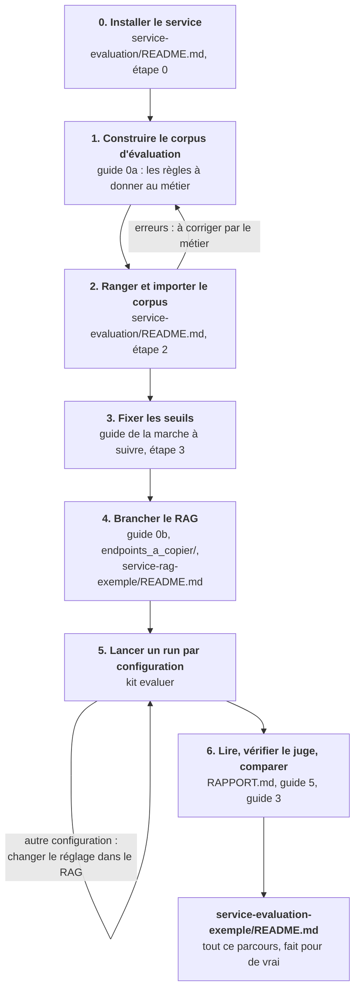

# Le fil conducteur : évaluer un RAG, du début à la fin

Ce document dit, dans l'ordre, ce qu'on fait pour évaluer un RAG, pourquoi, dans quel document c'est expliqué, et ce que ça a donné sur l'exemple. Il s'adresse à la personne qui prend en charge l'évaluation et sait lancer des commandes : c'est elle qui fait tout. Le métier remplit le corpus d'évaluation et fixe avec elle les seuils.

Les trois dossiers du dépôt :

- [`service-evaluation/`](service-evaluation/README.md) : le service d'évaluation, vierge, à prendre pour votre projet ;
- [`service-rag-exemple/`](service-rag-exemple/README.md) : un RAG simple, qui sert d'exemple à évaluer ;
- [`service-evaluation-exemple/`](service-evaluation-exemple/README.md) : le même service, après avoir tourné sur ce RAG. Tout ce qui est cité « dans l'exemple » s'y trouve.



## Étape 0. Installer le service

**Pourquoi.** Le service a besoin de quatre choses pour tourner :
- la commande `kit`, qui est le service lui-même : elle importe le corpus, appelle le RAG, calcule les scores et écrit les rapports ;
- Langfuse, un outil web où l'on suit chaque évaluation, et où le métier relit les réponses ;
- un accès à un modèle de langage, le **juge**, qui note les réponses du RAG. Le juge appartient au service, pas au RAG ;
- une base de données, où le service garde tous ses résultats.

**Le document.** [`service-evaluation/README.md`](service-evaluation/README.md#la-marche-à-suivre), étape 0 : un tableau dit ce qui s'installe, à quoi ça sert et comment.

**Ce que vous faites.** Copier `service-evaluation/` dans votre projet. Mettre dans `.env` la clé de l'API du juge, puis, depuis ce dossier :

```bash
./initialiser.sh && docker compose up -d && uv run kit verifier-modeles
```

**Fini quand** `kit verifier-modeles` dit que le juge et Langfuse répondent.

**Dans l'exemple.** Le juge est le modèle `chat`, différent du modèle qui écrit les réponses du RAG : un modèle tend à favoriser ses propres réponses.

## Étape 1. Construire le corpus d'évaluation

**Pourquoi.** Pour juger un RAG, il faut savoir ce qu'il aurait dû répondre. Le corpus d'évaluation le dit : des documents, des questions réelles, leur bonne réponse, et le passage exact des documents où elle se trouve. Le RAG ne le voit jamais : il ne reçoit que les documents.

**Le document.** [`service-evaluation/documentation/0a_construction_du_corpus.md`](service-evaluation/documentation/0a_construction_du_corpus.md), section 1 : le fichier à remplir, et les règles d'annotation. Le passage est copié-collé, jamais résumé ; il faut des questions sans réponse et des passages pièges ; un tiers des questions est gardé pour la décision ; chaque question a une fréquence et une gravité.

**Ce que vous faites.** C'est le métier qui remplit le corpus, parce que c'est lui qui connaît les documents et les questions des utilisateurs. Vous lui donnez le fichier Excel vierge, [`service-evaluation/corpus_annote/Corpus_evaluation_RAG.xlsx`](service-evaluation/corpus_annote/Corpus_evaluation_RAG.xlsx), et les règles du guide 0a. Vous pouvez lui montrer [le fichier rempli de l'exemple](service-evaluation-exemple/corpus_annote/Corpus_evaluation_RAG.xlsx).

**Fini quand** le métier vous rend les documents, un fichier par document nommé par sa référence, et le fichier rempli.

**Dans l'exemple.** L'entreprise est fictive : Claude a joué le métier. Il a rendu [50 documents](service-evaluation-exemple/corpus_annote/corpus_documentaire/) et [le fichier rempli](service-evaluation-exemple/corpus_annote/Corpus_evaluation_RAG.xlsx) : 60 questions, 97 passages, 20 pages scannées retapées. Les 60 questions sur une page : [questions_pour_relecture.md](service-evaluation-exemple/corpus_annote/questions_pour_relecture.md).

## Étape 2. Ranger et importer le corpus

**Pourquoi.** Le service contrôle tout le corpus avant d'évaluer : un corpus faux fausserait toute l'évaluation, sans que personne ne s'en aperçoive.

**Le document.** [`service-evaluation/README.md`](service-evaluation/README.md#la-marche-à-suivre), étape 2 : où ranger ce que le métier a rendu, et comment l'importer.

**Ce que vous faites.** Les documents dans `corpus_annote/corpus_documentaire/`, le fichier rempli dans `corpus_annote/`, puis :

```bash
uv run kit importer corpus_annote/Corpus_evaluation_RAG.xlsx
```

**Fini quand** l'import ne signale plus d'erreur. Sinon, vous renvoyez au métier la liste des erreurs, feuille par feuille et ligne par ligne, et vous recommencez.

**Dans l'exemple.** L'import a produit le corpus contrôlé : [`resultats/corpus/2026-11-20.1/`](service-evaluation-exemple/resultats/corpus/).

## Étape 3. Fixer les seuils

**Pourquoi.** Il y a un seuil par score : le niveau minimal qu'il doit atteindre. Le RAG part en production seulement si chaque score atteint son seuil, sur les questions gardées pour la décision, et s'il n'y a aucune erreur grave ni fuite de droits. On les fixe avant de voir le moindre score, pour ne pas les choisir de façon à faire passer le RAG.

**Le document.** [`service-evaluation/documentation/integrer_votre_rag.md`](service-evaluation/documentation/integrer_votre_rag.md#3-fixer-les-seuils-avec-le-métier), étape 3 : les questions à poser au métier (quelle part de réponses justes est acceptable, combien de temps attendre…), et la ligne de `config/seuils.json` à remplir pour chacune.

**Ce que vous faites.** Vous posez ces questions au métier, et vous écrivez ses réponses dans `config/seuils.json`.

**Fini quand** les seuils sont fixés, avant toute évaluation.

**Dans l'exemple.** [`config/seuils.json`](service-evaluation-exemple/config/seuils.json) : par exemple au moins 80 % de réponses justes, aucune erreur grave, une réponse en moins de 15 secondes.

## Étape 4. Brancher le RAG

**Pourquoi.** Le service ne connaît pas le code du RAG, et n'en a pas besoin. Il lui parle par quatre **endpoints**, quatre adresses web de forme fixe : ① il lui envoie les documents ; ② il lit ce que le RAG en a fait ; ③ il lui demande de rechercher ; ④ il lui demande de répondre.

**Le document.** [`service-evaluation/documentation/0b_endpoints_du_rag.md`](service-evaluation/documentation/0b_endpoints_du_rag.md) : ce que chaque endpoint reçoit et rend. Le code tout prêt, à copier : [`service-evaluation/endpoints_a_copier/`](service-evaluation/endpoints_a_copier/).

**Ce que vous faites.** Copier `endpoints_a_copier/` dans votre RAG, y brancher ses fonctions, lancer le RAG, mettre son adresse dans `rag.adresse` de `config/kit.yaml`, puis vérifier :

```bash
uv run kit appeler-rag
```

**Fini quand** `kit appeler-rag` répond « règle : respectée ».

**Dans l'exemple.** Le RAG d'exemple ouvre ses quatre endpoints dans [`src/rag/endpoints_evaluation/`](service-rag-exemple/src/rag/endpoints_evaluation/). On l'a lancé comme le dit [son README](service-rag-exemple/README.md#le-lancer) : `docker compose up -d --build`, depuis `service-rag-exemple/`, à l'adresse http://127.0.0.1:8100.

## Étape 5. Lancer un run par configuration

**Pourquoi.** Une configuration, ce sont les réglages du RAG à un moment donné : le nombre de morceaux que la recherche ramène (k), les modèles, le prompt… Une évaluation, ou run, porte sur une configuration. Les réglages se changent **dans le RAG**, jamais dans le service : le service les lit dans ce que le RAG déclare, et nomme l'évaluation d'après eux.

**Le document.** [`service-evaluation/README.md`](service-evaluation/README.md#la-marche-à-suivre), étape 5 ; pour changer de configuration dans le RAG d'exemple, [son README](service-rag-exemple/README.md#changer-de-configuration).

**Ce que vous faites.** Le RAG allumé avec la configuration à tester :

```bash
uv run kit evaluer
```

Le service appelle lui-même le RAG : il lui envoie les documents, pose toutes les questions, puis calcule les scores des quatre évaluations (l'ingestion, la recherche, la réponse, de bout en bout). Pour une autre configuration : changer le réglage dans le RAG, le relancer, relancer `kit evaluer`.

**Fini quand** chaque configuration a son `RAPPORT.md` dans `resultats/evaluations/`.

**Dans l'exemple.** Quatre runs, en relançant à chaque fois le RAG d'exemple avec un réglage différent :

| Configuration | Réglage du RAG | Rapport produit |
| --- | --- | --- |
| Référence | `docker compose up -d` : 5 morceaux ramenés | [RAPPORT.md](service-evaluation-exemple/resultats/evaluations/2026-11-20.1_graphrag-vectoriel-k5-5954e822/RAPPORT.md) |
| k = 3 | `RAG_K=3 docker compose up -d` | [RAPPORT.md](service-evaluation-exemple/resultats/evaluations/2026-11-20.1_graphrag-vectoriel-k3-5954e822/RAPPORT.md) |
| Sans réflexion | `sans_reflexion: true` dans la configuration du RAG | [RAPPORT.md](service-evaluation-exemple/resultats/evaluations/2026-11-20.1_graphrag-vectoriel-k5-94d362c8/RAPPORT.md) |
| Hybride | `RAG_GRAPHE=true docker compose up -d` : un graphe ajouté | [RAPPORT.md](service-evaluation-exemple/resultats/evaluations/2026-11-20.1_graphrag-hybride-k5-57001489/RAPPORT.md) |

## Étape 6. Lire, vérifier le juge, comparer

### 6a. Lire le rapport

**Pourquoi.** Le rapport dit si la configuration peut partir en production, et sinon où est le problème.

**Le document.** Le `RAPPORT.md` de la configuration, dans `resultats/evaluations/`. Comment le lire : [guide 5](service-evaluation/documentation/5_resultats_et_comparaison.md#2-lire-le-rapport-dans-lordre).

**Ce que vous faites.** Le lire dans l'ordre : la décision ; les scores, évaluation par évaluation ; les questions à regarder ; enfin, si la faute vient de la recherche ou de la réponse.

**Dans l'exemple.** Le [rapport de la référence](service-evaluation-exemple/resultats/evaluations/2026-11-20.1_graphrag-vectoriel-k5-5954e822/RAPPORT.md) dit : « Mise en production non recommandée ». Il y a 1 erreur grave, et quatre seuils ne sont pas atteints : la lecture des pages scannées, le bon passage ramené, les réponses justes, le score pondéré.

### 6b. Vérifier le juge

**Pourquoi.** C'est le juge qui note les réponses : avant de croire ses notes, on vérifie qu'il note comme le métier.

**Le document.** [Guide 3, « Vérifier le juge »](service-evaluation/documentation/3_evaluation_reponse.md#vérifier-le-juge-avant-de-lui-faire-confiance).

**Ce que vous faites.** `uv run kit verifier-juge --envoyer` envoie 30 réponses dans Langfuse ; le métier les note ; puis `uv run kit verifier-juge` mesure l'accord.

**Dans l'exemple.** Le juge et le métier sont d'accord à 89 %, pour 90 % exigés : le juge est à surveiller.

### 6c. Comparer deux configurations

**Pourquoi.** Savoir si un réglage améliore vraiment le RAG, ou si l'écart est dû au hasard.

**Le document.** [Guide 5, « Comparer »](service-evaluation/documentation/5_resultats_et_comparaison.md#5-comparer-deux-versions).

**Ce que vous faites.**

```bash
uv run kit comparer resultats/evaluations/<configuration A> resultats/evaluations/<configuration B>
```

Le service écrit un `RAPPORT.md` de comparaison dans `resultats/comparaisons_de_configurations/`.

**Dans l'exemple.** Chaque configuration est comparée à la référence :

| Comparaison | Conclusion | Rapport |
| --- | --- | --- |
| Référence contre k = 3 | pas meilleure : elle retrouve moins souvent le bon passage | [RAPPORT.md](service-evaluation-exemple/resultats/comparaisons_de_configurations/2026-11-20.1_graphrag-vectoriel-k5-5954e822_contre_graphrag-vectoriel-k3-5954e822/RAPPORT.md) |
| Référence contre sans réflexion | on garde la réflexion : sans elle, 9 fois plus rapide, mais les calculs deviennent faux | [RAPPORT.md](service-evaluation-exemple/resultats/comparaisons_de_configurations/2026-11-20.1_graphrag-vectoriel-k5-5954e822_contre_graphrag-vectoriel-k5-94d362c8/RAPPORT.md) |
| Référence contre hybride | rien de mesurable : l'écart peut venir du hasard | [RAPPORT.md](service-evaluation-exemple/resultats/comparaisons_de_configurations/2026-11-20.1_graphrag-vectoriel-k5-5954e822_contre_graphrag-hybride-k5-57001489/RAPPORT.md) |

**Conclusion de l'exemple.** Aucune configuration n'est prête. Les quatre butent sur les mêmes points : les pages scannées sont mal lues, et la recherche ne ramène pas assez souvent le bon passage. C'est donc là qu'il faut corriger le RAG, avant de relancer un run.
