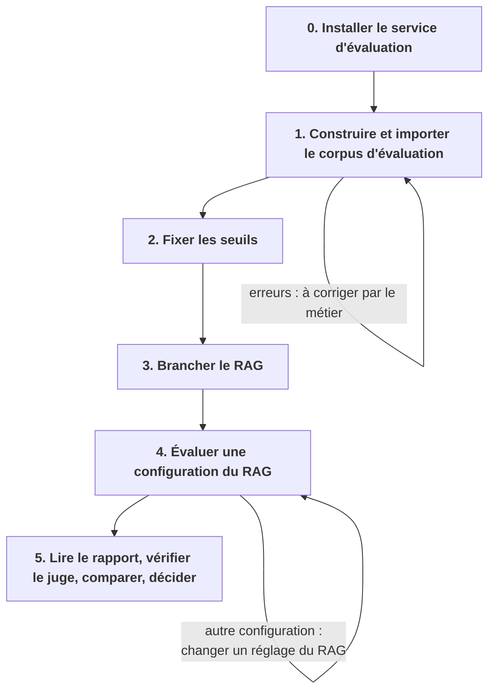

# Le fil conducteur : évaluer un RAG, du début à la fin

Ce document donne, dans l'ordre, ce qu'il faut faire pour évaluer un RAG. Chaque action renvoie au document qui la détaille. Il s'adresse à la personne qui prend en charge l'évaluation. Le métier intervient deux fois : pour construire le corpus d'évaluation, et pour fixer les seuils.

Ce qui est générique, valable pour tout projet, est dans [`service-evaluation/`](service-evaluation/README.md) : le service, vierge. Ce qui est propre à l'exemple est dans [`service-rag-exemple/`](service-rag-exemple/README.md), un RAG simple, et dans [`service-evaluation-exemple/`](service-evaluation-exemple/README.md), le même service après avoir évalué ce RAG.

## 0. Installer le service d'évaluation

Le service se compose :
- du **programme d'évaluation**, qui importe le corpus, interroge le RAG, calcule les scores et écrit les rapports ;
- de **Langfuse**, un site web local pour suivre les évaluations et faire relire les réponses par le métier ;
- d'un accès à un **modèle de langage, le juge**, qui note chaque réponse du RAG en la comparant à la bonne réponse ;
- d'une **base de données** qui garde les résultats.

**À faire.**
- Copier le dossier `service-evaluation/` dans le projet.
- L'installer en suivant [l'étape 0 de son README](service-evaluation/README.md#la-marche-à-suivre), qui dit ce qui s'installe et à quoi ça sert. L'installation est finie quand le service confirme que le juge et Langfuse répondent.

**Dans l'exemple.** Le juge est un autre modèle que celui qui écrit les réponses du RAG.

## 1. Construire et importer le corpus d'évaluation

Le corpus d'évaluation se compose des **documents** que le RAG doit lire, et d'un **fichier Excel** qui donne, pour chaque question, la bonne réponse et le passage exact des documents où elle se trouve. Le RAG ne reçoit que les documents, jamais le fichier.

**À faire.**
- Transmettre au métier [le fichier Excel vierge](service-evaluation/corpus_annote/Corpus_evaluation_RAG.xlsx) et [les règles pour le remplir](service-evaluation/documentation/0a_construction_du_corpus.md#1-ce-que-le-métier-annote) : c'est lui qui construit le corpus, car il connaît les documents et les questions des utilisateurs.
- Récupérer les documents, un fichier par document nommé par sa référence, et le fichier rempli.
- Ranger les documents dans `corpus_annote/corpus_documentaire/`, et le fichier dans `corpus_annote/`.
- [Importer le corpus](service-evaluation/documentation/0a_construction_du_corpus.md#3-importer-le-corpus). Le service contrôle chaque ligne : s'il trouve une erreur, il n'importe rien et donne la liste des corrections à demander au métier.

**Dans l'exemple.** Un corpus fictif, sur une entreprise inventée : [50 documents](service-evaluation-exemple/corpus_annote/corpus_documentaire/), et [un fichier rempli](service-evaluation-exemple/corpus_annote/Corpus_evaluation_RAG.xlsx) de 60 questions, 97 passages et 20 pages scannées retapées. L'import a produit [le corpus contrôlé](service-evaluation-exemple/resultats/corpus/).

## 2. Fixer les seuils

Un seuil est le niveau minimal qu'un score doit atteindre pour que le RAG parte en production. Il y en a un par score. Le RAG part seulement si chaque score atteint son seuil, et s'il ne fait ni erreur grave ni fuite de droits.

**À faire.**
- Poser au métier [les questions sur ce qui est acceptable](service-evaluation/documentation/integrer_votre_rag.md#2-fixer-les-seuils-avec-le-métier) : part de réponses justes, temps d'attente, coût…
- Écrire ses réponses dans `config/seuils.json`, à la ligne indiquée pour chaque question.
- Le faire avant la première évaluation, pour ne pas choisir les seuils de façon à faire passer le RAG.

**Dans l'exemple.** [Les seuils retenus](service-evaluation-exemple/config/seuils.json) : par exemple au moins 80 % de réponses justes, aucune erreur grave, une réponse en moins de 15 secondes.

## 3. Brancher le RAG

Le service ne connaît pas le code du RAG. Il l'interroge par quatre **endpoints**, quatre adresses web de forme fixe : ① lui envoyer les documents ; ② lire ce qu'il en a fait ; ③ lui faire rechercher ; ④ lui faire répondre.

**À faire.**
- Copier [le code tout prêt des quatre endpoints](service-evaluation/endpoints_a_copier/) dans le RAG, et y brancher les fonctions du RAG, en suivant [ce que chaque endpoint reçoit et rend](service-evaluation/documentation/0b_endpoints_du_rag.md).
- Lancer le RAG, et renseigner son adresse dans `config/kit.yaml`.
- [Vérifier le branchement](service-evaluation/documentation/integrer_votre_rag.md#vérifier-les-endpoints) : le service interroge le RAG et dit précisément ce qui ne va pas, jusqu'à « règle : respectée ».

**Dans l'exemple.** Le RAG d'exemple a déjà ses quatre endpoints, dans [`src/rag/endpoints_evaluation/`](service-rag-exemple/src/rag/endpoints_evaluation/). Il est lancé comme l'indique [son README](service-rag-exemple/README.md#le-lancer).

## 4. Évaluer une configuration du RAG

Une **configuration** est l'ensemble des réglages du RAG au moment de l'évaluation : nombre de morceaux de texte ramenés par la recherche, modèle qui écrit les réponses, prompt, graphe ou non… Ces réglages appartiennent au RAG : ils se trouvent dans sa propre configuration, et le RAG les déclare au service par l'endpoint ②.

Évaluer une configuration se fait en une commande, `kit evaluer`, qui enchaîne, sur le corpus importé à l'étape 1 et le RAG branché à l'étape 3 :
1. l'envoi au RAG des documents du corpus ;
2. la lecture de ce que le RAG en a fait : ses morceaux de texte, et la version exacte de sa configuration ;
3. chaque question du fichier Excel, posée au RAG au nom du profil indiqué, d'abord pour la recherche, puis pour la réponse ;
4. le calcul des scores des quatre évaluations (l'ingestion, la recherche, la réponse, de bout en bout), et leur comparaison aux seuils ;
5. l'écriture du rapport, `resultats/evaluations/<version du corpus>_<version du RAG>/RAPPORT.md`.

**À faire.**
- Lancer le RAG avec la configuration à évaluer.
- Lancer [`kit evaluer`, comme l'indique le README du service](service-evaluation/README.md#la-marche-à-suivre), étape 4. Le service prend le dernier corpus importé, et l'adresse du RAG inscrite dans `config/kit.yaml`. Il affiche à la fin la décision et le chemin du rapport.
- Pour évaluer une autre configuration : changer un réglage dans la configuration du RAG, relancer le RAG, puis relancer `kit evaluer`. La version du RAG change, et le service écrit un nouveau rapport, à côté du précédent.

**Dans l'exemple.** Le RAG d'exemple se règle par [quelques commandes de lancement](service-rag-exemple/README.md#changer-de-configuration). Quatre configurations ont été évaluées, chacune avec son rapport :

| Configuration | Ce qui change | Rapport |
| --- | --- | --- |
| Référence | 5 morceaux ramenés par question | [RAPPORT.md](service-evaluation-exemple/resultats/evaluations/2026-11-20.1_graphrag-vectoriel-k5-5954e822/RAPPORT.md) |
| k = 3 | 3 morceaux au lieu de 5 | [RAPPORT.md](service-evaluation-exemple/resultats/evaluations/2026-11-20.1_graphrag-vectoriel-k3-5954e822/RAPPORT.md) |
| Sans réflexion | le modèle répond sans raisonner d'abord | [RAPPORT.md](service-evaluation-exemple/resultats/evaluations/2026-11-20.1_graphrag-vectoriel-k5-94d362c8/RAPPORT.md) |
| Hybride | un graphe ajouté à la recherche | [RAPPORT.md](service-evaluation-exemple/resultats/evaluations/2026-11-20.1_graphrag-hybride-k5-57001489/RAPPORT.md) |

## 5. Lire le rapport, vérifier le juge, comparer, décider

**Lire le rapport.** Ouvrir le `RAPPORT.md` de la configuration, et le lire [dans cet ordre](service-evaluation/documentation/5_resultats_et_comparaison.md#2-lire-le-rapport-dans-lordre) :
1. la décision : la configuration peut-elle partir en production, et sinon pour quelles raisons ;
2. les scores, évaluation par évaluation, chacun avec son seuil : le premier score sous son seuil est souvent la cause des suivants ;
3. les questions à regarder en premier : erreurs graves, réponses fausses, passages perdus ;
4. le diagnostic : pour chaque question ratée, la faute vient-elle de la recherche ou de la réponse.

Pour un score sous son seuil, la partie « Si c'est mauvais » du guide de son évaluation dit quoi changer dans le RAG : [ingestion](service-evaluation/documentation/1_evaluation_ingestion.md#si-cest-mauvais), [recherche](service-evaluation/documentation/2_evaluation_recherche.md#si-cest-mauvais), [réponse](service-evaluation/documentation/3_evaluation_reponse.md#si-cest-mauvais), [bout en bout](service-evaluation/documentation/4_evaluation_bout_en_bout.md).

**Vérifier le juge**, une fois, avant de croire ses notes. Le service envoie 30 réponses au hasard dans Langfuse ; le métier note chacune juste, partielle ou fausse, sans voir la note du juge ; le service mesure l'accord. Le juge est validé à 90 % d'accord au moins ; sinon, changer de modèle juge. [Le pas à pas](service-evaluation/documentation/3_evaluation_reponse.md#vérifier-le-juge-avant-de-lui-faire-confiance).

**Comparer deux configurations**, une fois les deux évaluées, avec `kit comparer`. Le service écrit un rapport dans `resultats/comparaisons_de_configurations/` : ce qui change de l'une à l'autre, l'écart de chaque score, s'il est réel ou s'il peut venir du hasard, et les questions gagnées ou perdues. [Comment comparer](service-evaluation/documentation/5_resultats_et_comparaison.md#5-comparer-deux-versions).

**Décider.** Si une configuration atteint tous ses seuils, avec un juge validé, elle peut partir en production. Sinon, corriger le RAG là où le rapport l'indique, puis évaluer la nouvelle configuration (étape 4).

**Dans l'exemple.**
- Le [rapport de la référence](service-evaluation-exemple/resultats/evaluations/2026-11-20.1_graphrag-vectoriel-k5-5954e822/RAPPORT.md) conclut : « Mise en production non recommandée ». Il relève 1 erreur grave et quatre seuils non atteints.
- Le juge note comme le métier dans 89 % des cas, pour 90 % exigés : il est à surveiller.
- Les comparaisons avec la référence : [k = 3](service-evaluation-exemple/resultats/comparaisons_de_configurations/2026-11-20.1_graphrag-vectoriel-k5-5954e822_contre_graphrag-vectoriel-k3-5954e822/RAPPORT.md) n'est pas meilleure ; [sans réflexion](service-evaluation-exemple/resultats/comparaisons_de_configurations/2026-11-20.1_graphrag-vectoriel-k5-5954e822_contre_graphrag-vectoriel-k5-94d362c8/RAPPORT.md) est 9 fois plus rapide mais calcule mal ; [hybride](service-evaluation-exemple/resultats/comparaisons_de_configurations/2026-11-20.1_graphrag-vectoriel-k5-5954e822_contre_graphrag-hybride-k5-57001489/RAPPORT.md) n'apporte rien de mesurable.
- Décision : aucune configuration n'est prête. Les pages scannées sont mal lues, et la recherche ne ramène pas assez souvent le bon passage : c'est là qu'il faut corriger le RAG.
