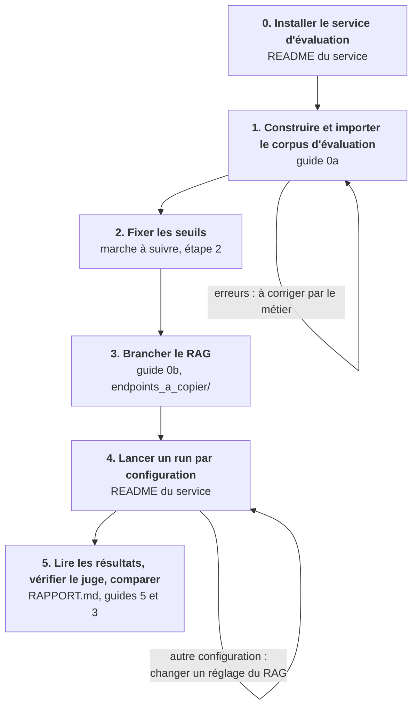

# Le fil conducteur : évaluer un RAG, du début à la fin

Ce document donne, dans l'ordre, ce qu'il faut faire pour évaluer un RAG, et le document à suivre pour chaque étape. Il s'adresse à la personne qui prend en charge l'évaluation. Le métier intervient deux fois : pour construire le corpus d'évaluation, et pour fixer les seuils.

Ce qui est générique, valable pour tout projet, est dans [`service-evaluation/`](service-evaluation/README.md) : le service, vierge. Ce qui est propre à l'exemple est dans [`service-rag-exemple/`](service-rag-exemple/README.md), un RAG simple, et dans [`service-evaluation-exemple/`](service-evaluation-exemple/README.md), le même service après avoir évalué ce RAG.

## 0. Installer le service d'évaluation

Le service se compose :
- du **programme d'évaluation**, qui importe le corpus, interroge le RAG, calcule les scores et écrit les rapports ;
- de **Langfuse**, un site web local pour suivre les évaluations et faire relire les réponses par le métier ;
- d'un accès à un **modèle de langage, le juge**, qui note chaque réponse du RAG en la comparant à la bonne réponse ;
- d'une **base de données** qui garde les résultats.

**À faire.** Copier le dossier `service-evaluation/` dans le projet, puis l'installer.

**À suivre.** [README du service](service-evaluation/README.md#la-marche-à-suivre), étape 0 : ce qui s'installe, à quoi ça sert, et les commandes.

**Dans l'exemple.** Le juge est un autre modèle que celui qui écrit les réponses du RAG.

## 1. Construire et importer le corpus d'évaluation

Le corpus d'évaluation se compose des **documents** que le RAG doit lire, et d'un **fichier Excel** qui donne, pour chaque question, la bonne réponse et le passage exact des documents où elle se trouve. Le RAG ne reçoit que les documents, jamais le fichier.

**À faire.**
- Transmettre au métier le fichier Excel vierge et le guide 0a : c'est lui qui construit le corpus, car il connaît les documents et les questions des utilisateurs.
- Récupérer les documents, un fichier par document nommé par sa référence, et le fichier rempli.
- Ranger les documents dans `corpus_annote/corpus_documentaire/`, et le fichier dans `corpus_annote/`.
- Importer le corpus. Le service contrôle chaque ligne : s'il trouve une erreur, il n'importe rien et donne la liste des corrections à demander au métier.

**À suivre.**
- Pour le métier : [guide 0a](service-evaluation/documentation/0a_construction_du_corpus.md), section 1 : les règles pour remplir le fichier.
- Pour l'import : [guide 0a](service-evaluation/documentation/0a_construction_du_corpus.md#3-importer-le-corpus), section 3.
- Le fichier vierge : [`service-evaluation/corpus_annote/Corpus_evaluation_RAG.xlsx`](service-evaluation/corpus_annote/Corpus_evaluation_RAG.xlsx).

**Dans l'exemple.** Un corpus fictif, sur une entreprise inventée : [50 documents](service-evaluation-exemple/corpus_annote/corpus_documentaire/), et [un fichier rempli](service-evaluation-exemple/corpus_annote/Corpus_evaluation_RAG.xlsx) de 60 questions, 97 passages et 20 pages scannées retapées. L'import a produit [le corpus contrôlé](service-evaluation-exemple/resultats/corpus/).

## 2. Fixer les seuils

Un seuil est le niveau minimal qu'un score doit atteindre pour que le RAG parte en production. Il y en a un par score. Le RAG part seulement si chaque score atteint son seuil, et s'il ne fait ni erreur grave ni fuite de droits.

**À faire.** Poser au métier les questions sur ce qui est acceptable (part de réponses justes, temps d'attente, coût…), puis écrire ses réponses dans `config/seuils.json`. Le faire avant la première évaluation, pour ne pas choisir les seuils de façon à faire passer le RAG.

**À suivre.** [Marche à suivre, étape 2](service-evaluation/documentation/integrer_votre_rag.md#2-fixer-les-seuils-avec-le-métier) : les questions à poser, et la ligne de `config/seuils.json` à remplir pour chacune.

**Dans l'exemple.** [Les seuils retenus](service-evaluation-exemple/config/seuils.json) : par exemple au moins 80 % de réponses justes, aucune erreur grave, une réponse en moins de 15 secondes.

## 3. Brancher le RAG

Le service ne connaît pas le code du RAG. Il l'interroge par quatre **endpoints**, quatre adresses web de forme fixe : ① lui envoyer les documents ; ② lire ce qu'il en a fait ; ③ lui faire rechercher ; ④ lui faire répondre.

**À faire.**
- Copier le code tout prêt des quatre endpoints dans le RAG, et y brancher les fonctions du RAG.
- Lancer le RAG, et renseigner son adresse dans `config/kit.yaml`.
- Vérifier le branchement : le service interroge le RAG et dit précisément ce qui ne va pas, jusqu'à « règle : respectée ».

**À suivre.**
- [Guide 0b](service-evaluation/documentation/0b_endpoints_du_rag.md) : ce que chaque endpoint reçoit et rend.
- [`service-evaluation/endpoints_a_copier/`](service-evaluation/endpoints_a_copier/) : le code à copier.
- [Marche à suivre, étape 3](service-evaluation/documentation/integrer_votre_rag.md#3-brancher-votre-rag) : le pas à pas, et les erreurs fréquentes.

**Dans l'exemple.** Le RAG d'exemple a déjà ses quatre endpoints, dans [`src/rag/endpoints_evaluation/`](service-rag-exemple/src/rag/endpoints_evaluation/). Il est lancé comme l'indique [son README](service-rag-exemple/README.md#le-lancer).

## 4. Lancer un run par configuration

Une **configuration** est l'ensemble des réglages du RAG à un moment donné : nombre de morceaux de texte ramenés par la recherche, modèles, prompt… Un **run** évalue une configuration : le service envoie les documents au RAG, pose toutes les questions, calcule les scores et écrit un rapport. Les réglages se changent dans le RAG, jamais dans le service.

**À faire.**
- Lancer le RAG avec la configuration à tester.
- Lancer l'évaluation.
- Pour tester une autre configuration : changer le réglage dans le RAG, le relancer, puis relancer l'évaluation.

**À suivre.** [README du service](service-evaluation/README.md#la-marche-à-suivre), étape 4. Pour changer de configuration dans le RAG d'exemple : [son README](service-rag-exemple/README.md#changer-de-configuration).

**Dans l'exemple.** Quatre configurations, chacune avec son rapport :

| Configuration | Ce qui change | Rapport |
| --- | --- | --- |
| Référence | 5 morceaux ramenés par question | [RAPPORT.md](service-evaluation-exemple/resultats/evaluations/2026-11-20.1_graphrag-vectoriel-k5-5954e822/RAPPORT.md) |
| k = 3 | 3 morceaux au lieu de 5 | [RAPPORT.md](service-evaluation-exemple/resultats/evaluations/2026-11-20.1_graphrag-vectoriel-k3-5954e822/RAPPORT.md) |
| Sans réflexion | le modèle répond sans raisonner d'abord | [RAPPORT.md](service-evaluation-exemple/resultats/evaluations/2026-11-20.1_graphrag-vectoriel-k5-94d362c8/RAPPORT.md) |
| Hybride | un graphe ajouté à la recherche | [RAPPORT.md](service-evaluation-exemple/resultats/evaluations/2026-11-20.1_graphrag-hybride-k5-57001489/RAPPORT.md) |

## 5. Lire les résultats, vérifier le juge, comparer

**Lire le rapport.** Le `RAPPORT.md` de chaque configuration donne, dans l'ordre : la décision, chaque score avec son seuil, les questions à regarder, et si la faute vient de la recherche ou de la réponse. À suivre : [guide 5](service-evaluation/documentation/5_resultats_et_comparaison.md#2-lire-le-rapport-dans-lordre).

**Vérifier le juge.** Avant de croire ses notes, vérifier qu'il note comme le métier : envoyer 30 réponses au métier dans Langfuse, les lui faire noter, puis mesurer l'accord. À suivre : [guide 3](service-evaluation/documentation/3_evaluation_reponse.md#vérifier-le-juge-avant-de-lui-faire-confiance).

**Comparer deux configurations.** Savoir si un réglage améliore vraiment le RAG, ou si l'écart vient du hasard. Le service écrit un rapport de comparaison. À suivre : [guide 5](service-evaluation/documentation/5_resultats_et_comparaison.md#5-comparer-deux-versions).

**Dans l'exemple.**
- Le [rapport de la référence](service-evaluation-exemple/resultats/evaluations/2026-11-20.1_graphrag-vectoriel-k5-5954e822/RAPPORT.md) conclut : « Mise en production non recommandée ». Il relève 1 erreur grave et quatre seuils non atteints.
- Le juge note comme le métier dans 89 % des cas, pour 90 % exigés : il est à surveiller.
- Les comparaisons avec la référence : [k = 3](service-evaluation-exemple/resultats/comparaisons_de_configurations/2026-11-20.1_graphrag-vectoriel-k5-5954e822_contre_graphrag-vectoriel-k3-5954e822/RAPPORT.md) n'est pas meilleure ; [sans réflexion](service-evaluation-exemple/resultats/comparaisons_de_configurations/2026-11-20.1_graphrag-vectoriel-k5-5954e822_contre_graphrag-vectoriel-k5-94d362c8/RAPPORT.md) est 9 fois plus rapide mais calcule mal ; [hybride](service-evaluation-exemple/resultats/comparaisons_de_configurations/2026-11-20.1_graphrag-vectoriel-k5-5954e822_contre_graphrag-hybride-k5-57001489/RAPPORT.md) n'apporte rien de mesurable.
- Conclusion : aucune configuration n'est prête. Les pages scannées sont mal lues, et la recherche ne ramène pas assez souvent le bon passage : c'est là qu'il faut corriger le RAG.
