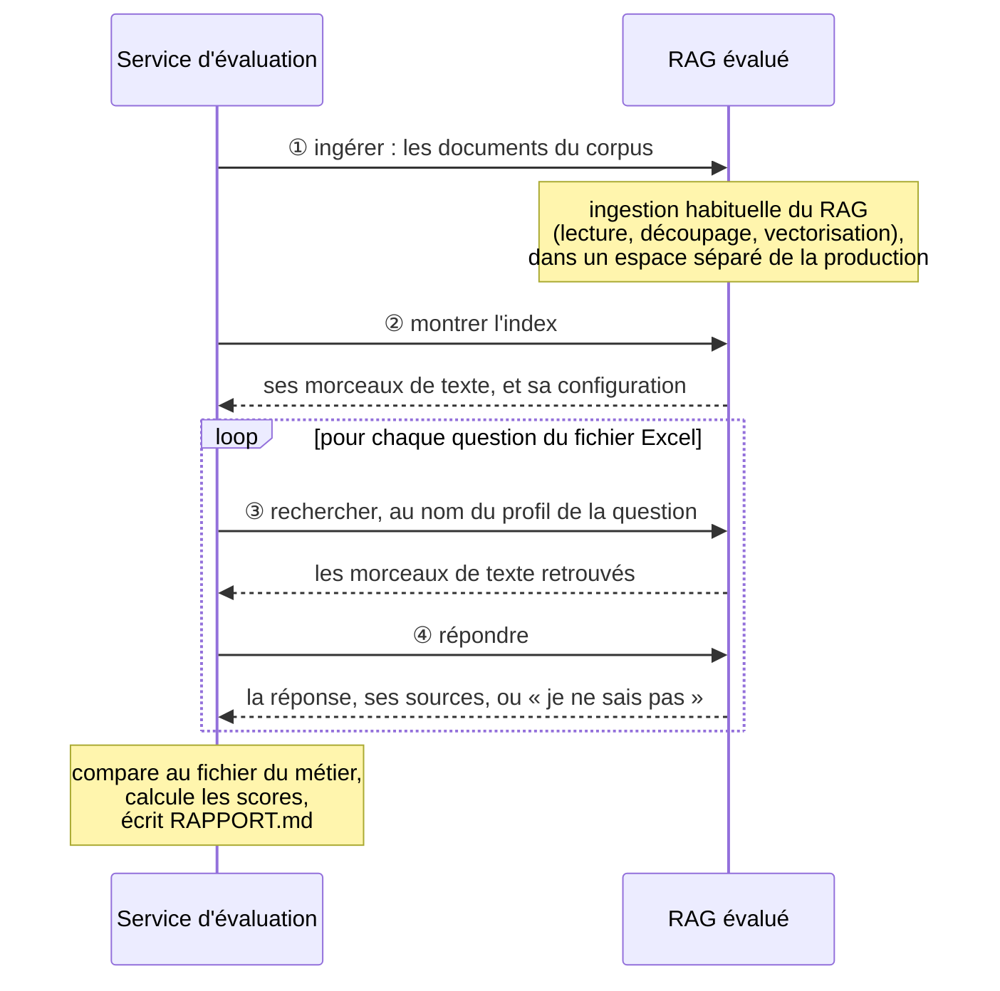
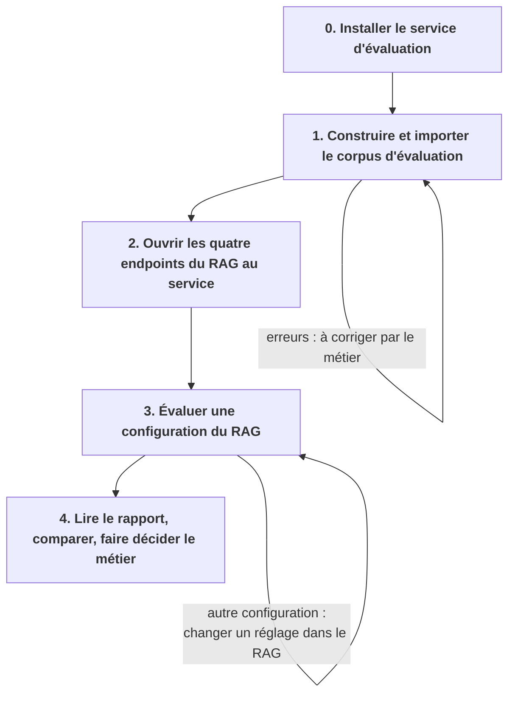

# Le fil conducteur : évaluer un RAG, du début à la fin

Ce document explique d'abord comment fonctionne l'évaluation, puis donne, dans l'ordre, ce qu'il faut faire. Chaque action renvoie au document qui la détaille. Il s'adresse à la personne qui prend en charge l'évaluation. Le métier intervient deux fois : pour construire le corpus d'évaluation, puis pour décider, à la lecture des scores, si le RAG peut partir en production.

Ce qui est générique, valable pour tout projet, est dans [`service-evaluation/`](service-evaluation/README.md) : le service d'évaluation, vierge. Ce qui est propre à l'exemple est dans [`service-rag-exemple/`](service-rag-exemple/README.md), un RAG simple, et dans [`service-evaluation-exemple/`](service-evaluation-exemple/README.md), le même service après avoir évalué ce RAG.

## Comment fonctionne l'évaluation

**Le principe.** Le service d'évaluation se comporte comme un utilisateur automatique qui connaîtrait les bonnes réponses. Il fait lire des documents au RAG, lui pose des questions dont le métier a écrit la bonne réponse, puis compare ce que le RAG a fait à ce qu'il aurait dû faire.

**Qui fait quoi.**

| | Le service d'évaluation | Le RAG évalué |
| --- | --- | --- |
| **Contient** | le corpus d'évaluation (les documents et le fichier Excel du métier), le juge | son propre code et ses propres réglages |
| **Fait** | envoie les documents au RAG, lui pose les questions, note ses réponses, écrit le rapport | ingère les documents reçus, recherche, répond, avec son code habituel |
| **Ne voit jamais** | le code du RAG | les bonnes réponses du métier |

**Comment ils se parlent.** Le RAG ouvre quatre **endpoints**, quatre adresses web de forme fixe. Le service les appelle dans cet ordre :



C'est donc le service qui déclenche l'ingestion, mais c'est le code du RAG qui la fait.

**Ce que le service rend.** Pour chaque configuration évaluée, un rapport, `RAPPORT.md`. Chaque score y est écrit en une phrase, avec ses chiffres, pour que le métier comme l'équipe du projet le comprennent sans explication. Chaque pourcentage est donné avec son intervalle de confiance : la fourchette où se trouve le vrai résultat, large quand il y a peu de questions. Le service ne décide pas : c'est le métier qui tranche à la lecture des scores. Exemple : [le rapport de la configuration de référence du RAG d'exemple](service-evaluation-exemple/resultats/evaluations/2026-11-20.1_graphrag-vectoriel-k5-5954e822/RAPPORT.md).

**Où se trouve la configuration du RAG.** Une configuration est l'ensemble des réglages du RAG : nombre de morceaux de texte ramenés par la recherche, modèle qui écrit les réponses, prompt, graphe ou non… Elle se règle **dans le RAG**, dans ses propres fichiers, jamais dans le service. Dans le service, on ne renseigne qu'une seule chose sur le RAG : son adresse, dans `config/kit.yaml`. C'est le RAG qui déclare sa configuration au service, en réponse à l'appel ②. Le service la range dans un fichier `rag.json`, et nomme l'évaluation d'après elle. Par exemple, le RAG d'exemple, réglé dans [`service-rag-exemple/config/config.yaml`](service-rag-exemple/config/config.yaml), déclare :

```json
{"nom": "graphrag", "version_rag": "graphrag-vectoriel-k5-5954e822", "type_rag": "vectoriel", "k": 5,
 "versions": {"decoupage": "sections-1", "embedding": "embed", "generation": "gemma-4-e4b", "prompt": "1.0", "reranker": "aucun"}}
```

**Ce qui est générique, et ce que votre RAG doit savoir faire.** Le service est le même pour tous les RAG : il ne connaît que les quatre endpoints. Votre RAG, lui, doit savoir faire quatre choses, une par endpoint :
1. ingérer une liste de fichiers qu'on lui envoie, avec sa chaîne d'ingestion habituelle, dans un espace séparé de la production ;
2. rendre ses morceaux de texte, chacun avec sa source, l'endroit de la source d'où il vient (la page d'un document, le champ d'une fiche) et ses droits d'accès, et déclarer sa configuration ;
3. rechercher pour une question, en écartant les sources interdites au profil qui la pose ;
4. répondre, avec ses sources, et dire « je ne sais pas » quand c'est le cas.

Le point à vérifier en premier est le 1. Si l'ingestion de votre RAG est une chaîne à part (un traitement planifié, une GED lue en direct, une application interrogée), l'endpoint ① doit déclencher cette chaîne sur les fichiers reçus. C'est le principal travail d'intégration.

## Les étapes



## 0. Installer le service d'évaluation

Le service se compose :
- du **programme d'évaluation**, qui importe le corpus, appelle le RAG, calcule les scores et écrit les rapports ;
- de **Langfuse**, un site web local pour suivre les évaluations et faire relire les réponses par le métier ;
- d'un accès à un **modèle de langage, le juge**, qui note chaque réponse du RAG en la comparant à la bonne réponse ;
- d'une **base de données** qui garde les résultats.

**À faire.**
- Copier le dossier `service-evaluation/` dans le projet.
- L'installer en suivant [l'étape 0 de son README](service-evaluation/README.md#la-marche-à-suivre), qui dit ce qui s'installe et à quoi ça sert. L'installation est finie quand le service confirme que le juge et Langfuse répondent.

**Dans l'exemple.** Le juge est un autre modèle que celui qui écrit les réponses du RAG.

## 1. Construire et importer le corpus d'évaluation

Le corpus d'évaluation se compose des **documents** que le RAG doit lire, et d'un **fichier Excel** qui donne, pour chaque question, la bonne réponse et le passage exact des documents où elle se trouve. Le RAG ne reçoit que les documents, jamais le fichier.

Un document est le plus souvent un fichier : PDF, Word, Excel. Quand le RAG lit une application (une fiche d'équipement, un ticket, une ligne de base de données), chaque enregistrement est exporté en fiche « champ : valeur » : sa référence est son identifiant dans l'application, et l'endroit de la réponse est le nom du champ, à la place de la page.

**À faire.**
- Transmettre au métier [le fichier Excel vierge](service-evaluation/corpus_annote/Corpus_evaluation_RAG.xlsx) et [les règles pour le remplir](service-evaluation/documentation/0a_construction_du_corpus.md#1-ce-que-le-métier-annote) : c'est lui qui construit le corpus, car il connaît les documents et les questions des utilisateurs.
- Récupérer les documents, un fichier par document nommé par sa référence, et le fichier rempli.
- Ranger les documents dans `corpus_annote/corpus_documentaire/`, et le fichier dans `corpus_annote/`.
- [Importer le corpus](service-evaluation/documentation/0a_construction_du_corpus.md#3-importer-le-corpus). Le service contrôle chaque ligne : s'il trouve une erreur, il n'importe rien et donne la liste des corrections à demander au métier.

**Dans l'exemple.** Un corpus fictif, sur une entreprise inventée : [50 documents](service-evaluation-exemple/corpus_annote/corpus_documentaire/), dont 17 comptes rendus d'intervention exportés d'une base de données en fiches « champ : valeur », et [un fichier rempli](service-evaluation-exemple/corpus_annote/Corpus_evaluation_RAG.xlsx) de 60 questions, 97 passages et 20 pages scannées retapées. L'import a produit [le corpus contrôlé](service-evaluation-exemple/resultats/corpus/).

## 2. Ouvrir les quatre endpoints du RAG au service

Il s'agit d'ajouter au RAG les quatre adresses web que le service appelle (voir « Comment ils se parlent », plus haut). Seule cette partie s'écrit pour l'évaluation : le reste du RAG ne change pas.

**À faire.**
- Copier dans le RAG [le code tout prêt des quatre endpoints](service-evaluation/endpoints_a_copier/), et le relier aux fonctions du RAG : son ingestion, sa recherche, sa génération. Ce que chaque endpoint reçoit et doit rendre : [guide 0b](service-evaluation/documentation/0b_endpoints_du_rag.md).
- Lancer le RAG, et inscrire son adresse dans `config/kit.yaml` du service.
- [Vérifier le branchement](service-evaluation/documentation/integrer_votre_rag.md#vérifier-les-endpoints) : le service appelle les quatre endpoints et dit précisément ce qui ne va pas, jusqu'à « règle : respectée ».

**Dans l'exemple.** Le RAG d'exemple a ses quatre endpoints dans [`src/rag/endpoints_evaluation/`](service-rag-exemple/src/rag/endpoints_evaluation/), un fichier par endpoint, qui appelle son ingestion, sa recherche et sa génération. Il est lancé comme l'indique [son README](service-rag-exemple/README.md#le-lancer), à l'adresse http://127.0.0.1:8100, inscrite dans [`config/kit.yaml`](service-evaluation-exemple/config/kit.yaml).

## 3. Évaluer une configuration du RAG

Le RAG tourne avec les réglages à évaluer : c'est la configuration évaluée. Une commande du service, `kit evaluer`, lancée depuis le dossier `service-evaluation/`, fait tout le déroulé décrit plus haut :
1. elle envoie les documents au RAG, qui les ingère ;
2. elle lit ses morceaux de texte et sa configuration ;
3. elle lui pose chaque question du fichier Excel ;
4. elle calcule les scores, et écrit le rapport dans `resultats/evaluations/`.

**À faire.**
- Régler le RAG dans ses propres fichiers de configuration, puis le lancer.
- Lancer [`kit evaluer`](service-evaluation/README.md#la-marche-à-suivre) (étape 3 du README du service). Le service affiche à la fin les scores clés et le chemin du rapport.
- Pour évaluer une autre configuration : modifier un réglage du RAG, relancer le RAG, puis relancer `kit evaluer`. Le RAG déclare sa nouvelle configuration, et le service écrit un nouveau rapport, à côté du précédent.

**Dans l'exemple.** Les réglages du RAG d'exemple sont dans [`config/config.yaml`](service-rag-exemple/config/config.yaml) ; deux d'entre eux se changent aussi au lancement ([comment](service-rag-exemple/README.md#changer-de-configuration)). Quatre configurations ont été évaluées :

| Configuration | Réglage changé dans le RAG | Rapport |
| --- | --- | --- |
| Référence | aucun : 5 morceaux ramenés par question | [RAPPORT.md](service-evaluation-exemple/resultats/evaluations/2026-11-20.1_graphrag-vectoriel-k5-5954e822/RAPPORT.md) |
| k = 3 | 3 morceaux au lieu de 5 (`RAG_K=3` au lancement) | [RAPPORT.md](service-evaluation-exemple/resultats/evaluations/2026-11-20.1_graphrag-vectoriel-k3-5954e822/RAPPORT.md) |
| Sans réflexion | le modèle répond sans raisonner d'abord (`sans_reflexion: true` dans `config.yaml`) | [RAPPORT.md](service-evaluation-exemple/resultats/evaluations/2026-11-20.1_graphrag-vectoriel-k5-94d362c8/RAPPORT.md) |
| Hybride | un graphe ajouté à la recherche (`RAG_GRAPHE=true` au lancement) | [RAPPORT.md](service-evaluation-exemple/resultats/evaluations/2026-11-20.1_graphrag-hybride-k5-57001489/RAPPORT.md) |

## 4. Lire le rapport, comparer, faire décider le métier

**Lire le rapport.** Ouvrir le `RAPPORT.md` de la configuration, et le lire [dans cet ordre](service-evaluation/documentation/5_resultats_et_comparaison.md#2-lire-le-rapport-dans-lordre) :
1. les scores clés : ceux à présenter au métier, chacun en une phrase ;
2. tous les scores, évaluation par évaluation : le premier score faible est souvent la cause des suivants ;
3. les questions à regarder en premier : erreurs graves, réponses fausses, passages perdus ;
4. le diagnostic : pour chaque question ratée, la faute vient-elle de la recherche ou de la réponse.

Pour un score faible, la partie « Si c'est mauvais » du guide de son évaluation dit quoi changer dans le RAG : [ingestion](service-evaluation/documentation/1_evaluation_ingestion.md#si-cest-mauvais), [recherche](service-evaluation/documentation/2_evaluation_recherche.md#si-cest-mauvais), [réponse](service-evaluation/documentation/3_evaluation_reponse.md#si-cest-mauvais), [bout en bout](service-evaluation/documentation/4_evaluation_bout_en_bout.md).

**Vérifier le juge**, une fois, avant de croire ses notes. Le service envoie 30 réponses au hasard dans Langfuse ; le métier note chacune juste, partielle ou fausse, sans voir la note du juge ; le service mesure l'accord. Le juge est validé à 90 % d'accord au moins ; sinon, changer de modèle juge. [Le pas à pas](service-evaluation/documentation/3_evaluation_reponse.md#vérifier-le-juge-avant-de-lui-faire-confiance).

**Comparer deux configurations**, une fois les deux évaluées, avec `kit comparer`. Le service écrit un rapport dans `resultats/comparaisons_de_configurations/` : ce qui change de l'une à l'autre, l'écart de chaque score, s'il est réel ou s'il peut venir du hasard, et les questions gagnées ou perdues. [Comment comparer](service-evaluation/documentation/5_resultats_et_comparaison.md#5-comparer-deux-versions).

**Faire décider le métier.** Lui présenter les scores clés et les questions ratées de la meilleure configuration. C'est lui qui dit si elle peut partir en production, ou ce qu'il faut corriger d'abord ; dans ce cas, corriger le RAG là où le rapport l'indique, puis évaluer la nouvelle configuration (étape 3).

**Dans l'exemple.**
- Le [rapport de la référence](service-evaluation-exemple/resultats/evaluations/2026-11-20.1_graphrag-vectoriel-k5-5954e822/RAPPORT.md) montre 1 erreur grave, 15 caractères sur 100 mal lus sur les pages scannées, et le bon passage ramené pour 9 questions sur 13 seulement.
- Le juge note comme le métier dans 89 % des cas, pour 90 % exigés : il est à surveiller.
- Les comparaisons avec la référence : [k = 3](service-evaluation-exemple/resultats/comparaisons_de_configurations/2026-11-20.1_graphrag-vectoriel-k5-5954e822_contre_graphrag-vectoriel-k3-5954e822/RAPPORT.md) n'est pas meilleure ; [sans réflexion](service-evaluation-exemple/resultats/comparaisons_de_configurations/2026-11-20.1_graphrag-vectoriel-k5-5954e822_contre_graphrag-vectoriel-k5-94d362c8/RAPPORT.md) est 9 fois plus rapide mais calcule mal ; [hybride](service-evaluation-exemple/resultats/comparaisons_de_configurations/2026-11-20.1_graphrag-vectoriel-k5-5954e822_contre_graphrag-hybride-k5-57001489/RAPPORT.md) n'apporte rien de mesurable.
- Ce qu'on présenterait au métier : l'erreur grave, les pages scannées mal lues, et la recherche qui ne ramène pas assez souvent le bon passage. C'est là qu'il faudrait corriger le RAG avant de lui demander de décider.
