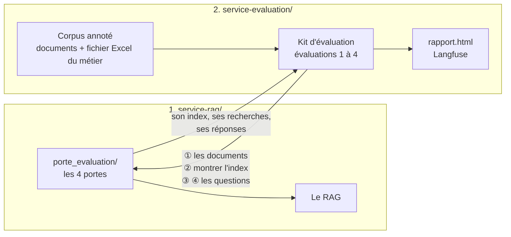

# Évaluer un RAG de bout en bout


Ce dépôt présente le modèle complet pour **évaluer un RAG de bout en bout, à partir d'un corpus annoté par le métier**. Il est divisé en deux parties :

| Partie | Dossier | Rôle |
| --- | --- | --- |
| **1. Le service RAG** | [`service-rag/`](service-rag/) | un RAG d'exemple, volontairement simple. Il montre la règle à suivre : les portes qu'un RAG met à disposition du service d'évaluation |
| **2. Le service d'évaluation** | [`service-evaluation/`](service-evaluation/) | le produit : un corpus annoté par le métier, et un kit qui évalue **n'importe quel RAG**. Il dit si le RAG lit bien les documents, s'il retrouve les bons passages, s'il répond juste, et s'il peut partir en production |

## Les quatre portes

Le service d'évaluation demande à chaque RAG **quatre portes de forme fixe**, à une adresse web :

- **① ingérer** : le service d'évaluation envoie ses documents ; le RAG les indexe à part de sa production.
- **② montrer l'index** : le RAG rend sa version exacte, ses chunks et les pages qu'il a lues.
- **③ rechercher** : pour une question, le RAG rend les k chunks qu'il a retrouvés.
- **④ répondre** : pour une question, le RAG rend sa réponse, ses sources, et s'il s'abstient.

Les deux services ne se parlent que par ces portes. La règle complète : [0b. La porte du RAG](service-evaluation/documentation/0b_porte_du_rag.md).



## Deux façons de s'en servir

| Je veux… | Suivre |
| --- | --- |
| **tester tel quel** : voir l'évaluation marcher sur le corpus et le RAG d'exemple, sans rien écrire | [Tester tel quel, étape par étape](#tester-tel-quel-étape-par-étape), ci-dessous |
| **voir des résultats**, sans rien lancer | [`service-evaluation/resultats_exemple/`](service-evaluation/resultats_exemple/) : ouvrir le `rapport.html` de la référence |
| **l'adapter à mon RAG** : évaluer mon RAG, sur mes documents, avec les questions de mon métier | [Intégrer votre RAG, pas à pas](service-evaluation/documentation/integrer_votre_rag.md) : constituer le corpus, ouvrir les quatre portes (avec un [modèle de code](service-evaluation/modele_porte/porte_evaluation.py) à copier), vérifier, évaluer |

## Tester tel quel, étape par étape

On lance **d'abord le RAG, puis l'évaluation**.

| Étape | Ce qu'on fait | Où | Documentation |
| --- | --- | --- | --- |
| **Avant de commencer** | installer Docker et uv ; avoir un point d'accès à des modèles de langage | — | ci-dessous |
| **Temps 1. Lancer le RAG** | ouvrir les quatre portes du RAG | `service-rag/` | [README du service RAG](service-rag/README.md) |
| **Temps 2. Lancer l'évaluation** | démarrer Langfuse, vérifier les modèles | `service-evaluation/` | [README du service d'évaluation](service-evaluation/README.md) |
| **Temps 2a. Brancher le corpus** | faire contrôler et ranger le fichier Excel du métier | `service-evaluation/` | [0a. Construction du corpus](service-evaluation/documentation/0a_construction_du_corpus.md) |
| **Temps 2b. Évaluer** | envoyer les documents au RAG, lui poser les 60 questions, noter ses réponses | `service-evaluation/` | [guides 1 à 4](service-evaluation/documentation/1_evaluation_ingestion.md) |
| **Lire les résultats** | ouvrir `rapport.html`, puis Langfuse ; comparer deux versions du RAG | `service-evaluation/sorties/resultats/` ; l'exemple : `service-evaluation/resultats_exemple/` | [5. Résultats et comparaison](service-evaluation/documentation/5_resultats_et_comparaison.md) |

### Avant de commencer

Il faut Docker, [uv](https://docs.astral.sh/uv/), et un point d'accès à des modèles de langage **compatible OpenAI** (ici LLM-Service, sur http://127.0.0.1:8080).

Avec un autre fournisseur : changer `modeles` (l'adresse et les noms des modèles) dans [`service-rag/config/config.yaml`](service-rag/config/config.yaml) (génération `gemma-4-e4b`, embeddings `embed`) et dans [`service-evaluation/config/kit.yaml`](service-evaluation/config/kit.yaml) (juge `chat`, embeddings `embed`). Le code ne change pas.

### Temps 1. Lancer le RAG

```bash
cd service-rag
```

```bash
cp .env.example .env
```

Mettre dans `.env` la clé du point d'accès aux modèles (`RAG_LLM_CLE`), puis :

```bash
docker compose up -d --build
```

Pour vérifier que les portes sont ouvertes :

```bash
curl -s http://127.0.0.1:8100/index
```

Réponse attendue : `Aucun document ingéré`. C'est normal : l'évaluation ne lui a encore rien envoyé.

### Temps 2. Lancer l'évaluation

```bash
cd ../service-evaluation
```

```bash
cp .env.example .env
```

Mettre dans `.env` la clé du point d'accès aux modèles du juge (`KIT_LLM_CLE`), puis démarrer Langfuse :

```bash
./initialiser.sh
```

```bash
docker compose up -d
```

Pour vérifier le juge, les embeddings et Langfuse (si Langfuse vient de démarrer, attendre une minute) :

```bash
uv run kit verifier-modeles
```

### Temps 2a. Brancher le corpus annoté

Le kit contrôle le fichier Excel du métier, et le range.

```bash
uv run kit importer corpus_exemple/Corpus_evaluation_RAG.xlsx
```

### Temps 2b. Évaluer

Le kit envoie les documents au RAG, lui pose les 60 questions, puis note ses réponses. Une dizaine de minutes en tout.

```bash
uv run kit evaluer
```

### Lire les résultats

À la fin, la commande affiche le chemin de `rapport.html` : l'ouvrir dans un navigateur. Pour comparer avec nos résultats : [`resultats_exemple/`](service-evaluation/resultats_exemple/). Les détails sont dans Langfuse (http://127.0.0.1:3100 ; identifiants : [README du service d'évaluation](service-evaluation/README.md#lancer-le-service)).

Facultatif : pour voir aussi les traces du RAG dans Langfuse, copier les trois lignes `LANGFUSE_*` de `service-evaluation/.env` dans `service-rag/.env`, puis relancer le RAG (`docker compose up -d`, dans `service-rag/`).

Vos chiffres peuvent différer de quelques points de ceux des guides : le modèle de génération ne répond pas toujours pareil, même à température 0.

## Pour continuer avec votre projet

| Je veux… | Lire |
| --- | --- |
| comprendre la méthode | le [document 3](service-evaluation/documentation/reference/methode_evaluation.md), sections 1 à 5, puis le [document 1](service-evaluation/documentation/reference/methode_corpus_annote.md) |
| intégrer mon RAG, du corpus à la décision | [Intégrer votre RAG, pas à pas](service-evaluation/documentation/integrer_votre_rag.md) |
| constituer le corpus de mon projet | [0a. Construction du corpus](service-evaluation/documentation/0a_construction_du_corpus.md) |
| ouvrir les portes de mon RAG à l'évaluation | [0b. La porte du RAG](service-evaluation/documentation/0b_porte_du_rag.md), avec l'exemple [`porte_evaluation/`](service-rag/src/rag/porte_evaluation/) |
| comprendre chaque évaluation | [1. Ingestion](service-evaluation/documentation/1_evaluation_ingestion.md), [2. Recherche](service-evaluation/documentation/2_evaluation_recherche.md), [3. Réponse](service-evaluation/documentation/3_evaluation_reponse.md), [4. Bout en bout](service-evaluation/documentation/4_evaluation_bout_en_bout.md) |
| lire les résultats, comparer deux versions du RAG | [5. Résultats et comparaison](service-evaluation/documentation/5_resultats_et_comparaison.md) |
| voir comment le RAG d'exemple est construit | [Guide du RAG](service-rag/documentation/guide_du_rag.md), et le [document 2](service-rag/documentation/reference/techniques_rag.md) pour les techniques |
| savoir pourquoi un choix a été fait | [DECISIONS.md](DECISIONS.md) |

## Ce qu'il y a dans le dépôt

```
RAG-Evaluation/
├── README.md                    vous êtes ici
├── DECISIONS.md                 les choix faits, et pourquoi
│
├── service-rag/                 1. LE SERVICE RAG D'EXEMPLE (commande rag)
│   ├── README.md                lancer le RAG, s'en servir
│   ├── docker-compose.yml       le RAG avec ses portes ouvertes, et Docling
│   ├── documentation/           le guide du RAG, et les techniques d'un RAG
│   ├── config/                  point d'accès, modèles, k
│   ├── src/rag/
│   │   ├── pipeline/            le RAG lui-même
│   │   └── porte_evaluation/    la seule partie écrite pour l'évaluation : les 4 portes
│   └── tests/
│
└── service-evaluation/          2. LE SERVICE D'ÉVALUATION (commande kit)
    ├── README.md                lancer l'évaluation : brancher le corpus, évaluer
    ├── docker-compose.yml       Langfuse
    ├── modele_porte/            le modèle des quatre portes, à copier dans votre RAG
    ├── corpus_exemple/          50 documents fictifs et leur fichier Excel annoté
    ├── resultats_exemple/       les résultats de nos évaluations, pour voir à quoi ils ressemblent
    ├── sorties/                 ce que le kit produit chez vous (vide dans le dépôt)
    ├── documentation/           le pas à pas pour intégrer votre RAG, les guides dans l'ordre, la règle des portes
    ├── config/                  le modèle juge, l'adresse du RAG, les seuils du métier
    ├── src/kit/                 le kit ; appel_du_rag/ est le seul endroit qui parle à un RAG
    └── tests/
```
