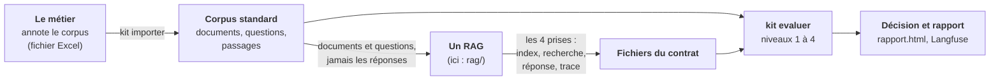

# Évaluer un RAG de bout en bout

Ce dépôt sert à **évaluer n'importe quel RAG**, à partir d'un corpus annoté par le métier. Il dit si le RAG lit bien les documents, s'il retrouve les bons passages, s'il répond juste, et s'il peut partir en production.

Il contient trois choses :

1. **un corpus annoté** : des documents, des questions, la réponse attendue et l'endroit exact où elle se trouve ;
2. **un kit d'évaluation** : il compare ce que le RAG a fait à ce que le métier attendait, sur quatre niveaux ;
3. **un RAG d'exemple** : il montre comment un RAG se branche sur le kit. C'est un prétexte ; le sujet, c'est l'évaluation.



Le RAG et le kit ne se connaissent pas : ils ne se parlent que par les fichiers du contrat. On peut brancher un autre RAG, écrit dans n'importe quel langage, sans toucher au kit.

## Ce qu'il y a dans le dépôt

```
RAG-Evaluation/
├── README.md                                vous êtes ici
├── DECISIONS.md                             les choix faits là où la méthode laissait une liberté
├── pyproject.toml                           installe les deux paquets d'un coup (uv sync)
│
├── evaluation/                              ÉVALUER UN RAG : le kit (commande kit) et le corpus annoté
│   ├── documentation/                       les guides, dans l'ordre :
│   │   ├── 0a_construction_du_corpus.md       annoter le corpus, l'importer
│   │   ├── 0b_branchement_du_rag.md           brancher un RAG : les 4 prises
│   │   ├── 1_evaluation_ingestion.md          le passage est-il dans l'index ?
│   │   ├── 2_evaluation_recherche.md          est-il retrouvé ?
│   │   ├── 3_evaluation_reponse.md            la réponse est-elle juste ? (juge, relecture)
│   │   ├── 4_evaluation_bout_en_bout.md       utile, sûr, rapide, pas cher ? la décision
│   │   ├── 5_resultats_et_comparaison.md      lire les résultats, comparer deux versions
│   │   └── reference/                         la méthode, le contrat, le prompt du juge, les schémas
│   ├── config/                              le modèle juge (kit.yaml), les seuils du métier (seuils.json)
│   ├── corpus_exemple/                      50 documents fictifs, leur fichier Excel annoté, l'ontologie du domaine
│   ├── src/kit/                             le code, un dossier par étape, mêmes noms que les guides :
│   │   ├── etape_0a_corpus/
│   │   ├── etape_0b_branchement/
│   │   ├── etape_1_evaluation_ingestion/
│   │   ├── etape_2_evaluation_recherche/
│   │   ├── etape_3_evaluation_reponse/
│   │   ├── etape_4_evaluation_bout_en_bout/
│   │   └── etape_5_resultats/
│   └── tests/
│
├── rag/                                     UN RAG D'EXEMPLE, autonome (commande rag)
│   ├── documentation/                       le guide du RAG, et les techniques d'un RAG (document 2)
│   ├── config/                              config.yaml : point d'accès, modèles, k, chemins
│   ├── src/rag/
│   │   ├── pipeline/                          une étape par fichier : extraction … génération
│   │   └── utils/branchement_evaluation.py    la seule partie écrite pour l'évaluation : les 4 prises
│   └── tests/
│
├── infra/                                   les services : Langfuse et Docling (Guide_des_services.md)
└── sorties/                                 tout ce qui est produit (non versionné)
```

## Par où commencer

| Je veux… | Lire |
| --- | --- |
| comprendre la méthode | le [document 3](evaluation/documentation/reference/methode_evaluation.md), sections 1 à 5, puis le [document 1](evaluation/documentation/reference/methode_corpus_annote.md) |
| constituer le corpus de mon projet | [0a. Construction du corpus](evaluation/documentation/0a_construction_du_corpus.md) |
| brancher mon RAG sur le kit | [0b. Branchement du RAG](evaluation/documentation/0b_branchement_du_rag.md), avec l'exemple [`branchement_evaluation.py`](rag/src/rag/utils/branchement_evaluation.py) |
| comprendre chaque évaluation | [1. Ingestion](evaluation/documentation/1_evaluation_ingestion.md), [2. Recherche](evaluation/documentation/2_evaluation_recherche.md), [3. Réponse](evaluation/documentation/3_evaluation_reponse.md), [4. Bout en bout](evaluation/documentation/4_evaluation_bout_en_bout.md) |
| savoir où sont les résultats, quoi corriger, comparer deux versions | [5. Résultats et comparaison](evaluation/documentation/5_resultats_et_comparaison.md) |
| voir comment le RAG d'exemple est construit | [Guide du GraphRAG](rag/documentation/guide_du_graphrag.md), et le [document 2](rag/documentation/reference/techniques_rag.md) pour les techniques |

## Démarrer

Prérequis : Docker, [uv](https://docs.astral.sh/uv/), et un point d'accès à des modèles de langage **compatible OpenAI** (ici LiteLLM ; n'importe quel fournisseur convient).

**1. Installer** le kit et le RAG d'exemple, deux paquets indépendants, en une commande :

```bash
uv sync
```

**2. Renseigner les clés** : copier `.env.example` en `.env` et y mettre les clés du point d'accès. L'adresse et les noms des modèles sont dans `evaluation/config/kit.yaml` (le juge) et `rag/config/config.yaml` (le RAG).

**3. Démarrer les services** : Langfuse (http://127.0.0.1:3100) et Docling (port 5101). Détails : [infra/Guide_des_services.md](infra/Guide_des_services.md).

```bash
infra/initialiser.sh
```

```bash
docker compose -f infra/docker-compose.yml --env-file infra/.env up -d
```

```bash
uv run kit verifier-modeles
```

Cette dernière commande teste tout. Si le juge ou les embeddings ne répondent pas, c'est que le point d'accès aux modèles n'est pas démarré (avec LLM-Service : `service/scripts/demarrer.sh`).

**4. Importer le corpus annoté** ([guide 0a](evaluation/documentation/0a_construction_du_corpus.md)) :

```bash
uv run kit importer evaluation/corpus_exemple/Corpus_evaluation_RAG.xlsx
```

**5. Faire tourner le RAG** ([guide 0b](evaluation/documentation/0b_branchement_du_rag.md)) : indexer les documents (2 minutes environ), puis répondre aux 40 questions par le connecteur (5 minutes environ).

```bash
uv run rag indexer
```

```bash
uv run kit lancer rag.utils.branchement_evaluation:Connecteur
```

**6. Évaluer** : les évaluations 1 à 4 d'un coup, en 5 minutes environ ([guides 1 à 4](evaluation/documentation/1_evaluation_ingestion.md)) :

```bash
uv run kit evaluer
```

**7. Lire le résultat** ([guide 5](evaluation/documentation/5_resultats_et_comparaison.md)) : ouvrir dans un navigateur le `rapport.html` dont le chemin est affiché à la fin de `kit evaluer`, puis l'expérience dans Langfuse (http://127.0.0.1:3100).

Vos chiffres peuvent différer de quelques points de ceux des guides : le modèle de génération ne répond pas toujours pareil, même à température 0 (par exemple, Q-004 est parfois une erreur grave ; [guide 3](evaluation/documentation/3_evaluation_reponse.md)).

Sans `--corpus` ni `--rag`, le kit prend le dernier corpus importé et la dernière sortie du RAG, et affiche lesquels. Pour en choisir d'autres : `--corpus sorties/corpus/<version>` et `--rag sorties/sorties_rag/<version du RAG>`.

## Toutes les commandes

| Commande | Ce qu'elle fait | Guide |
| --- | --- | --- |
| `kit verifier-modeles` | teste le point d'accès, le juge, les embeddings et Langfuse | [3](evaluation/documentation/3_evaluation_reponse.md) |
| `kit importer <fichier.xlsx>` | contrôle le fichier du métier, l'écrit en base, l'exporte, crée le jeu Langfuse | [0a](evaluation/documentation/0a_construction_du_corpus.md) |
| `kit init-base` | crée les tables de la base (fait aussi par `importer`) | [0a](evaluation/documentation/0a_construction_du_corpus.md) |
| `kit lancer <module:Classe>` | fait tourner un RAG Python par son connecteur, et écrit ses fichiers du contrat | [0b](evaluation/documentation/0b_branchement_du_rag.md) |
| `kit verifier-contrat <dossier> [--corpus <corpus>]` | dit précisément ce qui manque dans les fichiers d'un RAG | [0b](evaluation/documentation/0b_branchement_du_rag.md) |
| `kit evaluer-ingestion` | évaluation 1 : le passage est-il dans l'index ? | [1](evaluation/documentation/1_evaluation_ingestion.md) |
| `kit evaluer-recherche` | évaluation 2 : est-il retrouvé ? | [2](evaluation/documentation/2_evaluation_recherche.md) |
| `kit evaluer-reponse` | évaluation 3 : la réponse est-elle juste ? | [3](evaluation/documentation/3_evaluation_reponse.md) |
| `kit verifier-graphe [--envoyer]` | fait juger 50 relations du graphe par le métier, puis mesure leur justesse | [1](evaluation/documentation/1_evaluation_ingestion.md) |
| `kit verifier-juge [--envoyer]` | fait noter 30 réponses par le métier, puis mesure l'accord avec le juge | [3](evaluation/documentation/3_evaluation_reponse.md) |
| `kit evaluer-bout-en-bout` | évaluation 4 : score pondéré, temps, coût, décision, rapport | [4](evaluation/documentation/4_evaluation_bout_en_bout.md) |
| `kit evaluer` | les évaluations 1 à 4 d'un coup | [4](evaluation/documentation/4_evaluation_bout_en_bout.md) |
| `kit comparer <résultats A> <résultats B>` | compare deux versions du RAG | [5](evaluation/documentation/5_resultats_et_comparaison.md) |
| `rag indexer`, `rag demander "…"` | le RAG d'exemple, seul ; `--graphe` pour le RAG hybride | [GraphRAG](rag/documentation/guide_du_graphrag.md) |
| `rag exporter`, `rag repondre <questions.jsonl>` | le RAG d'exemple écrit lui-même ses fichiers du contrat | [0b](evaluation/documentation/0b_branchement_du_rag.md) |

Les évaluations 1 à 4 prennent `--corpus` et `--rag` (par défaut, les plus récents), et `--sans-langfuse` pour ne rien publier. Chaque commande a son aide : `uv run kit <commande> --help`.

## Tests

```bash
uv run pytest -q
```

Les tests utilisent des cas réels du corpus d'exemple. Un test vérifie que le kit et le RAG ne s'importent jamais l'un l'autre.
