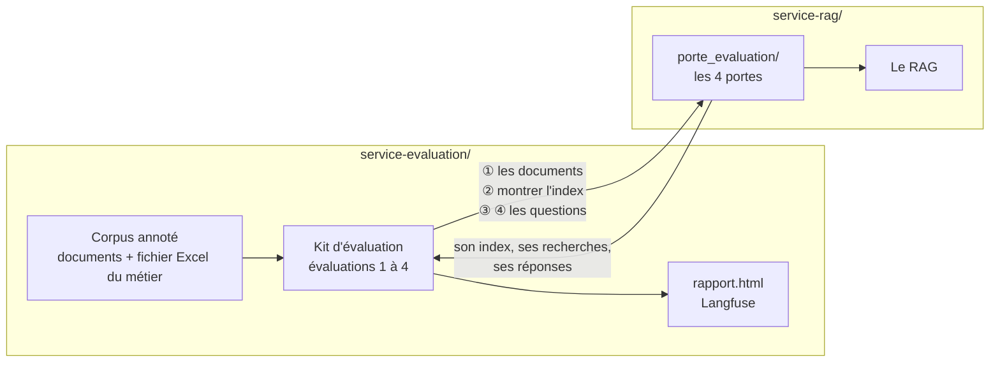

# Évaluer un RAG de bout en bout

Ce dépôt contient **deux services indépendants** :

| Service | Dossier | Rôle |
| --- | --- | --- |
| **Le service d'évaluation** | [`service-evaluation/`](service-evaluation/) | le produit : un corpus annoté par le métier, et un kit qui évalue **n'importe quel RAG**. Il dit si le RAG lit bien les documents, s'il retrouve les bons passages, s'il répond juste, et s'il peut partir en production |
| **Un service RAG d'exemple** | [`service-rag/`](service-rag/) | un RAG simple, qui montre comment un RAG se branche sur l'évaluation. C'est un prétexte : le sujet, c'est l'évaluation |

Le service d'évaluation demande à chaque RAG **une porte de forme fixe**, à une adresse web. Par cette porte, il lui envoie ses documents, lui pose ses questions, et récupère ce qu'il fait. Les deux services ne se parlent que par là.



## Lancer, en deux temps

Il faut Docker, [uv](https://docs.astral.sh/uv/), et un point d'accès à des modèles de langage **compatible OpenAI** (ici LLM-Service, sur http://127.0.0.1:8080).

### Temps 1 : lancer le RAG

```bash
cd service-rag
```

```bash
cp .env.example .env
```

Mettre dans `.env` la clé du point d'accès aux modèles (`RAG_LLM_CLE`), puis :

```bash
docker compose up -d --build
```

Le RAG est en place : il attend, sa porte ouverte à http://127.0.0.1:8100. Détails : [README du service RAG](service-rag/README.md).

### Temps 2 : lancer l'évaluation

```bash
cd ../service-evaluation
```

```bash
cp .env.example .env
```

Mettre dans `.env` la clé du point d'accès aux modèles du juge (`KIT_LLM_CLE`), puis démarrer Langfuse :

```bash
./initialiser.sh
```

```bash
docker compose up -d
```

**2a. Brancher le corpus annoté** : le kit contrôle le fichier Excel du métier et le range.

```bash
uv run kit importer corpus_exemple/Corpus_evaluation_RAG.xlsx
```

**2b. Évaluer** : le kit envoie les documents au RAG, lui pose les 60 questions, puis note ses réponses. Une dizaine de minutes en tout.

```bash
uv run kit evaluer
```

À la fin, la commande affiche le chemin de `rapport.html` : l'ouvrir dans un navigateur. Les détails sont dans Langfuse (http://127.0.0.1:3100). Détails : [README du service d'évaluation](service-evaluation/README.md).

Vos chiffres peuvent différer de quelques points de ceux des guides : le modèle de génération ne répond pas toujours pareil, même à température 0.

## Ce qu'il y a dans le dépôt

```
RAG-Evaluation/
├── README.md                    vous êtes ici : les deux temps
├── DECISIONS.md                 les choix faits, et pourquoi
│
├── service-evaluation/          LE SERVICE D'ÉVALUATION (commande kit)
│   ├── README.md                lancer l'évaluation : brancher le corpus, évaluer
│   ├── docker-compose.yml       Langfuse
│   ├── corpus_exemple/          50 documents fictifs et leur fichier Excel annoté
│   ├── documentation/           les guides, dans l'ordre, et la règle que chaque RAG doit suivre
│   ├── config/                  le modèle juge, les seuils du métier
│   ├── src/kit/                 le kit ; appel_du_rag/ est le seul endroit qui parle à un RAG
│   └── tests/
│
└── service-rag/                 UN SERVICE RAG D'EXEMPLE (commande rag)
    ├── README.md                lancer le RAG, s'en servir
    ├── docker-compose.yml       le RAG avec sa porte ouverte, et Docling
    ├── documentation/           le guide du RAG, et les techniques d'un RAG
    ├── config/                  point d'accès, modèles, k
    ├── src/rag/
    │   ├── pipeline/            le RAG lui-même
    │   └── porte_evaluation/    la seule partie écrite pour l'évaluation : les 4 portes
    └── tests/
```

## Par où continuer

| Je veux… | Lire |
| --- | --- |
| comprendre la méthode | le [document 3](service-evaluation/documentation/reference/methode_evaluation.md), sections 1 à 5, puis le [document 1](service-evaluation/documentation/reference/methode_corpus_annote.md) |
| constituer le corpus de mon projet | [0a. Construction du corpus](service-evaluation/documentation/0a_construction_du_corpus.md) |
| brancher mon RAG sur l'évaluation | [0b. La porte du RAG](service-evaluation/documentation/0b_porte_du_rag.md), avec l'exemple [`porte_evaluation/`](service-rag/src/rag/porte_evaluation/) |
| comprendre chaque évaluation | [1. Ingestion](service-evaluation/documentation/1_evaluation_ingestion.md), [2. Recherche](service-evaluation/documentation/2_evaluation_recherche.md), [3. Réponse](service-evaluation/documentation/3_evaluation_reponse.md), [4. Bout en bout](service-evaluation/documentation/4_evaluation_bout_en_bout.md) |
| lire les résultats, comparer deux versions du RAG | [5. Résultats et comparaison](service-evaluation/documentation/5_resultats_et_comparaison.md) |
| voir comment le RAG d'exemple est construit | [Guide du RAG](service-rag/documentation/guide_du_graphrag.md), et le [document 2](service-rag/documentation/reference/techniques_rag.md) pour les techniques |
