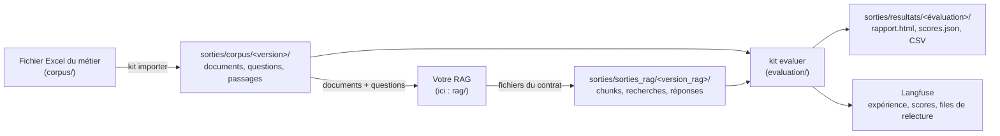

# Banc d'évaluation de RAG

Un outil pour **évaluer n'importe quel RAG de bout en bout**, à partir d'un corpus annoté par le métier.

Le dépôt met en œuvre la méthode décrite dans [`docs/`](docs/README.md). Il est construit autour de trois idées.

1. **Le métier annote un corpus** : des documents, des questions, la réponse attendue et l'endroit exact où elle se trouve.
2. **Le RAG produit des fichiers standard**, le *contrat* : ce qu'il a indexé, ce qu'il a retrouvé, ce qu'il a répondu.
3. **Le kit d'évaluation compare les deux** et rend des scores, une décision et un rapport lisible par le métier.

Le RAG et le kit ne se connaissent pas. Ils ne communiquent que par les fichiers du contrat. On peut donc brancher un autre RAG demain, écrit dans n'importe quel langage, sans toucher au kit.

> Le RAG fourni ici (`rag/`) n'est qu'un **prétexte**, volontairement minimal. Il sert à montrer le branchement. Ce qui compte, c'est le corpus et l'évaluation.

## Les trois dossiers

```
RAG-Evaluation/
├── corpus/       PARTIE 1 — le corpus annoté, et le contrat pour y brancher un RAG
├── rag/          PARTIE 2 — le RAG de démonstration (un exemple de RAG branché)
├── evaluation/   PARTIE 3 — le kit d'évaluation : niveaux 1 à 4, juge, décision, rapport
│
├── docs/         la méthode (documents de référence 1, 2, 3 et modèle Excel)
├── infra/        les services : Langfuse (suivi, relecture) et Docling (lecture des PDF)
└── sorties/      tout ce qui est produit (non versionné) : corpus exporté, sorties du RAG, résultats
```

| Dossier | Pour qui | Ce qu'on y trouve | À lire |
| --- | --- | --- | --- |
| [`corpus/`](corpus/README.md) | le métier, et l'équipe qui branche un RAG | le fichier Excel à remplir, le corpus d'exemple, l'import ; le **contrat** : ce que le RAG reçoit et ce qu'il doit rendre | [corpus/README.md](corpus/README.md) |
| [`rag/`](rag/README.md) | l'équipe technique d'un RAG | un RAG minimal qui respecte le contrat : à copier pour brancher le sien | [rag/README.md](rag/README.md) |
| [`evaluation/`](evaluation/README.md) | celui qui évalue | les commandes, la configuration (modèle juge, seuils), Langfuse | [evaluation/README.md](evaluation/README.md) |
| | le métier et l'équipe technique | **où sont les résultats, comment les lire, quoi corriger** | [evaluation/LIRE_LES_RESULTATS.md](evaluation/LIRE_LES_RESULTATS.md) |

Les choix faits là où la méthode laissait une liberté, et les écarts, sont dans [DECISIONS.md](DECISIONS.md).

## Le parcours complet



## Démarrage, de zéro à un premier rapport

Prérequis : Docker, [uv](https://docs.astral.sh/uv/), et un point d'accès à des modèles de langage **compatible OpenAI** (ici LiteLLM ; n'importe quel fournisseur convient).

**1. Installer**

```bash
uv sync
```

**2. Renseigner les clés** : copier `.env.example` en `.env` et y mettre les clés du point d'accès. L'adresse et les modèles sont dans `evaluation/config/kit.yaml` (le juge) et `rag/rag_demo/config.yaml` (le RAG). Rien d'autre à toucher pour changer de fournisseur.

**3. Démarrer les services** (Langfuse sur http://127.0.0.1:3100, Docling sur le port 5101) :

```bash
infra/initialiser.sh
```

```bash
docker compose -f infra/docker-compose.yml --env-file infra/.env up -d
```

**4. Vérifier le branchement des modèles et de Langfuse**

```bash
uv run kit verifier-modeles
```

**5. Importer le corpus annoté** (contrôles, base, export, jeu de questions dans Langfuse)

```bash
uv run kit importer corpus/exemple/Corpus_evaluation_RAG.xlsx
```

**6. Faire tourner le RAG** : indexer les documents, exporter l'index, répondre aux questions.

```bash
uv run rag-demo indexer
```

```bash
uv run rag-demo exporter
```

```bash
uv run rag-demo repondre sorties/corpus/2026-11-20.1/questions.jsonl
```

**7. Évaluer** (niveaux 1 à 4, environ 5 minutes, dont 3 pour le juge)

```bash
uv run kit evaluer --corpus sorties/corpus/2026-11-20.1 --rag sorties/sorties_rag/rag-demo-k5-80032dcd
```

**8. Lire le résultat** : ouvrir `sorties/resultats/<évaluation>/rapport.html`, puis l'expérience dans Langfuse. Le guide [LIRE_LES_RESULTATS.md](evaluation/LIRE_LES_RESULTATS.md) explique chaque chiffre.

Les noms de dossiers `2026-11-20.1` (version du corpus) et `rag-demo-k5-80032dcd` (version du RAG) sont affichés par les commandes précédentes.

## Toutes les commandes

| Commande | Partie | Ce qu'elle fait |
| --- | --- | --- |
| `kit verifier-modeles` | évaluation | teste le point d'accès, le juge, les embeddings et Langfuse |
| `kit init-base` | évaluation | crée les tables de la base (faite aussi par `importer`) |
| `kit importer <fichier.xlsx>` | corpus | contrôle le fichier du métier, l'écrit en base, l'exporte, crée le jeu Langfuse |
| `kit verifier-contrat <dossier> [--corpus <corpus>]` | corpus | dit précisément ce qui manque ou ne va pas dans les fichiers d'un RAG |
| `rag-demo indexer` / `exporter` / `repondre` | RAG | le RAG de démonstration : index, export du contrat, réponses |
| `kit lancer <module:Classe> --corpus <corpus>` | évaluation | fait tourner un RAG Python par son connecteur, et écrit ses fichiers du contrat |
| `kit niveau1` … `kit niveau4` | évaluation | un niveau à la fois : ingestion, recherche, réponse, bout en bout |
| `kit evaluer` | évaluation | les quatre niveaux d'un coup, décision et rapport |
| `kit verifier-juge [--envoyer]` | évaluation | fait noter 30 réponses par le métier dans Langfuse, puis mesure l'accord avec le juge |
| `kit comparer <résultats A> <résultats B>` | évaluation | compare deux versions du RAG : écarts, questions gagnées et perdues |

Chaque commande a son aide : `uv run kit <commande> --help`.

## Tests

```bash
uv run pytest -q
```

Les tests utilisent des cas réels du corpus d'exemple. Un test vérifie aussi que `evaluation/` et `rag/` ne s'importent jamais l'un l'autre.
