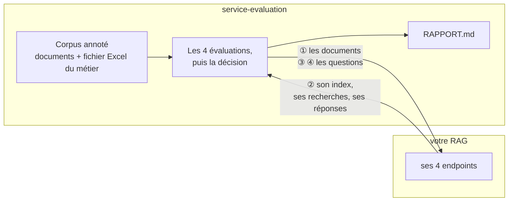

# Évaluer un RAG de bout en bout

Un **RAG** est un assistant qui répond à des questions en s'appuyant sur des documents : il les découpe en morceaux de texte, retrouve les morceaux utiles à une question, puis fait écrire la réponse par un modèle de langage.

Ce dépôt donne un **service qui évalue n'importe quel RAG** à partir d'un **corpus annoté** : des documents, et un fichier Excel où le métier a écrit des questions, leur bonne réponse, et l'endroit exact des documents où elle se trouve. Le service dit si le RAG peut partir en production, et pourquoi.

Il s'adresse à la personne qui prend en charge l'évaluation : data scientist, chef de projet technique, quelqu'un qui sait lire un dépôt et lancer des commandes. C'est elle qui fait tout. Le métier ne fait que fournir le corpus annoté, selon les règles qu'elle lui transmet, et fixer avec elle les seuils.

**Commencez ici : [le fil conducteur](FIL_CONDUCTEUR.md)**, qui dit dans l'ordre ce qu'on fait, pourquoi, et ce que ça a donné sur l'exemple, de l'installation à la lecture des résultats.

## Les trois dossiers

| Dossier | Ce que c'est | Pour qui |
| --- | --- | --- |
| [`service-evaluation/`](service-evaluation/README.md) | **le service d'évaluation, vierge** : à prendre pour votre projet | ceux qui veulent évaluer leur RAG |
| [`service-rag-exemple/`](service-rag-exemple/README.md) | **un RAG simple**, qui sert d'exemple à évaluer : il montre comment un RAG se branche sur le service | ceux qui veulent voir comment brancher un RAG |
| [`service-evaluation-exemple/`](service-evaluation-exemple/README.md) | **le service une fois qu'il a tourné sur ce RAG** : le même dossier que `service-evaluation/`, rempli, avec tous les résultats | ceux qui veulent voir à quoi ressemblent les résultats, sans rien installer |

## Évaluer votre RAG : la marche à suivre

| Étape | Ce que vous faites | Où |
| --- | --- | --- |
| 0. Installer le service | copier `service-evaluation/` dans votre projet, démarrer Langfuse, brancher le modèle juge | [README du service](service-evaluation/README.md) |
| 1. Demander le corpus au métier | lui donner le fichier Excel vierge et les règles pour le remplir ; il vous rend les documents et le fichier rempli | `corpus_annote/Corpus_evaluation_RAG.xlsx`, [guide 0a](service-evaluation/documentation/0a_construction_du_corpus.md) |
| 2. Ranger et importer le corpus | les documents dans `corpus_annote/corpus_documentaire/`, le fichier dans `corpus_annote/`, puis `kit importer` : il dit ligne par ligne ce que le métier doit corriger | `service-evaluation/corpus_annote/` |
| 3. Fixer les seuils avec le métier | ce que le RAG doit atteindre pour partir en production, **avant** toute évaluation | `config/seuils.json` |
| 4. Brancher votre RAG | copier le modèle des quatre endpoints dans votre RAG, y brancher ses fonctions, mettre l'adresse du RAG dans `config/kit.yaml` ; `kit appeler-rag` vérifie | `endpoints_a_copier/`, [guide 0b](service-evaluation/documentation/0b_endpoints_du_rag.md) |
| 5. Lancer l'évaluation | `kit evaluer`, une fois par configuration du RAG : le service appelle lui-même votre RAG, lui envoie les documents, pose toutes les questions, calcule les scores | depuis `service-evaluation/` |
| 6. Lire, corriger, comparer | lire le `RAPPORT.md` ; changer un réglage du RAG, réévaluer, puis `kit comparer` | `resultats/evaluations/`, [guide 5](service-evaluation/documentation/5_resultats_et_comparaison.md) |

**Les configurations.** Une configuration, ce sont les réglages de votre RAG à un moment donné : k, modèles, prompt, découpage… Ils sont propres à chaque RAG et **se changent dans le RAG, jamais dans le service**. Le service les lit dans ce que le RAG déclare (endpoint ②), et nomme l'évaluation d'après eux. Pour tester une autre configuration : vous changez le réglage dans le RAG, vous le relancez, puis vous relancez `kit evaluer`. Un run = une configuration.

Le détail de chaque étape : [Évaluer votre RAG : la marche à suivre](service-evaluation/documentation/integrer_votre_rag.md). Ces étapes, faites pour de vrai sur le RAG d'exemple : [ce qu'on a fait](service-evaluation-exemple/README.md#ce-quon-a-fait-dans-lordre).

## Ce que fait le service d'évaluation

Il **évalue une configuration** du RAG, c'est-à-dire le RAG avec tous ses réglages fixés (par exemple, le nombre de morceaux que la recherche ramène pour chaque question). Il pose toutes les questions du corpus au RAG, et vérifie, dans l'ordre :

1. **L'ingestion** : rien ne s'est perdu ni abîmé quand le RAG a découpé les documents et les a rangés dans sa base.
2. **La recherche** : pour chaque question, la recherche ramène les morceaux qui contiennent la réponse, et jamais un document interdit à la personne qui pose la question.
3. **La réponse** : elle est juste, ne dit que ce que disent les documents, et le RAG sait dire « je ne sais pas ». Pour juger si une réponse écrite en phrases est juste, le service utilise un modèle de langage, le **juge** : il appartient au service, pas au RAG, et compare chaque réponse du RAG à la bonne réponse écrite par le métier, point par point. On vérifie d'abord le juge lui-même : il doit donner les mêmes notes que le métier sur un échantillon.
4. **De bout en bout** : le RAG est bon sur les questions qui comptent le plus, assez rapide, et pas trop cher.

Puis il **décide** : la configuration peut partir en production si elle atteint les seuils fixés par le métier, sans erreur grave.

Il peut aussi **comparer deux configurations** déjà évaluées : laquelle fait mieux, et l'écart est-il réel ou dû au hasard ?

Chaque évaluation et chaque comparaison produit un rapport, `RAPPORT.md`, lisible directement sur GitHub.

## Comment un RAG se branche sur le service

Le RAG ouvre **quatre endpoints**, quatre adresses web de forme fixe que le service appelle :

- **① ingérer** : le service envoie ses documents ; le RAG les range à part de son propre corpus documentaire.
- **② montrer l'index** : le RAG rend sa version exacte, ses morceaux de texte, et les pages qu'il a lues.
- **③ rechercher** : pour une question, le RAG rend les morceaux qu'il a retrouvés.
- **④ répondre** : pour une question, le RAG rend sa réponse, ses sources, et s'il s'abstient.

Les deux services ne se parlent que par ces endpoints : le service d'évaluation n'a pas besoin de connaître le code du RAG.

## Par où commencer

| Je veux… | Aller à |
| --- | --- |
| voir à quoi ressemblent les résultats, sans rien installer | [`service-evaluation-exemple/`](service-evaluation-exemple/README.md) |
| faire tourner le service sur le RAG d'exemple | lancer le [RAG d'exemple](service-rag-exemple/README.md#le-lancer), puis suivre [le service d'évaluation](service-evaluation/README.md#essayer-avec-le-corpus-dexemple) |
| évaluer mon RAG, sur mes documents | [la marche à suivre](service-evaluation/documentation/integrer_votre_rag.md) |
| comprendre la méthode | le [document 3](service-evaluation/documentation/methode_et_contrat/methode_evaluation.md), sections 1 à 5, puis le [document 1](service-evaluation/documentation/methode_et_contrat/methode_corpus_annote.md) |
| savoir pourquoi un choix a été fait | [DECISIONS.md](DECISIONS.md) |

Il faut Docker, [uv](https://docs.astral.sh/uv/), et un accès à des modèles de langage par une API compatible OpenAI. Ici, le service LLM-Service, à http://127.0.0.1:8080 ; avec un autre fournisseur, on change l'adresse et les noms des modèles dans [`service-evaluation/config/kit.yaml`](service-evaluation/config/kit.yaml) et [`service-rag-exemple/config/config.yaml`](service-rag-exemple/config/config.yaml), sans toucher au code.
