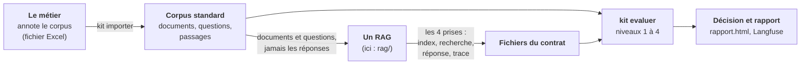

# Évaluer un RAG de bout en bout

Ce dépôt sert à **évaluer n'importe quel RAG**, à partir d'un corpus annoté par le métier. Il dit si le RAG lit bien les documents, s'il retrouve les bons passages, s'il répond juste, et s'il peut partir en production.

Il contient trois choses :

1. **un corpus annoté** : des documents, des questions, la réponse attendue et l'endroit exact où elle se trouve ;
2. **un kit d'évaluation** : il compare ce que le RAG a fait à ce que le métier attendait, sur quatre niveaux ;
3. **un RAG d'exemple** : il montre comment un RAG se branche sur le kit. C'est un prétexte ; le sujet, c'est l'évaluation.



Le RAG et le kit ne se connaissent pas : ils ne se parlent que par les fichiers du contrat. On peut brancher un autre RAG, écrit dans n'importe quel langage, sans toucher au kit.

## Ce qu'il y a dans le dépôt

```
RAG-Evaluation/
├── README.md                          vous êtes ici
├── DECISIONS.md                       les choix faits là où la méthode laissait une liberté
│
├── evaluation/                        ÉVALUER UN RAG : le corpus annoté et le kit (commande kit)
│   ├── 1_Construire_le_corpus_annote.md
│   ├── 2_Importer_le_corpus.md
│   ├── 3_Brancher_un_RAG.md
│   ├── 4_Evaluer_le_RAG.md
│   ├── 5_Lire_les_resultats.md
│   ├── corpus_exemple/                50 documents fictifs et leur fichier Excel annoté
│   ├── methode/                       les documents de référence 1 et 3, le contrat, le prompt du juge
│   ├── config/                        le modèle juge (kit.yaml) et les seuils du métier (seuils.json)
│   ├── kit/                           le code, un dossier par étape :
│   │   ├── corpus/                      importer le fichier Excel
│   │   ├── branchement/                 le contrat, le lancement d'un RAG
│   │   ├── niveau_1_ingestion/          le passage est-il dans l'index ?
│   │   ├── niveau_2_recherche/          est-il retrouvé ?
│   │   ├── niveau_3_reponse/            la réponse est-elle juste ? (juge, relecture)
│   │   ├── niveau_4_bout_en_bout/       utile, sûr, rapide, pas cher ?
│   │   └── resultats/                   scores, rapport, comparaison
│   └── tests/
│
├── rag/                               UN RAG D'EXEMPLE, autonome (commande rag)
│   ├── Guide_du_GraphRAG.md
│   ├── pipeline/                      une étape par fichier : extraction … génération
│   ├── branchement_evaluation.py      la seule partie écrite pour l'évaluation : les 4 prises
│   └── …
│
├── infra/                             les services : Langfuse et Docling (Guide_des_services.md)
└── sorties/                           tout ce qui est produit (non versionné)
```

## Par où commencer

| Je veux… | Lire |
| --- | --- |
| comprendre la méthode | le [document 3](evaluation/methode/RAG_3_Evaluer_le_RAG.md), sections 1 à 5, puis le [document 1](evaluation/methode/RAG_1_Constituer_le_corpus_d_evaluation.md) |
| constituer le corpus de mon projet | [1. Construire le corpus annoté](evaluation/1_Construire_le_corpus_annote.md), puis [2. Importer le corpus](evaluation/2_Importer_le_corpus.md) |
| brancher mon RAG sur le kit | [3. Brancher un RAG](evaluation/3_Brancher_un_RAG.md), avec l'exemple [`rag/branchement_evaluation.py`](rag/branchement_evaluation.py) |
| évaluer, vérifier le juge, comparer deux versions | [4. Évaluer le RAG](evaluation/4_Evaluer_le_RAG.md) |
| savoir où sont les résultats et quoi corriger | [5. Lire les résultats](evaluation/5_Lire_les_resultats.md) |
| voir comment le RAG d'exemple est construit | [Guide du GraphRAG](rag/Guide_du_GraphRAG.md), et le [document 2](rag/methode/RAG_2_Construire_le_pipeline.md) pour les techniques |

## Démarrer

Prérequis : Docker, [uv](https://docs.astral.sh/uv/), et un point d'accès à des modèles de langage **compatible OpenAI** (ici LiteLLM ; n'importe quel fournisseur convient).

**1. Installer** le kit et le RAG d'exemple, deux paquets indépendants, en une commande :

```bash
uv sync
```

**2. Renseigner les clés** : copier `.env.example` en `.env` et y mettre les clés du point d'accès. L'adresse et les noms des modèles sont dans `evaluation/config/kit.yaml` (le juge) et `rag/config.yaml` (le RAG).

**3. Démarrer les services** : Langfuse (http://127.0.0.1:3100) et Docling (port 5101). Détails : [infra/Guide_des_services.md](infra/Guide_des_services.md).

```bash
infra/initialiser.sh
```

```bash
docker compose -f infra/docker-compose.yml --env-file infra/.env up -d
```

```bash
uv run kit verifier-modeles
```

**4. Importer le corpus annoté** ([guide 2](evaluation/2_Importer_le_corpus.md)) :

```bash
uv run kit importer evaluation/corpus_exemple/Corpus_evaluation_RAG.xlsx
```

**5. Faire tourner le RAG** ([guide 3](evaluation/3_Brancher_un_RAG.md)) : indexer les documents, puis répondre aux questions par le connecteur.

```bash
uv run rag indexer
```

```bash
uv run kit lancer rag.branchement_evaluation:Connecteur --corpus sorties/corpus/2026-11-20.1 -p k=5
```

**6. Évaluer** ([guide 4](evaluation/4_Evaluer_le_RAG.md)), en 5 minutes environ :

```bash
uv run kit evaluer --corpus sorties/corpus/2026-11-20.1 --rag sorties/sorties_rag/rag-demo-k5-80032dcd
```

**7. Lire le résultat** ([guide 5](evaluation/5_Lire_les_resultats.md)) : ouvrir `sorties/resultats/<évaluation>/rapport.html`, puis l'expérience dans Langfuse.

Les noms `2026-11-20.1` (version du corpus) et `rag-demo-k5-80032dcd` (version du RAG) sont affichés par les commandes précédentes.

## Tests

```bash
uv run pytest -q
```

Les tests utilisent des cas réels du corpus d'exemple. Un test vérifie que le kit et le RAG ne s'importent jamais l'un l'autre.
