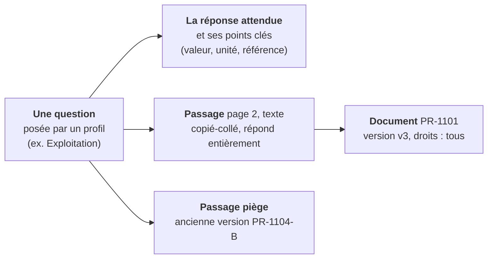

# 1. Construire le corpus annoté

Le corpus annoté est le cœur de l'évaluation. Le métier y écrit des questions réelles, la réponse attendue, et **l'endroit exact où elle se trouve** dans les documents. Le corpus est la seule chose à faire à la main ; tout le reste est automatique.



Pourquoi tant de détail ? Pour savoir **d'où vient une erreur**. Avec le passage exact, le kit peut dire si le RAG l'a bien *lu* (niveau 1), s'il l'a *retrouvé* (niveau 2), et seulement ensuite si la réponse est *juste* (niveau 3). Sans passage, on sait qu'une réponse est fausse, mais pas pourquoi.

La méthode complète est dans le [document 1](methode/RAG_1_Constituer_le_corpus_d_evaluation.md). Ce guide en donne l'essentiel.

## Le fichier à remplir

Le métier remplit **un fichier Excel**, sur le modèle vide [`methode/Corpus_evaluation_RAG.xlsx`](methode/Corpus_evaluation_RAG.xlsx). Chaque feuille porte ses définitions et ses listes de valeurs.

| Feuille | Une ligne = | L'essentiel |
| --- | --- | --- |
| Documents | un document retenu | sa référence dans la source, sa version, son format, ses **droits d'accès**, s'il est **en vigueur** |
| Questions | une question | écrite avec les mots des utilisateurs ; le **profil** qui la pose ; la **réponse attendue** et ses **points clés** ; si la réponse est dans les documents (oui, non, non accessible à ce profil) ; la **fréquence** et la **gravité** d'une erreur ; **réservée à la décision** ou non |
| Passages | un endroit où se trouve la réponse | le document, la **page**, le type d'élément (texte, tableau, texte scanné, image), le passage **copié-collé**, s'il répond entièrement, en partie, ou si c'est un **piège** |
| Pages OCR | une page scannée de référence | le texte retapé à la main : sert à mesurer la qualité de la lecture des scans |
| Tableau de bord | — | se calcule tout seul ; doit être « OK » partout avant de transmettre le fichier |

## Les règles qui comptent le plus

| Règle | Pourquoi |
| --- | --- |
| Le passage est **copié-collé** du document, pas résumé | le kit le cherche dans l'index du RAG ; un passage reformulé ne se retrouve pas |
| Pour un tableau : la ligne d'en-têtes, puis la ligne qui répond, cellules séparées par « \| » | le kit compare les mots, dans n'importe quel ordre |
| Pour un schéma : une phrase qui dit ce que montre la figure, avec son numéro | un schéma ne se copie pas |
| Des questions **sans réponse** dans les documents | vérifier que le RAG sait dire « je ne sais pas » au lieu d'inventer |
| Des questions posées avec un **profil restreint** sur un document qui lui est interdit | vérifier que le RAG ne montre jamais un document interdit |
| Des **passages pièges** : une ancienne version, un autre ouvrage | vérifier que le RAG ne se trompe pas de document |
| Un tiers des questions **réservées à la décision** | elles ne servent jamais à régler le RAG ; l'équipe technique n'en voit que les scores globaux. Cela évite de régler le RAG « pour le test » |
| **Fréquence** et **gravité** sur chaque question | une erreur sur une question fréquente et grave pèse 9 fois plus qu'une erreur rare et sans gravité |

La configuration minimale du document 1 : 10 documents par type, 50 questions, 20 pages OCR. En dessous, les scores sont trop imprécis pour décider (voir la marge d'erreur, [guide 5](5_Lire_les_resultats.md#4-les-marges-derreur--ne-pas-sur-interpréter)).

## Le corpus d'exemple, prêt à l'emploi

Le dossier [`corpus_exemple/`](corpus_exemple/) contient un corpus complet sur la maintenance électrique d'une entreprise **entièrement fictive**, Valtéra Industries. Il atteint la configuration minimale du document 1.

| Élément | Contenu |
| --- | --- |
| `corpus_exemple/sources/` | 50 documents PDF : 17 procédures (PDF natifs), 16 notes techniques (11 natives, 5 scannées et bruitées), 17 comptes rendus d'intervention (fiches de base de données exportées en « champ : valeur ») |
| `corpus_exemple/Corpus_evaluation_RAG.xlsx` | le fichier du métier, rempli : 50 documents, 60 questions, 97 passages, 20 pages OCR retapées |
| `corpus_exemple/questions_pour_relecture.md` | les 60 questions sur une page, pour les relire |
| `corpus_exemple/fabrication/` | de quoi tout refabriquer : le monde fictif, le contenu de chaque document, les scripts |

Ce qu'il couvre :

| Cas du document 1 | Dans le corpus d'exemple |
| --- | --- |
| Formats | PDF natif, PDF scanné (5 notes de 4 pages), fiche de base de données |
| Éléments | texte, tableaux, schémas avec figure numérotée (PR-1101, PR-1111, NT-057, NT-058), texte scanné |
| Droits | 4 documents réservés au profil « Maintenance » (PR-1102, NT-051, OT-24109, OT-24114) |
| Versions | PR-1104-B (2021) remplacée par PR-1104-C (2025), avec des valeurs différentes |
| Questions | 60 : 10 sans réponse, 19 à plusieurs passages, 6 synthèses, 7 avec un profil restreint dont 3 « non accessible », 6 questions de suite, 6 variantes, 6 avec passage piège, 20 réservées à la décision |

Les conventions retenues pour l'annoter :

| Point | Convention |
| --- | --- |
| Fiche de base de données | « Page » = nom du champ (par exemple « Pièces remplacées ») ; « Passage » = la valeur, ou la partie de la valeur qui répond |
| Question non accessible | posée avec le profil « Exploitation » sur un document réservé à « Maintenance » ; la réponse attendue est que le RAG ne donne pas l'information |
| Pages OCR | tout ce qu'on lit sur la page, en-tête et pied de page compris, dans l'ordre de lecture |

Pour refabriquer le corpus (rarement utile) :

```bash
uv run --group fabrication python evaluation/corpus_exemple/fabrication/fabriquer_pdf.py
```

```bash
uv run python evaluation/corpus_exemple/fabrication/remplir_excel.py
```

Le premier script dessine les PDF à partir de `fabrication/contenus/*.json`. Le second vérifie chaque passage de `fabrication/questions.yaml` contre sa source, remplit le fichier Excel et recalcule le tableau de bord.

**Étape suivante** : [2. Importer le corpus](2_Importer_le_corpus.md).
