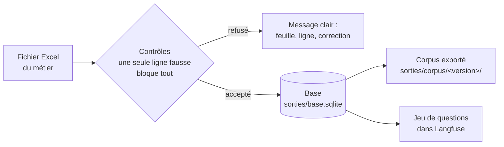

# 2. Importer le corpus

L'import transforme le fichier Excel du métier en un **corpus standard** : des fichiers que n'importe quel RAG sait lire, et que le kit sait évaluer.



## La commande

```bash
uv run kit importer evaluation/corpus_exemple/Corpus_evaluation_RAG.xlsx
```

Il faut d'abord avoir installé le dépôt et démarré Langfuse : voir le [README](../README.md#démarrer). Sans Langfuse, ajouter `--sans-langfuse`.

## Ce que fait l'import, dans l'ordre

**1. Les contrôles** ([CONTRAT.md](methode/CONTRAT.md), section 2). L'import signale une colonne obligatoire vide, une valeur hors liste, un passage dont le document n'existe pas, un identifiant en double, une question « oui » sans passage, une question « non accessible » sans document interdit… **Une seule ligne fausse bloque tout l'import** : un corpus importé à moitié fausserait l'évaluation sans que personne ne s'en aperçoive. Le message donne la feuille, la ligne et la correction attendue :

```
Import refusé : 1 ligne(s) à corriger dans Corpus_evaluation_RAG.xlsx.
  - feuille Questions, ligne 2 (Q-001) : « Exploit » n'est pas dans la colonne « Profils d'accès » de la feuille Listes (Tous les utilisateurs, Maintenance, Exploitation).
```

Si la configuration minimale du document 1 n'est pas atteinte (moins de 50 questions…), l'import passe, avec un avertissement.

**2. La conversion** des libellés du métier en codes : « PDF scanné » devient `pdf_scanne`, « Tous les utilisateurs » devient `tous`.

**3. L'écriture dans la base** (`sorties/base.sqlite` ; PostgreSQL en changeant seulement l'adresse dans [`config/kit.yaml`](config/kit.yaml)).

**4. L'export** du corpus standard dans `sorties/corpus/<version>/` :

| Fichier | Une ligne = | Donné au RAG ? |
| --- | --- | --- |
| `corpus.json` | la description du corpus : version, projet, date, fichier source | non |
| `documents.jsonl` | un document : référence, titre, type, version, date, format, droits d'accès, en vigueur | **oui** : ce sont les métadonnées que le RAG doit garder sur chaque morceau |
| `questions.jsonl` | une question, avec ses annotations | **en partie** : le RAG n'en lit que la question, le profil, et l'historique d'une question de suite |
| `passages.jsonl` | un passage annoté | **jamais** |
| `pages_ocr.jsonl` | une page scannée retapée | **jamais** |

**5. Le jeu de questions dans Langfuse** : `corpus-<projet>-<version>`, un élément par question. C'est sur lui que les évaluations seront rangées.

## La version du corpus

L'import donne une version au corpus : la date, puis un numéro (`2026-11-20.1`). Elle change à chaque import d'un fichier **modifié**. Réimporter le même fichier ne crée rien.

Deux évaluations ne se comparent que sur la même version du corpus : sinon, on ne saurait pas si l'écart vient du RAG ou des questions.

Un passage garde son identifiant d'une version à l'autre tant que sa ligne ne change pas (voir [DECISIONS.md](../DECISIONS.md), décision 1).

**Étape suivante** : [3. Brancher un RAG](3_Brancher_un_RAG.md).
