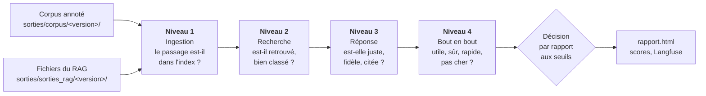
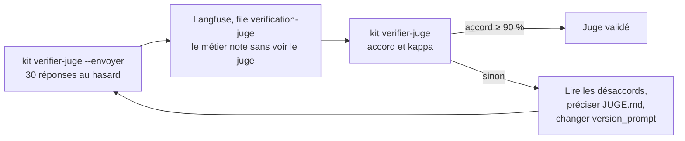

# 4. Évaluer le RAG

Le kit compare ce que le RAG a fait (ses fichiers du contrat) à ce que le métier attendait (le corpus annoté). Il le fait sur **quatre niveaux**, dans l'ordre où une erreur se propage : un passage mal lu ne peut pas être retrouvé, et un passage non retrouvé ne peut pas donner une bonne réponse.



La méthode complète est dans le [document 3](methode/RAG_3_Evaluer_le_RAG.md).

## Installer le kit

Le kit est un paquet Python, `evaluation/`, avec une commande : `kit`. Depuis la racine du dépôt, `uv sync` l'installe avec le RAG d'exemple. Pour l'utiliser seul dans un autre projet :

```bash
uv add --editable <chemin du dépôt>/evaluation
```

## Configurer : deux fichiers

**Le modèle juge** : [`config/kit.yaml`](config/kit.yaml). La clé est dans `.env` (`KIT_LLM_CLE`). N'importe quel point d'accès compatible OpenAI convient.

```yaml
modeles:
  adresse: http://127.0.0.1:8080/v1
  variable_cle: KIT_LLM_CLE
  juge:
    modele: chat           # de préférence un autre modèle que celui du RAG
    temperature: 0
```

Le juge doit être **un autre modèle que celui du RAG** : un modèle tend à favoriser ses propres réponses. Ici, le RAG génère avec `gemma-4-e4b` et le juge est `chat` (qwen3.5-4b). Pour tester le branchement des modèles et de Langfuse :

```bash
uv run kit verifier-modeles
```

**Les seuils** : [`config/seuils.json`](config/seuils.json). Pour chaque score : `seuil`, `sens` (`min` : au moins ; `max` : au plus) et `bloquant`. Les valeurs sont les repères du document 3. **Le métier les fixe avant la première évaluation**, et ne les change pas après avoir vu les résultats.

| Score | Seuil | Bloquant |
| --- | --- | --- |
| passages retrouvés dans l'index (`n1_passages_rattaches`) | ≥ 95 % | |
| erreur de lecture des scans (`n1_erreur_caracteres`) | ≤ 2 % | |
| bon passage retrouvé (`n2_reussite_k`) | ≥ 90 % | |
| **fuites de droits** (`n2_fuite_droits`) | 0 | **oui** |
| réponses justes (`n3_exactitude`) | ≥ 80 % | |
| abstentions correctes (`n3_abstention_correcte`) | ≥ 80 % | |
| fidélité aux sources (`n3_fidelite`) | ≥ 90 % | |
| **erreurs graves** (`n3_erreurs_graves`, `n4_erreurs_graves`) | 0 | **oui** |
| score pondéré (`n4_score_pondere`) | ≥ 80 % | |
| temps médian, temps à 95 %, coût moyen | 15 s, 30 s, 0,05 € | |

## Lancer l'évaluation

Le corpus doit être importé ([guide 2](2_Importer_le_corpus.md)) et le RAG doit avoir produit ses fichiers ([guide 3](3_Brancher_un_RAG.md)).

```bash
uv run kit evaluer --corpus sorties/corpus/2026-11-20.1 --rag sorties/sorties_rag/rag-demo-k5-80032dcd
```

Le kit vérifie d'abord le contrat : si un fichier est faux, il s'arrête et dit pourquoi. Puis il enchaîne les quatre niveaux, en 5 minutes environ (dont 3 pour le juge). On peut aussi les lancer **un par un, dans l'ordre**, avec `kit niveau1` à `kit niveau4` (mêmes options). Le niveau 1 peut tourner juste après l'ingestion, avant que le RAG ait répondu aux questions.

## Chaque niveau : la question posée, et comment le kit la tranche

Le code de chaque niveau est dans son dossier : [`kit/niveau_1_ingestion/`](kit/niveau_1_ingestion/), [`kit/niveau_2_recherche/`](kit/niveau_2_recherche/), [`kit/niveau_3_reponse/`](kit/niveau_3_reponse/), [`kit/niveau_4_bout_en_bout/`](kit/niveau_4_bout_en_bout/).

| Niveau | La question | Comment le kit la tranche |
| --- | --- | --- |
| 1. Ingestion | les documents sont-ils bien lus ? les passages du métier sont-ils dans l'index ? | il **rattache** chaque passage à un morceau de même document et même page : texte contenu, ou ressemblant à 95 % ; tableau aux mêmes mots à 90 % ; scan ressemblant à 90 % ; image : un morceau image de la page. Il mesure les erreurs de lecture des scans contre les pages retapées (jiwer) |
| 2. Recherche | le bon morceau est-il retrouvé, bien classé, sans document interdit ? | il compare les k morceaux retrouvés aux morceaux rattachés, selon la règle « la réponse est dans » (un passage, un parmi plusieurs, tous à combiner) |
| 3. Réponse | la réponse est-elle juste, appuyée, bien citée ? le RAG s'abstient-il quand il le faut ? | le **LLM juge** ([JUGE.md](methode/JUGE.md)) vérifie chaque point clé : présent, absent, contredit ; **Ragas** mesure la fidélité aux morceaux ; un script contrôle l'abstention, les citations, les valeurs chiffrées |
| 4. Bout en bout | le RAG est-il utile et sûr, à un temps et un coût acceptables ? | score pondéré par fréquence × gravité ; erreurs graves ; temps et coût ; **décision** par rapport aux seuils |

Une évaluation s'appelle `<version du corpus>_<version du RAG>`. Relancer un niveau remplace ses résultats. Évaluer une autre version du RAG crée une autre évaluation.

## Ce qui va dans Langfuse

Langfuse (http://127.0.0.1:3100) est l'interface partagée avec le métier.

| Objet Langfuse | Contenu | Créé par |
| --- | --- | --- |
| Jeu de données `corpus-<projet>-<version>` | une entrée par question : la question, le profil, l'historique, la réponse attendue, les points clés | `kit importer` |
| Traces du RAG | une par question : recherche, génération, tokens, durée | le RAG lui-même |
| Expérience `<évaluation>` | une ligne par question, reliée au jeu de données, avec la réponse du RAG et sa trace | le kit, au premier niveau publié |
| Scores | sur chaque question de l'expérience (hors questions réservées), et les scores globaux | chaque niveau |
| File `relecture-reponses` | les réponses que le métier doit relire : fausses ou partielles, toutes celles de gravité forte, 10 au hasard, les désaccords du juge | `kit niveau3` |
| File `verification-juge` | 30 réponses à noter par le métier, pour vérifier le juge | `kit verifier-juge --envoyer` |

Le métier note dans une file avec le score **`verdict_metier`** : juste, partielle ou fausse.

## Vérifier le juge, avant de lui faire confiance

Le juge est un modèle de langage : il peut se tromper. Avant de s'en servir pour décider, on vérifie qu'il note comme le métier.



1. Envoyer 30 réponses au métier (hors questions réservées) :
   ```bash
   uv run kit verifier-juge --corpus sorties/corpus/2026-11-20.1 --rag sorties/sorties_rag/rag-demo-k5-80032dcd --envoyer
   ```
2. Dans Langfuse, **Annotation Queues → `verification-juge`** : le métier lit chaque réponse avec sa question, et choisit `verdict_metier`, **sans regarder la note du juge**.
3. Calculer l'accord :
   ```bash
   uv run kit verifier-juge --corpus sorties/corpus/2026-11-20.1 --rag sorties/sorties_rag/rag-demo-k5-80032dcd
   ```
   Exemple de sortie (valeurs d'illustration : le métier n'a pas encore noté l'échantillon du corpus d'exemple) :
   ```
   Notes du métier : 30 sur 30.
   Accord juge / métier : 93 % (seuil 90 %) ; kappa de Cohen : 0.85. Juge VALIDÉ.
     - Q-030 : juge « fausse », métier « partielle »
   ```

On refait la vérification à chaque changement de modèle juge ou de prompt. Le **kappa de Cohen** est l'accord corrigé du hasard : il révèle un juge qui dit presque toujours « juste », et qui peut atteindre 90 % d'accord sans rien distinguer. Au-dessus de 0,8, l'accord est très bon ; sous 0,6, il faut se méfier, même si le taux d'accord passe.

## Comparer deux versions du RAG

Après un changement (k, prompt, modèle, découpage), on évalue la nouvelle version, puis on compare :

```bash
uv run kit comparer sorties/resultats/2026-11-20.1_rag-demo-k5-80032dcd sorties/resultats/2026-11-20.1_rag-demo-k3-80032dcd
```

Le kit refuse de comparer deux corpus différents. Il donne l'écart de chaque score et dit s'il dépasse la marge d'erreur. Il liste les **questions gagnées et perdues**, avec le **test de McNemar** : une valeur p au-dessus de 0,05 veut dire que l'écart peut être dû au hasard. Une question grave perdue est signalée comme **régression**, même si la moyenne monte.

## Toutes les commandes du kit

| Commande | Ce qu'elle fait |
| --- | --- |
| `kit verifier-modeles` | teste le point d'accès, le juge, les embeddings et Langfuse |
| `kit init-base` | crée les tables de la base (fait aussi par `importer`) |
| `kit importer <fichier.xlsx>` | contrôle le fichier du métier, l'écrit en base, l'exporte, crée le jeu Langfuse |
| `kit lancer <module:Classe> --corpus <corpus>` | fait tourner un RAG Python par son connecteur, et écrit ses fichiers du contrat |
| `kit verifier-contrat <dossier> [--corpus <corpus>]` | dit précisément ce qui manque dans les fichiers d'un RAG |
| `kit niveau1` … `kit niveau4` | un niveau à la fois |
| `kit evaluer` | les quatre niveaux d'un coup, la décision et le rapport |
| `kit verifier-juge [--envoyer]` | fait noter 30 réponses par le métier, puis mesure l'accord avec le juge |
| `kit comparer <résultats A> <résultats B>` | compare deux versions du RAG |

Chaque commande a son aide : `uv run kit <commande> --help`.

**Étape suivante** : [5. Lire les résultats](5_Lire_les_resultats.md).
