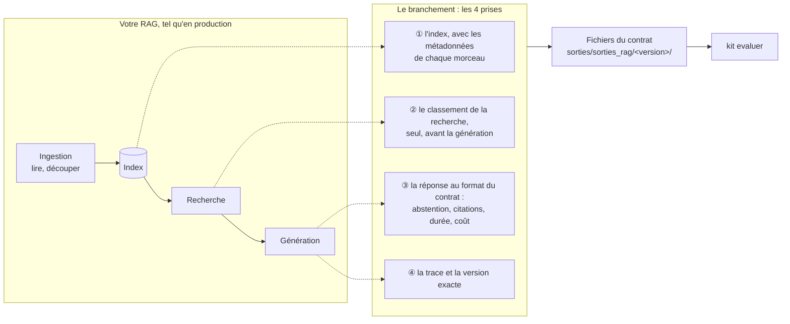

# 0b. Branchement du RAG

Le kit ne connaît aucun RAG. Pour être évalué, un RAG n'a pas à changer sa façon de travailler : il lui faut seulement **quatre prises**, par lesquelles le kit voit ce qu'il fait. Elles s'ajoutent à côté du RAG, dans un seul fichier.



| Où | Quoi |
| --- | --- |
| [`reference/contrat_des_fichiers.md`](reference/contrat_des_fichiers.md) | le contrat, champ par champ |
| [`reference/schemas/`](reference/schemas/) | les schémas JSON de chaque fichier |
| [`../../rag/src/rag/utils/branchement_evaluation.py`](../../rag/src/rag/utils/branchement_evaluation.py) | un exemple complet : le branchement du RAG d'exemple. C'est le **seul** fichier du RAG écrit pour l'évaluation : le RAG marche sans lui |
| [`../src/kit/etape_0b_branchement/`](../src/kit/etape_0b_branchement/) | le code du kit : vérification du contrat, lancement d'un connecteur |

## 1. Les quatre prises, et ce que le kit en fait

| Prise | Ce que le RAG doit donner | Pourquoi le kit en a besoin | Évaluation |
| --- | --- | --- | --- |
| ① Ingérer avec métadonnées | chaque morceau de l'index (chunk) avec la **référence du document, sa version, la page, le type d'élément, les droits d'accès, l'ordre dans la page** ; et le texte de chaque page lue, avant découpage | retrouver dans l'index les passages annotés par le métier, page par page ; mesurer les erreurs de lecture des scans | [1](1_evaluation_ingestion.md) |
| ② Rechercher | pour une question et un profil, les k morceaux retrouvés, **dans l'ordre**, avant toute génération | savoir si le bon passage est retrouvé et bien classé, et si un document interdit au profil remonte | [2](2_evaluation_recherche.md) |
| ③ Répondre | la réponse, **si le RAG s'abstient**, les morceaux cités, ceux donnés au modèle, la durée, le coût, les tokens | juger la réponse, vérifier qu'elle s'appuie sur les morceaux, mesurer temps et coût | [3](3_evaluation_reponse.md), [4](4_evaluation_bout_en_bout.md) |
| ④ Tracer | l'identifiant de la trace (Langfuse) de chaque réponse, et la version exacte du RAG : k, modèles, prompt, index | relier un score à ce qui s'est passé ; comparer deux versions sans ambiguïté | toutes |

Ce que le RAG **ne reçoit jamais** : les réponses attendues, les points clés, les passages annotés. Il reçoit les documents, leurs métadonnées, et les questions avec leur profil. C'est ce qui garantit que l'évaluation ne triche pas.

## 2. Ce que le RAG reçoit

| Quoi | Où, pour le corpus d'exemple | Ce que le RAG en fait |
| --- | --- | --- |
| les documents | `evaluation/corpus_exemple/sources/` | il les indexe comme en production |
| leurs métadonnées | l'export de la gestion documentaire, `evaluation/corpus_exemple/sources/export_ged.csv` | référence, version, droits d'accès, format : il les garde sur chaque morceau. C'est la même source qu'en production : le RAG ne lit rien de ce que le kit exporte, sauf les questions |
| les questions | `sorties/corpus/<version>/questions.jsonl`, exporté par le kit | il n'en lit que `question_id`, `question`, `profil` et, pour une question de suite, la question précédente et sa réponse attendue (l'historique) |

## 3. Ce que le RAG rend : les fichiers du contrat

Le RAG écrit un dossier par version, `sorties/sorties_rag/<version_rag>/`.

| Fichier | Une ligne = | Prise | Obligatoire |
| --- | --- | --- | --- |
| `rag.json` | la version évaluée : nom, type, k, versions de l'index, du modèle, du prompt | ④ | oui |
| `chunks.jsonl` | un morceau de l'index, avec ses métadonnées | ① | oui |
| `pages_extraites.jsonl` | une page telle que lue, avant découpage | ① | si des documents sont scannés |
| `graphe.ttl` | le graphe, en RDF | ① | si le RAG utilise un graphe |
| `recherches.jsonl` | une question : les k morceaux retrouvés, dans l'ordre | ② | oui |
| `reponses.jsonl` | une question : la réponse et tout ce qui l'accompagne, avec l'identifiant de trace | ③ ④ | oui |

## 4. Les règles d'appel

| Règle | Pourquoi |
| --- | --- |
| chaque question est posée **avec son profil**, et la recherche applique les droits de ce profil | tester les droits d'accès : un document interdit ne doit jamais remonter |
| une question de suite reçoit en historique la question précédente **et sa réponse attendue** | évaluer la question de suite seule, sans hériter d'une erreur sur la précédente |
| **le même k** pour toutes les questions | comparer les questions entre elles |
| **toutes** les questions sont posées, y compris les réservées | seul l'affichage des résultats diffère |
| le RAG dit lui-même s'il s'abstient (champ `abstention`) | mesurer l'abstention sans deviner à partir du texte |

## 5. Deux façons de brancher

**Par connecteur**, pour un RAG en Python : un objet avec six méthodes, que le kit appelle par leur nom. Le kit pose lui-même les questions et écrit les fichiers.

```python
class Connecteur:
    def decrire(self) -> dict: ...                          # ④ le contenu de rag.json
    def exporter_index(self): ...                           # ① les chunks (chunks.jsonl)
    def exporter_pages(self): ...                           # ① les pages lues, ou None
    def exporter_graphe(self, chemin): ...                  # ① écrit graphe.ttl, ou ne fait rien
    def rechercher(self, question, profil, historique): ... # ② [{"chunk_id", "rang", "score"}, …]
    def repondre(self, question, profil, historique): ...   # ③ ④ un objet de reponses.jsonl, sans question_id
```

```bash
uv run kit lancer rag.utils.branchement_evaluation:Connecteur --corpus sorties/corpus/2026-11-20.1 -p k=5
```

Le connecteur ne doit rien importer du kit : un test le vérifie pour le RAG d'exemple.

**Par fichiers**, pour un RAG dans n'importe quel langage : le RAG lit `questions.jsonl` et écrit lui-même les fichiers ci-dessus. Le RAG d'exemple sait faire les deux :

```bash
uv run rag exporter
```

```bash
uv run rag repondre sorties/corpus/2026-11-20.1/questions.jsonl
```

**Dans votre propre projet**, le kit s'installe comme une dépendance, à côté de votre RAG :

```bash
uv add --editable <chemin du dépôt>/evaluation
```

## 6. Vérifier le branchement

Avant toute évaluation, le kit vérifie les fichiers du RAG contre les schémas du contrat. Il dit **précisément ce qui manque**, fichier par fichier et ligne par ligne :

```bash
uv run kit verifier-contrat sorties/sorties_rag/rag-demo-k5-80032dcd --corpus sorties/corpus/2026-11-20.1
```

```
sorties/sorties_rag/mon-rag : 3 problème(s).
  - reponses.jsonl, ligne 3 : champ obligatoire « abstention » absent.
  - rag.json : champ(s) inconnu(s) du contrat : 'temperature'.
  - recherches.jsonl, Q-007 : posée avec le profil « tous » au lieu de « exploitation ».
```

Quand la commande répond « conforme au contrat », le RAG est branché.

**Étape suivante** : [1. Évaluation de l'ingestion](1_evaluation_ingestion.md).
