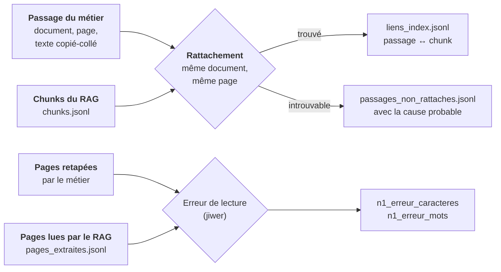
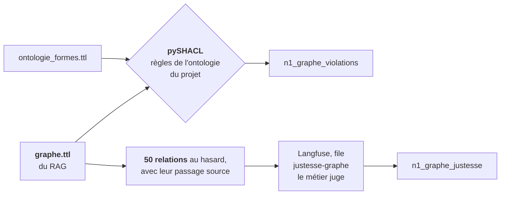

# 1. Évaluation de l'ingestion

**La question** : le RAG a-t-il bien lu et découpé les documents ? Les passages annotés par le métier sont-ils dans son index ?

C'est la première évaluation, et elle peut tourner juste après l'ingestion, avant que le RAG ait répondu à une seule question. Un passage absent de l'index ne pourra jamais être retrouvé ([évaluation 2](2_evaluation_recherche.md)), ni donner une bonne réponse ([évaluation 3](3_evaluation_reponse.md)).



| Où | Quoi |
| --- | --- |
| [`reference/methode_evaluation.md`](reference/methode_evaluation.md) | la méthode (document 3), section 6 pour le rattachement |
| [`../src/kit/etape_1_evaluation_ingestion/rattachement.py`](../src/kit/etape_1_evaluation_ingestion/rattachement.py) | le rattachement d'un passage à un chunk, et la cause probable d'un échec |
| [`../src/kit/etape_1_evaluation_ingestion/scores.py`](../src/kit/etape_1_evaluation_ingestion/scores.py) | les scores de l'ingestion |

## La commande

```bash
uv run kit evaluer-ingestion --corpus sorties/corpus/2026-11-20.1 --rag sorties/sorties_rag/graphrag-vectoriel-k5-5954e822
```

Il suffit que le RAG ait écrit `rag.json`, `chunks.jsonl` et, s'il y a des scans, `pages_extraites.jsonl` ([branchement, prise ①](0b_branchement_du_rag.md)).

## Comment le kit tranche : le rattachement

Pour chaque passage du métier, le kit cherche un chunk **du même document et de la même page**, puis compare les textes selon le type d'élément :

| Type de passage | Rattaché si |
| --- | --- |
| texte | le passage est contenu dans le chunk, ou lui ressemble à 95 % |
| tableau | 90 % des mots du passage sont dans le chunk, dans n'importe quel ordre |
| texte scanné | le passage ressemble au chunk à 90 % (l'OCR fait des fautes) |
| image | un chunk de type image existe sur la page |

Un passage réparti sur deux chunks consécutifs est rattaché, mais compté comme **coupé**. Tous les liens trouvés sont écrits dans `liens_index.jsonl` : les évaluations 2 et 3 s'en servent pour savoir quel chunk contient quel passage.

## Les scores

Les identifiants (`n1_…`) sont ceux de `scores.json`, du CSV et de Langfuse. La colonne « Exemple » donne la valeur du RAG d'exemple.

| Score | Ce qu'il mesure | Exemple | Si c'est mauvais |
| --- | --- | --- | --- |
| `n1_documents_indexes` | part des documents du corpus présents dans l'index | 100 % | un document manque : format non lu, erreur d'ingestion |
| `n1_metadonnees_completes` | part des chunks qui portent référence, version, page, type d'élément et droits | 100 % | sans elles, ni rattachement, ni filtre des droits, ni citation possible |
| `n1_passages_rattaches` | part des passages du métier retrouvés dans un chunk du même document, à la même page | 100 % | lire `passages_non_rattaches.jsonl` : chaque passage a sa cause probable (ci-dessous) |
| `n1_passages_coupes` | part des passages coupés entre deux chunks | 0 % | découper par section, ajouter du chevauchement |
| `n1_erreur_caracteres` | caractères à corriger pour passer du texte lu par l'OCR au texte retapé, divisé par le nombre de caractères retapés | **15 %** (seuil 2 %) | voir l'exemple ci-dessous |
| `n1_erreur_mots` | la même chose en mots | 20 % | — |

## Les causes probables d'un passage non rattaché

| Cause affichée par le kit | Ce qu'il faut faire |
| --- | --- |
| « aucun chunk sur la page 4 ; le passage est trouvé page 2 : page mal notée ? » | le **métier** corrige la page dans son fichier Excel |
| « aucun chunk sur la page… : page perdue à l'extraction » | l'équipe technique vérifie l'extraction de ce document |
| « tableau mal extrait : 60 % des mots retrouvés » | traitement dédié des tableaux |
| « OCR : ressemblance de 70 % au mieux » | meilleur OCR, ou modèle de vision sur les pages difficiles |
| « aucun chunk de type image sur la page » | décrire les images (modèle de vision) |
| « document absent de l'index » | l'ingestion a sauté ce document |

## Exemple : pourquoi l'OCR du RAG d'exemple est à 15 %

Comparer le texte retapé et le texte extrait d'une page (NT-031, page 2) montre trois causes :

- **Docling écarte l'en-tête et le pied de page** (« VALTÉRA INDUSTRIES — Archives techniques »).
- **Il colle des mots**, par exemple « TGBT-Aest » ou « Disjoncteurouvert ».
- **Il lit mal des chiffres**, par exemple « 1.600 A » au lieu de « 1 600 A ».

Sur une autre page (NT-040, page 3), il **mélange l'ordre des lignes**. Les passages restent retrouvés, car le rattachement tolère 10 % d'écart, mais une valeur mal lue peut fausser une réponse.

## Si le RAG a un graphe

Un RAG de type `graphe` ou `hybride` rend aussi `graphe.ttl` ([branchement, prise ①](0b_branchement_du_rag.md)). Le kit vérifie alors deux choses de plus.



| Score | Ce qu'il mesure | Si c'est mauvais |
| --- | --- | --- |
| `n1_graphe_violations` | le nombre de règles de l'ontologie non respectées : une classe fausse (une personne « située sur » un site), une relation inconnue, trop de valeurs (un équipement sur deux sites), une provenance manquante | contraindre davantage l'extraction : consigne, exemples, contrôle par l'ontologie avant d'écrire le graphe |
| `n1_graphe_justesse` | la part des relations jugées justes par le métier, d'après leur passage source | une relation conforme à l'ontologie peut être fausse : meilleur modèle d'extraction, relecture |

Les règles sont celles du projet, pas celles du RAG : le chemin de `ontologie_formes.ttl` est dans [`../config/kit.yaml`](../config/kit.yaml) (`graphe.formes`). Pour le corpus d'exemple : [`../corpus_exemple/ontologie/`](../corpus_exemple/ontologie/). Le code : [`../src/kit/etape_1_evaluation_ingestion/graphe.py`](../src/kit/etape_1_evaluation_ingestion/graphe.py).

Les violations sont calculées par `kit evaluer-ingestion`. La justesse demande le métier :

1. Envoyer 50 relations au métier :
   ```bash
   uv run kit verifier-graphe --corpus sorties/corpus/2026-11-20.1 --rag sorties/sorties_rag/graphrag-hybride-k5-57001489 --envoyer
   ```
2. Dans Langfuse, **Annotation Queues → `justesse-graphe`** : chaque élément montre la relation, sa source et le passage. Le métier choisit `justesse_relation` : juste ou fausse.
3. Voir où en est la relecture, puis inscrire le score dans les résultats :
   ```bash
   uv run kit verifier-graphe --corpus sorties/corpus/2026-11-20.1 --rag sorties/sorties_rag/graphrag-hybride-k5-57001489
   ```
   ```bash
   uv run kit evaluer-ingestion --corpus sorties/corpus/2026-11-20.1 --rag sorties/sorties_rag/graphrag-hybride-k5-57001489
   ```

**Le résultat sur le RAG hybride d'exemple** : 25 violations, et une justesse de **66 %** ± 13 % (33 relations justes sur 50). Les 17 relations fausses sont de trois sortes :

| Sorte d'erreur | Exemple | Combien |
| --- | --- | --- |
| relation vraie dans l'entreprise, mais que le passage ne dit pas : le modèle déduit le site du repère (« AD-B01 » → site B), et la provenance est fausse | AD-B01 situeSur Site B, d'après une page qui liste les armoires sans dire leur site | 7 |
| mauvais rôle ou mauvaise cible : une demandeuse, une responsable ou un bureau d'études comptés comme intervenants ; l'intervention rattachée au transformateur au lieu du TGBT | Sophie Lenoir intervientSur AD-B02 (elle est la demandeuse) | 5 |
| relation inversée ou inventée | AD-B06 alimente TGBT-B (c'est l'inverse) ; OND-A secourt GE-A ; un « technicien » absent du passage | 5 |

C'est la limite d'un petit modèle qui extrait page par page. La première sorte d'erreur ne se voit pas dans les violations : la relation respecte l'ontologie, seule la provenance est fausse. D'où l'intérêt de faire juger les relations par le métier, en plus des règles SHACL.

> Comme pour la vérification du juge, le métier est simulé dans le banc d'essai : c'est Claude qui a jugé les 50 relations, d'après leur passage source. Ses jugements et leur raison sont dans [`../corpus_exemple/relecture_simulee/justesse_graphe.json`](../corpus_exemple/relecture_simulee/justesse_graphe.json).

## Si c'est mauvais

Extraction, OCR, tableaux, images, découpage : le [document 2](../../rag/documentation/reference/techniques_rag.md), sections 3 et 4.

**Étape suivante** : [2. Évaluation de la recherche](2_evaluation_recherche.md).
