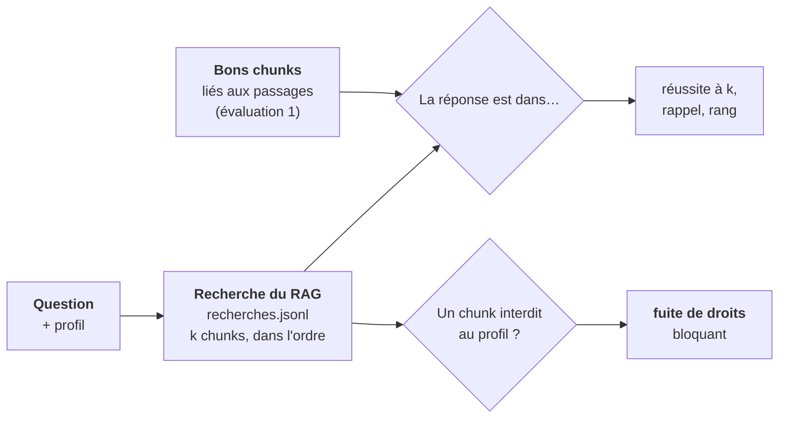

# 2. Évaluation de la recherche

**La question** : pour chaque question, la recherche du RAG ramène-t-elle le bon passage, bien classé, et jamais un document interdit au profil qui la pose ?

On regarde la recherche **seule, avant la génération** : si le bon passage n'arrive pas jusqu'au modèle, aucun prompt ne rattrapera la réponse.



| Où | Quoi |
| --- | --- |
| [`reference/methode_evaluation.md`](reference/methode_evaluation.md) | la méthode (document 3), section 7 |
| [`../src/kit/etape_2_evaluation_recherche/scores.py`](../src/kit/etape_2_evaluation_recherche/scores.py) | les règles de réussite et les scores de la recherche |

## La commande

```bash
uv run kit evaluer-recherche --corpus sorties/corpus/2026-11-20.1 --rag sorties/sorties_rag/rag-demo-k5-80032dcd
```

Elle a besoin de l'[évaluation de l'ingestion](1_evaluation_ingestion.md) (les liens passage ↔ chunk) et de `recherches.jsonl` ([branchement, prise ②](0b_branchement_du_rag.md)).

## Comment le kit tranche : « la réponse est dans »

Un **bon chunk** est un chunk lié, à l'évaluation 1, à un passage de la question qui n'est pas un piège. La réussite dépend de la colonne « La réponse est dans » du fichier du métier :

| La réponse est dans… | La question est réussie si |
| --- | --- |
| un seul passage | un chunk lié à ce passage est dans les k premiers |
| plusieurs passages, un seul suffit | un chunk lié à l'un d'eux est dans les k premiers |
| plusieurs passages **à combiner** | un chunk lié à **chacun** d'eux est dans les k premiers |
| synthèse, pas de réponse, non accessible | non comptée ici (sauf pour la fuite de droits) |

## Les scores

| Score | Ce qu'il mesure | Exemple | Si c'est mauvais |
| --- | --- | --- | --- |
| `n2_reussite_k` | part des questions dont la recherche ramène le bon passage dans les k premiers chunks | **86 %** ± 13 % (seuil 90 %) | voir la ventilation par type de document ; recherche hybride, phrase de contexte, filtres de métadonnées |
| `n2_rappel_k` | part des passages attendus retrouvés | 81 % | questions à combiner : décomposer la question |
| `n2_rang_premier` | 1 si le premier bon chunk est 1er, 1/2 s'il est 2e… | 0,68 | bon chunk trouvé mais mal classé : un reranker |
| `n2_reussite_1`, `_3`, `_5` | la réussite pour k = 1, 3, 5 | 54 %, 75 %, 86 % | aide à choisir k : ici, passer de 3 à 5 gagne 11 points |
| **`n2_fuite_droits`** | nombre de questions où un document **interdit au profil** est retrouvé | **0** | **bloquant** : filtrer les droits *pendant* la recherche, pas après |
| `n2_perimes_pieges` | part des questions où une version périmée ou un passage piège est classé avant le bon | 0 % | filtre sur la version en vigueur |

## Lire la ventilation

Dans `scores.json` (ou dans le rapport), `n2_reussite_k` par type de document donne, pour le RAG d'exemple :

- procédures : 100 % ;
- notes techniques : 88 % ;
- comptes rendus d'intervention : 50 %, sur 4 questions seulement.

Ce dernier chiffre est une tendance, pas une mesure, mais il dit où regarder en premier : les fiches d'intervention.

## Si c'est mauvais

Recherche hybride, reranker, filtres, choix de k : le [document 2](../../rag/documentation/reference/techniques_rag.md), section 6.

**Étape suivante** : [3. Évaluation de la réponse](3_evaluation_reponse.md).
