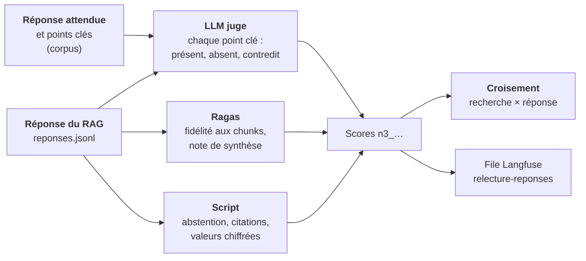
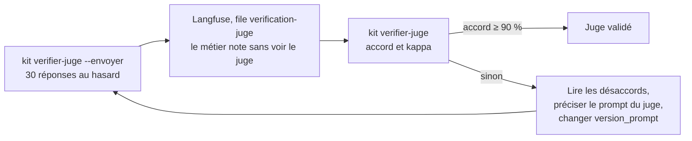

# 3. Évaluation de la réponse

**La question** : la réponse est-elle juste, appuyée sur les documents, bien citée ? Le RAG s'abstient-il quand il le faut, et seulement quand il le faut ?



| Où | Quoi |
| --- | --- |
| [`reference/methode_evaluation.md`](reference/methode_evaluation.md) | la méthode (document 3), section 8 |
| [`reference/prompt_du_juge.md`](reference/prompt_du_juge.md) | le prompt du juge, sa sortie, sa vérification |
| [`../config/kit.yaml`](../config/kit.yaml) | le modèle juge |
| [`../src/kit/etape_3_evaluation_reponse/`](../src/kit/etape_3_evaluation_reponse/) | `juge.py` (le juge), `scores.py` (les scores), `relecture.py` (les files Langfuse) |

## Le modèle juge

Il est réglé dans [`../config/kit.yaml`](../config/kit.yaml) ; sa clé est dans `.env` (`KIT_LLM_CLE`). N'importe quel point d'accès compatible OpenAI convient.

```yaml
modeles:
  adresse: http://127.0.0.1:8080/v1
  variable_cle: KIT_LLM_CLE
  juge:
    modele: chat           # de préférence un autre modèle que celui du RAG
    temperature: 0
```

Le juge doit être **un autre modèle que celui du RAG** : un modèle tend à favoriser ses propres réponses. Ici, le RAG génère avec `gemma-4-e4b` et le juge est `chat` (qwen3.5-4b). Pour tester le point d'accès, le juge et Langfuse :

```bash
uv run kit verifier-modeles
```

## La commande

```bash
uv run kit evaluer-reponse --corpus sorties/corpus/2026-11-20.1 --rag sorties/sorties_rag/rag-demo-k5-80032dcd
```

Elle a besoin des évaluations [1](1_evaluation_ingestion.md) et [2](2_evaluation_recherche.md), et de `reponses.jsonl` ([branchement, prise ③](0b_branchement_du_rag.md)). Elle prend environ 3 minutes, le temps que le juge lise chaque réponse.

## Comment le kit tranche

| Qui | Ce qu'il vérifie |
| --- | --- |
| le **LLM juge** ([prompt](reference/prompt_du_juge.md)) | chaque point clé attendu : présent, absent ou contredit. Le verdict en découle : juste, partielle ou fausse |
| **Ragas** | la fidélité : chaque affirmation de la réponse est-elle appuyée par les chunks donnés au modèle ? Et la note des synthèses, sur la grille du prompt du juge |
| un **script** | l'abstention (champ `abstention` du RAG), les citations, les valeurs chiffrées et leur unité |

## Les scores

| Score | Ce qu'il mesure | Exemple | Si c'est mauvais |
| --- | --- | --- | --- |
| `n3_exactitude` | juste = 1, partielle = 0,5, fausse = 0, selon le juge. Les abstentions ne sont pas notées ici | **79 %** ± 15 % (seuil 80 %) | lire la justification du juge dans le CSV ; regarder le croisement ci-dessous |
| `n3_completude_listes` | pour une question « liste » : part des éléments attendus présents | 100 % | graphe et ontologie pour les listes |
| `n3_valeurs` | les valeurs chiffrées attendues sont-elles dans la réponse, avec la bonne unité et dans la tolérance ? | 91 % | calcul délégué à un outil plutôt qu'au modèle |
| `n3_abstention_correcte` | sur les questions sans réponse ou interdites au profil : part des fois où le RAG dit ne pas savoir | 100 % | consigne d'abstention ; vérifier que le contexte suffit avant de répondre |
| `n3_abstention_a_tort` | part des questions où le RAG ne répond pas alors qu'il avait le bon passage | 6 % | consigne d'abstention trop stricte |
| `n3_fidelite` | (Ragas) part des affirmations de la réponse appuyées par les chunks donnés au modèle | 92 % | citations obligatoires ; LLM juge garde-fou |
| `n3_citations` | au moins une source citée est la bonne, sans piège ni document interdit | 89 % | — |
| **`n3_erreurs_graves`** | réponses fausses, non fidèles (une seule affirmation non appuyée suffit), ou données au lieu de s'abstenir, **sur une question de gravité forte** | **2** | **bloquant** ; chaque cas est relu par le métier |
| `n3_synthese` | (Ragas) note de 1 à 5 sur la grille du prompt du juge, ramenée sur 100 % | 50 % | un RAG vectoriel synthétise mal : graphe |
| `n3_questions_suite` | exactitude des questions de suite | 100 % | — |
| `n3_variantes` | part des groupes de reformulations dont les réponses diffèrent | 0 % | robustesse aux reformulations |

**Lire le verdict du juge.** Dans le CSV, la colonne `detail` de `n3_exactitude` donne le statut de chaque point clé. Par exemple, pour Q-008 :

```
1. present : La valeur de 72 A est explicitement mentionnée dans la réponse.
2. absent : La valeur de 500 ms n'est pas mentionnée dans la réponse.
```

Verdict : **partielle**. La réponse donne le courant de réglage, mais oublie la temporisation.

**Les deux erreurs graves du RAG d'exemple :**
- **Q-004** n'est pas fidèle (0,5) : une affirmation de la réponse n'est appuyée par aucun extrait.
- **Q-046** est une synthèse fausse.

## Le croisement recherche × réponse : où est la faute ?

Pour chaque question dont la réponse est dans les documents, le kit croise deux faits : le bon passage a-t-il été retrouvé ([évaluation 2](2_evaluation_recherche.md)) ? la réponse est-elle juste ? Le résultat est dans `croisement.jsonl` et dans le rapport.

| Bon passage retrouvé ? | Réponse | Diagnostic | Où agir ([document 2](../../rag/documentation/reference/techniques_rag.md)) |
| --- | --- | --- | --- |
| oui | juste | **ok** | — |
| oui | fausse, partielle ou abstention | **génération** : le RAG avait la bonne information et l'a mal utilisée | prompt, citations obligatoires, modèle, calcul délégué |
| non | fausse ou abstention | **recherche** : la bonne information n'est pas arrivée jusqu'au modèle | recherche hybride, reranker, phrase de contexte, découpage |
| non, et aucun passage rattaché | — | **ingestion** : l'information n'est même pas dans l'index | extraction, OCR, tableaux, images |
| non | juste | juste **sans le bon passage** : le modèle sait de lui-même, ou le corpus a oublié un passage | vérifier l'annotation |

Pour le RAG d'exemple, sur 32 questions : 20 ok, 6 « génération » (le bon chunk était retrouvé), 4 « recherche », 2 « abstention à tort ». La moitié des erreurs vient de la génération : on commence donc par le prompt et le modèle, pas par la recherche.

## La relecture par le métier

La commande remplit la file **`relecture-reponses`** de Langfuse (http://127.0.0.1:3100, **Annotation Queues**) avec les réponses que le métier doit relire : les fausses ou partielles, toutes celles de gravité forte, 10 au hasard, et les désaccords du juge. Le métier note chacune avec le score **`verdict_metier`** : juste, partielle ou fausse.

## Vérifier le juge, avant de lui faire confiance

Le juge est un modèle de langage : il peut se tromper. Avant de s'en servir pour décider, on vérifie qu'il note comme le métier.



1. Envoyer 30 réponses au métier (hors questions réservées) :
   ```bash
   uv run kit verifier-juge --corpus sorties/corpus/2026-11-20.1 --rag sorties/sorties_rag/rag-demo-k5-80032dcd --envoyer
   ```
2. Dans Langfuse, **Annotation Queues → `verification-juge`** : le métier lit chaque réponse avec sa question, et choisit `verdict_metier`, **sans regarder la note du juge**.
3. Calculer l'accord :
   ```bash
   uv run kit verifier-juge --corpus sorties/corpus/2026-11-20.1 --rag sorties/sorties_rag/rag-demo-k5-80032dcd
   ```
   Exemple de sortie (valeurs d'illustration : le métier n'a pas encore noté l'échantillon du corpus d'exemple) :
   ```
   Notes du métier : 30 sur 30.
   Accord juge / métier : 93 % (seuil 90 %) ; kappa de Cohen : 0.85. Juge VALIDÉ.
     - Q-030 : juge « fausse », métier « partielle »
   ```

On refait la vérification à chaque changement de modèle juge ou de prompt. Le **kappa de Cohen** est l'accord corrigé du hasard : il révèle un juge qui dit presque toujours « juste », et qui peut atteindre 90 % d'accord sans rien distinguer. Au-dessus de 0,8, l'accord est très bon ; sous 0,6, il faut se méfier, même si le taux d'accord passe.

## Si c'est mauvais

Regarder d'abord le croisement. « Recherche » : revenir à l'[évaluation 2](2_evaluation_recherche.md). « Génération » : prompt, citations, abstention, modèle, dans le [document 2](../../rag/documentation/reference/techniques_rag.md), section 7.

**Étape suivante** : [4. Évaluation de bout en bout](4_evaluation_bout_en_bout.md).
