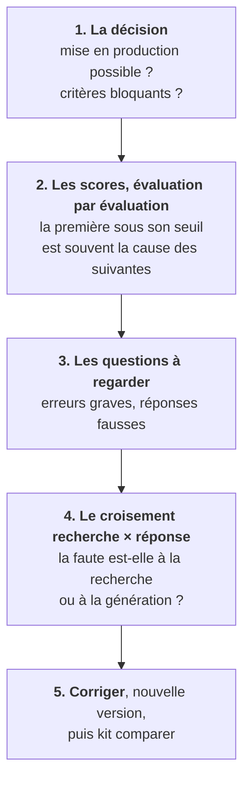

# 5. Résultats et comparaison

Ce guide dit **où sont les résultats**, **dans quel ordre les lire**, et **comment comparer deux versions** du RAG. Il s'appuie sur une vraie évaluation : celle du RAG d'exemple (k = 5) sur le corpus d'exemple.



| Où | Quoi |
| --- | --- |
| [`../src/kit/etape_5_resultats/`](../src/kit/etape_5_resultats/) | `publication.py` (base, fichiers, Langfuse), `rapport.py` (rapport.html), `comparaison.py` (kit comparer) |

## 1. Où sont les résultats

Une évaluation, c'est un corpus évalué avec une version du RAG. Son identifiant est `<version du corpus>_<version du RAG>`, par exemple `2026-11-20.1_rag-demo-k5-80032dcd`. Ses résultats sont à trois endroits.

**Dans un dossier**, `sorties/resultats/<évaluation>/` :

| Fichier | Pour qui | Contenu |
| --- | --- | --- |
| **`rapport.html`** | **le métier** : à ouvrir en premier | une page : la décision, les scores avec leur seuil, les questions à regarder, la cause probable des erreurs |
| `scores.json` | l'équipe technique | chaque score : valeur, marge d'erreur, nombre de questions, ventilation, seuil ; puis la décision |
| `resultats_par_question.csv` | les deux, dans un tableur | une ligne par question et par score, avec le détail (verdict et justification du juge, chunks en cause…) |
| `passages_non_rattaches.jsonl` | l'équipe technique | les passages du métier introuvables dans l'index, avec leur **cause probable** ([évaluation 1](1_evaluation_ingestion.md)) |
| `croisement.jsonl` | les deux | pour chaque question : bon passage retrouvé ou non, réponse juste ou non, et le diagnostic ([évaluation 3](3_evaluation_reponse.md#le-croisement-recherche--réponse--où-est-la-faute-)) |
| `relecture.jsonl` | le métier | les réponses à relire, et pourquoi |
| `liens_index.jsonl` | l'équipe technique | chaque lien passage du métier ↔ chunk du RAG, avec son mode (exact, approché, image, coupé) |
| `evaluation.json` | archive | ce qui a été évalué : versions du corpus, du kit et du RAG, modèle et prompt du juge, seuils |

**Dans Langfuse** (http://127.0.0.1:3100), l'interface partagée avec le métier :

| Objet Langfuse | Contenu | Créé par |
| --- | --- | --- |
| Jeu de données `corpus-<projet>-<version>` | une entrée par question : la question, le profil, l'historique, la réponse attendue, les points clés | `kit importer` |
| Traces du RAG | une par question : recherche, génération, tokens, durée | le RAG lui-même |
| Expérience `<évaluation>` | une ligne par question, reliée au jeu de données, avec la réponse du RAG, ses scores et sa trace | le kit, à la première évaluation publiée |
| Scores | sur chaque question de l'expérience (hors questions réservées), et les scores globaux | chaque évaluation |
| File `relecture-reponses` | les réponses que le métier doit relire | `kit evaluer-reponse` |
| File `verification-juge` | 30 réponses à noter par le métier, pour vérifier le juge | `kit verifier-juge --envoyer` |

**Dans la base** (`sorties/base.sqlite`) : tout, y compris le détail des questions réservées, qui n'apparaît nulle part ailleurs.

## 2. Lire le rapport, dans l'ordre

**La décision d'abord** : c'est l'encadré en haut du rapport. Comment elle est prise : [évaluation 4, la décision](4_evaluation_bout_en_bout.md#la-décision).

**Puis les scores, évaluation par évaluation, et dans l'ordre.** Une réponse fausse vient souvent d'un passage perdu à l'ingestion ou mal retrouvé : changer le prompt n'y changera rien. Ce que mesure chaque score, et quoi faire s'il est mauvais, est dans le guide de son évaluation : [1. ingestion](1_evaluation_ingestion.md#les-scores), [2. recherche](2_evaluation_recherche.md#les-scores), [3. réponse](3_evaluation_reponse.md#les-scores), [4. bout en bout](4_evaluation_bout_en_bout.md#les-scores).

Chaque score est donné avec :

| Colonne | Ce qu'elle veut dire |
| --- | --- |
| Valeur | le score, sur les questions non réservées |
| ± (marge) | l'incertitude à 95 % : avec 28 questions, « 86 % ± 13 % » veut dire « quelque part entre 73 % et 99 % ». **Un score sur moins de 10 questions est une tendance, pas une mesure** |
| n | le nombre de questions (ou de passages, de pages, de chunks) sur lequel il est calculé |
| Seuil, état | le seuil du métier, et s'il est atteint |

**Puis les questions à regarder**, dans cet ordre :
1. les erreurs graves et les fuites ;
2. les réponses fausses ;
3. les réponses données là où il fallait s'abstenir ;
4. les passages perdus à l'ingestion.

Pour chacune, le rapport donne la justification du juge, les chunks en cause, la cause probable.

**Enfin, le croisement recherche × réponse**, qui dit où chercher la cause : [évaluation 3, le croisement](3_evaluation_reponse.md#le-croisement-recherche--réponse--où-est-la-faute-).

## 3. Le parcours de correction, en résumé

```
Ingestion mauvaise ?   → extraction, OCR, tableaux, images, découpage      (document 2, sections 3 et 4)
Recherche mauvaise ?   → recherche hybride, reranker, filtres, k           (document 2, section 6)
Réponse mauvaise ?     → regarder d'abord le croisement :
                          « recherche »  → revenir à la recherche
                          « génération » → prompt, citations, abstention, modèle (document 2, section 7)
Bloquant ?             → fuite : filtre des droits pendant la recherche ; erreur grave : relecture métier, garde-fou
Puis                   → nouvelle version du RAG, kit evaluer, kit comparer avec la précédente
```

Le document 2 : [techniques d'un RAG](../../rag/documentation/reference/techniques_rag.md).

## 4. Les marges d'erreur : ne pas sur-interpréter

La marge est `± 1,96 × √(p × (1 − p) ÷ n)` (document 3). Ce qu'il faut retenir :
- avec 50 questions, un score est précis à ± 11 points environ ; avec 200, à ± 5,5 ;
- une marge de « ± 0 % » sur un score de 100 % ou de 0 % ne veut pas dire « certain » : la formule ne sait pas estimer l'incertitude aux extrêmes ;
- un score sur moins de 10 questions (une case de la ventilation, par exemple) est une tendance.

## 5. Comparer deux versions

Après un changement (k, prompt, modèle, découpage), on évalue la nouvelle version, puis on compare. `kit comparer A B` répond à la question : « la nouvelle version est-elle meilleure ? »

1. **Même corpus** : sinon la comparaison est refusée.
2. **Écart et marge** : un écart plus petit que la marge **ne prouve rien seul**.
3. **Question par question** : les questions gagnées et perdues sont plus parlantes que les moyennes.
4. **Test de McNemar** : il ne regarde que les questions qui ont changé. Une valeur p au-dessus de 0,05 veut dire que l'écart peut être dû au hasard.
5. **Régression** : une question de gravité forte perdue est signalée, même si la moyenne monte. Elle se regarde avant toute décision.

**Exemple : le RAG d'exemple avec k = 5 (A), puis k = 3 (B).**

```bash
uv run kit comparer sorties/resultats/2026-11-20.1_rag-demo-k5-80032dcd sorties/resultats/2026-11-20.1_rag-demo-k3-80032dcd
```

| Score | k = 5 | k = 3 | Lecture |
| --- | --- | --- | --- |
| bon passage retrouvé (`n2_reussite_k`) | 86 % | 75 % | moins de chunks, moins de chances de ramener le bon : 3 questions perdues |
| passages attendus retrouvés (`n2_rappel_k`) | 81 % | 64 % | le seul écart **plus grand que la marge** : ce n'est pas le hasard |
| réponses justes (`n3_exactitude`) | 79 % (n = 28) | 83 % (n = 23) | semble monter, mais sur 5 questions de moins : le RAG s'abstient davantage, et les abstentions ne sont pas notées ici |
| erreurs graves | 2 | 0 | moins de contexte, moins d'occasions d'affirmer sans appui |
| score pondéré (`n4_score_pondere`) | 80 % | 77 % | ce que vivront les utilisateurs : 4 questions perdues, aucune gagnée |

McNemar donne p = 0,125 sur le score pondéré : avec 40 questions, on ne peut pas exclure le hasard.

**Conclusion** : k = 3 n'est pas meilleur. Il évite les deux erreurs graves, mais en répondant moins. Pour décider, il faudrait plus de questions (la configuration recommandée en prévoit 200), et un correctif ciblé des deux erreurs graves sur k = 5.

C'est tout l'intérêt de lire **plusieurs scores ensemble**. Une exactitude qui monte peut cacher un RAG qui répond moins.

Retour au [README](../../README.md).
