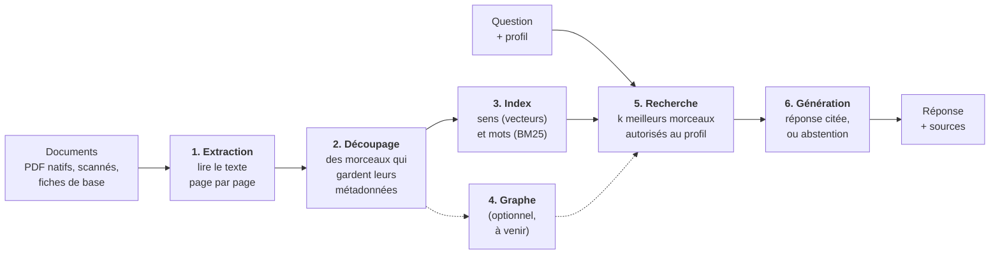
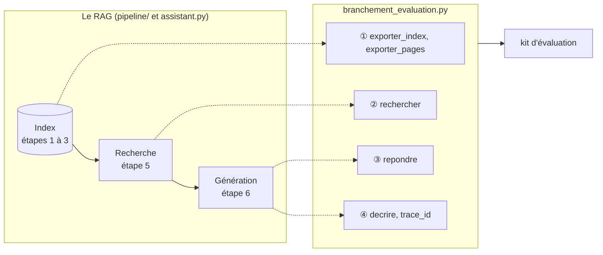

# Guide du GraphRAG d'exemple

Ce dossier contient **un RAG simple et complet**, qui marche seul sur n'importe quels documents. Il sert d'exemple : le sujet du dépôt est l'évaluation, pas le RAG. Il est volontairement minimal, et ses défauts sont utiles : ils donnent à l'évaluation quelque chose à mesurer.



Le graphe (étape 4) sera optionnel : on pourra le couper dans `config.yaml` sans rien changer d'autre. Il n'est pas encore écrit ; les autres étapes marchent sans lui.

## Les fichiers

```
rag/
├── Guide_du_GraphRAG.md        ce guide
├── config.yaml                 LE fichier de réglage : point d'accès, modèles, k, chemins
├── pipeline/                   le RAG, une étape par fichier, dans l'ordre
│   ├── etape_1_extraction.py
│   ├── etape_2_decoupage.py
│   ├── etape_3_index.py
│   ├── etape_5_recherche.py
│   └── etape_6_generation.py
├── assistant.py                enchaîne les étapes pour répondre à une question
├── commandes.py                la commande rag : indexer, demander, exporter, repondre
├── branchement_evaluation.py   la SEULE partie écrite pour l'évaluation : les 4 prises
├── methode/                    le document 2 : les techniques d'un RAG, selon les cas
└── tests/
```

Le RAG n'importe rien du kit d'évaluation, et le kit n'importe rien du RAG : un test le vérifie.

## S'en servir seul

```bash
uv run rag indexer
```

La commande lit, découpe et vectorise les documents (étapes 1 à 3). Il faut 2 minutes la première fois, le temps que Docling lise les 50 PDF du corpus d'exemple ; ensuite, la lecture est gardée en cache dans `sorties/rag/extraction/`.

```bash
uv run rag demander "Combien de temps faut-il pour consigner une armoire divisionnaire ?"
```

```
La durée moyenne de consignation pour une armoire divisionnaire BT est de 20 minutes [1].

  [1] cité  PR-1101 (version v3), page 3
  [2]       PR-1103 (version v2), page 1
  …
```

Avec `--profil exploitation`, la question est posée par un utilisateur de ce profil : il ne verra jamais un document réservé à « maintenance ».

## Les étapes, une par une

### 1. Extraction — [`pipeline/etape_1_extraction.py`](pipeline/etape_1_extraction.py)

Lire chaque document et en sortir le texte, page par page.

| Format | Outil | Pourquoi |
| --- | --- | --- |
| PDF natif | Docling (conteneur, voir [infra/](../infra/Guide_des_services.md)) | il rend la mise en page en Markdown : titres, listes, tableaux |
| PDF scanné | Docling, OCR forcé | les pages ne sont que des images |
| Fiche de base de données | pypdf, mode « mise en page » | il garde les deux colonnes « champ : valeur » |

La liste des documents et de leurs métadonnées (référence, version, droits d'accès, format) vient pour l'instant du corpus exporté par le kit (`sorties/corpus/<version>/documents.jsonl`).

### 2. Découpage — [`pipeline/etape_2_decoupage.py`](pipeline/etape_2_decoupage.py)

Couper chaque document en morceaux (chunks) assez petits pour être retrouvés, assez grands pour avoir un sens.

| Élément | Un morceau = |
| --- | --- |
| texte | une section, avec le chemin de titres en tête ; recoupée au-delà de 1 500 caractères |
| tableau | le tableau, chaque ligne écrite « colonne : valeur » (les en-têtes sont répétés) |
| figure | sa légende (pas de modèle de vision ici) |
| fiche de base | un champ |

Chaque morceau garde **la référence du document, sa version, sa page, son type d'élément, ses droits d'accès et son ordre dans la page**. Sans eux, le RAG ne pourrait ni citer ses sources ni filtrer les droits.

### 3. Index — [`pipeline/etape_3_index.py`](pipeline/etape_3_index.py)

Rendre les morceaux cherchables de deux façons : par le **sens** (un vecteur par morceau, modèle d'embeddings) et par les **mots** (BM25). Les vecteurs sont gardés dans un fichier, pas dans une base vectorielle : quelques milliers de morceaux tiennent en mémoire. L'index est écrit dans `sorties/rag/index/`.

### 4. Graphe — optionnel, à venir

Une petite ontologie du domaine, des entités et relations extraites des documents par un modèle de langage, chacune avec sa source (document et page). La recherche pourra alors suivre les relations, en plus des morceaux.

### 5. Recherche — [`pipeline/etape_5_recherche.py`](pipeline/etape_5_recherche.py)

Trouver les k morceaux les plus utiles. Deux recherches, par le sens et par les mots, fusionnées par rang : un morceau bien classé par les deux remonte en tête. **Le filtre des droits s'applique pendant la recherche** : un morceau interdit au profil n'est jamais classé, donc jamais montré au modèle. Pour une question de suite, on cherche avec la question précédente et la nouvelle.

### 6. Génération — [`pipeline/etape_6_generation.py`](pipeline/etape_6_generation.py)

Rédiger la réponse à partir des morceaux retrouvés, et d'eux seuls. Chaque phrase cite son extrait, [1], [2]… Si les extraits ne suffisent pas, le modèle répond une phrase fixe, « Je ne trouve pas cette information dans les documents. », au lieu d'inventer.

## Le régler : un seul fichier

Tout est dans [`config.yaml`](config.yaml) ; seule la clé est dans `.env` (`RAG_LLM_CLE`).

| Réglage | Valeur ici | Pour changer |
| --- | --- | --- |
| `modeles.adresse` | `http://127.0.0.1:8080/v1` (LiteLLM local) | n'importe quel point d'accès compatible OpenAI |
| `modeles.generation.modele` | `gemma-4-e4b` | un autre modèle ; prix au million de tokens pour le coût |
| `modeles.embeddings.modele` | `embed` (bge-m3) | relancer `rag indexer` après un changement |
| `recherche.k` | 5 | ou `--k 3` sur la ligne de commande |
| `documents` | les PDF du corpus d'exemple | le dossier de vos documents |

## Le brancher sur l'évaluation — [`branchement_evaluation.py`](branchement_evaluation.py)

C'est le seul fichier écrit pour l'évaluation. Il ne change rien au RAG : il met ce que fait l'assistant au format du contrat, par **quatre prises**.



| Prise | Ce qu'elle donne au kit | Méthode |
| --- | --- | --- |
| ① Ingérer avec métadonnées | les morceaux de l'index avec leurs métadonnées, et le texte de chaque page lue | `exporter_index`, `exporter_pages` |
| ② Rechercher | le classement de la recherche, seul, avant la génération | `rechercher` |
| ③ Répondre | la réponse, l'abstention, les morceaux cités et ceux du contexte, la durée, le coût, les tokens | `repondre` |
| ④ Tracer | l'identifiant de la trace Langfuse, et la version exacte du RAG | `repondre`, `decrire` |

Le détail de chaque prise, et comment brancher **votre** RAG : [guide 3 de l'évaluation](../evaluation/3_Brancher_un_RAG.md).

Pour évaluer ce RAG, deux façons :

```bash
uv run kit lancer rag.branchement_evaluation:Connecteur --corpus sorties/corpus/2026-11-20.1 -p k=5
```

ou, par fichiers :

```bash
uv run rag exporter
```

```bash
uv run rag repondre sorties/corpus/2026-11-20.1/questions.jsonl
```

La **version du RAG** (`rag-demo-k5-80032dcd`) se calcule à partir de k, des modèles, du prompt et de l'index. Changer un réglage donne une nouvelle version, dans un nouveau dossier de `sorties/sorties_rag/`. Deux versions se comparent avec `kit comparer`.

## Ses limites connues, et ce que l'évaluation en dit

| Limite | Ce que le kit mesure |
| --- | --- |
| Pas de modèle de vision : une figure n'est connue que par sa légende | niveau 3 : la question Q-034 (câbles du TGBT-A, lisibles seulement sur le schéma) reçoit une abstention |
| Docling écarte l'en-tête et le pied de page, colle des mots, mélange parfois l'ordre des lignes d'un scan | niveau 1 : 15 % d'erreur de caractères, pour un seuil de 2 % |
| Toutes les versions des documents sont indexées, même celles qui ne sont plus en vigueur | niveau 2 : « périmé ou piège avant le bon passage » |
| Recherche simple, sans reranker ni décomposition de la question | niveau 2 : les questions qui combinent plusieurs passages échouent plus souvent |
| Un seul prompt, petit modèle (4 milliards de paramètres) | niveau 3 : les synthèses sur l'ensemble des documents sont fausses |

Pour aller plus loin, le [document 2](methode/RAG_2_Construire_le_pipeline.md) décrit les techniques d'un RAG selon les cas, et ce qu'il faut corriger quand un score est mauvais.
