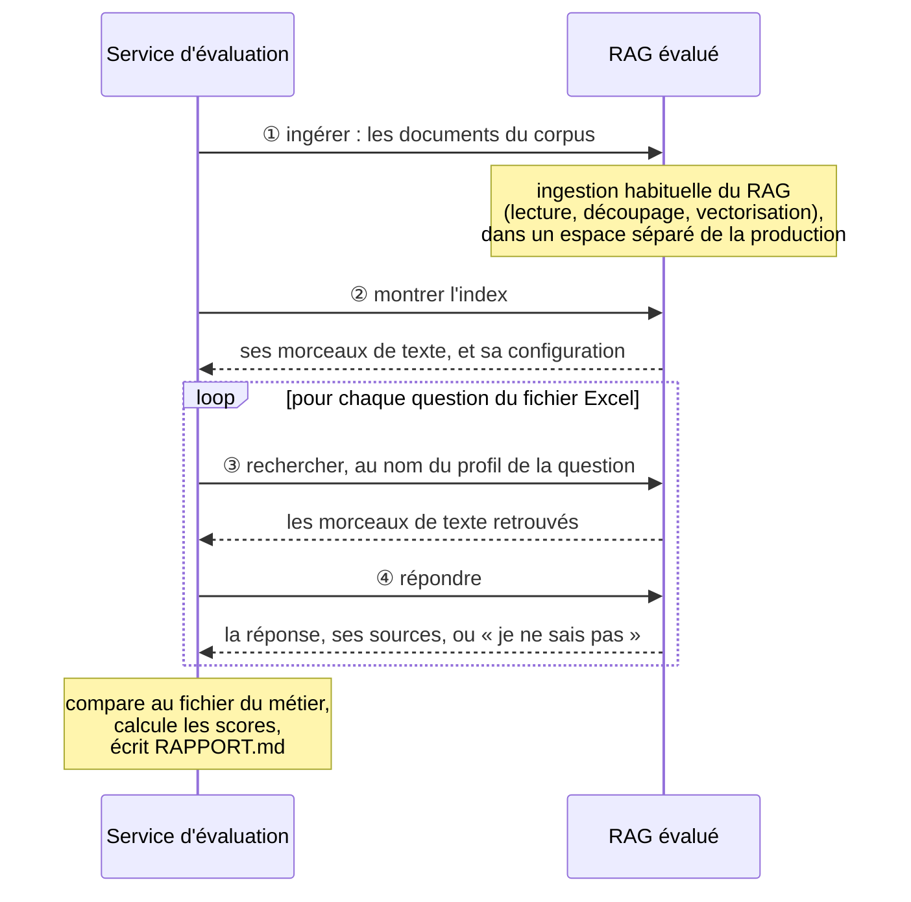
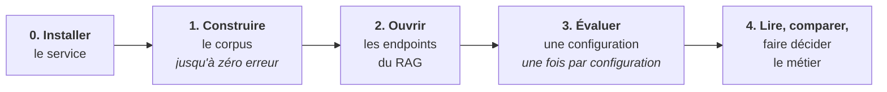

# Le fil conducteur : évaluer un RAG, du début à la fin

Ce document explique d'abord comment fonctionne l'évaluation, puis donne, dans l'ordre, ce qu'il faut faire. Chaque action renvoie au document qui la détaille. Il s'adresse à la personne qui prend en charge l'évaluation. Le métier intervient deux fois : pour construire le corpus d'évaluation, puis pour décider, à la lecture des scores, si le RAG peut partir en production.

Ce qui est générique, valable pour tout projet, est dans [`service-evaluation/`](../service-evaluation/README.md), le dossier de ce fil conducteur : le service d'évaluation, vierge. Ce qui est propre à l'exemple est dans [`service-rag-exemple/`](../service-rag-exemple/README.md), un RAG simple, et dans [`service-evaluation-exemple/`](../service-evaluation-exemple/README.md), le même service après avoir évalué ce RAG.

## Comment fonctionne l'évaluation

**Le principe.** Le service d'évaluation se comporte comme un utilisateur automatique qui connaîtrait les bonnes réponses. Il fait lire des documents au RAG, lui pose des questions dont le métier a écrit la bonne réponse, puis compare ce que le RAG a fait à ce qu'il aurait dû faire. La méthode complète : [Évaluer le RAG avec le corpus](documentation/methode_et_contrat/methode_evaluation.md).

**Qui fait quoi.**

| | Le service d'évaluation | Le RAG évalué |
| --- | --- | --- |
| **Contient** | le corpus d'évaluation (les documents et le fichier Excel du métier), le juge | son propre code et ses propres réglages |
| **Fait** | envoie les documents au RAG, lui pose les questions, note ses réponses, écrit le rapport | ingère les documents reçus, recherche, répond, avec son code habituel |
| **Ne voit jamais** | le code du RAG | les bonnes réponses du métier |

**Comment ils se parlent.** Le RAG ouvre quatre **endpoints**, quatre adresses web de forme fixe, décrits dans le guide [0b. Les endpoints du RAG : ce que chaque RAG doit fournir](documentation/0b_endpoints_du_rag.md). Le service les appelle dans cet ordre :

C'est donc le service qui déclenche l'ingestion, mais c'est le code du RAG qui la fait.

**Ce que vérifie le service.** Il **évalue une configuration** du RAG, c'est-à-dire le RAG avec tous ses réglages fixés (par exemple, le nombre de morceaux que la recherche ramène pour chaque question). Il vérifie, dans l'ordre :

1. **L'ingestion** : rien ne s'est perdu ni abîmé quand le RAG a découpé les documents et les a rangés dans sa base. Le détail des scores : [1. Évaluation de l'ingestion](documentation/1_evaluation_ingestion.md).
2. **La recherche** : pour chaque question, la recherche ramène les morceaux qui contiennent la réponse, et jamais un document interdit à la personne qui pose la question. Le détail : [2. Évaluation de la recherche](documentation/2_evaluation_recherche.md).
3. **La réponse** : elle est juste, ne dit que ce que disent les documents, et le RAG sait dire « je ne sais pas ». Pour juger si une réponse écrite en phrases est juste, le service utilise un modèle de langage, le **juge** : il appartient au service, pas au RAG, et compare chaque réponse du RAG à la bonne réponse écrite par le métier, point par point. On vérifie d'abord le juge lui-même : il doit donner les mêmes notes que le métier sur un échantillon. Le détail : [3. Évaluation de la réponse](documentation/3_evaluation_reponse.md), et la consigne donnée au juge : [Le LLM juge du kit — version 1.0](documentation/methode_et_contrat/prompt_du_juge.md).
4. **De bout en bout** : le RAG est bon sur les questions qui comptent le plus, assez rapide, et pas trop cher. Le détail : [4. Évaluation de bout en bout](documentation/4_evaluation_bout_en_bout.md).

Il **ne décide pas** : il donne les scores, chacun en une phrase que le métier comprend, par exemple « pour 9 questions sur 13, la recherche ramène le passage qui contient la réponse ». C'est le métier qui tranche.

Il peut aussi **comparer deux configurations** déjà évaluées : laquelle fait mieux, et l'écart est-il réel ou dû au hasard ? Chaque évaluation et chaque comparaison produit un rapport, `RAPPORT.md`, lisible directement sur GitHub ([5. Résultats et comparaison](documentation/5_resultats_et_comparaison.md)).

**Où se remplit la configuration.** Une configuration est l'ensemble des réglages du RAG pendant une évaluation : nombre de morceaux de texte ramenés, modèle qui écrit les réponses, consigne donnée à ce modèle… Elle se remplit dans le RAG lui-même, avant chaque évaluation ; l'étape 3 explique quels réglages, et comment. Le service n'a qu'une chose à savoir du RAG : son adresse. Le RAG lui déclare sa configuration à l'appel ②, et le service la recopie en tête du rapport. Ce que le RAG déclare, champ par champ : [Contrat entre un RAG et le kit d'évaluation — version 1.0](documentation/methode_et_contrat/contrat_des_fichiers.md).

**Ce qui est générique, et ce que votre RAG doit savoir faire.** Le service est le même pour tous les RAG : il ne connaît que les quatre endpoints. Votre RAG, lui, doit savoir faire quatre choses, une par endpoint :
1. ingérer une liste de fichiers qu'on lui envoie, avec sa chaîne d'ingestion habituelle, dans un espace séparé de la production ;
2. rendre ses morceaux de texte, chacun avec sa source, l'endroit de la source d'où il vient (la page d'un fichier, le champ d'une fiche de GED) et ses droits d'accès, et déclarer sa configuration ;
3. rechercher pour une question, en écartant les sources interdites au profil qui la pose ;
4. répondre, avec ses sources, et dire « je ne sais pas » quand c'est le cas.

Le point à vérifier en premier est le 1. Si l'ingestion de votre RAG est une chaîne à part (un traitement planifié, une GED lue en direct, une application interrogée), l'endpoint ① doit déclencher cette chaîne sur les fichiers reçus. C'est le principal travail d'intégration ([0b. Les endpoints du RAG : ce que chaque RAG doit fournir](documentation/0b_endpoints_du_rag.md)).

## Les étapes

## 0. Installer le service d'évaluation

Le service se compose :
- du **programme d'évaluation**, une commande nommée `kit` qu'on tape dans un terminal, qui importe le corpus, appelle le RAG, calcule les scores et écrit les rapports ;
- de **Langfuse**, un site web local pour suivre les évaluations et faire relire les réponses par le métier ;
- d'un accès à un **modèle de langage, le juge**, qui note chaque réponse du RAG en la comparant à la bonne réponse ([comment il note](documentation/3_evaluation_reponse.md)) ;
- d'une **base de données** qui garde les résultats.

**À faire.**
- Copier le dossier `service-evaluation/` dans le projet.
- L'installer en suivant [le README du service](../service-evaluation/README.md#installer-le-service), qui dit ce qui s'installe et à quoi ça sert. L'installation est finie quand le service confirme que le juge et Langfuse répondent.

**Dans l'exemple.** Le juge est un autre modèle que celui qui écrit les réponses du RAG.

## 1. Construire et importer le corpus d'évaluation

Le corpus d'évaluation se compose des **documents** que le RAG doit lire, et d'un **fichier Excel** qui donne, pour chaque question, la bonne réponse et le passage exact des documents où elle se trouve. Le RAG ne reçoit que les documents, jamais le fichier.

Les documents sont de deux sortes, mélangeables dans un même corpus. Ce sont des **fichiers** (PDF, Word, Excel), repérés par leur référence et leur page. Ou ce sont des **fiches de GED** : les fiches, tickets ou comptes rendus d'une base documentaire, qui s'affichent à l'écran sans être des fichiers. Le métier les repère par leur numéro dans la GED et le nom du champ où se trouve la réponse (« Résolution »…) ; le RAG les lit lui-même dans la GED. Les règles : [0a. Construction du corpus](documentation/0a_construction_du_corpus.md#les-sources--fichiers-et-fiches-de-ged).

**À faire.**
- Transmettre au métier [le fichier Excel vierge](corpus_annote/Corpus_evaluation_RAG.xlsx) et [les règles pour le remplir](documentation/0a_construction_du_corpus.md#1-ce-que-le-métier-annote) : c'est lui qui construit le corpus, car il connaît les documents et les questions des utilisateurs.
- Récupérer les documents, un fichier par document nommé par sa référence, et le fichier rempli.
- Ranger les documents dans `corpus_annote/corpus_documentaire/`, et le fichier dans `corpus_annote/`.
- [Importer le corpus](documentation/0a_construction_du_corpus.md#3-importer-le-corpus). Le service contrôle chaque ligne : s'il trouve une erreur, il n'importe rien et donne la liste des corrections à demander au métier.

**Dans l'exemple.** Un corpus fictif, sur une entreprise inventée : [50 documents](../service-evaluation-exemple/corpus_annote/corpus_documentaire/), dont 17 comptes rendus d'intervention qui sont des fiches de GED (exportées en PDF, car le RAG d'exemple ne lit pas de GED), et [un fichier rempli](../service-evaluation-exemple/corpus_annote/Corpus_evaluation_RAG.xlsx) de 60 questions, 97 passages et 20 pages scannées retapées. L'import a produit [le corpus contrôlé](../service-evaluation-exemple/resultats/corpus/).

## 2. Ouvrir les quatre endpoints du RAG au service

Il s'agit d'ajouter au RAG les quatre adresses web que le service appelle (voir « Comment ils se parlent », plus haut). Seule cette partie s'écrit pour l'évaluation : le reste du RAG ne change pas.

**À faire.**
- Copier dans le RAG [le code tout prêt des quatre endpoints](endpoints_a_copier/), et le relier aux fonctions du RAG : son ingestion, sa recherche, sa génération. Ce que chaque endpoint reçoit et doit rendre : [0b. Les endpoints du RAG : ce que chaque RAG doit fournir](documentation/0b_endpoints_du_rag.md).
- Lancer le RAG, et inscrire son adresse dans `config/kit.yaml` du service.
- [Vérifier le branchement](documentation/0b_endpoints_du_rag.md#4-vérifier-les-endpoints) : le service appelle les quatre endpoints et dit précisément ce qui ne va pas, jusqu'à « règle : respectée ».

**Dans l'exemple.** Le RAG d'exemple a ses quatre endpoints dans [`src/rag/endpoints_evaluation/`](../service-rag-exemple/src/rag/endpoints_evaluation/), un fichier par endpoint, qui appelle son ingestion, sa recherche et sa génération. Il est lancé comme l'indique [son README](../service-rag-exemple/README.md#le-lancer), à l'adresse http://127.0.0.1:8100, inscrite dans [`config/kit.yaml`](../service-evaluation-exemple/config/kit.yaml).

## 3. Évaluer une configuration du RAG

**Ce qu'est une configuration.** Une configuration est un ensemble de réglages du RAG. On en évalue plusieurs, qui ne diffèrent que par un réglage, pour savoir lequel améliore le RAG.

**Les réglages que tout RAG possède**, à tester en premier :

| Réglage | Ce que c'est, et ce qu'il change |
| --- | --- |
| Nombre de morceaux ramenés (k) | le nombre de morceaux de texte que la recherche renvoie pour une question, et que le modèle lit pour répondre. Plus il y en a, plus le bon morceau a de chances d'y être, mais plus la réponse est lente et noyée dans des morceaux inutiles |
| Seuil de pertinence | la ressemblance minimale avec la question qu'un morceau doit avoir pour être ramené, même s'il fait partie des k premiers. Trop bas, le modèle lit des morceaux hors sujet ; trop haut, il ne lit plus rien et répond « je ne sais pas » |
| Taille des morceaux | la longueur des morceaux découpés dans les documents, en caractères ou en tokens (un token vaut environ 4 caractères), et leur chevauchement. Trop petits, ils coupent une réponse en deux ; trop grands, ils la noient dans le reste du texte |
| Modèle qui écrit la réponse | le modèle de langage qui rédige la réponse à partir des morceaux. Un modèle plus gros répond plus juste, mais plus lentement et plus cher |
| Consigne du modèle (prompt) | le texte qui dit au modèle comment répondre : s'en tenir aux morceaux, citer ses sources, dire « je ne sais pas ». Elle joue sur les inventions et sur les abstentions |

**Les réglages pour aller plus loin**, seulement si le RAG les possède :

| Réglage | Ce que c'est, et ce qu'il change |
| --- | --- |
| Modèle de vectorisation (embedding) | le modèle qui transforme chaque morceau et chaque question en vecteur, pour que la recherche trouve les morceaux de même sens. Un modèle adapté à la langue et au vocabulaire du métier retrouve plus de bons passages. Le changer oblige à refaire l'ingestion |
| Recherche par mots-clés | une recherche classique, par les mots, ajoutée à la recherche par vecteurs. Elle retrouve les références et les codes, que les vecteurs saisissent mal |
| Reclassement (reranker) | l'ajout ou non d'un second modèle, et lequel, qui relit les morceaux ramenés et les reclasse, pour mettre le meilleur en tête. Plus juste, mais plus lent |
| Réflexion du modèle | le modèle raisonne avant de répondre. Des réponses plus justes, surtout pour les calculs, mais plus lentes |
| Graphe (GraphRAG) | l'ajout ou non d'une carte des liens entre les éléments des documents (équipements, sites, personnes), et le modèle qui l'extrait des documents. La recherche la consulte en plus des morceaux ; elle aide pour les questions qui croisent plusieurs documents |

**Le juge n'est pas un réglage du RAG.** Le juge, le modèle de langage qui note les réponses (en anglais, *LLM as a judge*), appartient au service d'évaluation et se règle dans son `config/kit.yaml`. Il reste le même pour toutes les configurations : sinon, leurs scores ne se compareraient pas.

**Ce qui ne change pas.** Les réglages qu'on ne fait pas varier restent les mêmes d'une configuration à l'autre. Le rapport les note quand même, pour qu'on sache toujours exactement ce qui a été évalué.

**Où se remplissent les réglages.** Dans le RAG, pas dans le service d'évaluation. Chaque RAG a sa façon de les fixer : un fichier de réglages, souvent au format YAML ou `.env`, des options données au lancement, ou les deux. C'est l'équipe qui a construit le RAG qui sait où ils sont. Pour chaque configuration de la grille, fixer ses réglages dans le RAG, puis relancer le RAG pour qu'il les prenne en compte. Le détail : [0c. Les configurations du RAG : fixer les réglages, puis lancer l'évaluation](documentation/0c_configurations_du_rag.md#1-où-se-remplissent-les-réglages).

**Lancer l'évaluation.** Le service d'évaluation s'utilise dans un terminal, avec la commande `kit` installée à l'étape 0. Le RAG doit tourner, avec la configuration à évaluer. Une seule commande fait alors tout le déroulé décrit dans « Comment ils se parlent » :
1. elle envoie les documents au RAG, qui les ingère ;
2. elle lit ses morceaux de texte et sa configuration ;
3. elle lui pose chaque question du fichier Excel ;
4. elle calcule les scores, et écrit le rapport.

La commande, et où la taper : [0c. Les configurations du RAG : fixer les réglages, puis lancer l'évaluation](documentation/0c_configurations_du_rag.md#2-lancer-lévaluation).

**Le rapport.** Chaque évaluation écrit un rapport, `RAPPORT.md`, dans un dossier à son nom sous `resultats/evaluations/`. Il commence par la configuration évaluée, réglage par réglage. Il donne ensuite chaque score en une phrase, avec ses chiffres, pour que le métier comme l'équipe du projet le comprennent sans explication. Chaque pourcentage est donné avec son intervalle de confiance : la fourchette où se trouve le vrai résultat, large quand il y a peu de questions. Le service ne décide pas : c'est le métier qui tranche à la lecture des scores. Exemple : [le rapport de la configuration de référence du RAG d'exemple](../service-evaluation-exemple/resultats/evaluations/2026-11-20.1_graphrag-vectoriel-k5-5954e822/RAPPORT.md).

**À faire.**
- Écrire la grille des configurations à tester, en commençant par les réglages que tout RAG possède, et en n'en changeant qu'un à la fois.
- Pour chaque configuration : fixer ses réglages dans le RAG, relancer le RAG, puis lancer l'évaluation ([la commande](documentation/0c_configurations_du_rag.md#2-lancer-lévaluation)). À la fin, le service affiche les scores clés et le chemin du rapport.

**Dans l'exemple.** Le RAG d'exemple fixe ses réglages dans son fichier [`config/config.yaml`](../service-rag-exemple/config/config.yaml) ; deux d'entre eux se changent aussi au lancement ([comment](../service-rag-exemple/README.md#changer-de-configuration)). La grille testée fait varier trois réglages, un à la fois :

| Configuration | Nombre de morceaux ramenés (k) | Réflexion du modèle | Graphe | Rapport |
| --- | --- | --- | --- | --- |
| Référence | 5 | oui | non | [RAPPORT.md](../service-evaluation-exemple/resultats/evaluations/2026-11-20.1_graphrag-vectoriel-k5-5954e822/RAPPORT.md) |
| k = 3 | **3** (`RAG_K=3` au lancement) | oui | non | [RAPPORT.md](../service-evaluation-exemple/resultats/evaluations/2026-11-20.1_graphrag-vectoriel-k3-5954e822/RAPPORT.md) |
| Sans réflexion | 5 | **non** (`sans_reflexion: true` dans `config.yaml`) | non | [RAPPORT.md](../service-evaluation-exemple/resultats/evaluations/2026-11-20.1_graphrag-vectoriel-k5-94d362c8/RAPPORT.md) |
| Hybride | 5 | oui | **oui** (`RAG_GRAPHE=true` au lancement) | [RAPPORT.md](../service-evaluation-exemple/resultats/evaluations/2026-11-20.1_graphrag-hybride-k5-57001489/RAPPORT.md) |

En gras, le réglage changé par rapport à la référence. Les autres réglages sont restés fixes : des morceaux découpés par section, d'au plus 1 500 caractères ; le modèle gemma-4-e4b pour écrire la réponse ; la consigne 1.0 ; le modèle embed pour la vectorisation ; une recherche par mots-clés en plus des vecteurs ; pas de reclassement.

## 4. Lire le rapport, comparer, faire décider le métier

**Lire le rapport.** Ouvrir le `RAPPORT.md` de la configuration, et le lire [dans cet ordre](documentation/5_resultats_et_comparaison.md#2-lire-le-rapport-dans-lordre) :
1. les scores clés : ceux à présenter au métier, chacun en une phrase ;
2. tous les scores, évaluation par évaluation : le premier score faible est souvent la cause des suivants ;
3. les questions à regarder en premier : erreurs graves, réponses fausses, passages perdus ;
4. le diagnostic : pour chaque question ratée, la faute vient-elle de la recherche ou de la réponse.

Pour un score faible, la partie « Si c'est mauvais » du guide de son évaluation dit quoi changer dans le RAG : [1. Évaluation de l'ingestion](documentation/1_evaluation_ingestion.md#si-cest-mauvais), [2. Évaluation de la recherche](documentation/2_evaluation_recherche.md#si-cest-mauvais), [3. Évaluation de la réponse](documentation/3_evaluation_reponse.md#si-cest-mauvais), [4. Évaluation de bout en bout](documentation/4_evaluation_bout_en_bout.md).

**Vérifier le juge**, une fois, avant de croire ses notes. Le service envoie 30 réponses au hasard dans Langfuse ; le métier note chacune juste, partielle ou fausse, sans voir la note du juge ; le service mesure l'accord. Le juge est validé à 90 % d'accord au moins ; sinon, changer de modèle juge. [Le pas à pas](documentation/3_evaluation_reponse.md#vérifier-le-juge-avant-de-lui-faire-confiance).

**Faire relire au métier les réponses douteuses**, que le service range dans la file `relecture-reponses` de Langfuse : [comment](documentation/3_evaluation_reponse.md).

**Comparer deux configurations**, une fois les deux évaluées, avec `kit comparer`. Le service écrit un rapport dans `resultats/comparaisons_de_configurations/` : ce qui change de l'une à l'autre, l'écart de chaque score, s'il est réel ou s'il peut venir du hasard, et les questions gagnées ou perdues. [Comment comparer](documentation/5_resultats_et_comparaison.md#5-comparer-deux-versions).

**Faire décider le métier.** Lui présenter les scores clés et les questions ratées de la meilleure configuration. C'est lui qui dit si elle peut partir en production, ou ce qu'il faut corriger d'abord ; dans ce cas, corriger le RAG là où le rapport l'indique, puis évaluer la nouvelle configuration (étape 3).

**Dans l'exemple.**
- Le [rapport de la référence](../service-evaluation-exemple/resultats/evaluations/2026-11-20.1_graphrag-vectoriel-k5-5954e822/RAPPORT.md) montre 1 erreur grave, 15 caractères sur 100 mal lus sur les pages scannées, et le bon passage ramené pour 9 questions sur 13 seulement.
- Le juge note comme le métier dans 89 % des cas, pour 90 % exigés : il est à surveiller.
- Les comparaisons avec la référence : [k = 3](../service-evaluation-exemple/resultats/comparaisons_de_configurations/2026-11-20.1_graphrag-vectoriel-k5-5954e822_contre_graphrag-vectoriel-k3-5954e822/RAPPORT.md) n'est pas meilleure ; [sans réflexion](../service-evaluation-exemple/resultats/comparaisons_de_configurations/2026-11-20.1_graphrag-vectoriel-k5-5954e822_contre_graphrag-vectoriel-k5-94d362c8/RAPPORT.md) est 9 fois plus rapide mais calcule mal ; [hybride](../service-evaluation-exemple/resultats/comparaisons_de_configurations/2026-11-20.1_graphrag-vectoriel-k5-5954e822_contre_graphrag-hybride-k5-57001489/RAPPORT.md) n'apporte rien de mesurable.
- Ce qu'on présenterait au métier : l'erreur grave, les pages scannées mal lues, et la recherche qui ne ramène pas assez souvent le bon passage. C'est là qu'il faudrait corriger le RAG avant de lui demander de décider.

## Récapitulatif

- [ ] le service est installé, et il confirme que le juge et Langfuse répondent ;
- [ ] le métier a rendu les documents et le fichier rempli, et l'import l'accepte ;
- [ ] le RAG ouvre ses quatre endpoints, range les documents de l'évaluation à part, et la vérification du branchement finit par « règle : respectée » ;
- [ ] chaque configuration de la grille est évaluée, avec son rapport, et le juge est vérifié ;
- [ ] le métier a lu les scores clés et a décidé.

## Pour aller plus loin

| Document | Ce qu'il contient |
| --- | --- |
| [README du service](../service-evaluation/README.md) | l'installation, et toutes les commandes du service |
| [La documentation du service](documentation/README.md) | la liste de tous les guides, dans l'ordre |
| [Constituer le corpus d'évaluation d'un RAG](documentation/methode_et_contrat/methode_corpus_annote.md) | la méthode complète pour construire le corpus d'évaluation : la référence de [0a. Construction du corpus](documentation/0a_construction_du_corpus.md) |
| [Évaluer le RAG avec le corpus](documentation/methode_et_contrat/methode_evaluation.md) | la méthode complète des quatre évaluations : chaque score, son calcul, ses outils |
| [Contrat entre un RAG et le kit d'évaluation — version 1.0](documentation/methode_et_contrat/contrat_des_fichiers.md) | chaque fichier échangé entre le service et le RAG, champ par champ, et leurs [schémas](documentation/methode_et_contrat/schemas/) |
| [Le LLM juge du kit — version 1.0](documentation/methode_et_contrat/prompt_du_juge.md) | la consigne exacte donnée au juge, et la forme de sa note |
| [Les décisions](../DECISIONS.md) | les choix faits là où la méthode laissait une question ouverte, et pourquoi |
| [Le RAG d'exemple](../service-rag-exemple/README.md) et [Guide du RAG d'exemple](../service-rag-exemple/documentation/guide_du_rag.md) | comment le RAG évalué dans l'exemple est construit, et comment il ouvre ses endpoints |
| [Construire le pipeline d'un RAG : ce qu'on met en place selon les cas](../service-rag-exemple/documentation/reference/techniques_rag.md) | les techniques qu'un RAG peut employer, de la lecture des documents à la génération : à lire pour comprendre les réglages et les corrections proposées par les guides [1. Évaluation de l'ingestion](documentation/1_evaluation_ingestion.md) à [4. Évaluation de bout en bout](documentation/4_evaluation_bout_en_bout.md) |
| [L'exemple complet](../service-evaluation-exemple/README.md) | toutes ces étapes faites pour de vrai sur le RAG d'exemple, avec leurs résultats |
