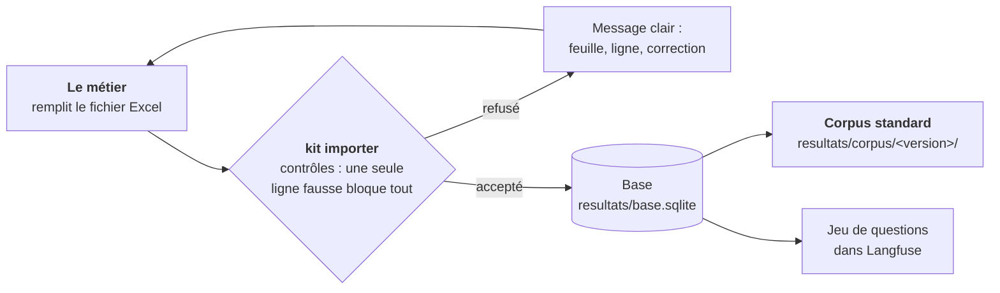
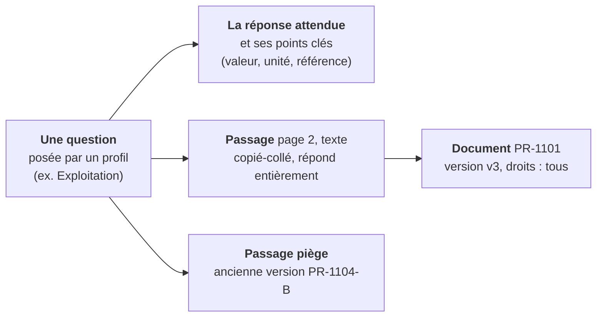

# 0a. Construction du corpus

Ce guide détaille l'étape 1 du [fil conducteur](../FIL_CONDUCTEUR.md#1-construire-et-importer-le-corpus-dévaluation).

Le corpus annoté est le cœur de l'évaluation. Le métier y écrit des questions réelles, la réponse attendue, et **l'endroit exact où elle se trouve** dans les documents. C'est la seule chose à faire à la main : le kit l'importe ensuite, et tout le reste est automatique.



| Où | Quoi |
| --- | --- |
| [`methode_et_contrat/methode_corpus_annote.md`](methode_et_contrat/methode_corpus_annote.md) | la méthode complète (document 1) ; ce guide en donne l'essentiel |
| [`corpus_annote/Corpus_evaluation_RAG.xlsx`](../corpus_annote/Corpus_evaluation_RAG.xlsx) | le fichier Excel vierge, à remplir par le métier |
| [`service-evaluation-exemple/corpus_annote/`](../../service-evaluation-exemple/corpus_annote/) | un corpus complet, déjà rempli |
| [`../src/kit/etape_0a_corpus/importer.py`](../src/kit/etape_0a_corpus/importer.py) | le code de l'import |

## 1. Ce que le métier annote



Pourquoi tant de détail ? Pour savoir **d'où vient une erreur**. Avec le passage exact, le kit peut dire si le RAG l'a bien *lu* ([1. Évaluation de l'ingestion](1_evaluation_ingestion.md)), s'il l'a *retrouvé* ([2. Évaluation de la recherche](2_evaluation_recherche.md)), et seulement ensuite si la réponse est *juste* ([3. Évaluation de la réponse](3_evaluation_reponse.md)). Sans passage, on sait qu'une réponse est fausse, mais pas pourquoi.

### Le fichier à remplir

Chaque feuille du fichier Excel porte ses définitions et ses listes de valeurs.

| Feuille | Une ligne = | L'essentiel |
| --- | --- | --- |
| Documents | un document retenu | sa référence dans la source, sa version, son format, ses **droits d'accès**, s'il est **en vigueur** |
| Questions | une question | écrite avec les mots des utilisateurs ; le **profil** qui la pose ; la **réponse attendue** et ses **points clés** ; si la réponse est dans les documents (oui, non, non accessible à ce profil) ; la **fréquence** et la **gravité** d'une erreur ; **réservée** ou non (colonne « Réservée à la décision ») |
| Passages | un endroit où se trouve la réponse | le document, la **page**, le type d'élément (texte, tableau, texte scanné, image), le passage **copié-collé**, s'il répond entièrement, en partie, ou si c'est un **piège** |
| Pages OCR | une page scannée de référence | le texte retapé à la main : sert à mesurer la qualité de la lecture des scans |
| Tableau de bord | — | se calcule tout seul ; doit être « OK » partout avant de transmettre le fichier |

### Les sources : fichiers et fiches de GED

Le RAG peut lire deux sortes de sources, et un même corpus peut mélanger les deux :
- des **fichiers** : PDF, Word, Excel ;
- des **fiches de GED** : les fiches, tickets ou comptes rendus d'une base documentaire (une GED, un outil de tickets, une GMAO). Ce ne sont pas des fichiers : elles s'affichent à l'écran, et sont stockées dans une base de données.

Le métier repère chaque source avec ce qu'il voit à l'écran :

| Colonne | Pour un fichier | Pour une fiche de GED |
| --- | --- | --- |
| Source (feuille Documents) | l'espace où il est rangé : SharePoint, dossier partagé… | le nom de la GED : « GED Maintenance », « GMAO »… |
| Référence dans la source (feuille Documents) | la référence du fichier, par exemple `PR-1101` | le numéro de la fiche affiché dans la GED, par exemple `OT-24102` |
| Format (feuille Documents) | PDF natif, PDF scanné, Word, Excel | Fiche de GED |
| Page (feuille Passages) | le numéro de la page | le nom du champ tel qu'il s'affiche, par exemple « Résolution » ; « Commentaire 3 » pour le troisième commentaire d'un fil |
| Passage (feuille Passages) | le texte copié-collé depuis le fichier | le texte copié-collé depuis l'écran de la GED |

Le numéro de la fiche et le nom du champ suffisent à désigner un endroit précis de la base : le métier n'a pas à connaître ses tables ni ses colonnes. Le RAG garde ces deux informations sur chaque morceau qu'il tire de la fiche, et le service retrouve ainsi le passage.

Trois règles pour les fiches de GED :
- une **pièce jointe** est une source à part : une ligne de plus dans la feuille Documents, avec sa référence dans la GED et son format (PDF…) ;
- le corpus porte sur une **copie figée** de la GED, ou sur des fiches closes : une fiche modifiée pendant l'évaluation rendrait fausse la réponse attendue ;
- une fiche **n'a pas de fichier à fournir** : le RAG la lit lui-même dans la GED, par son numéro. On peut aussi l'exporter en fichier, nommé `<référence>.pdf` : le service l'envoie alors au RAG comme les autres fichiers.

### Les règles qui comptent le plus

| Règle | Pourquoi |
| --- | --- |
| Le passage est **copié-collé** du document, pas résumé | le kit le cherche dans l'index du RAG ; un passage reformulé ne se retrouve pas |
| Pour un tableau : la ligne d'en-têtes, puis la ligne qui répond, cellules séparées par « \| » | le kit compare les mots, dans n'importe quel ordre |
| Pour un schéma : une phrase qui dit ce que montre la figure, avec son numéro | un schéma ne se copie pas |
| Des questions **sans réponse** dans les documents | vérifier que le RAG sait dire « je ne sais pas » au lieu d'inventer |
| Des questions posées avec un **profil restreint** sur un document qui lui est interdit | vérifier que le RAG ne montre jamais un document interdit |
| Des **passages pièges** : une ancienne version, un autre ouvrage | vérifier que le RAG ne se trompe pas de document |
| Un tiers des questions **réservées** | elles ne servent jamais à régler le RAG. Les scores présentés au métier, les scores clés, sont calculés sur elles ; l'équipe technique n'en voit que ces scores globaux. Cela évite de régler le RAG « pour le test » |
| **Fréquence** et **gravité** sur chaque question | une erreur sur une question fréquente et grave pèse 9 fois plus qu'une erreur rare et sans gravité |

La configuration minimale du document 1 : 10 documents par type, 50 questions, 20 pages OCR. En dessous, les scores sont trop imprécis pour décider (voir [les marges d'erreur](5_resultats_et_comparaison.md#4-les-marges-derreur--ne-pas-sur-interpréter)).

## 2. Le corpus d'exemple, prêt à l'emploi

Le dossier [`service-evaluation-exemple/corpus_annote/`](../../service-evaluation-exemple/corpus_annote/) contient un corpus complet sur la maintenance électrique d'une entreprise **entièrement fictive**, Valtéra Industries. Il atteint la configuration minimale du document 1.

| Élément | Contenu |
| --- | --- |
| `corpus_annote/corpus_documentaire/` | 50 documents PDF, un par référence (`<référence>.pdf`) ; c'est ce dossier que le kit envoie au RAG par son endpoint « ingérer » : 17 procédures (PDF natifs), 16 notes techniques (11 natives, 5 scannées et bruitées), 17 comptes rendus d'intervention (fiches de GED, exportées en PDF « champ : valeur » parce que le RAG d'exemple n'a pas de connecteur de GED) |
| `corpus_annote/Corpus_evaluation_RAG.xlsx` | le fichier du métier, rempli : 50 documents, 60 questions, 97 passages, 20 pages OCR retapées |
| `corpus_annote/questions_pour_relecture.md` | les 60 questions sur une page, pour les relire |
| `corpus_annote/notes_du_metier_simulees/` | les notes du métier, **simulées** pour le banc d'essai : 28 réponses notées pour vérifier le juge, et le script qui les écrit dans le fichier `verification_juge.xlsx` |
| `corpus_annote/fabrication_du_corpus/` | de quoi tout refabriquer : le monde fictif, le contenu de chaque document, les scripts |

Ce qu'il couvre :

| Cas du document 1 | Dans le corpus d'exemple |
| --- | --- |
| Formats | PDF natif, PDF scanné (5 notes de 4 pages), fiche de GED |
| Éléments | texte, tableaux, schémas avec figure numérotée (PR-1101, PR-1111, NT-057, NT-058), texte scanné |
| Droits | 4 documents réservés au profil « Maintenance » (PR-1102, NT-051, OT-24109, OT-24114) |
| Versions | PR-1104-B (2021) remplacée par PR-1104-C (2025), avec des valeurs différentes |
| Questions | 60 : 10 sans réponse, 19 à plusieurs passages, 6 synthèses, 7 avec un profil restreint dont 3 « non accessible », 6 questions de suite, 6 variantes, 6 avec passage piège, 20 réservées |

Les conventions retenues pour l'annoter :

| Point | Convention |
| --- | --- |
| Fiche de GED | « Page » = nom du champ (par exemple « Pièces remplacées ») ; « Passage » = la valeur, ou la partie de la valeur qui répond |
| Question non accessible | posée avec le profil « Exploitation » sur un document réservé à « Maintenance » ; la réponse attendue est que le RAG ne donne pas l'information |
| Pages OCR | tout ce qu'on lit sur la page, en-tête et pied de page compris, dans l'ordre de lecture |

Pour refabriquer le corpus (rarement utile) :

```bash
uv run --group fabrication python ../service-evaluation-exemple/corpus_annote/fabrication_du_corpus/fabriquer_pdf.py
```

```bash
uv run python ../service-evaluation-exemple/corpus_annote/fabrication_du_corpus/remplir_excel.py
```

Le premier script dessine les PDF à partir de `fabrication/contenus/*.json`. Le second vérifie chaque passage de `fabrication/questions.yaml` contre sa source, remplit le fichier Excel et recalcule le tableau de bord.

## 3. Importer le corpus

### Ce que le métier reçoit, ce qu'il rend, et où le ranger

Donnez au métier deux choses :

1. **Le fichier Excel vierge**, [`corpus_annote/Corpus_evaluation_RAG.xlsx`](../corpus_annote/Corpus_evaluation_RAG.xlsx). Chaque feuille porte ses définitions et ses listes de valeurs.
2. **Les règles pour le remplir** : le [section 1 de ce guide](#1-ce-que-le-métier-annote). Elles disent quels documents choisir, combien de questions écrire et de quels types, comment copier-coller le passage qui contient la réponse, comment noter la fréquence et la gravité de chaque question, et quelles questions garder de côté, pour qu'elles ne servent jamais à régler le RAG.

Il vous rend :

- **les documents**, un fichier par document, nommé par sa référence : `<référence>.<extension>`, par exemple `PR-1101.pdf`. Les fiches d'une GED (tickets, comptes rendus) n'ont pas besoin de fichier : le métier les repère par leur numéro et le nom du champ, et le RAG les lit lui-même dans la GED ([plus haut](#les-sources--fichiers-et-fiches-de-ged)) ;
- **le fichier Excel rempli** : la liste des documents, les questions, leur bonne réponse, les passages qui la contiennent, et quelques pages scannées retapées à la main.

Un fichier rempli, pour montrer au métier ce qu'on attend : [celui de l'exemple](../../service-evaluation-exemple/corpus_annote/Corpus_evaluation_RAG.xlsx).

| Ce que le métier a rendu | Où vous le mettez |
| --- | --- |
| les documents | `corpus_annote/corpus_documentaire/` |
| le fichier Excel rempli | `corpus_annote/Corpus_evaluation_RAG.xlsx`, à la place du fichier vierge |

### L'import

L'import transforme le fichier Excel du métier en un **corpus standard** : des fichiers que n'importe quel RAG sait lire, et que le kit sait évaluer. Il faut d'abord avoir installé le service et démarré Langfuse : voir son [README](../../service-evaluation/README.md). Sans Langfuse, ajouter `--sans-langfuse`.

```bash
uv run kit importer corpus_annote/Corpus_evaluation_RAG.xlsx
```

Pour importer le corpus d'exemple à la place (voir [le README](../../service-evaluation/README.md#essayer-avec-le-corpus-dexemple)) :

```bash
uv run kit importer ../service-evaluation-exemple/corpus_annote/Corpus_evaluation_RAG.xlsx
```

L'import fait, dans l'ordre :

**1. Les contrôles** ([Contrat entre un RAG et le kit d'évaluation — version 1.0](methode_et_contrat/contrat_des_fichiers.md), section 2). L'import signale une colonne obligatoire vide, une valeur hors liste, un passage dont le document n'existe pas, un identifiant en double, une question « oui » sans passage, une question « non accessible » sans document interdit… **Une seule ligne fausse bloque tout l'import** : un corpus importé à moitié fausserait l'évaluation sans que personne ne s'en aperçoive. Le message donne la feuille, la ligne et la correction attendue :

```
Import refusé : 1 ligne(s) à corriger dans Corpus_evaluation_RAG.xlsx.
  - feuille Questions, ligne 2 (Q-001) : « Exploit » n'est pas dans la colonne « Profils d'accès » de la feuille Listes (Tous les utilisateurs, Maintenance, Exploitation).
```

Si la configuration minimale du document 1 n'est pas atteinte (moins de 50 questions…), l'import passe, avec un avertissement.

**2. La conversion** des libellés du métier en codes : « PDF scanné » devient `pdf_scanne`, « Tous les utilisateurs » devient `tous`.

**3. L'écriture dans la base** (`resultats/base.sqlite` ; PostgreSQL en changeant seulement l'adresse dans [`../config/kit.yaml`](../config/kit.yaml)).

**4. L'export** du corpus standard dans `resultats/corpus/<version>/` :

| Fichier | Une ligne = | Donné au RAG ? |
| --- | --- | --- |
| `corpus.json` | la description du corpus : version, projet, date, fichier source | non |
| `documents.jsonl` | un document : référence, titre, type, version, date, format, droits d'accès, en vigueur | **en partie** : l'appel ① envoie au RAG, pour chaque document, sa référence, son titre, son type, sa version, son format et ses droits d'accès. Le kit s'en sert aussi pour vérifier ses chunks |
| `questions.jsonl` | une question, avec ses annotations | **en partie** : le RAG n'en lit que la question, le profil, et l'historique d'une question de suite |
| `passages.jsonl` | un passage annoté | **jamais** |
| `pages_ocr.jsonl` | une page scannée retapée | **jamais** |

**5. Le jeu de questions dans Langfuse** : `corpus-<projet>-<version>`, un élément par question. C'est sur lui que les évaluations seront rangées.

### La version du corpus

L'import donne une version au corpus : la date, puis un numéro (`2026-11-20.1`). Elle change à chaque import d'un fichier **modifié**. Réimporter le même fichier ne crée rien.

Deux évaluations ne se comparent que sur la même version du corpus : sinon, on ne saurait pas si l'écart vient du RAG ou des questions.

Un passage garde son identifiant d'une version à l'autre tant que sa ligne ne change pas (voir [DECISIONS.md](../../DECISIONS.md), décision 1).

Retour au [fil conducteur](../FIL_CONDUCTEUR.md#1-construire-et-importer-le-corpus-dévaluation), étape 1.

**Étape suivante** : [0b. Les endpoints du RAG](0b_endpoints_du_rag.md).
