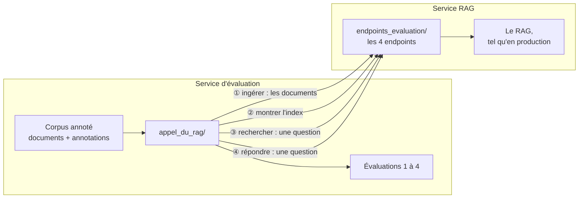

# 0b. Les endpoints du RAG : ce que chaque RAG doit fournir

Ce guide détaille l'étape 2 du [fil conducteur](../FIL_CONDUCTEUR.md#2-ouvrir-les-quatre-endpoints-du-rag-au-service).

Le service d'évaluation ne connaît aucun RAG. Il demande à chacun **quatre endpoints, de forme fixe, à une adresse web**. Par ces endpoints, il envoie ses documents au RAG, lui pose ses questions, et récupère ce qu'il fait. Le RAG n'a pas à changer sa façon de travailler : les endpoints s'ajoutent à côté de lui.

Un mot revient partout : un **chunk** est un morceau de document tel que le RAG l'a découpé et indexé (identifiant `chunk_id`, fichier `chunks.jsonl`).



| Où | Quoi |
| --- | --- |
| cette page | la règle : les quatre endpoints, ce qu'on envoie, ce qu'on attend |
| [`methode_et_contrat/contrat_des_fichiers.md`](methode_et_contrat/contrat_des_fichiers.md) | chaque champ, en détail |
| [`methode_et_contrat/schemas/`](methode_et_contrat/schemas/) | les schémas JSON de ce que le RAG rend |
| [`../endpoints_a_copier/endpoints_evaluation.py`](../endpoints_a_copier/endpoints_evaluation.py) | le modèle des quatre endpoints, à copier dans votre RAG ; le pas à pas : [section 3](#3-côté-rag--où-ranger-les-endpoints) |
| [`../src/kit/appel_du_rag/`](../src/kit/appel_du_rag/) | le côté évaluation : le seul endroit du kit qui appelle un RAG |
| [`../../service-rag-exemple/src/rag/endpoints_evaluation/`](../../service-rag-exemple/src/rag/endpoints_evaluation/) | un exemple complet : les endpoints du RAG d'exemple, un fichier par endpoint |

## 1. Les quatre endpoints

| Endpoint | Adresse | Le service d'évaluation envoie | Le RAG rend | Pour l'évaluation |
| --- | --- | --- | --- | --- |
| ① **ingérer** | `POST /ingerer` | les documents du corpus : pour chacun, `reference_source`, `titre`, `type_document`, `version`, `format`, `droits_acces`, `fichier` (son nom) et `contenu` (le fichier, en base64). Pour une fiche de GED sans fichier, `fichier` et `contenu` sont vides : le RAG lit la fiche dans sa GED, par sa référence | « c'est fait » : nombre de documents, de chunks, de pages | [1. Évaluation de l'ingestion](1_evaluation_ingestion.md) |
| ② **montrer l'index** | `GET /index` | rien | `rag` : sa description et sa version exacte ; `chunks` : chaque chunk de l'index avec la référence du document, sa version, la page, le type d'élément, les droits d'accès, l'ordre ; `pages` : le texte de chaque page lue, avant découpage ; `graphe` : son graphe en RDF, s'il en a un | [1. Évaluation de l'ingestion](1_evaluation_ingestion.md) |
| ③ **rechercher** | `POST /rechercher` | `question`, `profil`, `historique` | `resultats` : les k chunks retrouvés, dans l'ordre (`chunk_id`, `rang`, `score`), avant toute génération ; `duree_ms` | [2. Évaluation de la recherche](2_evaluation_recherche.md) |
| ④ **répondre** | `POST /repondre` | `question`, `profil`, `historique` | `reponse`, `abstention` (vrai si le RAG dit ne pas savoir), `chunks_cites`, `chunks_contexte`, `duree_ms`, `cout`, `tokens_entree`, `tokens_sortie`, `trace_id` | [3. Évaluation de la réponse](3_evaluation_reponse.md), [4. Évaluation de bout en bout](4_evaluation_bout_en_bout.md) |

Le détail de chaque champ est dans le [Contrat entre un RAG et le kit d'évaluation — version 1.0](methode_et_contrat/contrat_des_fichiers.md#3-ce-que-le-rag-rend). Le RAG d'exemple publie aussi la documentation de ses endpoints, générée, à http://127.0.0.1:8100/docs.

## 2. Les règles

| Règle | Pourquoi |
| --- | --- |
| **Le RAG range les documents de l'évaluation à part**, jamais avec ceux de la production | évaluer sans toucher à la production ; savoir exactement ce que le RAG a reçu |
| **Le RAG ne reçoit jamais les annotations** : ni réponse attendue, ni points clés, ni passages | l'évaluation ne triche pas. Seule exception : l'historique d'une question de suite |
| chaque question est posée **avec son profil**, et la recherche applique les droits de ce profil | tester les droits d'accès : un document interdit ne doit jamais remonter |
| une question de suite reçoit en `historique` la question précédente **et sa réponse attendue** | évaluer la question de suite seule, sans hériter d'une erreur sur la précédente |
| **le même k** pour toutes les questions | comparer les questions entre elles |
| pour une fiche de GED, chaque chunk garde la **référence de la fiche**, et en `page` le **nom du champ** tel qu'il s'affiche dans la GED | le service retrouve les passages du métier par la référence et le champ |
| **toutes** les questions sont posées, y compris les réservées | seul l'affichage des résultats diffère |
| le RAG dit lui-même s'il s'abstient (`abstention`) | mesurer l'abstention sans deviner à partir du texte |
| la version (`version_rag`) change dès que l'index, un modèle, le prompt ou k changent | comparer deux versions sans ambiguïté |

## 3. Côté RAG : où ranger les endpoints

Les endpoints sont écrits pour l'évaluation, et pour rien d'autre. On les range **dans un dossier à part**, pour que chacun voie ce qui a été ajouté. C'est le cas du RAG d'exemple :

| Dossier | Ce qu'il contient |
| --- | --- |
| [`service-rag-exemple/src/rag/pipeline/`](../../service-rag-exemple/src/rag/pipeline/) | le RAG lui-même, tel qu'en production |
| [`service-rag-exemple/src/rag/endpoints_evaluation/`](../../service-rag-exemple/src/rag/endpoints_evaluation/) | les quatre endpoints, un fichier par endpoint, écrits pour le service d'évaluation et rien d'autre |

Les endpoints se servent du RAG, jamais l'inverse : si on les supprime, le RAG marche toujours en production. Un RAG écrit dans un autre langage ouvre les mêmes quatre adresses, avec les mêmes champs.

### Partir du modèle

[`endpoints_a_copier/endpoints_evaluation.py`](../endpoints_a_copier/endpoints_evaluation.py) est un modèle complet, à copier dans votre RAG. Tel quel, il marche déjà : c'est un « RAG » jouet, qui fait un morceau par page et cherche par mots communs. Vous remplacez le contenu des quatre fonctions marquées **À REMPLACER** par l'appel à votre RAG ; les formes d'entrée et de sortie ne changent pas.

Avant de toucher à votre RAG, lancez le modèle tel quel, depuis `endpoints_a_copier/`, puis faites les étapes 3 et 4 du [fil conducteur](../FIL_CONDUCTEUR.md#les-étapes) : vous verrez le service évaluer le RAG jouet de bout en bout (score pondéré d'environ 24 % : c'est un jouet).

```bash
uv run --with fastapi --with uvicorn --with pypdf uvicorn endpoints_evaluation:app --host 127.0.0.1 --port 8100
```

Votre RAG n'est pas en Python ? Il ouvre les mêmes quatre adresses, avec les mêmes champs ([Contrat entre un RAG et le kit d'évaluation — version 1.0](methode_et_contrat/contrat_des_fichiers.md#les-endpoints-dévaluation)).

### ① Ingérer

Le service envoie ses documents. Votre RAG les range **comme en production** (même lecture, même découpage, mêmes modèles), mais **à part** : un autre dossier, une autre collection, jamais l'index de production.

Pour chaque document, il reçoit `reference_source`, `titre`, `type_document`, `version`, `format`, `droits_acces`, `fichier` (le nom du fichier) et `contenu` (le fichier, en base64). Par exemple, si votre RAG a une fonction qui indexe un dossier (`mon_rag.indexer` est un nom d'exemple) :

```python
import base64
from pathlib import Path

import mon_rag   # votre RAG


@app.post("/ingerer")
def ingerer(demande: Documents) -> dict:
    dossier = Path("espace_evaluation/documents")        # à part de la production
    dossier.mkdir(parents=True, exist_ok=True)
    metadonnees = []
    for d in demande.documents:
        (dossier / Path(d.fichier).name).write_bytes(base64.b64decode(d.contenu))
        metadonnees.append({"reference": d.reference_source, "version": d.version,
                            "droits": d.droits_acces, "fichier": Path(d.fichier).name})
    resultat = mon_rag.indexer(dossier, metadonnees, collection="evaluation")
    return {"documents": len(demande.documents), "chunks": resultat.nb_chunks, "pages": resultat.nb_pages}
```

Le point qui compte : chaque morceau de votre index doit garder **la référence du document reçue (`reference_source`), sa version, sa page et ses droits d'accès**. Sans eux, le service ne peut pas retrouver les passages du métier, ni vérifier les droits.

### ② Montrer l'index

| Partie | Ce qu'on y met |
| --- | --- |
| `rag` | le nom du RAG, sa **version** (`version_rag`), son type (`vectoriel`, `graphe`, `hybride`, `agent`), k, les versions de ses briques |
| `chunks` | chaque morceau de l'index : `chunk_id`, `reference_source`, `version_document`, `page`, `type_element`, `droits_acces`, `ordre`, `texte`, `version_index` |
| `pages` | le texte de chaque page lue, avant découpage : il sert à mesurer la lecture des scans |
| `graphe` | le graphe en Turtle, si votre RAG en a un ; sinon `null` |

La version doit **changer dès que l'index, un modèle, le prompt ou k changent** : c'est ce qui permet de comparer deux configurations sans ambiguïté.

### ③ Rechercher

Pour une question, votre RAG rend les k morceaux retrouvés, dans l'ordre, **avant toute génération** : `chunk_id`, `rang`, `score`. Il applique les droits du `profil` **pendant** la recherche : un morceau interdit ne doit jamais remonter. Pour une question de suite, `historique` contient l'échange précédent.

### ④ Répondre

Pour une question, votre RAG rend sa réponse, telle qu'un utilisateur la recevrait : `reponse`, `abstention` (vrai si votre RAG dit lui-même ne pas savoir), `chunks_cites` (les sources citées), `chunks_contexte` (tous les morceaux donnés au modèle), `duree_ms`, `trace_id`, et si possible `cout`, `tokens_entree`, `tokens_sortie`.

## 4. Vérifier les endpoints

Lancez votre RAG, endpoints ouverts, mettez son adresse dans `rag.adresse` de [`config/kit.yaml`](../config/kit.yaml), puis appelez-le.

Une commande appelle les quatre endpoints dans l'ordre : elle envoie les documents, pose chaque question, et range ce que le RAG rend dans `resultats/reponses_du_rag/<version du RAG>/`.

```bash
uv run kit appeler-rag
```

Sans option, elle appelle l'adresse de [`../config/kit.yaml`](../config/kit.yaml) (`rag.adresse`, http://127.0.0.1:8100). Pour un autre RAG : `--rag http://…`. `kit evaluer` commence par cet appel, puis enchaîne les évaluations.

Puis le kit vérifie ce que le RAG a rendu, et dit **précisément ce qui ne va pas**, fichier par fichier et ligne par ligne :

```
resultats/reponses_du_rag/mon-rag : 3 problème(s).
  - reponses.jsonl, ligne 3 : champ obligatoire « abstention » absent.
  - rag.json : champ(s) inconnu(s) du contrat : 'temperature'.
  - recherches.jsonl, Q-007 : posée avec le profil « tous » au lieu de « exploitation ».
```

On corrige les endpoints, on relance, jusqu'à « règle : respectée ».

| Erreur fréquente | Ce que l'évaluation verra |
| --- | --- |
| une référence de document modifiée (`PR-1101.pdf` au lieu de `PR-1101`) | aucun passage retrouvé : l'évaluation 1 s'effondre |
| la page d'un morceau en nombre, ou la page où il finit | des passages introuvables |
| les droits filtrés **après** la recherche, au lieu de pendant | une fuite de droits : un document montré à qui n'y a pas droit |
| des `chunk_id` différents entre ② et ③ | des recherches qui citent des morceaux inconnus : le service refuse |
| une version qui ne change pas quand un réglage change | deux configurations confondues, comparaison impossible |
| l'abstention devinée dans le texte, au lieu d'être dite par le RAG | des abstentions mal comptées |
| les documents de l'évaluation indexés avec ceux de la production | une évaluation faussée, et une production polluée |

## 5. Sans adresse web : par fichiers

Un RAG qui ne peut pas ouvrir d'adresse écrit lui-même les fichiers que les endpoints auraient rendus. Il les range où il veut, dans un dossier nommé `<version du RAG>/` :

| Fichier | Une ligne = | Endpoint |
| --- | --- | --- |
| `rag.json` | la description et la version du RAG | ② |
| `chunks.jsonl` | un chunk de l'index | ② |
| `pages_extraites.jsonl` | une page lue, avant découpage (si des documents sont scannés) | ② |
| `graphe.ttl` | le graphe, si le RAG en a un | ② |
| `recherches.jsonl` | une question : les k chunks retrouvés | ③ |
| `reponses.jsonl` | une question : la réponse | ④ |

Il lit les documents dans `corpus_annote/corpus_documentaire/` (`chemins.corpus_documentaire` de [`kit.yaml`](../config/kit.yaml)), et les questions dans `resultats/corpus/<version>/questions.jsonl`. De ce fichier, il ne lit que `question_id`, `question` et `profil`, plus, pour une question de suite, la question précédente (`question_precedente`) et sa réponse attendue : c'est l'historique, seule exception de la règle. Le reste, ce sont les annotations, qu'il ne doit pas voir. Puis on donne son dossier au kit :

```bash
uv run kit verifier-contrat <dossier>
```

```bash
uv run kit evaluer --rag <dossier>
```

Retour au [fil conducteur](../FIL_CONDUCTEUR.md#2-ouvrir-les-quatre-endpoints-du-rag-au-service), étape 2.

**Étape suivante** : [0c. Les configurations du RAG](0c_configurations_du_rag.md).
