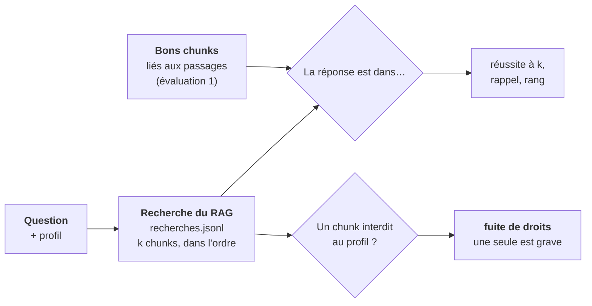

# 2. Évaluation de la recherche

Ce guide détaille la vérification 2, la recherche, présentée dans le [fil conducteur](../FIL_CONDUCTEUR.md#comment-fonctionne-lévaluation) : ce qu'elle vérifie, comment chaque score est calculé, et quoi faire si c'est mauvais.

## Ce que vérifie cette évaluation

Pour chaque question, la recherche du RAG compare la question aux vecteurs de la base et ramène les k morceaux les plus proches (ici 5), sans écrire de réponse. L'évaluation de la recherche vérifie que la bonne information est dans ce qui est ramené. Elle s'appuie sur le guide [1. Évaluation de l'ingestion](1_evaluation_ingestion.md), qui a déjà établi quels morceaux contiennent les passages du métier. Elle vérifie **cinq choses**, avec un score pour chacune.

**1. Le bon passage est ramené**

Pour chaque question, le service regarde si au moins un morceau contenant le passage du métier est parmi les k ramenés. Quand le métier a indiqué qu'il faut combiner plusieurs passages, il faut un bon morceau pour chacun. La question compte 1 si c'est le cas, 0 sinon. Le score est le nombre de questions réussies divisé par le nombre de questions. Une question ratée ici, c'est une question où le modèle écrira sa réponse sans avoir l'information sous les yeux. Le même score est recalculé comme si la recherche ne ramenait que 1, 3 ou 5 morceaux : cela aide à choisir k.

**2. Tous les passages nécessaires sont ramenés**

La même vérification, mais passage par passage au lieu de question par question. Le score est le nombre de passages attendus qui sont parmi les k morceaux, divisé par le nombre de passages attendus. Il montre les questions à plusieurs passages où un seul a été trouvé.

**3. Le bon morceau arrive en tête**

Chaque question reçoit 1 si le premier bon morceau est classé 1er, 1/2 s'il est 2e, 1/3 s'il est 3e, et 0 s'il n'est pas ramené. Le score est la moyenne. Si le bon passage est souvent ramené mais que ce score est bas, la bonne information arrive trop loin dans la liste.

**4. Aucun document interdit n'est ramené**

Chaque question est posée au nom d'un profil, par exemple « Exploitation ». Le service compte les questions où au moins un morceau ramené vient d'un document réservé à un autre profil. Une seule fuite est grave, quels que soient les autres scores : un document réservé a été montré à quelqu'un qui n'y a pas droit.

**5. Les pièges ne passent pas devant**

Le métier a désigné des passages pièges, qui ressemblent à la réponse sans l'être, et le corpus contient un document remplacé par une version plus récente. Le service compte les questions où un piège ou l'ancienne version est classé avant le bon morceau, et divise par le nombre de questions.

Le détail des règles est plus bas : [« la réponse est dans »](#comment-le-kit-tranche---la-réponse-est-dans-), et [les scores avec leur code](#les-scores).

On regarde la recherche **seule, avant la génération** : si le bon passage n'arrive pas jusqu'au modèle, aucun prompt ne rattrapera la réponse.



| Où | Quoi |
| --- | --- |
| [`methode_et_contrat/methode_evaluation.md`](methode_et_contrat/methode_evaluation.md) | la méthode (document 3), section 7 |
| [`../src/kit/etape_2_evaluation_recherche/scores.py`](../src/kit/etape_2_evaluation_recherche/scores.py) | les règles de réussite et les scores de la recherche |

## La commande

Elle est déjà lancée par `kit evaluer`. Pour la relancer seule, sur les dernières réponses du RAG :

```bash
uv run kit evaluer-recherche
```

Elle a besoin du guide [1. Évaluation de l'ingestion](1_evaluation_ingestion.md) (les liens passage ↔ chunk) et de `recherches.jsonl` ([endpoints du RAG, ③ rechercher](0b_endpoints_du_rag.md)).

## Comment le kit tranche : « la réponse est dans »

Un **bon chunk** est un chunk lié, à l'évaluation 1, à un passage de la question qui n'est pas un piège. La réussite dépend de la colonne « La réponse est dans » du fichier du métier :

| La réponse est dans… | La question est réussie si |
| --- | --- |
| un seul passage | un chunk lié à ce passage est dans les k premiers |
| plusieurs passages, un seul suffit | un chunk lié à l'un d'eux est dans les k premiers |
| plusieurs passages **à combiner** | un chunk lié à **chacun** d'eux est dans les k premiers |
| synthèse, pas de réponse, non accessible | non comptée ici (sauf pour la fuite de droits) |

## Les scores

| Score | Ce qu'il mesure | Exemple | Si c'est mauvais |
| --- | --- | --- | --- |
| `n2_reussite_k` | part des questions dont la recherche ramène le bon passage dans les k premiers chunks | **86 %** ± 13 % | voir la ventilation par type de document ; recherche hybride, phrase de contexte, filtres de métadonnées |
| `n2_rappel_k` | part des passages attendus retrouvés | 81 % | questions à combiner : décomposer la question |
| `n2_rang_premier` | 1 si le premier bon chunk est 1er, 1/2 s'il est 2e… | 0,68 | bon chunk trouvé mais mal classé : un reranker |
| `n2_reussite_1`, `_3`, `_5` | la réussite pour k = 1, 3, 5 | 54 %, 75 %, 86 % | aide à choisir k : ici, passer de 3 à 5 gagne 11 points |
| **`n2_fuite_droits`** | nombre de questions où un document **interdit au profil** est retrouvé | **0** | **une seule est grave** : filtrer les droits *pendant* la recherche, pas après |
| `n2_perimes_pieges` | part des questions où une version périmée ou un passage piège est classé avant le bon | 0 % | filtre sur la version en vigueur |

## Lire la ventilation

Dans `scores.json` (ou dans le rapport), `n2_reussite_k` par type de document donne, pour le RAG d'exemple :

- procédures : 100 % ;
- notes techniques : 88 % ;
- comptes rendus d'intervention : 50 %, sur 4 questions seulement.

Ce dernier chiffre est une tendance, pas une mesure, mais il dit où regarder en premier : les fiches d'intervention.

## Si c'est mauvais

Recherche hybride, reranker, filtres, choix de k : le document [Construire le pipeline d'un RAG : ce qu'on met en place selon les cas](../../service-rag-exemple/documentation/reference/techniques_rag.md), section 6.

Retour au [fil conducteur](../FIL_CONDUCTEUR.md#comment-fonctionne-lévaluation).

**Étape suivante** : [3. Évaluation de la réponse](3_evaluation_reponse.md).
