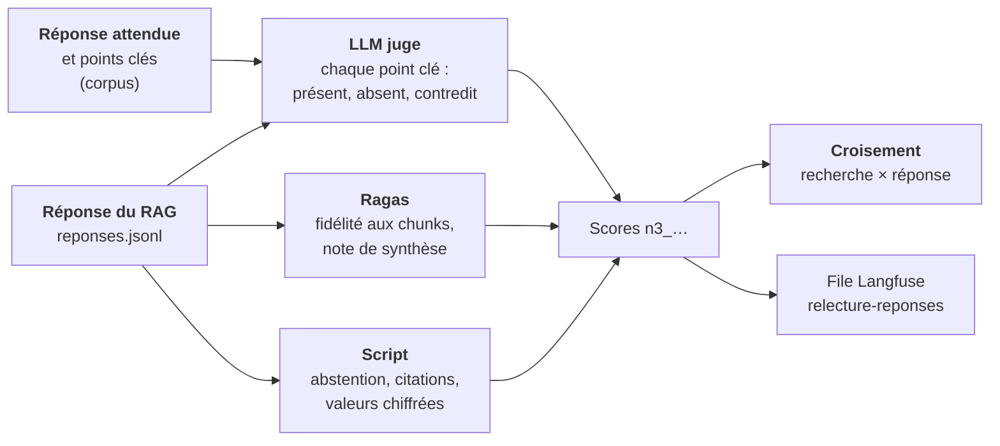
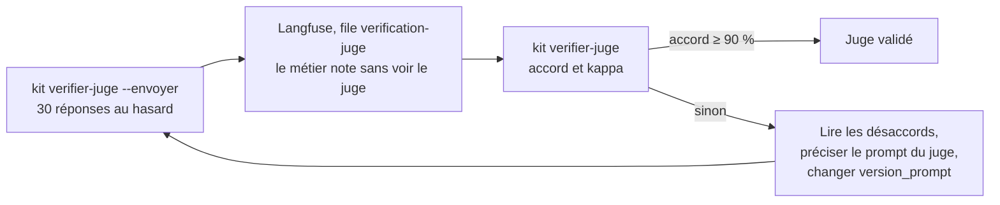

# 3. Évaluation de la réponse

## Ce que vérifie cette évaluation

Le RAG reçoit la question, ramène ses k morceaux, et demande au modèle de langage d'écrire une réponse à partir de ces morceaux, en citant ses sources. L'évaluation de la réponse vérifie que cette réponse est juste, fondée sur les documents, et prudente quand il le faut. Elle vérifie **six choses**.

**1. La réponse est juste** (seuil : 80 %)

Pour chaque question, le métier a écrit la bonne réponse et l'a découpée en points clés, par exemple « 72 A » et « temporisation de 500 ms ». Un modèle de langage, le juge, lit la réponse du RAG et classe chaque point clé : présent, absent ou contredit. La réponse est juste si tous les points sont présents sans contradiction, partielle s'il en manque sans qu'aucun soit contredit, fausse sinon. Juste compte 1, partielle 0,5, fausse 0. Le score est la moyenne sur les questions qui ont une réponse dans les documents.

**2. La réponse ne dit que ce que disent les documents** (seuil : 90 %)

On découpe la réponse en affirmations, puis on vérifie chacune dans les morceaux que le modèle avait sous les yeux. Le score est le nombre d'affirmations appuyées par un morceau divisé par le nombre d'affirmations. Une réponse peut être juste par chance tout en inventant une partie : ce score le voit.

**3. Le RAG sait dire « je ne sais pas »** (seuil : 80 %)

Certaines questions n'ont pas de réponse dans les documents, ou portent sur un document interdit au profil qui la pose. Le RAG doit alors s'abstenir. Le score est le nombre d'abstentions divisé par le nombre de ces questions. À l'inverse, un second score (sans seuil) compte les questions où le RAG s'est abstenu alors qu'il avait le bon passage : l'excès de prudence.

**4. Les sources citées sont les bonnes** (sans seuil)

Une question compte 1 si au moins une source citée par le RAG contient le passage du métier, et si aucune n'est un piège ni un document interdit. Le score est la part de questions qui comptent 1.

**5. Aucune erreur grave** (seuil : 0, bloquant)

Le métier a donné à chaque question une gravité : forte, moyenne ou faible. Une erreur grave, c'est, sur une question de gravité forte, une réponse fausse, une réponse qui invente, ou une réponse donnée là où il fallait s'abstenir. Le service les compte. Une seule suffit à refuser la mise en production, et chacune est relue par le métier.

**6. La justesse sur les questions difficiles** (sans seuil)

Les mêmes réponses, regardées par type de question :
- pour une liste : la part des éléments attendus présents dans la réponse ;
- pour un chiffre : la valeur attendue est-elle dans la réponse, avec la bonne unité ;
- pour une question de suite, qui dépend de l'échange précédent : la même note juste, partielle ou fausse ;
- pour une synthèse qui rassemble plusieurs documents : une note de 1 à 5 donnée par le juge sur une grille, ramenée sur 100 % ;
- pour une même question posée avec d'autres mots : la part des cas où les réponses ne disent pas la même chose.

Le détail est plus bas : [le juge](#le-modèle-juge), et [les scores avec leur code](#les-scores).



| Où | Quoi |
| --- | --- |
| [`methode_et_contrat/methode_evaluation.md`](methode_et_contrat/methode_evaluation.md) | la méthode (document 3), section 8 |
| [`methode_et_contrat/prompt_du_juge.md`](methode_et_contrat/prompt_du_juge.md) | le prompt du juge, sa sortie, sa vérification |
| [`../config/kit.yaml`](../config/kit.yaml) | le modèle juge |
| [`../src/kit/etape_3_evaluation_reponse/`](../src/kit/etape_3_evaluation_reponse/) | `juge.py` (le juge), `scores.py` (les scores), `relecture.py` (les files Langfuse) |

## Le modèle juge

Il est réglé dans [`../config/kit.yaml`](../config/kit.yaml) ; sa clé est dans `.env` (`KIT_LLM_CLE`). N'importe quel point d'accès compatible OpenAI convient.

```yaml
modeles:
  adresse: http://127.0.0.1:8080/v1
  variable_cle: KIT_LLM_CLE
  juge:
    modele: chat           # de préférence un autre modèle que celui du RAG
    temperature: 0
```

Le juge doit être **un autre modèle que celui du RAG** : un modèle tend à favoriser ses propres réponses. Ici, le RAG génère avec `gemma-4-e4b` et le juge est `chat` (qwen3.5-4b). Pour tester le point d'accès, le juge et Langfuse :

```bash
uv run kit verifier-modeles
```

## La commande

Elle est déjà lancée par `kit evaluer`. Pour la relancer seule, sur les dernières réponses du RAG :

```bash
uv run kit evaluer-reponse
```

Elle a besoin des évaluations [1](1_evaluation_ingestion.md) et [2](2_evaluation_recherche.md), et de `reponses.jsonl` ([endpoints du RAG, ④ répondre](0b_endpoints_du_rag.md)). Elle prend environ 3 minutes, le temps que le juge lise chaque réponse.

## Comment le kit tranche

| Qui | Ce qu'il vérifie |
| --- | --- |
| le **LLM juge** ([prompt](methode_et_contrat/prompt_du_juge.md)) | chaque point clé attendu : présent, absent ou contredit. Le verdict en découle : juste, partielle ou fausse |
| **Ragas** | la fidélité : chaque affirmation de la réponse est-elle appuyée par les chunks donnés au modèle ? Et la note des synthèses, sur la grille du prompt du juge |
| un **script** | l'abstention (champ `abstention` du RAG), les citations, les valeurs chiffrées et leur unité |

## Les scores

| Score | Ce qu'il mesure | Exemple | Si c'est mauvais |
| --- | --- | --- | --- |
| `n3_exactitude` | juste = 1, partielle = 0,5, fausse = 0, selon le juge. Les abstentions ne sont pas notées ici | **79 %** ± 15 % (seuil 80 %) | lire la justification du juge dans le CSV ; regarder le croisement ci-dessous |
| `n3_completude_listes` | pour une question « liste » : part des éléments attendus présents | 100 % | graphe et ontologie pour les listes |
| `n3_valeurs` | les valeurs chiffrées attendues sont-elles dans la réponse, avec la bonne unité et dans la tolérance ? | 91 % | calcul délégué à un outil plutôt qu'au modèle |
| `n3_abstention_correcte` | sur les questions sans réponse ou interdites au profil : part des fois où le RAG dit ne pas savoir | 100 % | consigne d'abstention ; vérifier que le contexte suffit avant de répondre |
| `n3_abstention_a_tort` | part des questions où le RAG ne répond pas alors qu'il avait le bon passage | 6 % | consigne d'abstention trop stricte |
| `n3_fidelite` | (Ragas) part des affirmations de la réponse appuyées par les chunks donnés au modèle | 95 % | citations obligatoires ; LLM juge garde-fou |
| `n3_citations` | au moins une source citée est la bonne, sans piège ni document interdit | 93 % | — |
| **`n3_erreurs_graves`** | réponses fausses, non fidèles (une seule affirmation non appuyée suffit), ou données au lieu de s'abstenir, **sur une question de gravité forte** | **1** | **bloquant** ; chaque cas est relu par le métier |
| `n3_synthese` | (Ragas) note de 1 à 5 sur la grille du prompt du juge, ramenée sur 100 % | 65 % | un RAG vectoriel synthétise mal : graphe |
| `n3_questions_suite` | exactitude des questions de suite | 100 % | — |
| `n3_variantes` | part des groupes de reformulations dont les réponses diffèrent | 0 % | robustesse aux reformulations |

**Lire le verdict du juge.** Dans le CSV, la colonne `detail` de `n3_exactitude` donne le statut de chaque point clé. Par exemple, pour Q-008 :

```
1. present : La valeur de 72 A est explicitement mentionnée dans la réponse.
2. absent : L'information sur la temporisation de 500 ms n'est pas présente dans la réponse de l'assistant.
```

Verdict : **partielle**. La réponse donne le courant de réglage, mais oublie la temporisation.

**L'erreur grave du RAG d'exemple** : **Q-046**, une synthèse hors sujet sur une question de gravité forte. On demande les règles de sécurité communes à toutes les interventions ; le RAG donne celles de l'éclairage de sécurité.

> **Une même version ne répond pas toujours pareil.** Sur une exécution précédente du même RAG (mêmes réglages, même index), Q-004 était aussi une erreur grave : une affirmation non appuyée par les extraits. Le modèle de génération n'est pas parfaitement déterministe, même à température 0. C'est une raison de plus pour lire les marges d'erreur, et pour faire relire chaque erreur grave par le métier.

## Le croisement recherche × réponse : où est la faute ?

Pour chaque question dont la réponse est dans les documents, le kit croise deux faits : le bon passage a-t-il été retrouvé ([évaluation 2](2_evaluation_recherche.md)) ? la réponse est-elle juste ? Le résultat est dans `croisement.jsonl` et dans le rapport.

| Bon passage retrouvé ? | Réponse | Diagnostic | Où agir ([document 2](../../service-rag-exemple/documentation/reference/techniques_rag.md)) |
| --- | --- | --- | --- |
| oui | juste | **ok** | — |
| oui | fausse, partielle ou abstention | **génération** : le RAG avait la bonne information et l'a mal utilisée | prompt, citations obligatoires, modèle, calcul délégué |
| non | fausse ou abstention | **recherche** : la bonne information n'est pas arrivée jusqu'au modèle | recherche hybride, reranker, phrase de contexte, découpage |
| non, et aucun passage rattaché | — | **ingestion** : l'information n'est même pas dans l'index | extraction, OCR, tableaux, images |
| non | juste | juste **sans le bon passage** : le modèle sait de lui-même, ou le corpus a oublié un passage | vérifier l'annotation |

Pour le RAG d'exemple, sur 32 questions : 20 ok, 6 « génération » (le bon chunk était retrouvé), 4 « recherche », 2 « abstention à tort ». La moitié des erreurs vient de la génération : on commence donc par le prompt et le modèle, pas par la recherche.

## La relecture par le métier

La commande remplit la file **`relecture-reponses`** de Langfuse (http://127.0.0.1:3100, **Annotation Queues**) avec les réponses que le métier doit relire : les fausses ou partielles, toutes celles de gravité forte, 10 au hasard, et les désaccords du juge. Le métier note chacune avec le score **`verdict_metier`** : juste, partielle ou fausse.

## Vérifier le juge, avant de lui faire confiance

Le juge est un modèle de langage : il peut se tromper. Avant de s'en servir pour décider, on vérifie qu'il note comme le métier.



1. Envoyer 30 réponses au métier, tirées au hasard parmi celles notées par le juge, hors questions réservées (le corpus d'exemple n'en a que 28) :
   ```bash
   uv run kit verifier-juge --envoyer
   ```
2. Dans Langfuse, **Annotation Queues → `verification-juge`** : le métier lit chaque réponse avec sa question, et choisit `verdict_metier`, **sans regarder la note du juge**.

   Dans le banc d'essai, il n'y a pas de métier : cette commande inscrit les notes simulées (voir l'encadré plus bas) :
   ```bash
   uv run python ../service-evaluation-exemple/corpus_annote/notes_du_metier_simulees/publier.py
   ```
3. Calculer l'accord :
   ```bash
   uv run kit verifier-juge
   ```
   Le résultat sur le corpus d'exemple :
   ```
   Notes du métier : 28 sur 28.
   Accord juge / métier : 89% (seuil 90%) ; kappa de Cohen : 0.75. Juge NON validé.
     - Q-030 : juge « fausse », métier « partielle »
     - Q-041 : juge « fausse », métier « partielle »
     - Q-043 : juge « fausse », métier « juste »
   ```

**Ce que dit ce résultat.** Le juge n'est pas validé, à une réponse près. Ses trois désaccords vont dans le même sens : il est **trop sévère**. Il dit « fausse » des réponses justes ou en partie justes, parce qu'il voit une contradiction là où il n'y en a pas :
- sur Q-043, la réponse donne les quatre enseignements attendus ; le juge lit « depuis 2023 », qui vient de la question, comme une date de la réponse attendue, et compte la périodicité « passée à 12 mois en 2025 » comme contredite ;
- sur Q-030, la fiche dit « Suite à donner : aucune » ; le juge y voit une contradiction avec le remplacement du différentiel ;
- sur Q-041, la réponse ne donne qu'un problème sur cinq : elle est incomplète, pas fausse.

Dans un vrai projet, on lirait ces désaccords, on préciserait le prompt du juge (par exemple : « contredit veut dire que la réponse affirme le contraire de la référence ; un détail que la référence ne dit pas n'est pas une contradiction »), on changerait `version_prompt`, puis on referait la vérification. Ici, le prompt est un document de référence du dépôt, qu'on ne modifie pas : le juge reste non validé, et ses verdicts se lisent avec prudence, surtout pour les réponses partielles.

> **Dans le banc d'essai, le métier est simulé.** L'entreprise et le corpus sont fictifs : c'est Claude qui a joué le rôle du métier, en notant chaque réponse à partir de la question, de la réponse attendue et des points clés, sans voir la note du juge. Ses notes et leur raison sont dans [`../corpus_annote/notes_du_metier_simulees/verdicts_metier.json`](../../service-evaluation-exemple/corpus_annote/notes_du_metier_simulees/verdicts_metier.json) ; le script [`publier.py`](../../service-evaluation-exemple/corpus_annote/notes_du_metier_simulees/publier.py) les inscrit dans Langfuse comme le ferait le métier dans l'interface. Ces notes visent les réponses obtenues par l'auteur, avec le RAG `graphrag-vectoriel-k5-5954e822` : si le vôtre a répondu autrement, certaines notes ne vont plus avec la réponse notée, et l'accord mesuré perd son sens. Dans un vrai projet, ce dossier n'existe pas : le métier note lui-même.

On refait la vérification à chaque changement de modèle juge ou de prompt. Le **kappa de Cohen** est l'accord corrigé du hasard : il révèle un juge qui dit presque toujours « juste », et qui peut atteindre 90 % d'accord sans rien distinguer. Au-dessus de 0,8, l'accord est très bon ; sous 0,6, il faut se méfier, même si le taux d'accord passe.

## Si c'est mauvais

Regarder d'abord le croisement. « Recherche » : revenir à l'[évaluation 2](2_evaluation_recherche.md). « Génération » : prompt, citations, abstention, modèle, dans le [document 2](../../service-rag-exemple/documentation/reference/techniques_rag.md), section 7.

**Étape suivante** : [4. Évaluation de bout en bout](4_evaluation_bout_en_bout.md).
