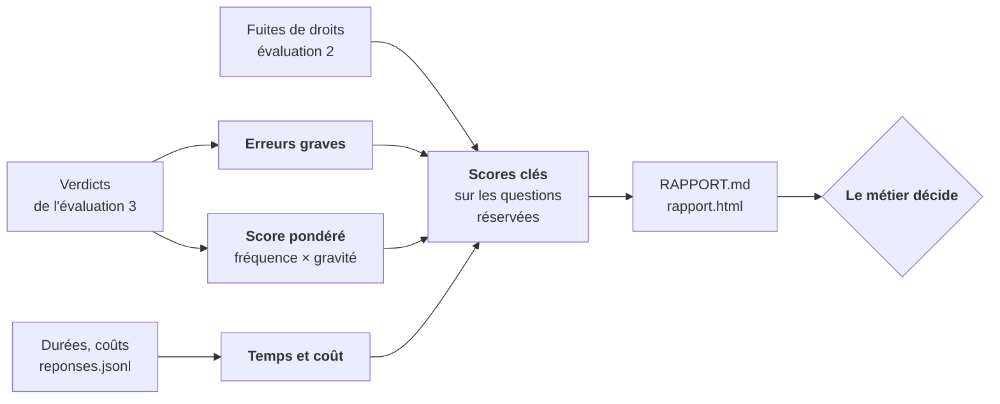

# 4. Évaluation de bout en bout

Ce guide détaille la vérification 4, de bout en bout, présentée dans le [fil conducteur](../FIL_CONDUCTEUR.md#comment-fonctionne-lévaluation) : ce qu'elle vérifie, comment chaque score est calculé, et quoi faire si c'est mauvais.

## Ce que vérifie cette évaluation

On regarde le RAG comme l'utilisateur le voit : une question, une réponse, au bout d'un certain temps et pour un certain coût. L'évaluation de bout en bout vérifie que le RAG est bon là où ça compte, assez rapide et pas trop cher. Elle vérifie **quatre choses**.

**1. Le RAG est bon sur les questions qui comptent**

Le métier a donné à chaque question une fréquence (rare 1, occasionnelle 2, fréquente 3) et une gravité (faible 1, moyenne 2, forte 3). Le poids de la question est fréquence × gravité, de 1 à 9. Chaque question reçoit sa note du guide [3. Évaluation de la réponse](3_evaluation_reponse.md) : juste 1, partielle 0,5, fausse 0. Une abstention compte juste si la question n'a pas de réponse, et fausse si elle en a une. Le score est la moyenne des notes, pondérée par les poids. Une erreur sur une question fréquente et grave coûte 9 fois plus qu'une erreur sur une question rare et sans risque.

**2. Aucune erreur grave**

Le même compte qu'à l'évaluation de la réponse, repris ici parce qu'une seule erreur grave peut suffire au métier pour refuser le RAG.

**3. Le RAG répond assez vite**

Le service mesure le temps de chaque réponse. Il donne le temps médian, celui sous lequel répond la moitié des questions, et le temps sous lequel répondent 95 % des questions.

**4. Le RAG ne coûte pas trop cher**

Le RAG indique le coût de chaque réponse ; le score est la moyenne par question. Il vaut 0 avec des modèles qui tournent en local.

Ces scores, avec ceux des évaluations 1 à 3, donnent [les scores clés](#les-scores-clés-et-la-décision-du-métier), plus bas.

C'est la dernière évaluation. Elle reprend les précédentes, pèse chaque question selon son importance, et rend les **scores clés** que le métier lit pour décider.



| Où | Quoi |
| --- | --- |
| [`methode_et_contrat/methode_evaluation.md`](methode_et_contrat/methode_evaluation.md) | la méthode (document 3), section 9 |
| [`../src/kit/etape_4_evaluation_bout_en_bout/scores.py`](../src/kit/etape_4_evaluation_bout_en_bout/scores.py) | les scores de bout en bout |
| [`../src/kit/etape_5_resultats/`](../src/kit/etape_5_resultats/) | les scores clés, le rapport, la publication dans Langfuse |

## La commande

Elle est déjà lancée par `kit evaluer`. Pour la relancer seule, sur les dernières réponses du RAG :

```bash
uv run kit evaluer-bout-en-bout
```

Elle a besoin du guide [3. Évaluation de la réponse](3_evaluation_reponse.md). Elle affiche les scores clés en clair et écrit le rapport.

## Tout en une commande

En pratique, une seule commande fait tout, une fois le RAG lancé :

```bash
uv run kit evaluer
```

Elle appelle d'abord les quatre endpoints du RAG ([0b. Les endpoints du RAG : ce que chaque RAG doit fournir](0b_endpoints_du_rag.md)) : elle lui envoie les documents, lui pose les 60 questions, et range ses réponses (5 minutes environ pour le RAG d'exemple). Elle vérifie ce que le RAG a rendu : si quelque chose est faux, elle s'arrête et dit pourquoi. Puis elle enchaîne les évaluations 1 à 4, dans l'ordre (5 minutes environ, dont 3 pour le juge).

Pour réévaluer des réponses déjà rangées, sans rappeler le RAG : `uv run kit evaluer --rag resultats/reponses_du_rag/<version du RAG>`. Une évaluation s'appelle `<version du corpus>_<version du RAG>`. Relancer une étape remplace ses résultats. Évaluer une autre version du RAG crée une autre évaluation.

## Les scores

| Score | Ce qu'il mesure | Exemple |
| --- | --- | --- |
| `n4_score_pondere` | réponses justes, pondérées par **fréquence × gravité** (de 1 à 9). Une question fréquente et grave compte 9 fois plus qu'une question rare et sans gravité. Une abstention compte juste sur une question sans réponse, et fausse sur une question qui en a une | 80 % ± 12 % |
| `n4_erreurs_graves` | repris de l'évaluation 3 | 1 |
| `n4_temps_median`, `n4_temps_p95` | temps de réponse médian, et temps sous lequel répondent 95 % des questions | 7,4 s et 12,8 s |
| `n4_cout_moyen` | coût moyen par question, en euros | 0 € (modèles locaux) |

Le score pondéré dit ce que vivront les utilisateurs. Un RAG à 90 % d'exactitude qui se trompe sur les questions fréquentes et graves sera moins bon ici.

## Les scores clés et la décision du métier

Le service ne fixe pas de seuil et ne décide pas de la mise en production. Il rend les **scores clés**, en tête du rapport, chacun écrit en une phrase claire : « Pour 9 questions sur 13, la recherche ramène le passage qui contient la réponse. » **C'est le métier qui décide**, à leur lecture et à celle des questions ratées.

Les scores clés sont calculés sur les **questions réservées** : celles qui n'ont jamais servi à régler le RAG. Les fuites de droits et les erreurs graves sont comptées sur **toutes** les questions : une seule suffit à poser problème.

Pour le RAG d'exemple, le métier lit notamment :
- 1 erreur grave (Q-046, une synthèse hors sujet) ;
- 15 caractères sur 100 mal lus sur les pages scannées ;
- sur les questions réservées : le bon passage ramené pour 9 questions sur 13 (69 %), 77 % de réponses justes, un score pondéré de 76 %.

> **Deux jeux de questions.** Si l'on règle le RAG en regardant les questions qui servent à le juger, on finit par le régler « pour le test », et le score ne veut plus rien dire. Le rapport et le CSV montrent donc le détail des questions de réglage. Pour les questions réservées, ils ne montrent que les scores clés. Leur détail reste dans la base.

Retour au [fil conducteur](../FIL_CONDUCTEUR.md#comment-fonctionne-lévaluation).

**Étape suivante** : [5. Résultats et comparaison](5_resultats_et_comparaison.md).
