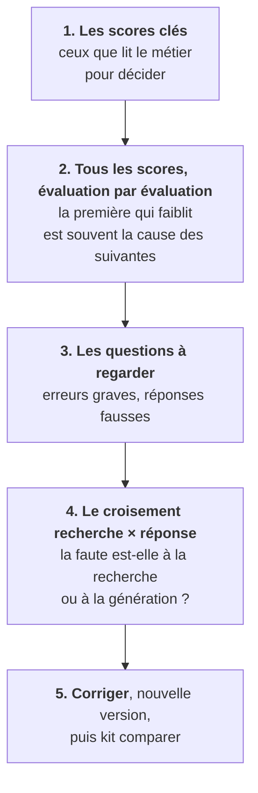

# 5. Résultats et comparaison

Ce guide détaille l'étape 4 du [fil conducteur](../FIL_CONDUCTEUR.md#4-lire-le-rapport-comparer-faire-décider-le-métier).

Le service fait deux choses différentes. Il **évalue une configuration** du RAG (le RAG avec tous ses réglages fixés) : il en donne les scores, et le métier dit, à leur lecture, si elle peut partir en production. Et il **compare deux configurations** déjà évaluées : laquelle fait mieux, et l'écart est-il réel ? Ce guide dit **où sont les résultats** de chacune, **dans quel ordre les lire**, et **comment comparer**. Il s'appuie sur une vraie évaluation : celle du RAG d'exemple (k = 5) sur le corpus d'exemple.



| Où | Quoi |
| --- | --- |
| [`../src/kit/etape_5_resultats/`](../src/kit/etape_5_resultats/) | `publication.py` (base, fichiers, Langfuse), `rapport.py` (RAPPORT.md et rapport.html d'une évaluation), `comparaison.py` (kit comparer et son RAPPORT.md) |

## 1. Où sont les résultats

Une évaluation, c'est une configuration du RAG évaluée sur un corpus. Son identifiant est `<version du corpus>_<version du RAG>`, par exemple `2026-11-20.1_graphrag-vectoriel-k5-5954e822` chez l'auteur ; chez vous, la version du corpus est la date de votre import. `kit evaluer` affiche le dossier à la fin ; sinon : `ls resultats/evaluations/`. Ses résultats sont à trois endroits.

Pour voir à quoi ils ressemblent sans rien lancer : [les résultats d'exemple](../../service-evaluation-exemple/README.md), les quatre évaluations et les trois comparaisons citées dans ce guide.

**Dans un dossier**, `resultats/evaluations/<évaluation>/` : le `RAPPORT.md`, et les autres fichiers dans `fichiers_techniques/` :

| Fichier | Pour qui | Contenu |
| --- | --- | --- |
| **`RAPPORT.md`** | **tout le monde** : à ouvrir en premier, il se lit directement sur GitHub | la configuration évaluée, les scores clés, chaque score expliqué en une phrase claire, les questions à regarder, la cause probable des erreurs |
| `rapport.html` | le métier, dans un navigateur | la même chose, en page web |
| `scores.json` | l'équipe technique | chaque score : valeur, marge d'erreur, nombre de questions, ventilation ; puis les scores clés |
| `resultats_par_question.csv` | les deux, dans un tableur | une ligne par question et par score, avec le détail (verdict et justification du juge, chunks en cause…) |
| `passages_non_rattaches.jsonl` | l'équipe technique | les passages du métier introuvables dans l'index, avec leur **cause probable** ([1. Évaluation de l'ingestion](1_evaluation_ingestion.md)) |
| `croisement.jsonl` | les deux | pour chaque question : bon passage retrouvé ou non, réponse juste ou non, et le diagnostic ([3. Évaluation de la réponse](3_evaluation_reponse.md#le-croisement-recherche--réponse--où-est-la-faute-)) |
| `relecture.jsonl` | le métier | les réponses à relire, et pourquoi |
| `liens_index.jsonl` | l'équipe technique | chaque lien passage du métier ↔ chunk du RAG, avec son mode (exact, approché, image, coupé) |
| `evaluation.json` | archive | ce qui a été évalué : versions du corpus, du kit et du RAG, modèle et prompt du juge |

**Dans Langfuse** (http://127.0.0.1:3100), l'interface partagée avec le métier :

| Objet Langfuse | Contenu | Créé par |
| --- | --- | --- |
| Jeu de données `corpus-<projet>-<version>` | une entrée par question : la question, le profil, l'historique, la réponse attendue, les points clés | `kit importer` |
| Traces du RAG | une par question : recherche, génération, tokens, durée | le RAG lui-même, si ses clés Langfuse sont dans son `.env` ([README](../../README.md)) |
| Expérience `<évaluation>` | une ligne par question, reliée au jeu de données, avec la réponse du RAG, ses scores et sa trace | le kit, à la première évaluation publiée |
| Scores | sur chaque question de l'expérience (hors questions réservées), et les scores globaux | chaque évaluation |
| File `relecture-reponses` | les réponses que le métier doit relire | `kit evaluer-reponse` |
| File `justesse-graphe` | 50 relations du graphe à juger par le métier, avec leur passage source | `kit verifier-graphe --envoyer` |

**Dans la base** (`resultats/base.sqlite`) : tout, y compris le détail des questions réservées, qui n'apparaît nulle part ailleurs.

## 2. Lire le rapport, dans l'ordre

**Les scores clés d'abord** : c'est le tableau en haut du rapport, celui que lit le métier pour décider. Ce qu'ils sont : [4. Évaluation de bout en bout](4_evaluation_bout_en_bout.md#les-scores-clés-et-la-décision-du-métier), les scores clés.

**Puis tous les scores, évaluation par évaluation, et dans l'ordre.** Une réponse fausse vient souvent d'un passage perdu à l'ingestion ou mal retrouvé : changer le prompt n'y changera rien. Ce que mesure chaque score, et quoi faire s'il est mauvais, est dans le guide de son évaluation : [1. Évaluation de l'ingestion](1_evaluation_ingestion.md#les-scores), [2. Évaluation de la recherche](2_evaluation_recherche.md#les-scores), [3. Évaluation de la réponse](3_evaluation_reponse.md#les-scores), [4. Évaluation de bout en bout](4_evaluation_bout_en_bout.md#les-scores).

Chaque score est donné avec :

| Colonne | Ce qu'elle veut dire |
| --- | --- |
| Résultat | le score, sur les questions non réservées. Entre parenthèses, la fourchette où se trouve le vrai résultat, à 95 % : avec 28 questions, « 86 % (entre 73 et 99 %) ». **Un score sur moins de 10 questions est une tendance, pas une mesure** |
| Ce que ça veut dire | le score en une phrase, avec le nombre de questions (ou de passages, de pages, de chunks) sur lequel il est calculé : « Pour 24 questions sur 28, la recherche ramène le passage qui contient la réponse. » |
| Code | l'identifiant du score, pour le retrouver dans les fichiers techniques |

Pourquoi le nombre de questions change d'un score à l'autre, sur le corpus d'exemple : 60 questions = 40 de réglage + 20 réservées, jamais détaillées. Parmi les 40, 32 ont leur réponse dans les documents ; l'exactitude ne note que les réponses données à celles-ci, pas les abstentions (28 chez l'auteur : le RAG s'est abstenu sur 4).

**Puis les questions à regarder**, dans cet ordre :
1. les erreurs graves et les fuites ;
2. les réponses fausses ;
3. les réponses données là où il fallait s'abstenir ;
4. les passages perdus à l'ingestion.

Pour chacune, le rapport donne la justification du juge, les chunks en cause, la cause probable.

**Enfin, le croisement recherche × réponse**, qui dit où chercher la cause : [3. Évaluation de la réponse](3_evaluation_reponse.md#le-croisement-recherche--réponse--où-est-la-faute-), le croisement.

## 3. Le parcours de correction, en résumé

```
Ingestion mauvaise ?   → extraction, OCR, tableaux, images, découpage      (document 2, sections 3 et 4)
Recherche mauvaise ?   → recherche hybride, reranker, filtres, k           (document 2, section 6)
Réponse mauvaise ?     → regarder d'abord le croisement :
                          « recherche »  → revenir à la recherche
                          « génération » → prompt, citations, abstention, modèle (document 2, section 7)
Fuite, erreur grave ?  → fuite : filtre des droits pendant la recherche ; erreur grave : relecture métier, garde-fou
Puis                   → nouvelle version du RAG, kit evaluer, kit comparer avec la précédente
```

Le document [Construire le pipeline d'un RAG : ce qu'on met en place selon les cas](../../service-rag-exemple/documentation/reference/techniques_rag.md).

## 4. Les marges d'erreur : ne pas sur-interpréter

La marge est `± 1,96 × √(p × (1 − p) ÷ n)` (document 3). Ce qu'il faut retenir :
- avec 50 questions, un score est précis à ± 11 points environ ; avec 200, à ± 5,5 ;
- une marge de « ± 0 % » sur un score de 100 % ou de 0 % ne veut pas dire « certain » : la formule ne sait pas estimer l'incertitude aux extrêmes ;
- un score sur moins de 10 questions (une case de la ventilation, par exemple) est une tendance.

## 5. Comparer deux versions

Après un changement (k, prompt, modèle, découpage), on évalue la nouvelle configuration, puis on la compare à l'ancienne. `kit comparer A B` répond à la question : « la configuration B fait-elle mieux que A ? » Il écrit son propre dossier, `resultats/comparaisons_de_configurations/<A>_contre_<B>/`, avec un `RAPPORT.md` qui dit ce qui change de A à B, les écarts, s'ils sont réels, et les questions gagnées ou perdues. Les trois comparaisons ci-dessous sont dans les [résultats d'exemple](../../service-evaluation-exemple/README.md#2-les-trois-comparaisons-avec-la-référence).

1. **Même corpus** : sinon la comparaison est refusée.
2. **Écart et marge** : un écart plus petit que la marge **ne prouve rien seul**.
3. **Question par question** : les questions gagnées et perdues sont plus parlantes que les moyennes.
4. **Test de McNemar** : il ne regarde que les questions qui ont changé. Une valeur p au-dessus de 0,05 veut dire que l'écart peut être dû au hasard.
5. **Régression** : une question de gravité forte perdue est signalée, même si la moyenne monte. Elle se regarde avant que le métier décide.

**Exemple : le RAG d'exemple avec k = 5 (A), puis k = 3 (B).** Une autre version du RAG, c'est le RAG relancé avec un autre réglage, puis évalué de nouveau :

```bash
cd ../service-rag-exemple && RAG_K=3 docker compose up -d && cd ../service-evaluation
```

```bash
uv run kit evaluer
```

Puis on compare les deux dossiers de résultats (`<corpus>` : la version de votre corpus) :

```bash
uv run kit comparer resultats/evaluations/<corpus>_graphrag-vectoriel-k5-5954e822 resultats/evaluations/<corpus>_graphrag-vectoriel-k3-5954e822
```

| Score | k = 5 | k = 3 | Lecture |
| --- | --- | --- | --- |
| bon passage retrouvé (`n2_reussite_k`) | 86 % | 75 % | moins de chunks, moins de chances de ramener le bon : 3 questions perdues (Q-031, Q-038, Q-057) |
| passages attendus retrouvés (`n2_rappel_k`) | 81 % | 64 % | le seul écart **plus grand que la marge** : ce n'est pas le hasard |
| réponses justes (`n3_exactitude`) | 79 % (n = 28) | 83 % (n = 23) | semble monter, mais sur 5 questions de moins : le RAG s'abstient davantage, et les abstentions ne sont pas notées ici |
| erreurs graves | 1 | 0 | Q-046 n'est plus fausse : avec 3 chunks, le RAG s'abstient. L'erreur est évitée en ne répondant pas, pas par une meilleure réponse |
| score pondéré (`n4_score_pondere`) | 80 % | 77 % | ce que vivront les utilisateurs : 4 questions perdues, aucune gagnée |

McNemar donne p = 0,125 sur le score pondéré : avec 40 questions, on ne peut pas exclure le hasard.

Pour revenir au réglage de base (k = 5) : `cd ../service-rag-exemple && docker compose up -d && cd ../service-evaluation`.

**Conclusion** : k = 3 n'est pas meilleur. Il retrouve moins et répond moins ; il n'a plus d'erreur grave seulement parce qu'il se tait sur Q-046. Pour décider, il faudrait plus de questions (la configuration recommandée en prévoit 200), et un correctif ciblé de l'erreur grave sur k = 5.

C'est tout l'intérêt de lire **plusieurs scores ensemble**. Une exactitude qui monte peut cacher un RAG qui répond moins.

**Exemple : le RAG vectoriel (A) et le RAG hybride, avec son graphe (B), tous deux avec k = 5.** Le RAG hybride, c'est le RAG relancé avec `RAG_GRAPHE=true docker compose up -d` (dans `service-rag-exemple/`), puis évalué avec `uv run kit evaluer`. Le même kit les évalue sans changer une ligne de code : il voit seulement `type_rag` = `hybride` et un graphe de plus.

```bash
uv run kit comparer resultats/evaluations/<corpus>_graphrag-vectoriel-k5-5954e822 resultats/evaluations/<corpus>_graphrag-hybride-k5-57001489
```

| Score | vectoriel | hybride | Lecture |
| --- | --- | --- | --- |
| violations de l'ontologie (`n1_graphe_violations`) | — | 25 | le graphe existe, avec des erreurs d'extraction : des personnes « situées sur » un site, un onduleur qui « secourt » un site |
| justesse des relations (`n1_graphe_justesse`) | — | 66 % (n = 50) | une relation sur trois est fausse d'après son passage source ([1. Évaluation de l'ingestion](1_evaluation_ingestion.md)) |
| bon passage retrouvé (`n2_reussite_k`) | 86 % | 82 % | les éléments du graphe prennent des places parmi les k : 1 question perdue (Q-031) |
| bon passage en tête (`n2_reussite_1`) | 54 % | 39 % | un élément du graphe passe souvent devant le bon passage |
| réponses justes (`n3_exactitude`) | 79 % (n = 28) | 90 % (n = 25) | 2 questions gagnées (Q-012, Q-043), mais sur 3 questions de moins : le RAG hybride s'abstient plus souvent à tort (9 % contre 6 %) |
| bonnes citations (`n3_citations`) | 93 % | 100 % | — |
| erreurs graves | 1 | 0 | le RAG hybride s'abstient sur Q-046, comme k = 3 |
| synthèses (`n3_synthese`) | 65 % | 73 % | sur 3 ou 4 questions : une tendance, pas une mesure |
| score pondéré (`n4_score_pondere`) | 80 % | 82 % | 2 questions gagnées, 1 perdue ; McNemar p = 1 |

**Conclusion** : sur ce corpus, le graphe n'apporte rien de mesurable. Aucun écart ne dépasse la marge, et le score pondéré bouge de deux points, sur trois questions. Le corpus d'exemple a peu de questions qui demandent de suivre des liens ou de faire une liste. C'est ce que dit le document 2 : le graphe s'ajoute quand l'évaluation montre des échecs que la recherche de passages ne peut pas corriger. Ici, elle n'en montre pas.

**Exemple : corriger un défaut, et choisir entre deux corrections.** En relisant les réponses, on a vu que trois d'entre elles étaient vides ou coupées en cours de phrase (Q-043, Q-030, Q-046). Le modèle de génération « réfléchit » avant d'écrire, et cette réflexion consommait les 800 tokens de `max_tokens`. Deux corrections étaient possibles : laisser plus de place (`max_tokens` à 4 000), ou couper la réflexion (`sans_reflexion: true`). Le kit les départage. La version sans réflexion s'obtient avec `sans_reflexion: true` dans [`service-rag-exemple/config/config.yaml`](../../service-rag-exemple/config/config.yaml), puis `docker compose restart rag` (dans `service-rag-exemple/`) et `uv run kit evaluer` ; remettre ensuite `false`.

```bash
uv run kit comparer resultats/evaluations/<corpus>_graphrag-vectoriel-k5-5954e822 resultats/evaluations/<corpus>_graphrag-vectoriel-k5-94d362c8
```

| Score | avec réflexion, 4 000 tokens | sans réflexion | Lecture |
| --- | --- | --- | --- |
| réponses justes (`n3_exactitude`) | 79 % | 71 % | 4 questions perdues, dont 3 calculs (Q-022, Q-023, Q-038) ; 1 gagnée (Q-043) |
| valeurs chiffrées (`n3_valeurs`) | 91 % | 75 % | sans réflexion, le petit modèle calcule mal |
| erreurs graves | 1 | 0 | sans réflexion, le RAG s'abstient sur Q-046 |
| score pondéré (`n4_score_pondere`) | 80 % | 77 % | McNemar p = 0,45 : l'écart peut être dû au hasard |
| temps médian, temps à 95 % | 7,4 s et 12,8 s | 0,9 s et 2,6 s | 9 fois plus rapide |

**Conclusion** : les deux corrections suppriment la coupure. On garde la réflexion : elle rend les calculs justes, et une réponse en 7 secondes reste acceptable pour l'utilisateur. Si le temps devenait le problème, la version sans réflexion serait le bon compromis, et ce tableau dirait ce qu'elle coûte. Avant la correction, la version avec 800 tokens avait un score pondéré de 81 % : la coupure ne coûtait presque rien dans les scores. Les réponses coupées étaient déjà fausses ou partielles pour d'autres raisons, et Q-043, devenue complète, est restée « fausse » pour le juge ([3. Évaluation de la réponse](3_evaluation_reponse.md#vérifier-le-juge-avant-de-lui-faire-confiance)). Relire les réponses trouve des défauts que les moyennes ne montrent pas.

Retour au [fil conducteur](../FIL_CONDUCTEUR.md#4-lire-le-rapport-comparer-faire-décider-le-métier), étape 4.

**Étape suivante** : [6. Aide à la décision : lire les scores](6_aide_a_la_decision.md).
