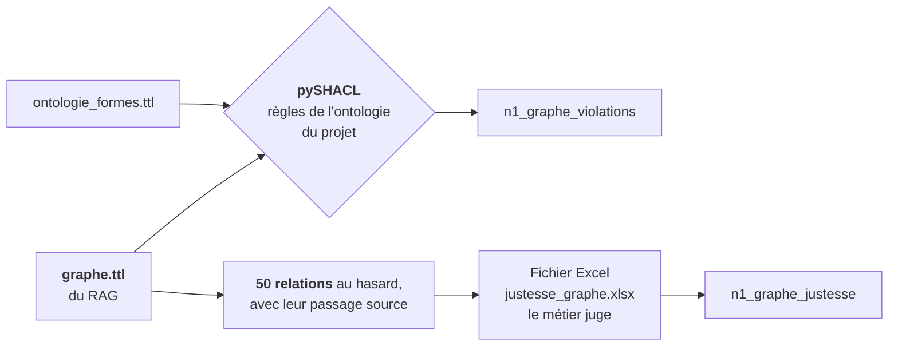

# Pour aller plus loin : les cas particuliers

Ce document complète le [fil conducteur](../FIL_CONDUCTEUR.md) pour des RAG qui sortent du cas courant. Le cas courant est un RAG qui cherche des morceaux de texte dans des documents, puis rédige une réponse. Chaque partie dit ce que le service évalue déjà dans ce cas particulier, ce qu'il n'évalue pas encore, et ce qu'il faudrait pour aller plus loin. Lire seulement la partie qui concerne votre RAG.

## 1. Un RAG avec un graphe de connaissances

**De quoi il s'agit.** En plus des morceaux de texte, le RAG construit une carte des liens entre les éléments des documents : équipements, sites, personnes. Un modèle de langage lit les documents et en tire des relations, par exemple « l'armoire AD-A07 est alimentée par le TGBT-A ». Une **ontologie** dit quelles sortes d'éléments et de relations existent : « équipement », « site », « est alimenté par »… Le graphe n'invente pas un lien : il ne contient que les relations que l'extraction a trouvées dans les documents, avec les mots de l'ontologie.

**À quoi sert un graphe.** Aux questions dont la réponse est éparpillée dans plusieurs documents, et qu'on n'obtient qu'en suivant des liens. Trois documents :
- la fiche de l'armoire AD-A07 : « L'armoire AD-A07 est alimentée par le TGBT-A. »
- la fiche de l'armoire AD-A12 : « L'armoire AD-A12 est alimentée par le TGBT-A. »
- la note du site : « Le TGBT-A est le tableau général du site A. »

À la question « Si le TGBT-A tombe en panne, quelles armoires sont coupées ? » :

| | Sans graphe | Avec graphe |
| --- | --- | --- |
| Ce que fait le RAG | il ramène les morceaux de texte qui ressemblent le plus à la question | il suit le lien « est alimentée par le TGBT-A » |
| Le résultat | il peut trouver la fiche AD-A07 et rater la fiche AD-A12 : réponse incomplète | il trouve les deux armoires : réponse complète |

**Ce que le service évalue déjà.** Deux contrôles du graphe, à l'évaluation de l'ingestion, parce que le graphe est construit en lisant les documents. Le RAG rend son graphe à l'appel ②, dans `graphe.ttl` ([0b. Les endpoints du RAG : ce que chaque RAG doit fournir](0b_endpoints_du_rag.md)) :
- **la conformité** : le graphe respecte-t-il les règles de l'ontologie du projet ? Une personne « située sur » un site, ou une relation inconnue, compte comme une violation ;
- **la justesse** : le métier juge 50 relations tirées au hasard, d'après le passage d'où elles viennent.



| Score | Ce qu'il mesure | Si c'est mauvais |
| --- | --- | --- |
| `n1_graphe_violations` | le nombre de règles de l'ontologie non respectées : une classe fausse (une personne « située sur » un site), une relation inconnue, trop de valeurs (un équipement sur deux sites), une provenance manquante | contraindre davantage l'extraction : consigne, exemples, contrôle par l'ontologie avant d'écrire le graphe |
| `n1_graphe_justesse` | la part des relations jugées justes par le métier, d'après leur passage source | une relation conforme à l'ontologie peut être fausse : meilleur modèle d'extraction, relecture |

Les règles sont celles du projet, pas celles du RAG : le chemin de `ontologie_formes.ttl` est dans [`config/kit.yaml`](../config/kit.yaml) (`graphe.formes`). Le code : [`../src/kit/etape_1_evaluation_ingestion/graphe.py`](../src/kit/etape_1_evaluation_ingestion/graphe.py).

Les violations sont calculées par `kit evaluer-ingestion`. La justesse demande le métier :

1. Écrire le fichier à faire remplir par le métier, `justesse_graphe.xlsx`, dans le dossier de l'évaluation : 50 relations tirées au hasard, chacune avec son document, sa page et le passage d'où elle vient.
   ```bash
   uv run kit verifier-graphe --preparer
   ```
2. Le remettre au métier. Pour chaque relation, il choisit dans « Votre jugement » : **juste** si le passage dit bien cette relation, **fausse** sinon. Il rend le fichier, qu'on remet à la même place.

   Un métier qui a déjà Langfuse en main peut juger là plutôt que dans le fichier : ajouter `--langfuse` à la commande, et les relations sont aussi mises dans la file **`justesse-graphe`** (Annotation Queues, score `justesse_relation`). Le service relit les jugements là où ils ont été mis.

3. Voir où en est la relecture, puis inscrire le score dans les résultats :
   ```bash
   uv run kit verifier-graphe
   ```
   ```bash
   uv run kit evaluer-ingestion
   ```

**Ce qu'il n'évalue pas encore.** Ce que le graphe apporte aux réponses. Les deux contrôles disent si les relations du graphe sont justes, pas si le graphe contient les liens dont on a besoin, ni s'il aide à mieux répondre. Un premier essai, sur le corpus d'exemple, n'a rien montré de mesurable : le corpus n'avait presque pas de questions qui demandent de suivre des liens. Le graphe a donc été retiré du RAG d'exemple.

**Pour aller plus loin**, deux ajouts, à faire dans cet ordre :
1. **Des questions de liens dans le corpus.** Le métier écrit une dizaine de questions comme celle des armoires, avec tous les passages qui contiennent la réponse. Le rapport donnerait, à part, la part de bonnes réponses sur ces questions. En évaluant le RAG sans graphe puis avec graphe, la comparaison dirait si le graphe vaut ce qu'il coûte : nettement plus de bonnes réponses avec lui, on le garde ; sinon, on le retire.
2. **Les relations attendues.** Une feuille facultative du fichier du corpus, « Relations attendues », remplie seulement si le RAG a un graphe construit avec une ontologie. Une ligne par relation, avec les mots de l'ontologie, et le document et la page où elle est écrite : « AD-A07 · est alimentée par · TGBT-A · fiche AD-A07, page 1 ». Le service vérifierait que ces relations sont dans le graphe du RAG : on saurait s'il contient les liens qu'on attend de lui.

Ni l'un ni l'autre n'est fait aujourd'hui : c'est une prochaine version du service.

## 2. Un RAG qui se repose des questions

**De quoi il s'agit.** Certains RAG ne cherchent pas une seule fois : selon ce qu'ils ont trouvé, ils se reposent une question, refont une recherche, et ne répondent qu'ensuite. On les appelle souvent des agents. Pour la question des armoires, un tel RAG peut trouver le lien sans graphe : il lit « AD-A07 est alimentée par le TGBT-A », puis cherche « quelles autres armoires sont alimentées par le TGBT-A ? ».

**Ce que le service évalue.** La réponse est évaluée comme pour tout RAG, sans supposer comment il l'a obtenue : c'est le guide [3. Évaluation de la réponse](3_evaluation_reponse.md). Les questions de liens de la partie 1 servent donc aussi à évaluer ce RAG.

**La seule précaution.** L'évaluation de la recherche, le guide [2. Évaluation de la recherche](2_evaluation_recherche.md), porte sur les morceaux de texte que le RAG déclare avoir ramenés, à l'appel ③. Un RAG qui cherche plusieurs fois doit y rendre tous les morceaux qu'il a lus pour répondre, sinon sa recherche paraît moins bonne qu'elle ne l'est.

## 3. Des réponses qui se calculent sur des données

**De quoi il s'agit.** Quand les sources sont des fiches d'une GED ou des lignes d'une base de données, les utilisateurs posent aussi des questions comme « combien de tickets ont été ouverts en mars ? » ou « quel site a eu le plus de pannes ? ». La réponse se calcule sur des dizaines de fiches : elle n'est écrite dans aucun passage. Certains RAG traduisent alors la question en requête sur la base, sans chercher de morceaux de texte.

**Ce que le service évalue.** Seulement la réponse, avec les guides [3. Évaluation de la réponse](3_evaluation_reponse.md) et [4. Évaluation de bout en bout](4_evaluation_bout_en_bout.md). L'évaluation de l'ingestion et celle de la recherche ne s'appliquent pas, puisqu'il n'y a pas de passage à retrouver.

**Deux précautions :**
- **une copie figée des données**, datée : sur une base qui change tous les jours, la bonne réponse écrite par le métier deviendrait fausse au bout de quelques semaines ;
- **le métier écrit la bonne réponse en la calculant lui-même** sur cette copie, et la met en point clé : « 42 tickets ».

Retour au [fil conducteur](../FIL_CONDUCTEUR.md#pour-aller-plus-loin).
