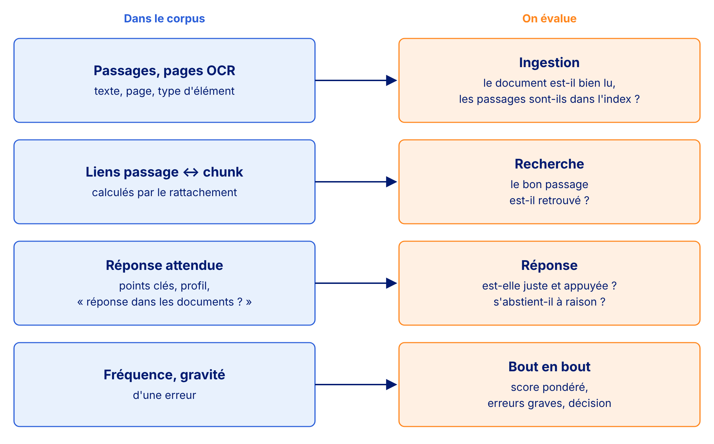
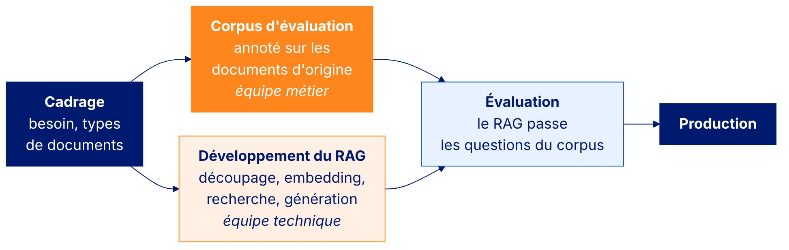
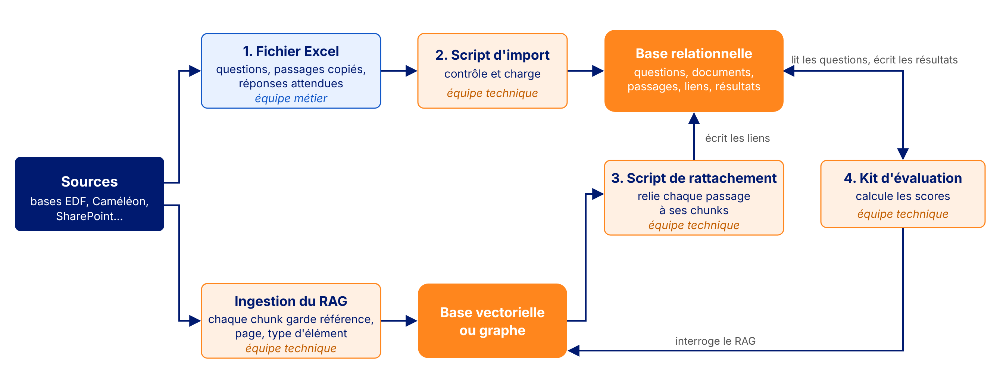
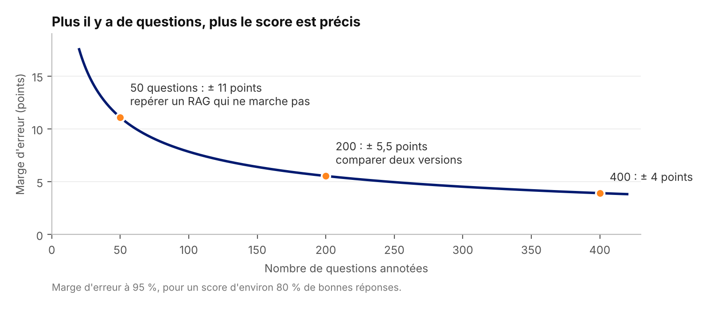
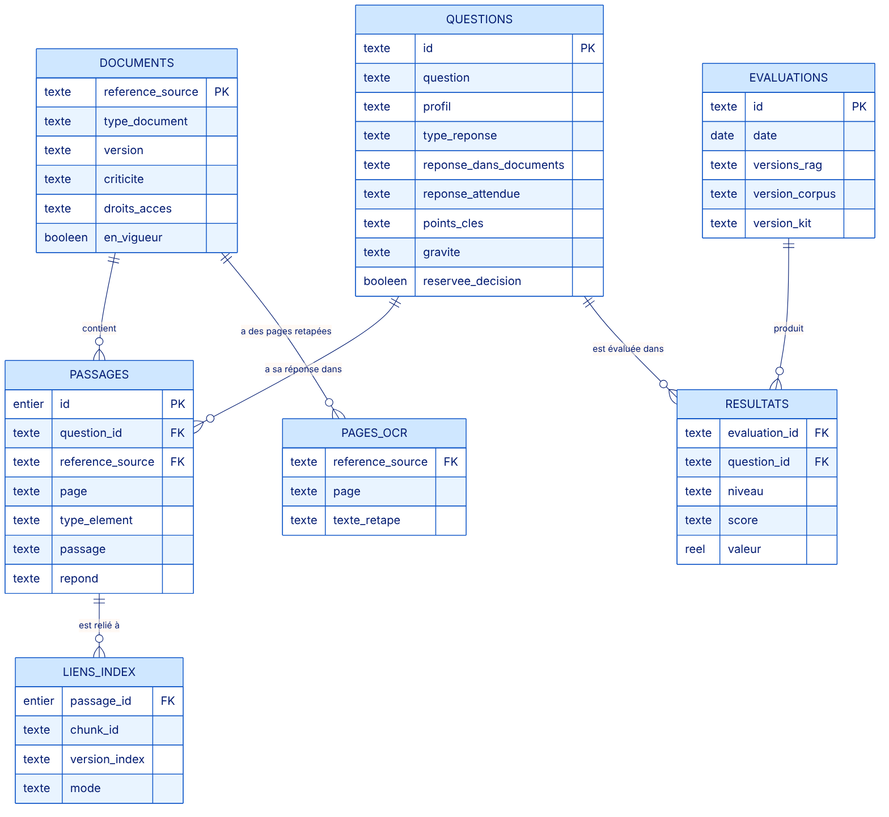

# Constituer le corpus d'évaluation d'un RAG

Règles à suivre pour tout projet RAG, quel qu'il soit : base vectorielle, graphe, ou les deux. Le métier remplit le fichier `Corpus_evaluation_RAG.xlsx` ; l'équipe technique le charge dans une base relationnelle reliée au RAG, puis l'exporte au format standard que lit le kit d'évaluation (document 3).

## 1. Pourquoi ce corpus

Sans corpus annoté, on ne peut pas dire si un RAG répond juste, ni si une nouvelle version fait mieux. Le corpus sert à évaluer le RAG à quatre niveaux.

## 2. Quand on le construit

En parallèle du développement du RAG, et avant la première évaluation. Le métier annote les documents tels qu'ils sont dans leur source : le corpus ne dépend d'aucun choix technique du RAG.

## 3. Le chemin complet

| Étape | Qui | Ce qui se passe |
| --- | --- | --- |
| 1. Fichier Excel | équipe métier | écrit les questions, copie les passages depuis les sources, écrit les réponses attendues |
| 2. Script d'import | équipe technique | contrôle le fichier, le charge dans la base relationnelle, et l'exporte au format standard |
| Ingestion du RAG | équipe technique | indexe les sources dans la base vectorielle ou le graphe ; chaque chunk garde la référence du document, la page et le type d'élément |
| 3. Script de rattachement | équipe technique | relie chaque passage du métier aux chunks qui le contiennent, et écrit ces liens dans la base relationnelle |
| 4. Kit d'évaluation | équipe technique | pose les questions au RAG, compare ce qu'il retrouve et répond au corpus, enregistre les scores (document 3) |

Le lien entre le corpus et le RAG, c'est **la référence du document dans sa source, la page et le texte du passage**. Le métier les connaît ; l'ingestion les garde sur chaque chunk.

## 4. Ce que fait le métier : le fichier Excel

### Organisation

Une question a sa réponse dans un ou plusieurs documents ; dans chaque document, dans un ou plusieurs passages. Le fichier a une feuille par niveau, plus une feuille pour les pages de référence de l'OCR.

Chaque colonne est expliquée dans le fichier : en survolant son en-tête, et dans la feuille Définitions.

### Feuille Documents : une ligne par document

| Colonne | Ce qu'on écrit |
| --- | --- |
| Référence dans la source | l'identifiant du document dans sa source : numéro dans la base EDF, référence Caméléon, chemin du fichier |
| Titre, type de document, source | le titre ; un type de la feuille Listes ; le système d'où vient le document |
| Version, date | la version annotée et sa date |
| Format, nombre de pages | PDF natif, PDF scanné, Word, Excel, fiche de base de données ; nombre de pages |
| Criticité | C1, C2, C2 export, C3 |
| Droits d'accès | le profil qui a le droit de voir le document (feuille Listes) ; « tous les utilisateurs » s'il n'y a pas de restriction |
| En vigueur, remplacé par | oui · non ; si non, la référence du document qui le remplace |
| Sélection | tiré au hasard, ou choisi par le métier |

### Feuille Questions : une ligne par question

| Colonne | Ce qu'on écrit |
| --- | --- |
| Identifiant, question | Q-001… ; la question, avec les mots d'un utilisateur |
| Profil de l'utilisateur | le profil qui pose la question (feuille Listes) ; « tous les utilisateurs » par défaut |
| Rédigée par | le métier · une IA, puis relue par le métier · question réelle, venue de la production |
| Type de réponse | fait (une valeur, un nom, une date) · liste · calcul · explication · synthèse (sur l'ensemble des documents) |
| Réponse dans les documents ? | oui · non (le RAG doit dire qu'il ne sait pas) · non accessible à ce profil (le RAG ne doit rien tirer d'un document interdit) |
| La réponse est dans | un seul passage · plusieurs passages à combiner · plusieurs passages, un seul suffit · l'ensemble des documents (synthèse) |
| Réponse attendue | la bonne réponse en 1 à 3 phrases, chiffres avec unités |
| Points clés attendus | ce que la réponse doit contenir pour être juste, séparés par « ; » (règles ci-dessous) |
| Difficulté | facile : une phrase, avec les mots de la question · moyenne : d'autres mots, ou un tableau · difficile : plusieurs passages, un calcul, un raisonnement |
| Fréquence | fréquente : chaque semaine · occasionnelle : chaque mois · rare : moins souvent |
| Gravité d'une erreur | faible : une gêne · moyenne : une perte de temps · forte : un risque pour la sûreté, la sécurité, un enjeu financier ou juridique |
| Réservée à la décision | oui : la question ne sert qu'à décider de la mise en production ; l'équipe technique ne la regarde pas |
| Question précédente | pour une question de suite (« et pour le site B ? ») : l'identifiant de la question qui la précède dans la conversation |
| Variante de | pour une même question reformulée : l'identifiant de la question d'origine |

**Écrire les points clés selon le type de réponse :**

| Type de réponse | Points clés |
| --- | --- |
| Fait, explication | les éléments indispensables : « disjoncteur ; PR-1234 » |
| Liste | chaque élément de la liste, un par point clé : on mesure si la liste est complète |
| Calcul | la valeur, l'unité et la tolérance : « 14 jours » ; « 2 % ± 0,1 » |
| Synthèse | les thèmes que la réponse doit couvrir |

### Feuille Passages : une ligne par endroit où se trouve la réponse

| Colonne | Ce qu'on écrit |
| --- | --- |
| Question | Q-001 |
| Référence du document | la référence dans la source, comme dans la feuille Documents |
| Page | la page ; pour une fiche de base de données, le nom du champ |
| Type d'élément | texte · tableau · texte scanné · image ou schéma |
| Passage | voir le tableau ci-dessous |
| Répond | entièrement · en partie · piège (ressemble à la réponse mais ne répond pas : ancienne version, autre site) |

### Écrire le passage selon le type d'élément

| Type d'élément | Ce que le métier écrit dans « Passage » |
| --- | --- |
| Texte | un copier-coller exact depuis la source |
| Tableau | un copier-coller de la ligne qui répond, avec les en-têtes de colonnes |
| Texte scanné | la phrase clé, recopiée (le copier-coller est impossible) |
| Image ou schéma | une phrase qui dit ce que l'image montre et qui répond, avec le numéro de figure s'il existe |
| Fiche de base de données | la valeur du champ, et le nom du champ dans « Page » |

### Feuille Pages OCR : les pages de référence

Si des documents sont scannés, on retape à la main quelques pages entières : texte et tableaux, ligne par ligne. Comparées au texte que lit l'ingestion, elles mesurent la qualité de l'OCR (document 3, niveau ingestion).

| Colonne | Ce qu'on écrit |
| --- | --- |
| Référence du document, page | la page retapée |
| Texte retapé | le texte exact de la page, dans l'ordre de lecture ; un tableau ligne par ligne, cellules séparées par « \| » |
| Retapé par, date | qui, quand |

On choisit des pages variées : texte simple, tableau, page de mauvaise qualité. L'équipe technique peut retaper ; le métier relit.

### Ajouter des colonnes

Chaque projet ajoute à droite les colonnes utiles : service, site, unité, palier, équipement… Elles permettront de lire les résultats par service, par site, etc. On ne renomme pas une colonne standard.

### Configuration minimale ou recommandée

| | Configuration minimale | Configuration recommandée |
| --- | --- | --- |
| **Documents** | 10 par type : 8 tirés au hasard, 2 choisis par le métier | 20 par type |
| **Questions** | 50, dont 5 par type de document | 200 et plus |
| **Questions sans réponse dans les documents** | 5 | 1 sur 10 |
| **Questions à plusieurs passages** | 5 | 1 sur 6 |
| **Questions posées avec un profil restreint** (si le RAG filtre les droits) | 5, dont 2 « non accessible à ce profil » | 1 sur 10 |
| **Questions de synthèse** (si le RAG utilise un graphe) | 5 | 1 sur 10 |
| **Pages de référence OCR** (si des documents sont scannés) | 20 | 50 |
| **Passages pièges, questions de suite, variantes** | — | 1 question sur 10 pour chacun |
| **Contrôle** | tableau de bord du fichier « OK », relecture de 10 questions par un autre membre du métier | 10 à 20 % des questions annotées une seconde fois |
| **Questions rédigées par une IA** | non | oui, relues par le métier |

Avec 50 questions, le score est précis à ± 11 points : assez pour voir si le RAG marche. Avec 200, à ± 5,5 points : assez pour dire si une nouvelle version fait mieux. Les autres valeurs sont des repères à adapter.

### Le déroulé pour le métier

1. Avec l'équipe technique, lister les types de documents, les sources et les profils d'accès (feuille Listes).
2. Pour chaque type, retenir 10 documents : 8 tirés au hasard dans la source, 2 choisis (feuille Documents).
3. Écrire les questions, sans le document sous les yeux, avec les mots des utilisateurs (feuille Questions).
4. Pour chaque question, ouvrir les documents dans leur source et remplir une ligne par passage qui répond (feuille Passages).
5. Écrire la réponse attendue, les points clés, et qualifier la question (feuille Questions).
6. Si des documents sont scannés, faire retaper les pages de référence et les relire (feuille Pages OCR).
7. Vérifier que le tableau de bord du fichier est « OK », puis transmettre le fichier à l'équipe technique.

## 5. Ce que fait l'équipe technique

### À l'ingestion : une exigence

Chaque chunk de la base vectorielle, ou chaque élément du graphe, garde dans ses métadonnées :

| Métadonnée | Exemple |
| --- | --- |
| Référence du document dans sa source | PR-1234 |
| Version du document | v4 |
| Page (ou champ, pour une fiche de base) | 4 |
| Type d'élément | texte, tableau, texte scanné, image ou schéma |
| Droits d'accès | profil autorisé |

Les images et schémas sont convertis en texte à l'ingestion (description par un modèle de vision) et indexés comme chunks de type « image ou schéma », avec leur page.

### La base relationnelle

Elle centralise le corpus, les liens avec le RAG et les résultats. Elle est indépendante de la base vectorielle choisie.

| Table | Une ligne = | Remplie par |
| --- | --- | --- |
| documents | un document du corpus | le script d'import |
| questions | une question | le script d'import |
| passages | un endroit où se trouve la réponse | le script d'import |
| pages_ocr | une page de référence retapée | le script d'import |
| liens_index | un lien entre un passage et un chunk, pour une version de l'index | le script de rattachement |
| evaluations | une évaluation : date, versions du RAG, du corpus et du kit | le kit d'évaluation |
| resultats | un score d'une question, à un niveau, dans une évaluation | le kit d'évaluation |

Les droits d'accès à cette base sont ceux des documents les plus sensibles qu'elle contient (criticité C2, C3…).

### Le corpus au format standard

Le script d'import exporte le corpus en quatre fichiers, toujours avec les mêmes noms de champs. C'est ce que lit le kit d'évaluation, quel que soit le projet. Le détail des champs est dans la spécification du contrat ([`contrat_des_fichiers.md`](contrat_des_fichiers.md)).

| Fichier | Une ligne = |
| --- | --- |
| documents.jsonl | un document |
| questions.jsonl | une question, avec sa réponse attendue et ses points clés |
| passages.jsonl | un passage |
| pages_ocr.jsonl | une page de référence |

Un fichier `corpus.json` donne la version du corpus et sa date. Chaque modification du fichier Excel donne une nouvelle version.

### Ce qu'il faut développer

| Script | Lit | Fait | Écrit | Quand |
| --- | --- | --- | --- | --- |
| Import | le fichier Excel | contrôle les lignes (colonnes remplies, références existantes), rejette les erreurs, exporte le format standard | documents, questions, passages, pages_ocr ; les fichiers standard | à chaque nouvelle version du fichier |
| Rattachement | les passages, et les chunks exportés par le RAG | pour chaque passage, cherche les chunks de même référence et même page, puis garde ceux qui correspondent (tableau ci-dessous) | liens_index, avec la version de l'index ; une alerte pour chaque passage sans lien | après chaque ingestion |
| Kit d'évaluation | le corpus, les liens et les sorties du RAG | voir le document 3 | evaluations, resultats | à chaque nouvelle version du RAG |

Le rattachement selon le type d'élément :

| Type d'élément | Un chunk correspond si |
| --- | --- |
| Texte, tableau, fiche de base | même référence, même page, et son texte contient le passage |
| Texte scanné | même référence, même page, et son texte ressemble au passage (tolérance aux erreurs d'OCR) |
| Image ou schéma | même référence, même page, et c'est un chunk de type « image ou schéma » |

Un passage sans lien signifie que l'ingestion l'a perdu (scan mal lu, tableau cassé) ou que la page notée est fausse : c'est à corriger avant d'évaluer. Les passages « piège » sont rattachés de la même façon : le kit vérifie ensuite que le RAG ne les cite pas.

## 6. Cinq règles à ne jamais oublier

1. Le métier annote les documents tels qu'ils sont dans leur source, avec leur référence.
2. L'ingestion garde la référence, la page, le type d'élément et les droits sur chaque chunk.
3. Le lien entre passages et chunks est recalculé après chaque ingestion, jamais saisi à la main.
4. Les questions sont écrites sans le document sous les yeux, et certaines n'ont pas de réponse.
5. Les questions réservées à la décision ne servent jamais à régler le RAG.
