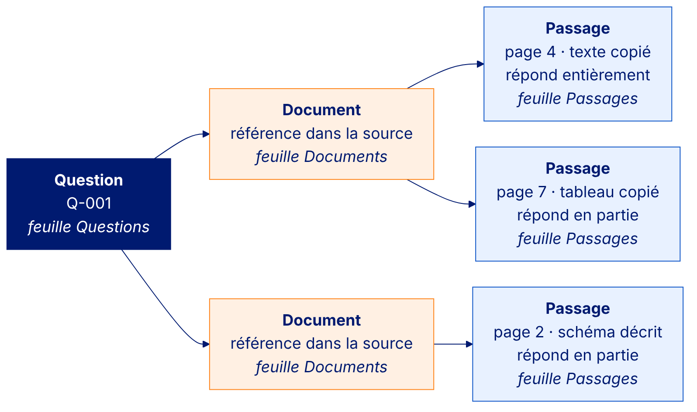

# Constituer le corpus d'évaluation d'un RAG

Un **RAG** est un assistant qui répond à des questions en s'appuyant sur des documents. Pour savoir s'il répond juste, et si une nouvelle version fait mieux que la précédente, il faut le tester sur des questions dont on connaît la bonne réponse. Cet ensemble de questions, de bonnes réponses et de documents s'appelle le **corpus d'évaluation**.

Ce document explique, de bout en bout, comment le construire. Il s'adresse à deux équipes : **le métier**, qui connaît les documents et les questions des utilisateurs, et **l'équipe technique**, qui charge le corpus et le relie au RAG. Il se suffit à lui-même : on n'a besoin d'aucun autre document pour construire le corpus.

## Le principe en bref

**Ce qu'on construit.** Le corpus se compose de deux choses :
- les **documents** que le RAG devra lire, tels qu'ils sont dans leur source (PDF, Word, Excel, ou fiches d'une base documentaire) ;
- un **fichier Excel**, rempli par le métier : pour chaque question, la bonne réponse et le **passage exact** des documents où elle se trouve, copié-collé.

Le RAG ne reçoit que les documents. Il ne voit jamais le fichier Excel : sinon, il aurait les réponses sous les yeux.

**Pourquoi un passage exact ?** Pour savoir **d'où vient une erreur**. Quand le RAG se trompe, il y a trois causes possibles : il a mal lu le document, il n'a pas retrouvé le bon morceau, ou il l'a retrouvé mais a mal répondu. Avec le passage exact, on sait laquelle. Sans lui, on sait seulement que la réponse est fausse.

**À quoi il sert : quatre vérifications.** Le service qui évalue le RAG pose les questions du corpus, puis contrôle, dans l'ordre :

| Ce qu'on vérifie | La question qu'on se pose | Ce qui, dans le corpus, le permet |
| --- | --- | --- |
| **1. L'ingestion** | Le RAG a-t-il bien lu les documents ? | les passages, les pages scannées retapées |
| **2. La recherche** | Retrouve-t-il le bon morceau, et jamais un document interdit ? | le lien entre chaque passage et le morceau du RAG qui le contient |
| **3. La réponse** | Est-elle juste, appuyée sur les documents ? Dit-il « je ne sais pas » quand il le faut ? | la réponse attendue, ses points clés, le profil de l'utilisateur |
| **4. Le bout en bout** | Est-il bon là où ça compte le plus ? | la fréquence de la question, la gravité d'une erreur |

**Quand le construire.** En parallèle du développement du RAG, et avant la première évaluation. Le métier annote les documents **tels qu'ils sont dans leur source** : le corpus ne dépend d'aucun choix technique du RAG, il sert donc à évaluer n'importe quel RAG.

**Qui fait quoi.**

| Qui | Ce qu'il fait | Ce qu'il livre |
| --- | --- | --- |
| **Le métier** | choisit les documents, écrit les questions, copie les passages, écrit les réponses attendues | le fichier Excel rempli, et les documents |
| **L'équipe technique** | contrôle et charge le fichier, relie chaque passage au RAG | le corpus contrôlé, prêt à évaluer |
| **Le service d'évaluation** | pose les questions au RAG et compare ses réponses au corpus | les scores |

**Le lien entre le corpus et le RAG** tient en trois informations, que le métier connaît et que le RAG doit conserver : **la référence du document dans sa source, la page, et le texte du passage**.

## Étape 1. Préparer : types de documents, sources, profils

Avant de remplir quoi que ce soit, on se met d'accord, métier et équipe technique, sur trois listes :
- les **types de documents** (par exemple : procédure, compte rendu d'intervention, note technique) ;
- les **sources** d'où viennent les documents (un espace de partage, une GED, un outil de tickets…) ;
- les **profils d'accès** : qui a le droit de voir quoi (par exemple : « tous les utilisateurs », « Maintenance », « Exploitation »).

**À faire.** Saisir ces trois listes dans la feuille **Listes** du fichier Excel : les autres feuilles s'en servent pour proposer des valeurs.

**Dans l'exemple.** Trois types de documents (procédure, compte rendu d'intervention, note technique), trois sources (une GED, une GMAO, des archives techniques), et des profils comme « Tous les utilisateurs », « Maintenance » et « Exploitation ».

## Étape 2. Choisir les documents

On ne met pas toute la base documentaire dans le corpus : on en retient un échantillon, qui doit ressembler à la réalité.

**À faire.**
- Pour chaque type de document, retenir **10 documents** : **8 tirés au hasard** dans la source, **2 choisis** par le métier. Le tirage au hasard garantit que l'échantillon ressemble à la réalité ; les deux documents choisis permettent d'y ajouter les cas que le métier veut absolument tester.
- Remplir **une ligne par document** dans la feuille **Documents**.
- Pour les documents **sensibles**, indiquer le profil qui a le droit de les voir ; pour les documents qui ont été **remplacés** par une version plus récente, indiquer « non » dans « En vigueur » et la référence du document qui les remplace. Ces deux cas permettent de tester que le RAG respecte les droits et ne se trompe pas de version.

Les documents sont de deux sortes, mélangeables dans un même corpus :

| | Un fichier | Une fiche de GED |
| --- | --- | --- |
| **C'est** | un PDF, un Word, un Excel | une fiche, un ticket, un compte rendu d'une base documentaire, qui s'affiche à l'écran |
| **Sa référence** | celle du document (par exemple `PR-1101`) | le numéro de la fiche affiché dans la GED (par exemple `OT-24102`) |
| **Sa « page »** | le numéro de page | le nom du champ affiché (par exemple « Résolution » ou « Pièces remplacées ») |

Trois règles pour les fiches de GED : une **pièce jointe** est une source à part, avec sa propre ligne ; on travaille sur une **copie figée** de la GED, ou sur des fiches closes, car une fiche modifiée pendant l'évaluation rendrait fausse la réponse attendue ; le numéro de la fiche et le nom du champ suffisent à désigner un endroit précis : le métier n'a pas à connaître la structure de la base.

**Dans l'exemple.** 50 documents d'une entreprise fictive : 17 procédures, 16 notes techniques (dont 5 scannées), 17 comptes rendus d'intervention qui sont des fiches de GED. 4 documents sont réservés au profil « Maintenance » ; une procédure de 2021 est remplacée par une version de 2025 qui donne des valeurs différentes.

## Étape 3. Écrire les questions

**À faire.**
- Écrire les questions **sans avoir le document sous les yeux**, avec **les mots des utilisateurs** et non ceux du document : c'est ainsi qu'on les posera vraiment. Une question peut aussi être rédigée par une IA, à condition que le métier la relise, ou venir de la production.
- Remplir **une ligne par question** dans la feuille **Questions** : le profil de la personne qui la pose, le type de réponse (un fait, une liste, un calcul, une explication, une synthèse sur l'ensemble des documents), la difficulté.
- Indiquer pour chaque question **si la réponse est dans les documents** : **oui** ; **non** (le RAG doit dire qu'il ne sait pas, et non inventer) ; **non accessible à ce profil** (la réponse existe, mais dans un document que ce profil n'a pas le droit de voir : le RAG ne doit rien en tirer).
- Indiquer la **fréquence** (la question revient-elle chaque semaine, chaque mois, plus rarement ?) et la **gravité** d'une erreur (une gêne, une perte de temps, ou un risque pour la sûreté, la sécurité, un enjeu financier ou juridique). Une erreur sur une question fréquente et grave pèse **9 fois plus** qu'une erreur sur une question rare et sans gravité.
- Réserver **environ une question sur trois** à la décision (colonne « Réservée à la décision »). Ces questions ne servent **jamais à régler le RAG** : les scores présentés à ceux qui décident sont calculés sur elles. L'équipe technique n'en voit que des scores globaux. Cela évite de régler le RAG « pour le test ».

**Dans l'exemple.** Voici trois questions du corpus.

| Question | Ce qu'elle teste |
| --- | --- |
| Q-001 : « comment on consigne une armoire électrique basse tension ? » | une question courante, de gravité forte, dont la réponse est une liste de cinq étapes |
| Q-047 : « quel est le budget de la maintenance électrique pour 2027 ? » | une question **sans réponse** dans les documents : le RAG doit dire qu'il ne sait pas |
| Q-007 : « quels sont les réglages du relais de protection générale du poste HTA du site A ? », posée avec le profil « Exploitation » | une question **non accessible** : la réponse est dans un document réservé à « Maintenance » |

## Étape 4. Relever les passages et écrire les réponses

C'est l'étape qui demande le plus de soin.

**À faire.**
- Pour chaque question, **ouvrir les documents dans leur source** et remplir **une ligne par passage qui répond** dans la feuille **Passages** : la référence du document, la page, le type d'élément, le passage, et s'il répond **entièrement**, **en partie**, ou s'il est un **piège**.
- Un **piège** est un passage qui ressemble à la réponse sans la donner : une ancienne version du document, un autre site. Il sert à vérifier que le RAG ne s'y laisse pas prendre.
- Écrire le passage **copié-collé**, jamais résumé ni reformulé : le service le cherche tel quel dans ce que le RAG a lu, et un passage reformulé ne se retrouve pas. La façon de l'écrire dépend du type d'élément :

| Type d'élément | Ce qu'on écrit dans « Passage » |
| --- | --- |
| **Texte** | un copier-coller exact depuis la source |
| **Tableau** | la ligne d'en-têtes, puis la ligne qui répond, cellules séparées par « \| » |
| **Texte scanné** | la phrase clé, recopiée à la main (le copier-coller est impossible) |
| **Image ou schéma** | une phrase qui dit ce que l'image montre et qui répond, avec le numéro de figure s'il existe |
| **Fiche de GED** | la valeur du champ, et le nom du champ dans la colonne « Page » |

- Écrire la **réponse attendue** (1 à 3 phrases, chiffres avec leurs unités) et les **points clés** : ce que la réponse doit contenir pour être juste, séparés par « ; ». Le juge s'en sert pour noter la réponse du RAG.

| Type de réponse | Les points clés sont… | Exemple |
| --- | --- | --- |
| Fait, explication | les éléments indispensables | « disjoncteur ; PR-1234 » |
| Liste | chaque élément de la liste, un par point clé : on mesure si la liste est complète | « séparation ; condamnation ; identification… » |
| Calcul | la valeur, l'unité et la tolérance | « 14 jours » ; « 2 % ± 0,1 » |
| Synthèse | les thèmes que la réponse doit couvrir | |

Une question peut avoir plusieurs passages, dans un ou plusieurs documents. La colonne « La réponse est dans » dit comment les lire : **un seul passage** ; **plusieurs passages à combiner** (il faut tous les trouver) ; **plusieurs passages, un seul suffit** ; **l'ensemble des documents** (synthèse).

**Dans l'exemple.** Pour Q-001, le passage est copié de la page 2 de `PR-1101` : « La consignation comporte cinq étapes, toujours exécutées dans l'ordre : séparation, condamnation… ». Un deuxième passage décrit la figure 1 de la même page (type « image ou schéma »). Pour Q-003, le passage est un tableau : « Point \| Armoire divisionnaire BT \| TGBT » puis la ligne « Durée moyenne \| 20 minutes \| 90 minutes ».

## Étape 5. Retaper quelques pages scannées

Si certains documents sont des scans, le RAG doit les lire par reconnaissance de caractères (OCR), qui fait des fautes. Pour mesurer ces fautes, on retape à la main quelques pages entières, que le service compare à ce que le RAG a lu.

**À faire.**
- Choisir des pages variées : du texte simple, un tableau, une page de mauvaise qualité.
- Les retaper dans la feuille **Pages OCR** : tout ce qu'on lit sur la page, en-tête et pied de page compris, dans l'ordre de lecture ; un tableau ligne par ligne, cellules séparées par « \| ». L'équipe technique peut retaper ; **le métier relit**.
- Viser **20 pages** pour la configuration minimale.

**Dans l'exemple.** 20 pages retapées : les 4 pages de chacune des 5 notes techniques scannées.

## Étape 6. Contrôler et transmettre

**À faire.**
- Ouvrir la feuille **Tableau de bord** : elle se calcule toute seule et doit afficher « OK » partout avant de transmettre le fichier.
- Faire relire **10 questions** par un autre membre du métier.
- Transmettre le fichier et les documents à l'équipe technique.

**Combien de documents et de questions ?** Trop peu de questions, et les scores sont trop imprécis pour décider.

| | Configuration minimale | Configuration recommandée |
| --- | --- | --- |
| **Documents** | 10 par type | 20 par type |
| **Questions** | 50, dont 5 par type de document | 200 et plus |
| **Sans réponse dans les documents** | 5 | 1 sur 10 |
| **À plusieurs passages** | 5 | 1 sur 6 |
| **Avec un profil restreint** (si le RAG filtre les droits) | 5, dont 2 « non accessible à ce profil » | 1 sur 10 |
| **De synthèse** (si le RAG doit répondre sur l'ensemble des documents ; un graphe y aide) | 5 | 1 sur 10 |
| **Pages scannées retapées** (s'il y a des scans) | 20 | 50 |
| **Passages pièges, questions de suite, variantes** | — | 1 question sur 10 pour chacun |
| **Contrôle** | tableau de bord « OK », 10 questions relues par un autre membre du métier | 10 à 20 % des questions annotées une seconde fois |
| **Questions rédigées par une IA** | non | oui, relues par le métier |

Une **question de suite** est une question qui suit une autre dans la conversation (« et pour le site B ? ») : on indique la question précédente. Une **variante** est la même question reformulée : on indique la question d'origine.

Pour un score d'environ 80 % de bonnes réponses, 50 questions donnent une précision de ± 11 points : assez pour voir si le RAG marche. Avec 200 questions, la précision est de ± 5,5 points : assez pour dire si une nouvelle version fait mieux. Pour un score proche de 50 %, la marge est plus large (environ ± 14 points avec 50 questions, ± 7 avec 200). Les autres valeurs sont des repères à adapter.

**Dans l'exemple.** 60 questions : 10 sans réponse, 19 à plusieurs passages, 6 synthèses, 7 avec un profil restreint dont 3 « non accessible », 6 questions de suite, 6 variantes, 6 avec passage piège, 20 réservées. Le corpus atteint la configuration minimale.

## Étape 7. Ce que fait l'équipe technique

### 7.1 Importer le fichier

Le script d'import **contrôle chaque ligne** du fichier Excel, puis le charge dans une base de données et l'exporte au format standard. S'il trouve une erreur, il **rejette** et dit précisément quelle ligne corriger. Il vérifie notamment :
- aucune colonne obligatoire n'est vide, aucune valeur n'est hors liste ;
- la référence de chaque passage existe dans la feuille Documents ;
- aucun identifiant de question n'est en double ; chaque « question précédente » ou « variante de » renvoie à une question qui existe ;
- une question dont la réponse est « oui » a au moins un passage (hors pièges) ; une question « non accessible » a au moins un passage qui vient d'un document interdit à son profil.

Un simple **avertissement**, sans rejet, signale que la configuration minimale n'est pas atteinte. Chaque modification du fichier Excel donne une **nouvelle version** du corpus.

### 7.2 Le corpus au format standard

L'import exporte le corpus en cinq fichiers, toujours avec les mêmes noms de champs, pour que n'importe quel RAG et le service d'évaluation les lisent de la même façon. Ce sont des fichiers texte en UTF-8 : `corpus.json` est un seul objet, les autres (`.jsonl`) ont un objet par ligne.

| Fichier | Une ligne = | Ce qu'il contient |
| --- | --- | --- |
| `corpus.json` | le corpus entier | sa version (par exemple `2026-11-20.1`), son projet, sa date, le fichier Excel d'origine, les colonnes ajoutées par le projet |
| `documents.jsonl` | un document | référence, titre, type, source, version, date, format, nombre de pages, criticité, droits d'accès, en vigueur, remplacé par |
| `questions.jsonl` | une question | la question, le profil, le type de réponse, la réponse attendue et ses points clés, la difficulté, la fréquence, la gravité, si elle est réservée, la question précédente, la question d'origine |
| `passages.jsonl` | un passage | la question, le document, la page, le type d'élément, le texte, s'il répond entièrement, en partie, ou s'il est un piège |
| `pages_ocr.jsonl` | une page scannée retapée | le document, la page, le texte exact retapé |

Dans ces fichiers, les libellés du métier deviennent des codes sans accent : « Tous les utilisateurs » devient `tous`, « PDF scanné » devient `pdf_scanne`, « Image ou schéma » devient `image_schema`.

### 7.3 La base de données

Le même corpus est chargé dans une base relationnelle, qui garde aussi les liens avec le RAG et les résultats des évaluations. Elle est indépendante de la base vectorielle du RAG. Chaque ligne des tables du corpus porte la version du corpus : plusieurs versions peuvent coexister.

Le schéma montre l'essentiel des tables ; le tableau ci-dessous les liste toutes.

| Table | Une ligne = | Remplie par |
| --- | --- | --- |
| corpus | une version du corpus importée : version, projet, date, fichier Excel source, colonnes ajoutées par le projet | l'import |
| documents | un document du corpus | l'import |
| questions | une question | l'import |
| passages | un endroit où se trouve la réponse | l'import |
| pages_ocr | une page de référence retapée | l'import |
| liens_index | un lien entre un passage et un chunk (un morceau de texte du RAG), pour une version de l'index | le rattachement |
| evaluations | une évaluation : date, versions du RAG, du corpus et du service | le service d'évaluation |
| resultats | un score, à un niveau, dans une évaluation : d'une question, ou d'un document, d'un chunk ou d'une page. Elle garde aussi la valeur ou le verdict, le détail, les axes de ventilation, le poids de la question et si elle est réservée | le service d'évaluation |

Les droits d'accès à cette base sont ceux des documents les plus sensibles qu'elle contient (criticité C2, C3…).

### 7.4 Ce que le RAG doit garder à l'ingestion

Le RAG découpe les documents en **chunks**, des morceaux de texte qu'il range dans sa base. Chaque chunk (ou chaque élément du graphe, si le RAG en a un) doit garder cinq informations :

| Information | Exemple |
| --- | --- |
| Référence du document dans sa source | PR-1234 |
| Version du document | v4 |
| Page (ou nom du champ, pour une fiche de GED) | 4 |
| Type d'élément | texte, tableau, texte scanné, image ou schéma |
| Droits d'accès | le profil autorisé |

Sans elles, le service ne peut ni relier un passage à un chunk, ni vérifier les droits. Les images et schémas sont convertis en texte à l'ingestion (par exemple par la description d'un modèle de vision, ou à défaut par leur légende) et rangés comme chunks de type « image ou schéma », avec leur page.

### 7.5 Le rattachement : relier chaque passage à ses chunks

Après chaque ingestion, un script cherche, pour chaque passage du métier, le chunk du RAG qui le contient. C'est le **rattachement**. Les liens sont **recalculés après chaque ingestion, jamais saisis à la main**. Un chunk correspond à un passage s'il a **la même référence, la même page**, et si :

| Type d'élément | Le chunk correspond si… |
| --- | --- |
| **Texte**, fiche de GED | il contient le passage ; sinon, il lui ressemble à 95 % au moins |
| **Tableau** | il contient les mêmes mots que le passage, dans n'importe quel ordre, à 90 % au moins |
| **Texte scanné** | une partie du chunk ressemble au passage à 90 % au moins (l'OCR fait des fautes) |
| **Image ou schéma** | c'est un chunk de type « image ou schéma », à la même page |

Avant de comparer, les textes sont normalisés : majuscules, espaces, césures, apostrophes et guillemets sont ignorés. Les seuils de ressemblance sont réglables.

Un passage **sans lien** signifie que l'ingestion l'a perdu (scan mal lu, tableau cassé) ou que la page notée par le métier est fausse : c'est à corriger **avant** d'évaluer. Les passages « piège » sont rattachés de la même façon : le service vérifie ensuite que le RAG ne les cite pas.

| Script | Lit | Fait | Quand |
| --- | --- | --- | --- |
| **Import** | le fichier Excel | contrôle, rejette les erreurs, charge la base, exporte le format standard | à chaque nouvelle version du fichier |
| **Rattachement** | les passages, et les chunks du RAG | relie chaque passage à ses chunks, signale ceux qui n'ont pas de lien | après chaque ingestion |
| **Évaluation** | le corpus, les liens, les réponses du RAG | calcule les scores | à chaque nouvelle version du RAG |

## Cinq règles à ne jamais oublier

1. Le métier annote les documents **tels qu'ils sont dans leur source**, avec leur référence.
2. L'ingestion garde **la référence, la page, le type d'élément et les droits** sur chaque chunk.
3. Le lien entre passages et chunks est **recalculé après chaque ingestion**, jamais saisi à la main.
4. Les questions sont écrites **sans le document sous les yeux**, et certaines n'ont pas de réponse.
5. Les questions réservées **ne servent jamais à régler le RAG**.

## Annexe A. Le fichier Excel, feuille par feuille

Le fichier a une feuille par type d'information, plus un tableau de bord. Chaque colonne est expliquée dans le fichier lui-même : en survolant son en-tête, et dans la feuille Définitions.

### Feuille Documents : une ligne par document

| Colonne | Ce qu'on écrit |
| --- | --- |
| Référence dans la source | l'identifiant du document dans sa source : la référence du document, ou le numéro de la fiche affiché dans la GED |
| Titre, type de document, source | le titre ; un type de la feuille Listes ; le système d'où vient le document |
| Version, date | la version annotée et sa date |
| Format, nombre de pages | PDF natif, PDF scanné, Word, Excel, fiche de GED ; nombre de pages |
| Criticité | C1, C2, C2 export, C3 |
| Droits d'accès | le profil qui a le droit de voir le document (feuille Listes) ; « tous les utilisateurs » s'il n'y a pas de restriction |
| En vigueur, remplacé par | oui · non ; si non, la référence du document qui le remplace |
| Sélection | tiré au hasard, ou choisi par le métier |

### Feuille Questions : une ligne par question

| Colonne | Ce qu'on écrit |
| --- | --- |
| Identifiant, question | Q-001… ; la question, avec les mots d'un utilisateur |
| Profil de l'utilisateur | le profil qui pose la question (feuille Listes) ; « tous les utilisateurs » par défaut |
| Rédigée par | le métier · une IA, puis relue par le métier · question réelle, venue de la production |
| Type de réponse | fait (une valeur, un nom, une date) · liste · calcul · explication · synthèse (sur l'ensemble des documents) |
| Réponse dans les documents ? | oui · non (le RAG doit dire qu'il ne sait pas) · non accessible à ce profil (le RAG ne doit rien tirer d'un document interdit) |
| La réponse est dans | un seul passage · plusieurs passages à combiner · plusieurs passages, un seul suffit · l'ensemble des documents (synthèse) |
| Réponse attendue | la bonne réponse en 1 à 3 phrases, chiffres avec unités |
| Points clés attendus | ce que la réponse doit contenir pour être juste, séparés par « ; » |
| Difficulté | facile : une phrase, avec les mots de la question · moyenne : d'autres mots, ou un tableau · difficile : plusieurs passages, un calcul, un raisonnement |
| Fréquence | fréquente : chaque semaine · occasionnelle : chaque mois · rare : moins souvent |
| Gravité d'une erreur | faible : une gêne · moyenne : une perte de temps · forte : un risque pour la sûreté, la sécurité, un enjeu financier ou juridique |
| Réservée à la décision | oui : la question ne sert jamais à régler le RAG ; les scores présentés au métier sont calculés dessus ; l'équipe technique n'en voit que des scores globaux |
| Question précédente | pour une question de suite : l'identifiant de la question qui la précède dans la conversation |
| Variante de | pour une même question reformulée : l'identifiant de la question d'origine |
| Annotateur, date | qui a annoté la question, et quand |
| Nombre de passages | colonne calculée par le fichier (nombre de passages de la question, hors pièges) : le métier n'y écrit rien |

### Feuille Passages : une ligne par endroit où se trouve la réponse

| Colonne | Ce qu'on écrit |
| --- | --- |
| Question | Q-001 |
| Référence du document | la référence dans la source, comme dans la feuille Documents |
| Page | la page ; pour une fiche de GED, le nom du champ |
| Type d'élément | texte · tableau · texte scanné · image ou schéma |
| Passage | voir l'étape 4 |
| Répond | entièrement · en partie · piège |
| Type du document | colonne calculée par le fichier, d'après la référence du document : le métier n'y écrit rien |

### Feuille Pages OCR : les pages de référence

| Colonne | Ce qu'on écrit |
| --- | --- |
| Référence du document, page | la page retapée |
| Texte retapé | le texte exact de la page, dans l'ordre de lecture |
| Retapé par, relu par, date | qui, quand |

### Ajouter des colonnes

Chaque projet peut ajouter, à droite des colonnes standard, les colonnes utiles : service, site, unité, palier, équipement… Elles permettront de lire les résultats par service, par site, etc. **On ne renomme jamais une colonne standard.**

## Annexe B. Petit glossaire

| Mot | Ce que ça veut dire |
| --- | --- |
| **RAG** | assistant qui répond à des questions en s'appuyant sur des documents |
| **Corpus d'évaluation** | les documents, les questions et les bonnes réponses qui servent à tester un RAG |
| **Passage** | l'endroit exact d'un document où se trouve la réponse, copié-collé |
| **Passage piège** | passage qui ressemble à la réponse sans la donner (ancienne version, autre site) |
| **Ingestion** | la lecture des documents par le RAG, qui les découpe et les range dans sa base |
| **Chunk** | un morceau de texte du RAG, avec sa référence, sa page, son type d'élément, ses droits |
| **Rattachement** | le lien établi entre un passage du métier et le chunk du RAG qui le contient |
| **OCR** | la lecture d'un document scanné par reconnaissance de caractères, qui fait des fautes |
| **Profil** | le rôle d'un utilisateur, qui détermine les documents qu'il a le droit de voir |
| **Abstention** | quand le RAG répond qu'il ne sait pas |
| **Fiche de GED** | fiche, ticket ou compte rendu d'une base documentaire, qui n'est pas un fichier |
| **Question réservée** | question qui ne sert jamais à régler le RAG, seulement à la décision |
| **Juge** | le modèle de langage qui note les réponses du RAG en les comparant à la réponse attendue |
