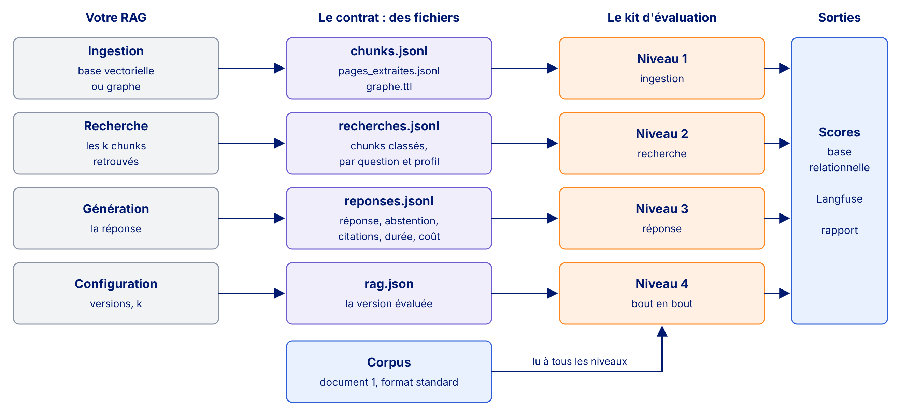
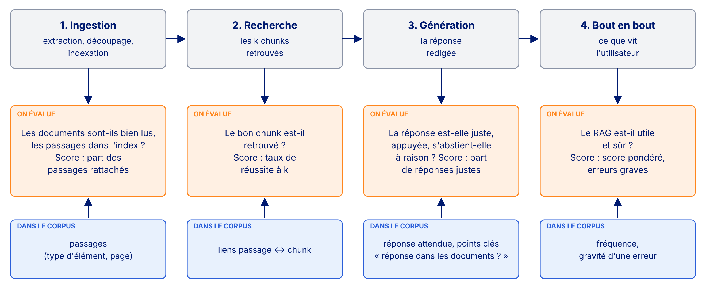
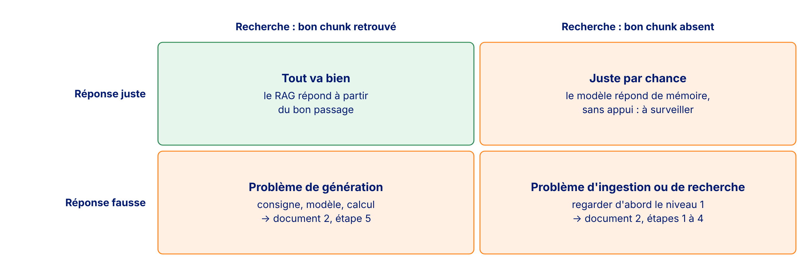
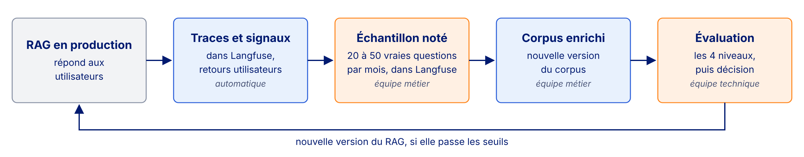

# Évaluer le RAG avec le corpus

Règles à suivre pour tout projet RAG : base vectorielle, graphe, ou agent. On part du corpus du document 1. Le RAG et l'évaluation sont séparés : le RAG fournit ses sorties dans un format standard, le contrat ; le kit d'évaluation les compare au corpus et rend des scores standard, niveau par niveau. Le détail des champs est dans [`contrat_des_fichiers.md`](contrat_des_fichiers.md).

## 1. Le principe : le RAG et le kit sont séparés

| Partie | Qui | Ce qu'elle fait |
| --- | --- | --- |
| Le RAG | équipe technique du projet | produit les fichiers du contrat : chunks exportés, résultats de recherche, réponses |
| Le corpus | équipe métier (document 1) | questions, passages, réponses attendues, au format standard |
| Le kit d'évaluation | le même pour tous les projets | lit le contrat et le corpus, calcule les scores des quatre niveaux, les publie dans la base relationnelle et dans Langfuse |
| La décision | équipe métier, à la lecture des scores, avec l'équipe technique | corriger le RAG avec le document 2, ou le mettre en production |

**Le kit ne connaît pas le RAG** : il ne lit que les fichiers du contrat. Un RAG vectoriel, un GraphRAG ou un agent s'évaluent de la même façon.

## 2. Le contrat : ce que votre RAG doit fournir

| Fichier | Une ligne = | Champs obligatoires | Sert au niveau |
| --- | --- | --- | --- |
| rag.json | la version du RAG évaluée | nom ; versions de l'index, du découpage, du modèle d'embedding, du modèle de génération, du prompt, du reranker ; k ; date | tous |
| chunks.jsonl | un chunk, ou un élément du graphe | identifiant ; référence du document ; version du document ; page ; type d'élément ; droits d'accès ; texte ; ordre dans la page | 1 |
| pages_extraites.jsonl | une page lue par l'extraction, avant découpage | référence du document ; page ; texte | 1, si des documents sont scannés |
| graphe.ttl | le graphe, exporté en RDF | les nœuds et relations, chacun avec sa provenance (référence, page) | 1, si graphe |
| recherches.jsonl | une question posée à la recherche | identifiant de la question ; profil ; les k chunks retrouvés, classés (identifiant, rang, score) | 2 |
| reponses.jsonl | une question posée au RAG complet | identifiant de la question ; réponse ; abstention (oui ou non) ; chunks cités ; chunks donnés au modèle ; durée ; coût ; identifiant de la trace Langfuse | 3 et 4 |

**Deux façons de produire ces fichiers**, au choix de l'équipe :

| Façon | Comment | Pour qui |
| --- | --- | --- |
| Par les endpoints d'évaluation | le RAG ouvre quatre endpoints à une adresse web : ingérer les documents, montrer l'index, rechercher, répondre ; le kit les appelle et écrit les fichiers | tout RAG, quel que soit son langage (la façon recommandée) |
| Par fichiers | le RAG lit `questions.jsonl` et écrit lui-même les fichiers | un RAG qui ne peut pas ouvrir d'adresse |

**Règles d'appel :**

| Règle | Pourquoi |
| --- | --- |
| Chaque question est posée avec son profil, et la recherche applique les droits de ce profil | tester les droits d'accès |
| Une question de suite reçoit en historique la question précédente et sa réponse attendue, pas la réponse du RAG | évaluer la question de suite seule, sans hériter d'une erreur |
| Le même k pour toutes les questions | comparer les questions entre elles |
| Le RAG ne voit jamais les réponses attendues ni les passages | ne pas fausser l'évaluation |
| Le RAG signale lui-même s'il s'abstient (champ « abstention ») | mesurer l'abstention sans deviner à partir du texte |

## 3. Ce que le kit rend : les sorties standard

| Sortie | Où | Contenu |
| --- | --- | --- |
| Résultats par question | table resultats ; fichier resultats_par_question.csv | une ligne par question : chaque score de chaque niveau |
| Scores globaux | table evaluations ; fichier scores.json | chaque score avec sa marge d'erreur, au total et par type de document, difficulté, type d'élément, profil et colonne ajoutée par le projet |
| Langfuse | une « expérience » par évaluation, sur le jeu de questions du corpus | les scores attachés à chaque question ; les files de relecture du métier ; la comparaison de deux évaluations |
| Rapport | RAPPORT.md (et rapport.html) | une page : les scores clés, chacun en une phrase claire, puis tous les scores, et les questions à regarder en premier |

Chaque évaluation enregistre `rag.json`, la version du corpus et la version du kit : deux évaluations ne se comparent que si le corpus est le même.

## 4. Ce qu'on met en place au départ

### Configuration minimale ou recommandée

| | Configuration minimale | Configuration recommandée |
| --- | --- | --- |
| **Niveaux évalués** | les quatre : ingestion, recherche, réponse, bout en bout | en plus : production |
| **Ingestion** | rattachement, métadonnées ; OCR si scans ; graphe si graphe | taux d'erreur de mots ; mesure sur 50 pages |
| **Recherche** | réussite à k, rappel, rang du premier bon chunk ; fuite de droits si droits | nDCG ; réussite à 1, 3, 5, 10 ; avant et après reranker ; documents périmés, pièges |
| **Réponse** | exactitude par le LLM juge, fidélité (Ragas), abstention, citations, erreurs graves | second avis sur l'exactitude ; questions de suite ; variantes |
| **Notation** | LLM juge vérifié sur 30 réponses notées par le métier ; le métier relit les réponses fausses ou partielles, toutes les questions de gravité forte, et 10 au hasard | vérification du juge sur 50 réponses ; double relecture |
| **Suivi** | Langfuse : expériences, scores, files de relecture, temps et coût | Langfuse en production : traces, retours utilisateurs, juge en ligne |
| **Lancement** | à la main, à chaque nouvelle version du RAG | automatique, à chaque changement d'index, de prompt ou de modèle ; alerte si un score baisse par rapport à la version précédente |
| **Comparer deux versions** | écart des scores, et question par question | en plus, test statistique apparié |

### Les actions de départ

| Action | Qui | Résultat |
| --- | --- | --- |
| Installer Langfuse et le kit d'évaluation | équipe technique | le jeu de questions du corpus est chargé dans Langfuse |
| Faire produire au RAG les fichiers du contrat | équipe technique | le RAG ouvre ses endpoints au kit |
| Fixer k, le nombre de chunks donnés au modèle | équipe technique | inscrit dans `rag.json` |
| Vérifier le LLM juge sur 30 réponses (section 8) | équipe métier | le juge est fiable, ou sa consigne est corrigée |
| Lancer une première évaluation et la garder | équipe technique | la référence pour comparer toutes les versions suivantes |

## 5. Les niveaux du RAG et ce qu'on évalue

| Niveau | La question posée | Entrée du RAG | Comparé à, dans le corpus | Score principal |
| --- | --- | --- | --- | --- |
| 1. Ingestion | les documents sont-ils bien lus, et les passages dans l'index ? | chunks, pages extraites | passages, pages OCR | part des passages rattachés |
| 2. Recherche | le bon chunk est-il retrouvé ? | recherches | liens passage ↔ chunk | taux de réussite à k |
| 3. Réponse | la réponse est-elle juste, appuyée, ou s'abstient-elle à raison ? | réponses | réponse attendue, points clés | part de réponses justes |
| 4. Bout en bout | le RAG est-il utile et sûr pour le métier ? | réponses | fréquence, gravité d'une erreur | score pondéré ; erreurs graves |

**On lit les niveaux dans l'ordre.** Une réponse fausse vient souvent d'un passage perdu à l'ingestion ou mal retrouvé : changer le prompt n'y changera rien.

Chaque niveau est décrit ci-dessous selon la même fiche : ce qu'on évalue, ce que le RAG fournit, ce qu'on prend dans le corpus, ce qu'on met en place, ce qui sort, comment le lire.

## 6. Niveau 1 — Ingestion

| Rubrique | Contenu |
| --- | --- |
| Ce qu'on évalue | les documents sont-ils bien lus ? les passages du corpus sont-ils dans l'index, entiers, avec leurs métadonnées ? |
| Entrée du RAG | chunks.jsonl ; pages_extraites.jsonl si des documents sont scannés ; graphe.ttl si graphe |
| Dans le corpus | documents ; passages (référence, page, type d'élément, texte) ; pages OCR |
| Ce qu'on met en place | le script de rattachement du kit ; jiwer pour l'OCR ; pySHACL pour le graphe |
| Sortie | par passage : rattaché ou non, mode de rattachement, coupé ou non, chunks liés ; par page OCR : taux d'erreur ; les scores ci-dessous |
| Quand | après chaque ingestion, sans poser de question au RAG |
| Si le score est mauvais | document 2, extraction et découpage (section 11) |

| Score | Comment il est calculé | Configuration |
| --- | --- | --- |
| Documents indexés | part des documents du corpus qui ont au moins un chunk | minimale |
| Métadonnées complètes | part des chunks qui ont référence, version, page, type d'élément et droits | minimale |
| Passages rattachés | part des passages (hors pièges) reliés à au moins un chunk ; aussi par type d'élément et par type de document | minimale |
| Passages coupés | part des passages qu'aucun chunk ne contient en entier, mais que deux chunks qui se suivent contiennent | minimale |
| Taux d'erreur de caractères (OCR) | nombre de caractères à ajouter, supprimer ou remplacer pour passer du texte extrait au texte retapé, divisé par le nombre de caractères retapés ; calculé par jiwer | minimale, si scans |
| Taux d'erreur de mots (OCR) | la même chose, en mots | recommandée |
| Conformité du graphe | nombre de violations des règles de l'ontologie (classes, propriétés, nombre de valeurs) ; calculé par pySHACL | minimale, si graphe |
| Justesse du graphe | 50 relations tirées au hasard, chacune avec son passage source, jugées justes ou fausses par le métier dans Langfuse ; part de relations justes | minimale, si graphe |

**Les règles du rattachement.** Le texte est d'abord normalisé : casse, espaces, césures, apostrophes et guillemets.

| Type d'élément | Un chunk de même référence et même page correspond si | Mode |
| --- | --- | --- |
| Texte, fiche de GED | il contient le passage ; sinon, il lui ressemble à 95 % au moins | exact, ou approché |
| Tableau | il contient les mêmes mots que le passage, dans n'importe quel ordre, à 90 % au moins | approché |
| Texte scanné | une partie du chunk ressemble au passage à 90 % au moins | approché |
| Image ou schéma | c'est un chunk de type « image ou schéma » | image |

Les seuils de ressemblance sont réglables dans le kit. Chaque passage non rattaché est examiné un par un : soit l'équipe technique corrige l'ingestion, soit le métier corrige la page dans son fichier.

## 7. Niveau 2 — Recherche

| Rubrique | Contenu |
| --- | --- |
| Ce qu'on évalue | le bon chunk est-il retrouvé, et bien classé ? aucun chunk interdit n'est-il retrouvé ? |
| Entrée du RAG | recherches.jsonl |
| Dans le corpus | liens passage ↔ chunk ; colonne « La réponse est dans » ; profil ; droits et version en vigueur des documents ; passages pièges |
| Ce qu'on met en place | le script de recherche du kit ; ranx pour le nDCG (recommandé) |
| Sortie | par question : réussie ou non, rappel, rang du premier bon chunk, fuite, piège retrouvé ; les scores ci-dessous |
| Quand | à chaque version du RAG |
| Si le score est mauvais | document 2, recherche (section 11) |

| Score | Comment il est calculé | Configuration |
| --- | --- | --- |
| Taux de réussite à k (Hit@k) | part des questions réussies (règle ci-dessous) | minimale |
| Rappel à k (Recall@k) | part des passages attendus dont un chunk lié est dans les k premiers | minimale |
| Rang du premier bon chunk (MRR) | 1 si le premier bon chunk est 1er, 1/2 s'il est 2e, 1/3 s'il est 3e… ; 0 s'il est absent ; moyenne sur les questions | minimale |
| Fuite de droits | nombre de questions dont un chunk retrouvé vient d'un document interdit au profil | minimale si le RAG filtre les droits ; une seule est grave |
| nDCG | comme le rang, mais un passage qui répond « entièrement » compte double ; calculé par ranx | recommandée |
| Réussite à 1, 3, 5, 10 | le taux de réussite pour plusieurs k : aide à choisir k | recommandée |
| Avant et après reranker | le taux de réussite sur la liste avant reclassement, puis après | recommandée |
| Documents périmés, pièges | part des questions dont un chunk d'un document qui n'est plus en vigueur, ou d'un passage piège, est classé avant le bon chunk | recommandée |

Une question est réussie selon la colonne « La réponse est dans » :

| La réponse est dans | Réussie si |
| --- | --- |
| un seul passage | un chunk lié à ce passage est dans les k premiers |
| plusieurs passages, un seul suffit | un chunk lié à l'un des passages est dans les k premiers |
| plusieurs passages à combiner | un chunk lié à chaque passage est dans les k premiers |
| l'ensemble des documents (synthèse), ou pas de réponse | non comptée à ce niveau |

Avec un graphe : les éléments retrouvés (nœuds, relations, extraits de texte) portent la même provenance que les chunks et se comparent de la même façon. Les résumés de GraphRAG, sans page, s'évaluent au niveau réponse.

## 8. Niveau 3 — Réponse

| Rubrique | Contenu |
| --- | --- |
| Ce qu'on évalue | la réponse est-elle juste, complète, appuyée par les sources, bien citée ? le RAG s'abstient-il quand il le faut ? |
| Entrée du RAG | reponses.jsonl ; recherches.jsonl, pour croiser avec la recherche |
| Dans le corpus | réponse attendue ; points clés ; type de réponse ; « réponse dans les documents ? » ; gravité d'une erreur ; liens et passages pièges |
| Ce qu'on met en place | le script du kit (abstention, citations, valeurs) ; le LLM juge du kit (exactitude) ; Ragas (fidélité, synthèse) ; les files de relecture de Langfuse |
| Sortie | par question : verdict juste, partielle ou fausse, avec la justification du juge ; chaque score ci-dessous |
| Quand | à chaque version du RAG |
| Si le score est mauvais | croiser avec la recherche (schéma ci-dessous), puis document 2, génération |

| Score | Comment il est calculé | Configuration |
| --- | --- | --- |
| Exactitude | le LLM juge du kit vérifie chaque point clé : présent, absent ou contredit. Juste : tous présents, aucun contredit. Partielle : au moins un présent, aucun contredit. Fausse : sinon. Une réponse partielle compte pour moitié | minimale |
| Complétude des listes | pour les questions de type liste : part des éléments attendus présents | minimale |
| Valeurs et calculs | le script compare chaque valeur de la réponse à la valeur attendue, avec son unité et sa tolérance | minimale |
| Abstention correcte | sur les questions « non » et « non accessible à ce profil » : part des réponses où le RAG s'abstient | minimale |
| Abstention à tort | part des questions avec réponse dans les documents où le RAG s'abstient alors que le bon chunk était retrouvé | minimale |
| Fidélité | Ragas `Faithfulness` : le juge découpe la réponse en affirmations et vérifie chacune dans les chunks donnés au modèle ; part d'affirmations appuyées | minimale |
| Citations correctes | part des réponses dont au moins un chunk cité est lié à un passage de la question, sans citer de piège ni de document interdit | minimale |
| Synthèse | Ragas `RubricsScore` : note de 1 à 5 sur une grille (couverture des thèmes attendus, exactitude, appui sur les sources) | minimale si graphe |
| Erreurs graves | nombre de réponses fausses, ou non fidèles, à une question de gravité forte ; chacune est relue par le métier | minimale ; une seule est grave |
| Second avis | Ragas `FactualCorrectness`, comparé au verdict du juge du kit ; les désaccords vont en relecture | recommandée |
| Questions de suite | exactitude calculée à part sur ces questions | recommandée |
| Variantes | part des groupes de variantes dont les verdicts diffèrent | recommandée |

Croiser la recherche et la réponse dit où chercher la cause :

### Qui note les réponses

| Qui | Ce qu'il note | Outil |
| --- | --- | --- |
| Le script du kit | abstention, citations, valeurs et calculs | code du kit |
| Le LLM juge | exactitude, complétude, fidélité, synthèse | prompt du kit et Ragas |
| L'équipe métier | les réponses fausses ou partielles ; toutes les questions de gravité forte ; 10 réponses au hasard ; les désaccords entre le script et le juge | file de relecture dans Langfuse |

Le juge utilise un prompt fourni par le kit ([`prompt_du_juge.md`](prompt_du_juge.md)), le même pour tous les projets, avec une température à 0. C'est de préférence un autre modèle que celui du RAG : un modèle tend à favoriser ses propres réponses.

**Vérifier le LLM juge avant de s'en servir :**

1. Le métier note 30 réponses (50 en configuration recommandée) dans un fichier Excel, juste, partielle ou fausse, avec le même critère que le juge, sans voir sa note.
2. Le juge note les mêmes réponses.
3. S'ils sont d'accord sur au moins 9 réponses sur 10, le juge est validé ; sinon, lire les réponses où le juge et le métier ne sont pas d'accord, préciser la consigne du juge (son prompt, dont on change alors la version) ou changer de modèle juge, puis refaire la vérification.
4. On refait cette vérification à chaque changement du modèle juge ou de son prompt.

## 9. Niveau 4 — Bout en bout

| Rubrique | Contenu |
| --- | --- |
| Ce qu'on évalue | le RAG est-il utile et sûr pour le métier, à un coût et un temps de réponse acceptables ? |
| Entrée du RAG | reponses.jsonl (durée, coût) ; résultats du niveau 3 |
| Dans le corpus | fréquence ; gravité d'une erreur ; questions réservées |
| Ce qu'on met en place | le script du kit ; Langfuse pour le temps et le coût |
| Sortie | score pondéré, erreurs graves, temps et coût ; les scores clés, calculés sur les questions réservées |

Le poids d'une question = fréquence × gravité d'une erreur.

| Fréquence ↓ · Gravité d'une erreur → | faible (1) | moyenne (2) | forte (3) |
| --- | --- | --- | --- |
| **fréquente (3)** | 3 | 6 | 9 |
| **occasionnelle (2)** | 2 | 4 | 6 |
| **rare (1)** | 1 | 2 | 3 |

| Score | Comment il est calculé | Configuration |
| --- | --- | --- |
| Score pondéré | somme des poids des réponses justes (une partielle compte pour moitié) ÷ somme des poids de toutes les questions | minimale |
| Erreurs graves | repris du niveau 3 | minimale ; une seule est grave |
| Temps de réponse | médiane, et temps sous lequel répondent 95 % des questions | minimale |
| Coût par question | moyenne | minimale |
| Marge d'erreur de chaque score | ± 1,96 × √(p × (1 − p) ÷ n), où p est le score et n le nombre de questions | minimale |
| Marge par rééchantillonnage | les questions tirées 1 000 fois au hasard ; on garde l'intervalle qui contient 95 % des scores | recommandée |

### Les scores clés et la décision du métier

Le kit ne fixe pas de seuil et ne décide pas de la mise en production. Il rend les **scores clés**, chacun écrit en une phrase compréhensible par le métier : « pour 9 questions sur 13, la recherche ramène le passage qui contient la réponse ». **Le métier décide**, à leur lecture et à celle des questions ratées : un seuil fixé à l'avance se discute mal, le métier juge mieux devant les chiffres.

Les repères ci-dessous sont des ordres de grandeur, pour aider le métier à lire les scores. Ils ne décident pas. Comment les lire, avec l'intervalle de confiance de chaque score : [6. Aide à la décision : lire les scores](../6_aide_a_la_decision.md).

| Niveau | Score | Ordre de grandeur |
| --- | --- | --- |
| Ingestion | passages rattachés | 95 % |
| Ingestion | métadonnées complètes | 100 % |
| Ingestion | taux d'erreur de caractères | 2 % au plus |
| Recherche | taux de réussite à k | 90 % |
| Recherche | fuite de droits | 0 : une seule est grave |
| Réponse | réponses justes | 80 % |
| Réponse | abstentions correctes | 80 % |
| Réponse | fidélité | 90 % |
| Réponse | erreurs graves | 0 : chacune est relue par le métier |
| Bout en bout | score pondéré, temps de réponse, coût | selon ce que les utilisateurs acceptent |

**Les règles :**

- L'équipe technique règle le RAG sur les questions non réservées.
- Les scores clés sont calculés sur les questions réservées ; l'équipe technique n'en voit que les scores globaux.
- Les fuites de droits et les erreurs graves se comptent sur toutes les questions. Une seule se regarde avant tout le reste, quel que soit le score.

**Comparer deux versions du RAG :**

- Même version du corpus, mêmes questions, même k.
- Un écart plus petit que la marge d'erreur ne prouve rien seul.
- On regarde alors question par question : questions gagnées, questions perdues. Une question grave perdue est une régression, même si la moyenne monte.
- Recommandé : test de McNemar sur les questions gagnées et perdues ; il dit si l'écart est dû au hasard.

## 10. Les tests transverses

Ils ne forment pas un niveau à part : ils s'appuient sur des colonnes du corpus et sont mesurés aux niveaux déjà décrits.

| Test | Ce qu'on vérifie | Dans le corpus | Mesuré au niveau | Configuration |
| --- | --- | --- | --- | --- |
| Droits d'accès | aucun chunk interdit retrouvé ni cité ; abstention sur « non accessible à ce profil » | profil ; droits d'accès des documents | 2 et 3 | minimale si le RAG filtre les droits |
| Synthèse | réponse sur l'ensemble des documents | type de réponse « synthèse » | 3 | minimale si graphe |
| Construction du graphe | conformité à l'ontologie, justesse des relations | ontologie du projet | 1 | minimale si graphe |
| Version en vigueur | le RAG s'appuie sur la version applicable | en vigueur, remplacé par ; passages pièges | 2 et 3 | recommandée |
| Conversation | les questions de suite sont comprises | question précédente | 3 | recommandée |
| Robustesse | la même question, reformulée, reçoit la même réponse | variante de | 3 | recommandée |
| Contenus piégés | une consigne cachée dans un document ne détourne pas la réponse | 5 à 10 documents de test, hors corpus | 3 | recommandée |

## 11. Lire les résultats et corriger

Langfuse et le rapport donnent chaque score par type de document, type d'élément, difficulté, type de réponse, profil, et par colonne ajoutée par le projet (service, site…). Un score calculé sur moins de 10 questions est une tendance, pas une mesure.

| Ce qu'on observe | Où ça casse | Ce qu'on met en place (document 2) |
| --- | --- | --- |
| Taux d'erreur de caractères élevé ; passages non rattachés sur les scans | extraction | OCR, modèle de vision sur les pages difficiles |
| Passages non rattachés sur les tableaux | extraction | traitement dédié des tableaux |
| Métadonnées manquantes | découpage | métadonnées du document 1 sur chaque chunk |
| Passages coupés | découpage | découpage par section, chevauchement |
| Violations de l'ontologie dans le graphe | indexation | extraction des entités contrainte par l'ontologie |
| Bon chunk absent ; la question emploie d'autres mots que le document | recherche | recherche hybride, phrase de contexte devant le chunk |
| Bon chunk absent ; la question cite un code ou une référence | recherche | mots-clés (BM25), filtres de métadonnées |
| Bon chunk retrouvé, mais loin dans la liste | recherche | reranker |
| Fuite de droits | recherche | filtre des droits pendant la recherche |
| Documents périmés retrouvés | recherche | filtre sur la version en vigueur |
| Questions à combiner : un des passages manque | recherche | décomposition de la question, ou agent |
| Listes incomplètes | indexation | graphe et ontologie |
| Bon chunk retrouvé, réponse fausse | génération | consigne, citations obligatoires, calcul délégué |
| Fidélité basse ; réponse inventée à une question sans réponse | génération | abstention, LLM juge garde-fou |

## 12. En production

Le RAG en production envoie ses traces à Langfuse, avec les mêmes champs que le contrat : chunks retrouvés, chunks cités, abstention, versions, durée, coût.

| Signal | Ce qu'il indique | Ce qu'on fait |
| --- | --- | --- |
| Retours négatifs des utilisateurs | une réponse jugée fausse ou inutile | le métier qualifie ; la question entre dans le corpus |
| Abstentions | une question hors des documents, ou un passage non retrouvé | vérifier si la réponse existe dans les sources |
| Rejets du LLM juge garde-fou | une réponse non appuyée par les chunks | chercher la cause : recherche ou génération |
| Recherches sous le seuil du reranker | aucun chunk pertinent | document absent de l'index, ou question hors périmètre |
| Juge en ligne sur un échantillon | la fidélité des réponses réelles | comparer à la fidélité mesurée sur le corpus |
| Documents jamais retrouvés | un document mal ingéré, ou inutile | contrôler son ingestion |
| Questions les plus posées | ce qui compte pour les utilisateurs | corriger la fréquence dans le corpus |

En configuration recommandée, le métier note chaque mois 20 à 50 vraies questions dans Langfuse et les ajoute au corpus, qui passe à une nouvelle version. On relance l'évaluation après chaque ingestion, à chaque changement de modèle, de prompt ou de découpage, et à chaque nouvelle version du corpus.

## 13. Les outils

On prend sur étagère ce qui existe. On code ce qu'aucun outil ne fait : le rattachement au corpus du métier, les règles de réussite, la pondération, les scores clés.

| Outil | Ce qu'il fait dans le kit | Licence |
| --- | --- | --- |
| Langfuse, auto-hébergé | jeu de questions, expériences, scores par question, files de relecture du métier, comparaison de versions, temps et coût, traces de production | MIT pour le cœur ; certaines fonctions d'entreprise sont payantes |
| Ragas | fidélité (`Faithfulness`), synthèse (`RubricsScore`), second avis sur l'exactitude (`FactualCorrectness`) | Apache 2.0 |
| rapidfuzz | ressemblance de textes pour le rattachement approché | MIT |
| jiwer | taux d'erreur de caractères et de mots pour l'OCR | Apache 2.0 |
| ranx | nDCG et autres scores de recherche | MIT |
| pySHACL | contrôle du graphe par les règles de l'ontologie | Apache 2.0 |
| Base relationnelle | corpus, liens, résultats ; PostgreSQL, ou SQLite pour un essai | — |

**Pourquoi pas tout dans Ragas ?** Ragas calcule des scores question par question. Il ne relie pas un passage annoté par le métier à un chunk, ne connaît ni la gravité d'une erreur, ni les questions réservées, ni les droits d'accès. Il sert de calculette à l'intérieur du kit.

## 14. Ce qu'il faut développer : le kit

| Module | Entrées | Sorties |
| --- | --- | --- |
| Import du corpus | fichier Excel | base relationnelle ; corpus au format standard ; jeu de questions dans Langfuse |
| Rattachement et niveau 1 | corpus ; chunks, pages extraites, graphe | liens_index ; scores du niveau 1 |
| Appel du RAG | corpus et ses documents ; les quatre endpoints du RAG | rag.json, chunks.jsonl, pages_extraites.jsonl, graphe.ttl, recherches.jsonl, reponses.jsonl |
| Niveau 2 | recherches ; liens | scores du niveau 2 |
| Niveau 3 | réponses ; recherches ; corpus | verdicts du juge ; scores du niveau 3 ; files de relecture |
| Niveau 4 et scores clés | scores des niveaux 1 à 3 | score pondéré, marges, scores clés |
| Publication | tous les scores | base relationnelle, Langfuse, RAPPORT.md et rapport.html |
| Vérification du juge | notes du métier et du juge | taux d'accord |

Le bac à sable met en œuvre ce kit avec un RAG très simple, séparé du kit, et un petit corpus annoté selon le document 1 (consignes : `CLAUDE.md`).

## 15. Cinq règles à ne jamais oublier

1. Le RAG ne parle au kit que par le contrat ; le kit ne connaît pas le RAG.
2. On lit les niveaux dans l'ordre : ingestion, recherche, réponse.
3. Le kit donne les scores ; le métier décide.
4. Une seule fuite de droits ou une seule erreur grave se regarde avant tout le reste.
5. Les questions réservées ne servent jamais à régler le RAG.

## Sources

- Es et al., Ragas, 2023 : [arxiv.org/abs/2309.15217](https://arxiv.org/abs/2309.15217)
- Zheng et al., Judging LLM-as-a-Judge, 2023 : [arxiv.org/abs/2306.05685](https://arxiv.org/abs/2306.05685)
- Saad-Falcon et al., ARES, 2023 : [arxiv.org/abs/2311.09476](https://arxiv.org/abs/2311.09476)
- Sufficient Context, 2025 : [arxiv.org/abs/2411.06037](https://arxiv.org/abs/2411.06037)
- Langfuse, documentation : [langfuse.com/docs](https://langfuse.com/docs)
- Ragas, documentation : [docs.ragas.io](https://docs.ragas.io)
- W3C, SHACL : [w3.org/TR/shacl](https://www.w3.org/TR/shacl/)
