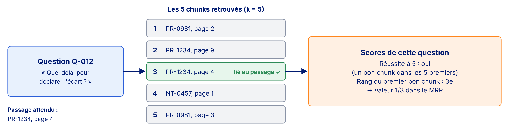

# Évaluer le RAG avec le corpus

Un **RAG** est un assistant qui répond à des questions en s'appuyant sur des documents : il les découpe en morceaux de texte (des **chunks**), retrouve ceux qui servent à une question, puis fait écrire la réponse par un modèle de langage.

Ce document explique comment **évaluer** un RAG : ce qu'on mesure, comment, et comment lire les résultats pour décider. Il s'adresse à l'équipe technique, qui met l'évaluation en place, et au métier, qui décide à la lecture des scores. Il se suffit à lui-même : on a seulement besoin d'un **corpus d'évaluation**, c'est-à-dire de documents, de questions, de leurs bonnes réponses et du passage exact où se trouve chaque réponse, écrits par le métier.

## Le principe en bref

**Le service d'évaluation se comporte comme un utilisateur automatique qui connaîtrait les bonnes réponses.** Il fait lire des documents au RAG, lui pose les questions du corpus, puis compare ce que le RAG a fait à ce qu'il aurait dû faire. Il rend des **scores**, niveau par niveau.

**Le RAG et le service sont séparés.** Le service ne connaît pas le code du RAG : il ne lit que ce que le RAG lui rend, dans un format standard. Un RAG à base de vecteurs, un RAG à graphe ou un agent s'évaluent donc de la même façon.

**Le service donne les scores, le métier décide.** Il ne fixe aucun seuil de mise en production : chaque score est écrit en une phrase que le métier comprend, par exemple « pour 9 questions sur 13, la recherche ramène le passage qui contient la réponse ».

**Quatre niveaux, lus dans l'ordre.** Une réponse fausse vient souvent d'un passage perdu à l'ingestion ou mal retrouvé : changer la consigne du modèle n'y changerait rien. On regarde donc d'abord l'ingestion, puis la recherche, puis la réponse.

| Niveau | La question qu'on se pose |
| --- | --- |
| **1. Ingestion** | Les documents sont-ils bien lus, et les passages sont-ils dans la base du RAG ? |
| **2. Recherche** | Le bon chunk est-il retrouvé, et jamais un document interdit ? |
| **3. Réponse** | La réponse est-elle juste, appuyée sur les documents ? Le RAG dit-il « je ne sais pas » à raison ? |
| **4. Bout en bout** | Le RAG est bon sur les questions qui comptent le plus, assez rapide, pas trop cher ? |

## Un exemple suivi de bout en bout : la question Q-001

Prenons une question du corpus d'exemple : **« comment on consigne une armoire électrique basse tension ? »** Le métier a indiqué que la réponse tient en cinq étapes (séparation, condamnation, identification, vérification d'absence de tension, mise à la terre et en court-circuit), qu'elle se trouve en page 2 de la procédure `PR-1101` (un texte, et un schéma), que la question est fréquente et que l'erreur serait grave. Voici ce que le service constate.

| Niveau | Ce que le service constate | Score |
| --- | --- | --- |
| **1. Ingestion** | Le texte de la page 2 se retrouve à l'identique dans un chunk du RAG, et le schéma dans un autre chunk de la même page. Rien n'est perdu. | passages rattachés : 2 sur 2 |
| **2. Recherche** | Pour cette question, la recherche ramène 5 chunks. Les deux bons chunks sont aux rangs 2 et 3. Aucun document interdit. | réussite : oui ; rang du premier bon chunk : 2e, soit 1/2 |
| **3. Réponse** | Le RAG répond avec les cinq étapes, dans l'ordre, et cite l'un des bons chunks. Le juge trouve les cinq points clés dans la réponse. | verdict : juste ; fidélité : 100 % |
| **4. Bout en bout** | Une question fréquente (3) et grave (3) pèse 9. La réponse est juste, elle arrive en 12,8 secondes. | rapporte ses 9 points |

Si la réponse avait été fausse, ce tableau dirait où chercher : le texte absent des chunks (niveau 1), un bon chunk non retrouvé (niveau 2), ou un bon chunk retrouvé mais mal exploité (niveau 3).

## Étape 1. Mettre en place l'évaluation

| Action | Qui | Résultat |
| --- | --- | --- |
| Installer le service d'évaluation et Langfuse (un site web local qui garde les évaluations) | équipe technique | le jeu de questions du corpus est chargé dans Langfuse |
| Faire produire au RAG les fichiers du contrat (étape 2) | équipe technique | le RAG ouvre ses endpoints au service |
| Fixer **k**, le nombre de chunks donnés au modèle pour répondre | équipe technique | inscrit dans le fichier `rag.json` du RAG |
| Vérifier le juge sur 30 réponses (niveau 3) | métier | le juge est fiable, ou sa consigne est corrigée |
| Lancer une première évaluation et la garder | équipe technique | la référence pour comparer toutes les versions suivantes |

On commence par la **configuration minimale** : les quatre niveaux, avec les scores essentiels de chacun. La configuration recommandée s'y ajoute ensuite (voir l'annexe C).

**Dans l'exemple.** Un RAG simple, évalué sur un corpus fictif de 50 documents et 60 questions, avec Langfuse en local.

## Étape 2. Brancher le RAG : ce qu'il doit fournir

Le RAG rend six fichiers, toujours avec les mêmes noms de champs, quel que soit le RAG. C'est ce qu'on appelle le **contrat**.

| Fichier | Ce qu'il contient | Sert au niveau |
| --- | --- | --- |
| `rag.json` | la version évaluée : nom, identifiant de version, type de RAG (vectoriel, graphe, hybride, agent), versions de l'index, du découpage, des modèles, du prompt et du reranker, k, filtre des droits, date ; en option, ses autres réglages | tous |
| `chunks.jsonl` | un chunk par ligne : identifiant, référence du document, version, page, type d'élément, droits d'accès, texte, ordre dans la page | 1 |
| `pages_extraites.jsonl` | les pages telles qu'elles ont été lues avant découpage (si des documents sont scannés) | 1 |
| `graphe.ttl` | le graphe exporté en RDF, avec la provenance de chaque nœud (si le RAG a un graphe) | 1 |
| `recherches.jsonl` | pour chaque question : le profil, et les k chunks retrouvés, classés | 2 |
| `reponses.jsonl` | pour chaque question : la réponse, si le RAG s'abstient, les chunks cités, les chunks donnés au modèle, la durée, le coût, l'identifiant de la trace Langfuse | 3 et 4 |

**Deux façons de les produire.** La façon **recommandée** : le RAG ouvre **quatre adresses web** (des « endpoints ») que le service appelle dans cet ordre : ① ingérer les documents, ② montrer l'index, ③ rechercher, ④ répondre. Le service écrit lui-même les fichiers. Cela marche pour tout RAG, quel que soit son langage. L'autre façon, pour un RAG qui ne peut pas ouvrir d'adresse : il lit les questions du corpus et écrit lui-même les fichiers.

**Les règles d'appel**, qui garantissent une évaluation honnête :
- Chaque question est posée avec son **profil**, et la recherche applique les droits de ce profil : c'est ainsi qu'on teste les droits d'accès.
- Une **question de suite** reçoit en historique les questions qui la précèdent dans la conversation, avec leurs réponses attendues (du plus ancien au plus récent), pas les réponses du RAG : on l'évalue seule, sans qu'elle hérite d'une erreur.
- Le **même k** est utilisé pour toutes les questions, pour pouvoir les comparer.
- Le RAG ne voit **jamais** les réponses attendues ni les passages.
- Le RAG signale **lui-même** s'il s'abstient (champ « abstention ») : on mesure l'abstention sans la deviner à partir du texte.

**Ce que le service rend.** Pour chaque évaluation : un rapport lisible (`RAPPORT.md` et `rapport.html`), les scores de chaque question, les scores globaux avec leur marge d'erreur, et une « expérience » dans Langfuse. Chaque évaluation enregistre la version du RAG, celle du corpus et celle du service : **deux évaluations ne se comparent que sur le même corpus**.

## Étape 3. Évaluer, niveau par niveau

Pour chaque niveau : ce qu'on vérifie, les scores à regarder, et ce qu'il faut en retenir. Le calcul précis de **tous** les scores est dans l'annexe A.

### Niveau 1. L'ingestion

**Ce qu'on vérifie.** Que rien ne s'est perdu ni abîmé quand le RAG a lu les documents, les a découpés et rangés dans sa base. On n'a pas besoin de poser de question au RAG : on le fait après chaque ingestion.

**Comment : le rattachement.** Pour chaque passage du métier, le service cherche un chunk du RAG qui a **la même référence de document et la même page**, puis compare les textes (après normalisation : majuscules, espaces, césures, apostrophes et guillemets ignorés) :
- **texte ou fiche de GED** : le chunk contient le passage, ou lui ressemble à 95 % au moins ;
- **tableau** : le chunk contient les mêmes mots que le passage, dans n'importe quel ordre, à 90 % au moins ;
- **texte scanné** : une partie du chunk ressemble au passage à 90 % au moins (l'OCR fait des fautes) ;
- **image ou schéma** : un chunk de type « image ou schéma » existe à cette page.

Les seuils de ressemblance sont réglables. Un passage réparti sur deux chunks qui se suivent est rattaché, mais compté comme **coupé**. Un passage qu'aucun chunk ne contient est **non rattaché** : le service le liste, avec sa cause probable. Soit l'équipe technique corrige l'ingestion, soit le métier corrige la page dans son fichier.

| Les scores à regarder | Ce qu'ils disent | Dans l'exemple |
| --- | --- | --- |
| **Passages rattachés** | la part des passages du métier retrouvés dans un chunk | 100 % (61 sur 61) |
| **Métadonnées complètes** | la part des chunks qui portent référence, version, page, type d'élément et droits | 100 % (534 sur 534) |
| **Erreur de lecture des scans** | la part de caractères mal lus sur les pages retapées par le métier | 15 % |

> **À retenir.** Un passage non rattaché est perdu pour le RAG : aucun réglage de la recherche ne le retrouvera. Si le score est mauvais : améliorer l'OCR (ou utiliser un modèle de vision) pour les scans, un traitement dédié pour les tableaux, un découpage par section avec chevauchement, et garder les cinq métadonnées sur chaque chunk.

### Niveau 2. La recherche

**Ce qu'on vérifie.** Que, pour chaque question, la recherche ramène le chunk qui contient la réponse, bien classé, et **jamais un chunk d'un document interdit au profil** qui pose la question. On le fait à chaque version du RAG.

**Quand une question est-elle réussie ?** Cela dépend de la colonne « La réponse est dans » du corpus :
- **un seul passage** : un chunk lié à ce passage est dans les k premiers ;
- **plusieurs passages, un seul suffit** : un chunk lié à l'un d'eux est dans les k premiers ;
- **plusieurs passages à combiner** : un chunk lié à **chacun** d'eux est dans les k premiers ;
- **synthèse, ou pas de réponse** : la question n'est pas comptée à ce niveau (sauf pour la fuite de droits).

| Les scores à regarder | Ce qu'ils disent | Dans l'exemple |
| --- | --- | --- |
| **Taux de réussite à k** | la part des questions réussies | 86 % (24 sur 28) |
| **Rang du premier bon chunk** | 1 s'il est 1er, 1/2 s'il est 2e, 1/3 s'il est 3e… | 68 % |
| **Fuite de droits** | le nombre de questions qui ont ramené un document interdit au profil | 0 |

> **À retenir.** **Une seule fuite de droits est grave**, quel que soit le reste : elle se regarde avant tout. Si la réussite est mauvaise : une recherche hybride (vecteurs et mots-clés), un reranker (un modèle qui reclasse les chunks), ou filtrer les droits **pendant** la recherche, pas après. Avec un graphe, les éléments retrouvés portent la même provenance que les chunks et se comparent de la même façon.

### Niveau 3. La réponse

**Ce qu'on vérifie.** Que la réponse est juste, complète, appuyée sur les documents et bien citée, et que le RAG dit « je ne sais pas » quand il le faut. On le fait à chaque version du RAG.

**Qui note quoi.** Un **script du service** note l'abstention, les citations, les valeurs et les calculs. Un **juge**, un modèle de langage, note l'exactitude, la complétude des listes, la fidélité et la synthèse. Le **métier** relit les réponses fausses ou partielles, toutes celles de gravité forte, 10 au hasard, et les désaccords entre le script et le juge, dans un fichier Excel (ou une file de relecture dans Langfuse, s'il préfère).

**Comment le juge note l'exactitude.** Il reçoit la question, la réponse attendue, les points clés et la réponse du RAG. Pour chaque point clé, il dit s'il est **présent** (la réponse l'exprime, avec les mêmes mots ou d'autres de même sens ; une valeur chiffrée n'est présente que si elle est égale à la valeur attendue, avec la même unité, dans la tolérance), **absent**, ou **contredit** (la réponse affirme quelque chose d'incompatible). Le **verdict** s'en déduit :
- **juste** : tous les points clés sont présents et rien n'est contredit ;
- **partielle** : au moins un point clé est présent, et rien n'est contredit ;
- **fausse** : dans tous les autres cas.

Une information juste en plus des points clés ne change rien ; le style et la longueur ne comptent pas. Le service recalcule lui-même le verdict à partir des statuts : s'il diffère de celui du juge, il garde le sien et envoie la question en relecture. Le juge n'évalue que les questions qui ont une réponse dans les documents, et auxquelles le RAG a répondu. Il utilise **la même consigne pour tous les projets**, avec une température de 0 (pas de hasard dans ses notes), et de préférence **un autre modèle que celui du RAG** : un modèle tend à favoriser ses propres réponses. Toute modification de la consigne change sa version et oblige à vérifier le juge à nouveau.

| Les scores à regarder | Ce qu'ils disent | Dans l'exemple |
| --- | --- | --- |
| **Exactitude** | juste = 1, partielle = 0,5, fausse = 0, selon le juge | 79 % |
| **Fidélité** | la part des affirmations de la réponse qui se trouvent dans les chunks donnés au modèle | 95 % |
| **Abstention correcte** | quand la réponse n'est pas dans les documents (ou est interdite au profil), la part des fois où le RAG dit qu'il ne sait pas | 100 % (8 sur 8) |
| **Abstention à tort** | la part des questions avec réponse où le RAG dit qu'il ne sait pas alors que le bon chunk était retrouvé | 6 % (2 sur 32) |
| **Citations correctes** | la part des réponses qui citent un chunk lié au bon passage, sans citer de piège ni de document interdit | 93 % (26 sur 28) |
| **Erreurs graves** | le nombre de questions de gravité forte dont la réponse est fausse, non fidèle (une seule affirmation non appuyée suffit), ou donnée là où le RAG devait s'abstenir | 1 |

**Vérifier le juge avant de s'en servir.** Un juge peut se tromper. On vérifie donc qu'il note comme le métier :
1. le métier note **30 réponses** (50 en configuration recommandée), tirées au hasard hors questions réservées, dans un fichier Excel : juste, partielle ou fausse, avec le même critère que le juge, **sans voir sa note** ;
2. le juge note les mêmes réponses ;
3. si le métier et le juge sont d'accord sur **au moins 9 réponses sur 10**, le juge est validé. Sinon, on lit les réponses sur lesquelles ils ne sont pas d'accord, on précise la consigne du juge (on change alors sa version) ou on change de modèle juge, puis on recommence ;
4. on refait cette vérification à chaque changement du modèle juge ou de sa consigne.

Le service affiche aussi le **kappa de Cohen**, un accord corrigé du hasard : il repère un juge qui dit presque toujours « juste » et atteint 90 % d'accord sans rien valoir.

**Dans l'exemple.** Sur 28 réponses, le juge est d'accord avec le métier dans 89 % des cas : il en faut 90 %, il n'est pas validé. Ses trois désaccords vont dans le même sens : il est trop sévère. Le rapport le dit en tête, car le score « réponses justes » en dépend. Ici, le métier est simulé : c'est Claude qui a noté les réponses, car l'entreprise est fictive.

**Croiser la recherche et la réponse** dit où chercher la cause d'une réponse fausse :

| | Le bon chunk était retrouvé | Le bon chunk était absent |
| --- | --- | --- |
| **Réponse juste** | tout va bien | juste par chance : le modèle répond de mémoire, à surveiller |
| **Réponse fausse** | problème de **génération** : la consigne, le modèle, le calcul | problème d'**ingestion ou de recherche** : regarder d'abord le niveau 1 |

Dans l'exemple, sur les questions qui ont une réponse dans les documents : 20 vont bien, 5 sont un problème de génération, 5 un problème de recherche, et 2 des abstentions à tort.

> **À retenir.** Une réponse fausse ne se corrige pas toujours dans la réponse : le croisement dit si la cause est en amont. Si la fidélité est basse ou si le RAG invente : une consigne d'abstention, des citations obligatoires, un juge qui sert de garde-fou, un calcul délégué à un outil.

### Niveau 4. Le bout en bout

**Ce qu'on vérifie.** Que le RAG est bon **sur les questions qui comptent le plus**, assez rapide et pas trop cher.

**Le poids d'une question** est sa fréquence multipliée par la gravité d'une erreur. Une erreur sur une question fréquente et grave pèse 9 fois plus qu'une erreur sur une question rare et sans gravité.

| Fréquence ↓ · Gravité d'une erreur → | faible (1) | moyenne (2) | forte (3) |
| --- | --- | --- | --- |
| **fréquente (3)** | 3 | 6 | 9 |
| **occasionnelle (2)** | 2 | 4 | 6 |
| **rare (1)** | 1 | 2 | 3 |

| Les scores à regarder | Ce qu'ils disent | Dans l'exemple |
| --- | --- | --- |
| **Score pondéré** | la part de réponses justes, en comptant davantage les questions fréquentes et graves | 80 % |
| **Temps de réponse** | la médiane, et le temps sous lequel répondent 95 % des questions | 7,4 s et 12,8 s |
| **Coût par question** | le coût moyen d'une réponse | 0 € (modèles locaux) |

Dans le score pondéré, sur une question sans réponse dans les documents, ou non accessible au profil, s'abstenir compte juste et répondre compte faux ; sur une question qui a une réponse, s'abstenir compte faux.

> **À retenir.** Un RAG à 90 % d'exactitude qui se trompe sur les questions fréquentes et graves sera moins bon ici : le score pondéré dit ce que vivront les utilisateurs.

## Étape 4. Lire les résultats, comparer, décider

### Les scores clés

Le service rend les **scores clés**, chacun écrit en une phrase, avec sa fourchette : le vrai résultat du RAG, celui qu'on mesurerait avec beaucoup plus de questions, a 95 chances sur 100 de s'y trouver. **Le métier décide**, à leur lecture et à celle des questions ratées : un seuil fixé à l'avance se discute mal, le métier juge mieux devant les chiffres.

**Deux jeux de questions.** Si l'on règle le RAG en regardant les questions qui servent à le juger, on finit par le régler « pour le test », et le score ne veut plus rien dire. Donc :
- l'équipe technique règle le RAG sur les questions **non réservées** ;
- les scores clés sont calculés sur les questions **réservées**, jamais utilisées pour régler le RAG ; l'équipe technique n'en voit que les scores globaux ;
- les **fuites de droits** et les **erreurs graves** se comptent sur **toutes** les questions : une seule se regarde avant tout le reste.

**Dans l'exemple.** Sur les 20 questions réservées : le bon passage est ramené pour 9 questions sur 13 (69 %, avec une fourchette de 44 à 94 %), les réponses sont justes à 77 %, le score pondéré est de 76 %. Une erreur grave (Q-046, une synthèse hors sujet : on demandait les règles de sécurité communes à toutes les interventions, le RAG donne celles de l'éclairage de sécurité) et aucune fuite de droits.

**Les repères.** Ce sont des ordres de grandeur pour aider à lire les scores. Ils ne décident pas, et se règlent avec le métier : une application de sécurité peut exiger 95 % de réponses justes.

| Niveau | Score | Ordre de grandeur |
| --- | --- | --- |
| Ingestion | passages rattachés | 95 % |
| Ingestion | métadonnées complètes | 100 % |
| Ingestion | erreur de caractères | 2 % au plus |
| Recherche | taux de réussite à k | 90 % |
| Recherche | fuite de droits | 0 |
| Réponse | réponses justes | 80 % |
| Réponse | abstentions correctes | 80 % |
| Réponse | fidélité | 90 % |
| Réponse | erreurs graves | 0 |
| Bout en bout | score pondéré, temps, coût | selon ce que les utilisateurs acceptent |

**Lire la fourchette.** « 69 % (entre 44 et 94 %) » est compté sur 13 questions : le RAG peut être médiocre comme très bon. **Si la fourchette contient le repère, on ne peut pas conclure** : il faut plus de questions, ou lire les questions ratées une par une. Un score calculé sur moins de 10 questions est une tendance, pas une mesure. À 0 % ou à 100 %, la formule ne sait pas estimer l'incertitude : cela ne veut pas dire que le score est certain.

Le rapport donne aussi chaque score par type de document, de question, de profil, et par colonne ajoutée par le projet (service, site…). C'est ainsi qu'on voit qu'une moyenne cache un point faible : dans l'exemple, les comptes rendus d'intervention ont 25 % de réponses justes (sur 4 questions seulement), contre 85 % pour les procédures (sur 17).

### Comparer deux versions du RAG

Pour savoir si une modification améliore le RAG :
- même version du corpus, mêmes questions ; **un seul réglage change**, par exemple k ;
- **un écart plus petit que la marge d'erreur ne prouve rien seul** ;
- on regarde alors question par question : questions gagnées, questions perdues. **Une question grave perdue est une régression**, même si la moyenne monte ;
- en configuration recommandée, un test de McNemar sur les questions gagnées et perdues dit si l'écart peut être dû au hasard (au-dessus de 0,05, on ne peut pas l'exclure).

**Dans l'exemple.** On passe k de 5 à 3. Le « bon passage ramené » baisse de 86 % à 75 %, un écart dans la marge : non prouvé. Les « passages nécessaires ramenés » baissent de 81 % à 64 %, plus que la marge : c'est réel. Le score pondéré passe de 80 % à 77 %, aucune question gagnée et quatre perdues, mais le test dit que cela peut venir du hasard (p = 0,12) : aucune des deux configurations n'est démontrée meilleure.

## Étape 5. Suivre le RAG en production (recommandé)

Le RAG en production envoie ses traces à Langfuse, avec les mêmes champs que le contrat : chunks retrouvés, chunks cités, abstention, versions, durée, coût. Ces signaux disent ce qu'il faut regarder :
- les **retours négatifs** des utilisateurs : le métier qualifie la réponse, et la question entre dans le corpus ;
- les **abstentions** : une question hors des documents, ou un passage non retrouvé ; on vérifie si la réponse existe dans les sources ;
- les réponses **rejetées par un juge garde-fou** : une réponse non appuyée par les chunks ; on cherche la cause, recherche ou génération ;
- les **recherches sous le seuil du reranker** : aucun chunk pertinent, document absent de l'index ou question hors périmètre ;
- un **juge en ligne** sur un échantillon : on compare la fidélité des réponses réelles à celle mesurée sur le corpus ;
- les **documents jamais retrouvés** : un document mal ingéré, ou inutile ;
- les **questions les plus posées** : elles servent à corriger les fréquences du corpus.

Chaque mois, le métier note 20 à 50 vraies questions et les ajoute au corpus, qui passe à une nouvelle version. On relance l'évaluation après chaque ingestion, à chaque changement de modèle, de prompt ou de découpage, et à chaque nouvelle version du corpus.

## Cinq règles à ne jamais oublier

1. Le RAG ne parle au service que par le contrat ; le service ne connaît pas le RAG.
2. On lit les niveaux dans l'ordre : ingestion, recherche, réponse.
3. Le service donne les scores ; le métier décide.
4. Une seule fuite de droits ou une seule erreur grave se regarde avant tout le reste.
5. Les questions réservées ne servent jamais à régler le RAG.

## Annexe A. Tous les scores, avec leur calcul

Les scores « recommandés » ne font pas partie de la configuration minimale.

### Niveau 1. Ingestion

| Score | Comment il est calculé | Configuration |
| --- | --- | --- |
| Documents indexés | part des documents du corpus qui ont au moins un chunk | minimale |
| Métadonnées complètes | part des chunks qui ont référence, version, page, type d'élément et droits | minimale |
| Passages rattachés | part des passages (hors pièges) reliés à au moins un chunk ; aussi par type d'élément et par type de document | minimale |
| Passages coupés | part des passages qu'aucun chunk ne contient en entier, mais que deux chunks qui se suivent contiennent | minimale |
| Erreur de caractères (OCR) | nombre de caractères à ajouter, supprimer ou remplacer pour passer du texte lu au texte retapé, divisé par le nombre de caractères retapés | minimale, si scans |
| Erreur de mots (OCR) | la même chose, en mots | recommandée |
| Conformité du graphe | nombre de violations des règles de l'ontologie (classes, propriétés, nombre de valeurs) | minimale, si graphe |
| Justesse du graphe | 50 relations tirées au hasard, chacune avec son passage source, jugées justes ou fausses par le métier dans un fichier Excel (ou dans Langfuse) ; part de relations justes | minimale, si graphe |

### Niveau 2. Recherche

| Score | Comment il est calculé | Configuration |
| --- | --- | --- |
| Taux de réussite à k (Hit@k) | part des questions réussies (règle du niveau 2) | minimale |
| Rappel à k (Recall@k) | part des passages attendus dont un chunk lié est dans les k premiers | minimale |
| Rang du premier bon chunk (MRR) | 1 si le premier bon chunk est 1er, 1/2 s'il est 2e, 1/3 s'il est 3e… ; 0 s'il est absent ; moyenne sur les questions | minimale |
| Fuite de droits | nombre de questions dont un chunk retrouvé vient d'un document interdit au profil | minimale si le RAG filtre les droits ; une seule est grave |
| nDCG | comme le rang, mais un passage qui répond « entièrement » compte double | recommandée |
| Réussite à 1, 3, 5, 10 | le taux de réussite pour plusieurs k : aide à choisir k (dans l'exemple : 54 %, 75 %, 86 % pour k = 1, 3, 5) | recommandée |
| Avant et après reranker | le taux de réussite avant reclassement, puis après | recommandée |
| Documents périmés, pièges | part des questions où un chunk d'un document qui n'est plus en vigueur, ou d'un passage piège, passe devant le bon | recommandée |

### Niveau 3. Réponse

| Score | Comment il est calculé | Configuration |
| --- | --- | --- |
| Exactitude | juste = 1, partielle = 0,5, fausse = 0, selon le juge ; moyenne sur les questions notées | minimale |
| Complétude des listes | pour les questions de type liste : part des éléments attendus présents | minimale |
| Valeurs et calculs | le script compare chaque valeur de la réponse à la valeur attendue, avec son unité et sa tolérance | minimale |
| Abstention correcte | sur les questions « non » et « non accessible à ce profil » : part des réponses où le RAG s'abstient | minimale |
| Abstention à tort | part des questions avec réponse où le RAG s'abstient alors que le bon chunk était retrouvé | minimale |
| Fidélité | le juge découpe la réponse en affirmations et vérifie chacune dans les chunks donnés au modèle ; part d'affirmations appuyées | minimale |
| Citations correctes | part des réponses dont au moins un chunk cité est lié à un passage de la question, sans citer de piège ni de document interdit | minimale |
| Synthèse | note de 1 à 5 sur la grille ci-dessous, ramenée sur 100 % | minimale, s'il y a des questions de synthèse |
| Erreurs graves | nombre de questions de gravité forte dont la réponse est fausse, non fidèle (une seule affirmation non appuyée suffit), ou donnée là où le RAG devait s'abstenir ; chacune est relue par le métier | minimale ; une seule est grave |
| Second avis | un second calcul d'exactitude, comparé au verdict du juge ; les désaccords vont en relecture | recommandée |
| Questions de suite | exactitude calculée à part sur ces questions | recommandée |
| Variantes | part des groupes de reformulations dont les verdicts diffèrent | recommandée |

**Grille de la synthèse.**

| Note | Description |
| --- | --- |
| 1 | la réponse ne traite pas la question, ou n'est appuyée sur aucune source |
| 2 | moins de la moitié des thèmes attendus, ou une erreur importante |
| 3 | la moitié des thèmes attendus au moins, sans erreur importante |
| 4 | presque tous les thèmes attendus, appuyés par les sources |
| 5 | tous les thèmes attendus, exacts, chacun appuyé par une source citée |

### Niveau 4. Bout en bout

| Score | Comment il est calculé | Configuration |
| --- | --- | --- |
| Score pondéré | somme des poids des réponses justes (une partielle compte pour moitié) ÷ somme des poids de toutes les questions ; règle des abstentions : voir le niveau 4 | minimale |
| Erreurs graves | repris du niveau 3 | minimale ; une seule est grave |
| Temps de réponse | médiane, et temps sous lequel répondent 95 % des questions | minimale |
| Coût par question | moyenne | minimale |
| Marge d'erreur de chaque score | ± 1,96 × √(p × (1 − p) ÷ n), où p est le score et n le nombre de questions | minimale |
| Marge par rééchantillonnage | les questions sont tirées 1 000 fois au hasard ; on garde l'intervalle qui contient 95 % des scores | recommandée |

## Annexe B. Que corriger ?

| Ce qu'on observe | Où ça casse | Ce qu'on met en place |
| --- | --- | --- |
| Taux d'erreur de caractères élevé ; passages non rattachés sur les scans | extraction | OCR, modèle de vision sur les pages difficiles |
| Passages non rattachés sur les tableaux | extraction | traitement dédié des tableaux |
| Métadonnées manquantes | découpage | garder référence, version, page, type d'élément et droits sur chaque chunk |
| Passages coupés | découpage | découpage par section, chevauchement |
| Violations de l'ontologie dans le graphe | indexation | extraction des entités contrainte par l'ontologie |
| Bon chunk absent ; la question emploie d'autres mots que le document | recherche | recherche hybride, phrase de contexte devant le chunk |
| Bon chunk absent ; la question cite un code ou une référence | recherche | mots-clés (BM25), filtres de métadonnées |
| Bon chunk retrouvé, mais loin dans la liste | recherche | reranker |
| Fuite de droits | recherche | filtre des droits pendant la recherche |
| Documents périmés retrouvés | recherche | filtre sur la version en vigueur |
| Questions à combiner : un des passages manque | recherche | décomposition de la question, ou agent |
| Listes incomplètes | indexation | graphe et ontologie |
| Bon chunk retrouvé, réponse fausse | génération | consigne, citations obligatoires, calcul délégué |
| Fidélité basse ; réponse inventée à une question sans réponse | génération | abstention, juge garde-fou |

## Annexe C. Configuration minimale ou recommandée, et tests transverses

| | Configuration minimale | Configuration recommandée |
| --- | --- | --- |
| **Niveaux évalués** | les quatre | en plus : la production |
| **Ingestion** | rattachement, métadonnées ; OCR si scans ; graphe si graphe | taux d'erreur de mots ; mesure sur 50 pages |
| **Recherche** | réussite à k, rappel, rang du premier bon chunk ; fuite de droits si le RAG filtre les droits | nDCG ; réussite à 1, 3, 5, 10 ; avant et après reranker ; documents périmés, pièges |
| **Réponse** | exactitude, fidélité, abstention, citations, erreurs graves | second avis ; questions de suite ; variantes |
| **Notation** | juge vérifié sur 30 réponses ; le métier relit les réponses fausses ou partielles, toutes les questions de gravité forte, et 10 au hasard | vérification du juge sur 50 réponses ; double relecture |
| **Suivi** | Langfuse : expériences, scores, files de relecture, temps et coût | Langfuse en production : traces, retours utilisateurs, juge en ligne |
| **Lancement** | à la main, à chaque nouvelle version du RAG | automatique, à chaque changement d'index, de prompt ou de modèle ; alerte si un score baisse |
| **Comparer deux versions** | écart des scores, et question par question | en plus, un test statistique apparié |

Les **tests transverses** ne forment pas un niveau à part : ils s'appuient sur des colonnes du corpus et sont mesurés aux niveaux déjà décrits.

| Test | Ce qu'on vérifie | Mesuré au niveau | Configuration |
| --- | --- | --- | --- |
| Droits d'accès | aucun chunk interdit retrouvé ni cité ; abstention sur « non accessible à ce profil » | 2 et 3 | minimale si le RAG filtre les droits |
| Synthèse | réponse sur l'ensemble des documents | 3 | minimale, s'il y a des questions de synthèse |
| Construction du graphe | conformité à l'ontologie, justesse des relations | 1 | minimale si graphe |
| Version en vigueur | le RAG s'appuie sur la version applicable | 2 et 3 | recommandée |
| Conversation | les questions de suite sont comprises | 3 | recommandée |
| Robustesse | la même question, reformulée, reçoit la même réponse | 3 | recommandée |
| Contenus piégés | une consigne cachée dans un document ne détourne pas la réponse (5 à 10 documents de test, hors corpus) | 3 | recommandée |

## Annexe D. Les outils et les modules du service

On prend sur étagère ce qui existe. On code ce qu'aucun outil ne fait : le rattachement au corpus du métier, les règles de réussite, la pondération, les scores clés.

| Outil | Ce qu'il fait | Licence |
| --- | --- | --- |
| **Langfuse** (auto-hébergé) | jeu de questions, expériences, scores par question, files de relecture du métier, comparaison de versions, temps et coût, traces de production | MIT pour le cœur ; certaines fonctions d'entreprise sont payantes |
| **Ragas** | fidélité, synthèse, second avis sur l'exactitude | Apache 2.0 |
| **rapidfuzz** | ressemblance de textes pour le rattachement approché | MIT |
| **jiwer** | taux d'erreur de caractères et de mots pour l'OCR | Apache 2.0 |
| **ranx** | nDCG et autres scores de recherche | MIT |
| **pySHACL** | contrôle du graphe par les règles de l'ontologie | Apache 2.0 |
| **Base relationnelle** | corpus, liens, résultats ; PostgreSQL, ou SQLite pour un essai | — |

**Pourquoi pas tout dans Ragas ?** Ragas calcule des scores question par question. Il ne relie pas un passage annoté par le métier à un chunk, ne connaît ni la gravité d'une erreur, ni les questions réservées, ni les droits d'accès. Il sert de calculette à l'intérieur du service.

| Module du service | Entrées | Sorties |
| --- | --- | --- |
| Import du corpus | fichier Excel du métier | base relationnelle ; corpus au format standard ; jeu de questions dans Langfuse |
| Appel du RAG | le corpus et ses documents ; les quatre endpoints du RAG | les six fichiers du contrat |
| Rattachement et niveau 1 | corpus ; chunks, pages extraites, graphe | liens passage ↔ chunk ; scores du niveau 1 |
| Niveau 2 | recherches ; liens | scores du niveau 2 |
| Niveau 3 | réponses ; recherches ; corpus | verdicts du juge ; scores du niveau 3 ; fichiers de relecture |
| Niveau 4 et scores clés | scores des niveaux 1 à 3 | score pondéré, marges, scores clés |
| Publication | tous les scores | base relationnelle, Langfuse, `RAPPORT.md` et `rapport.html` |
| Vérification du juge | notes du métier et du juge | taux d'accord |

## Annexe E. Petit glossaire

| Mot | Ce que ça veut dire |
| --- | --- |
| **RAG** | assistant qui répond à des questions en s'appuyant sur des documents |
| **Chunk** | un morceau de texte du RAG, avec sa référence, sa page, son type d'élément, ses droits |
| **Ingestion** | la lecture des documents par le RAG, qui les découpe et les range dans sa base |
| **k** | le nombre de chunks que la recherche donne au modèle pour répondre |
| **Rattachement** | le lien établi entre un passage du métier et le chunk du RAG qui le contient |
| **Profil** | le rôle d'un utilisateur, qui détermine les documents qu'il a le droit de voir |
| **Abstention** | quand le RAG répond qu'il ne sait pas |
| **Fidélité** | part des affirmations d'une réponse qui se trouvent dans les chunks donnés au modèle |
| **Juge** | le modèle de langage qui note les réponses du RAG en les comparant à la réponse attendue |
| **Reranker** | un modèle qui reclasse les chunks retrouvés, du plus au moins utile |
| **Question réservée** | question qui ne sert jamais à régler le RAG, seulement à la décision |
| **Erreur grave** | réponse fausse, non fidèle, ou donnée à tort, sur une question de gravité forte |
| **OCR** | la lecture d'un document scanné par reconnaissance de caractères, qui fait des fautes |

## Sources

- Es et al., Ragas, 2023 : [arxiv.org/abs/2309.15217](https://arxiv.org/abs/2309.15217)
- Zheng et al., Judging LLM-as-a-Judge, 2023 : [arxiv.org/abs/2306.05685](https://arxiv.org/abs/2306.05685)
- Saad-Falcon et al., ARES, 2023 : [arxiv.org/abs/2311.09476](https://arxiv.org/abs/2311.09476)
- Sufficient Context, 2025 : [arxiv.org/abs/2411.06037](https://arxiv.org/abs/2411.06037)
- Langfuse, documentation : [langfuse.com/docs](https://langfuse.com/docs)
- Ragas, documentation : [docs.ragas.io](https://docs.ragas.io)
- W3C, SHACL : [w3.org/TR/shacl](https://www.w3.org/TR/shacl/)
