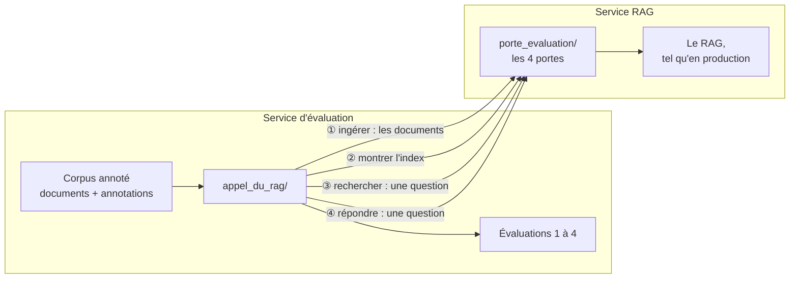

# 0b. La porte du RAG : ce que chaque RAG doit fournir

Le service d'évaluation ne connaît aucun RAG. Il demande à chacun **quatre portes, de forme fixe, à une adresse web**. Par ces portes, il envoie ses documents au RAG, lui pose ses questions, et récupère ce qu'il fait. Le RAG n'a pas à changer sa façon de travailler : les portes s'ajoutent à côté de lui.

Un mot revient partout : un **chunk** est un morceau de document tel que le RAG l'a découpé et indexé (identifiant `chunk_id`, fichier `chunks.jsonl`).



| Où | Quoi |
| --- | --- |
| cette page | la règle : les quatre portes, ce qu'on envoie, ce qu'on attend |
| [`reference/contrat_des_fichiers.md`](reference/contrat_des_fichiers.md) | chaque champ, en détail |
| [`reference/schemas/`](reference/schemas/) | les schémas JSON de ce que le RAG rend |
| [`../modele_porte/porte_evaluation.py`](../modele_porte/porte_evaluation.py) | le modèle des quatre portes, à copier dans votre RAG ; le pas à pas : [intégrer votre RAG](integrer_votre_rag.md) |
| [`../src/kit/appel_du_rag/`](../src/kit/appel_du_rag/) | le côté évaluation : le seul endroit du kit qui appelle un RAG |
| [`../../service-rag/src/rag/porte_evaluation/`](../../service-rag/src/rag/porte_evaluation/) | un exemple complet : la porte du RAG d'exemple, un fichier par porte |

## 1. Les quatre portes

| Porte | Adresse | Le service d'évaluation envoie | Le RAG rend | Pour l'évaluation |
| --- | --- | --- | --- | --- |
| ① **ingérer** | `POST /ingerer` | les documents du corpus : pour chacun, `reference_source`, `titre`, `type_document`, `version`, `format`, `droits_acces`, `fichier` (son nom) et `contenu` (le fichier, en base64) | « c'est fait » : nombre de documents, de chunks, de pages | [1](1_evaluation_ingestion.md) |
| ② **montrer l'index** | `GET /index` | rien | `rag` : sa description et sa version exacte ; `chunks` : chaque chunk de l'index avec la référence du document, sa version, la page, le type d'élément, les droits d'accès, l'ordre ; `pages` : le texte de chaque page lue, avant découpage ; `graphe` : son graphe en RDF, s'il en a un | [1](1_evaluation_ingestion.md) |
| ③ **rechercher** | `POST /rechercher` | `question`, `profil`, `historique` | `resultats` : les k chunks retrouvés, dans l'ordre (`chunk_id`, `rang`, `score`), avant toute génération ; `duree_ms` | [2](2_evaluation_recherche.md) |
| ④ **répondre** | `POST /repondre` | `question`, `profil`, `historique` | `reponse`, `abstention` (vrai si le RAG dit ne pas savoir), `chunks_cites`, `chunks_contexte`, `duree_ms`, `cout`, `tokens_entree`, `tokens_sortie`, `trace_id` | [3](3_evaluation_reponse.md), [4](4_evaluation_bout_en_bout.md) |

Le détail de chaque champ est dans le [contrat](reference/contrat_des_fichiers.md#3-ce-que-le-rag-rend). Le RAG d'exemple publie aussi la documentation de ses portes, générée, à http://127.0.0.1:8100/docs.

## 2. Les règles

| Règle | Pourquoi |
| --- | --- |
| **Le RAG range les documents de l'évaluation à part**, jamais avec ceux de la production | évaluer sans toucher à la production ; savoir exactement ce que le RAG a reçu |
| **Le RAG ne reçoit jamais les annotations** : ni réponse attendue, ni points clés, ni passages | l'évaluation ne triche pas. Seule exception : l'historique d'une question de suite |
| chaque question est posée **avec son profil**, et la recherche applique les droits de ce profil | tester les droits d'accès : un document interdit ne doit jamais remonter |
| une question de suite reçoit en `historique` la question précédente **et sa réponse attendue** | évaluer la question de suite seule, sans hériter d'une erreur sur la précédente |
| **le même k** pour toutes les questions | comparer les questions entre elles |
| **toutes** les questions sont posées, y compris les réservées à la décision | seul l'affichage des résultats diffère |
| le RAG dit lui-même s'il s'abstient (`abstention`) | mesurer l'abstention sans deviner à partir du texte |
| la version (`version_rag`) change dès que l'index, un modèle, le prompt ou k changent | comparer deux versions sans ambiguïté |

## 3. Côté RAG : où ranger la porte

La porte est écrite pour l'évaluation, et pour rien d'autre. On la range **dans un dossier à part**, pour que chacun voie ce qui a été ajouté. C'est le cas du RAG d'exemple :

```
service-rag/src/rag/
├── pipeline/              le RAG lui-même, tel qu'en production
└── porte_evaluation/      écrit pour le service d'évaluation, et rien d'autre
    ├── ingerer.py         ① ENTRÉE : les documents
    ├── montrer_index.py   ② SORTIE : ce que le RAG a lu et découpé
    ├── rechercher.py      ③ ENTRÉE une question → SORTIE les k chunks
    ├── repondre.py        ④ ENTRÉE une question → SORTIE la réponse
    └── adresse_web.py     les quatre portes, à http://127.0.0.1:8100
```

La porte se sert du RAG, jamais l'inverse : si on la supprime, le RAG marche toujours en production. Un RAG écrit dans un autre langage ouvre les mêmes quatre adresses, avec les mêmes champs.

## 4. Côté évaluation : appeler la porte

Une commande appelle les quatre portes dans l'ordre : elle envoie les documents, pose chaque question, et range ce que le RAG rend dans `sorties/sorties_rag/<version du RAG>/`.

```bash
uv run kit appeler-rag
```

Sans option, elle appelle l'adresse de [`../config/kit.yaml`](../config/kit.yaml) (`rag.adresse`, http://127.0.0.1:8100). Pour un autre RAG : `--rag http://…`. `kit evaluer` commence par cet appel, puis enchaîne les évaluations.

Puis le kit vérifie ce que le RAG a rendu, et dit **précisément ce qui ne va pas**, fichier par fichier et ligne par ligne :

```
sorties/sorties_rag/mon-rag : 3 problème(s).
  - reponses.jsonl, ligne 3 : champ obligatoire « abstention » absent.
  - rag.json : champ(s) inconnu(s) du contrat : 'temperature'.
  - recherches.jsonl, Q-007 : posée avec le profil « tous » au lieu de « exploitation ».
```

## 5. Sans adresse web : par fichiers

Un RAG qui ne peut pas ouvrir d'adresse écrit lui-même les fichiers que les portes auraient rendus. Il les range où il veut, dans un dossier nommé `<version du RAG>/` :

| Fichier | Une ligne = | Porte |
| --- | --- | --- |
| `rag.json` | la description et la version du RAG | ② |
| `chunks.jsonl` | un chunk de l'index | ② |
| `pages_extraites.jsonl` | une page lue, avant découpage (si des documents sont scannés) | ② |
| `graphe.ttl` | le graphe, si le RAG en a un | ② |
| `recherches.jsonl` | une question : les k chunks retrouvés | ③ |
| `reponses.jsonl` | une question : la réponse | ④ |

Il lit les documents dans `corpus_exemple/documents/` (`chemins.documents` de [`kit.yaml`](../config/kit.yaml)), et les questions dans `sorties/corpus/<version>/questions.jsonl`. De ce fichier, il ne lit que `question_id`, `question` et `profil`, plus, pour une question de suite, la question précédente (`question_precedente`) et sa réponse attendue : c'est l'historique, seule exception de la règle. Le reste, ce sont les annotations, qu'il ne doit pas voir. Puis on donne son dossier au kit :

```bash
uv run kit verifier-contrat <dossier>
```

```bash
uv run kit evaluer --rag <dossier>
```

**Étape suivante** : [1. Évaluation de l'ingestion](1_evaluation_ingestion.md).
