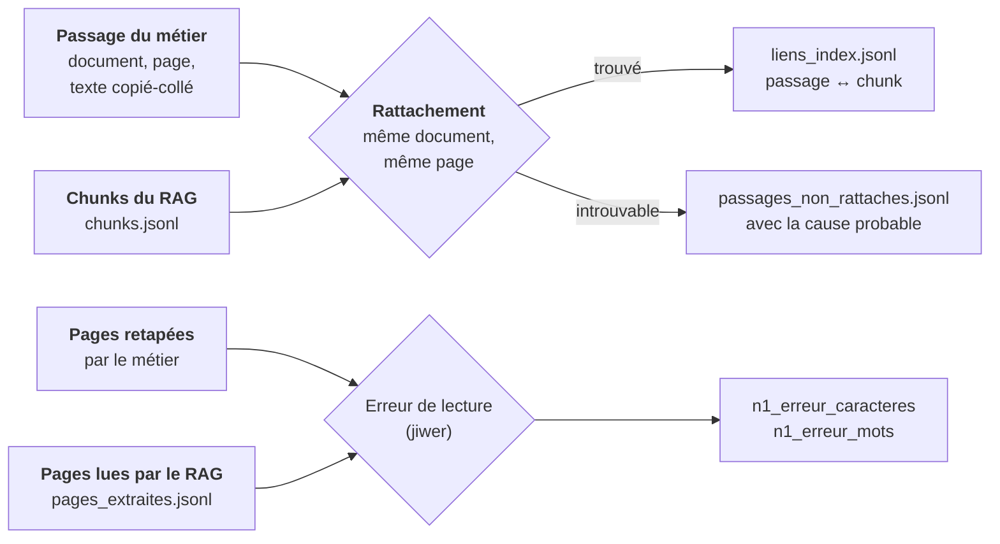
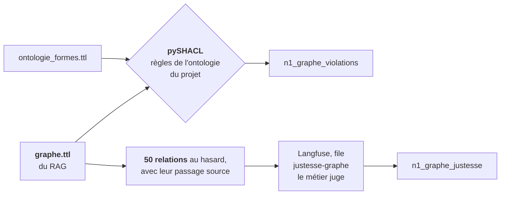

# 1. Évaluation de l'ingestion

## Ce que vérifie cette évaluation

Le service d'ingestion du RAG lit les documents, les découpe en morceaux de texte (les *chunks*), transforme chaque morceau en vecteur et range le tout dans la base vectorielle. L'évaluation de l'ingestion vérifie que rien ne s'est perdu ni abîmé en route. Elle vérifie **cinq choses**, avec un score pour chacune.

**1. Tous les documents sont arrivés dans la base** (seuil : 100 %)

Le service prend les documents du corpus un par un et regarde si chacun a au moins un morceau dans la base. Le score est le nombre de documents présents divisé par le nombre de documents envoyés. Un document absent est invisible pour le RAG : aucune de ses informations ne pourra servir.

**2. Les réponses aux questions sont arrivées intactes** (seuil : 95 %)

Pour chaque question du corpus, le métier a identifié dans les documents le ou les passages qui contiennent la réponse, et les a copiés-collés dans le fichier d'annotation. Le service cherche chacun de ces passages dans les morceaux du même document et de la même page, avec une petite tolérance pour les fautes de lecture. Le score est le nombre de passages retrouvés divisé par le nombre de passages. Un passage perdu, c'est une question qui n'aura jamais de bonne réponse, quelle que soit la qualité de la suite.

Les points 1 et 2 ne font pas doublon. Le premier compte les cartons ; le second ouvre ceux dont on a besoin et vérifie que les objets importants ne sont pas cassés. Un document peut être arrivé alors que la réponse qu'il contient a été abîmée.

**3. Les pages scannées ont été bien lues** (seuil : 2 % d'erreurs au plus)

Une page scannée est une image : le service d'ingestion doit en reconnaître le texte. Le métier a retapé à la main quelques-unes de ces pages. Le service compare ce texte à celui que le service d'ingestion a lu, caractère par caractère. Le score est le nombre de caractères mal lus divisé par le nombre de caractères retapés. Un mot mal lu ne sera plus reconnu par la recherche.

**4. Chaque morceau sait d'où il vient et à qui il est réservé** (seuil : 100 %)

Chaque morceau doit porter son document, sa page et ses droits d'accès (« ouvert à tous » ou « réservé à un service »). Le score est le nombre de morceaux qui ont ces trois informations divisé par le nombre de morceaux. Sans le document et la page, le RAG ne peut pas citer sa source. Sans les droits d'accès, il ne peut pas cacher un document réservé à la Maintenance à quelqu'un de l'Exploitation.

**5. Le découpage n'a pas coupé de réponse en deux** (sans seuil, il sert à comprendre)

Quand un passage n'est dans aucun morceau en entier, le service essaie de recoller deux morceaux qui se suivent. S'il le retrouve ainsi, le passage compte comme retrouvé au point 2, mais il est signalé comme coupé. Le score est le nombre de passages coupés divisé par le nombre de passages. S'il est élevé, il faut revoir le découpage.

Le détail des règles est plus bas : [le rattachement](#comment-le-kit-tranche--le-rattachement), et [les scores avec leur code](#les-scores).

C'est la première évaluation, et elle peut tourner juste après l'ingestion, avant que le RAG ait répondu à une seule question. Un passage absent de l'index ne pourra jamais être retrouvé ([évaluation 2](2_evaluation_recherche.md)), ni donner une bonne réponse ([évaluation 3](3_evaluation_reponse.md)).



| Où | Quoi |
| --- | --- |
| [`reference/methode_evaluation.md`](reference/methode_evaluation.md) | la méthode (document 3), section 6 pour le rattachement |
| [`../src/kit/etape_1_evaluation_ingestion/rattachement.py`](../src/kit/etape_1_evaluation_ingestion/rattachement.py) | le rattachement d'un passage à un chunk, et la cause probable d'un échec |
| [`../src/kit/etape_1_evaluation_ingestion/scores.py`](../src/kit/etape_1_evaluation_ingestion/scores.py) | les scores de l'ingestion |

## La commande

Elle est déjà lancée par `kit evaluer`. Pour la relancer seule :

```bash
uv run kit evaluer-ingestion
```

Sans option, le kit prend le dernier corpus importé et les dernières réponses du RAG, et les affiche ([les options](../README.md#les-options---corpus-et---rag)). Il suffit que `sorties/sorties_rag/<version du RAG>/` contienne `rag.json`, `chunks.jsonl` et, s'il y a des scans, `pages_extraites.jsonl` : le kit les y a rangés après la porte ② ([porte du RAG](0b_porte_du_rag.md)).

## Comment le kit tranche : le rattachement

Pour chaque passage du métier, le kit cherche un chunk **du même document et de la même page**, puis compare les textes selon le type d'élément :

| Type de passage | Rattaché si |
| --- | --- |
| texte | le passage est contenu dans le chunk, ou lui ressemble à 95 % |
| tableau | 90 % des mots du passage sont dans le chunk, dans n'importe quel ordre |
| texte scanné | le passage ressemble au chunk à 90 % (l'OCR fait des fautes) |
| image | un chunk de type image existe sur la page |

Un passage réparti sur deux chunks consécutifs est rattaché, mais compté comme **coupé**. Tous les liens trouvés sont écrits dans `liens_index.jsonl` : les évaluations 2 et 3 s'en servent pour savoir quel chunk contient quel passage.

## Les scores

Les identifiants (`n1_…`) sont ceux de `scores.json`, du CSV et de Langfuse. La colonne « Exemple » donne la valeur du RAG d'exemple.

| Score | Ce qu'il mesure | Exemple | Si c'est mauvais |
| --- | --- | --- | --- |
| `n1_documents_indexes` | part des documents du corpus présents dans l'index | 100 % | un document manque : format non lu, erreur d'ingestion |
| `n1_metadonnees_completes` | part des chunks qui portent référence, version, page, type d'élément et droits | 100 % | sans elles, ni rattachement, ni filtre des droits, ni citation possible |
| `n1_passages_rattaches` | part des passages du métier retrouvés dans un chunk du même document, à la même page | 100 % | lire `passages_non_rattaches.jsonl` : chaque passage a sa cause probable (ci-dessous) |
| `n1_passages_coupes` | part des passages coupés entre deux chunks | 0 % | découper par section, ajouter du chevauchement |
| `n1_erreur_caracteres` | caractères à corriger pour passer du texte lu par l'OCR au texte retapé, divisé par le nombre de caractères retapés | **15 %** (seuil 2 %) | voir l'exemple ci-dessous |
| `n1_erreur_mots` | la même chose en mots | 20 % | — |

## Les causes probables d'un passage non rattaché

| Cause affichée par le kit | Ce qu'il faut faire |
| --- | --- |
| « aucun chunk sur la page 4 ; le passage est trouvé page 2 : page mal notée ? » | le **métier** corrige la page dans son fichier Excel |
| « aucun chunk sur la page… : page perdue à l'extraction » | l'équipe technique vérifie l'extraction de ce document |
| « tableau mal extrait : 60 % des mots retrouvés » | traitement dédié des tableaux |
| « OCR : ressemblance de 70 % au mieux » | meilleur OCR, ou modèle de vision sur les pages difficiles |
| « aucun chunk de type image sur la page » | décrire les images (modèle de vision) |
| « document absent de l'index » | l'ingestion a sauté ce document |

## Exemple : pourquoi l'OCR du RAG d'exemple est à 15 %

Comparer le texte retapé et le texte extrait d'une page (NT-031, page 2) montre trois causes :

- **Docling écarte l'en-tête et le pied de page** (« VALTÉRA INDUSTRIES — Archives techniques »).
- **Il colle des mots**, par exemple « TGBT-Aest » ou « Disjoncteurouvert ».
- **Il lit mal des chiffres**, par exemple « 1.600 A » au lieu de « 1 600 A ».

Sur une autre page (NT-040, page 3), il **mélange l'ordre des lignes**. Les passages restent retrouvés, car le rattachement tolère 10 % d'écart, mais une valeur mal lue peut fausser une réponse.

## Si le RAG a un graphe

Un RAG de type `graphe` ou `hybride` rend aussi `graphe.ttl` ([porte du RAG, ② montrer l'index](0b_porte_du_rag.md)). Le kit vérifie alors deux choses de plus.



| Score | Ce qu'il mesure | Si c'est mauvais |
| --- | --- | --- |
| `n1_graphe_violations` | le nombre de règles de l'ontologie non respectées : une classe fausse (une personne « située sur » un site), une relation inconnue, trop de valeurs (un équipement sur deux sites), une provenance manquante | contraindre davantage l'extraction : consigne, exemples, contrôle par l'ontologie avant d'écrire le graphe |
| `n1_graphe_justesse` | la part des relations jugées justes par le métier, d'après leur passage source | une relation conforme à l'ontologie peut être fausse : meilleur modèle d'extraction, relecture |

Les règles sont celles du projet, pas celles du RAG : le chemin de `ontologie_formes.ttl` est dans [`../config/kit.yaml`](../config/kit.yaml) (`graphe.formes`). Pour le corpus d'exemple : [`../corpus_exemple/ontologie/`](../corpus_exemple/ontologie/). Le code : [`../src/kit/etape_1_evaluation_ingestion/graphe.py`](../src/kit/etape_1_evaluation_ingestion/graphe.py).

Il faut d'abord évaluer le RAG hybride : `RAG_GRAPHE=true docker compose up -d` dans `service-rag/`, puis `uv run kit evaluer`. Ses réponses sont alors les plus récentes, et les commandes ci-dessous les prennent sans option.

Les violations sont calculées par `kit evaluer-ingestion`. La justesse demande le métier :

1. Envoyer 50 relations au métier :
   ```bash
   uv run kit verifier-graphe --envoyer
   ```
2. Dans Langfuse, **Annotation Queues → `justesse-graphe`** : chaque élément montre la relation, sa source et le passage. Le métier choisit `justesse_relation` : juste ou fausse.

   Dans le banc d'essai, il n'y a pas de métier : cette commande inscrit les jugements simulés (voir l'encadré plus bas) :
   ```bash
   uv run python corpus_exemple/relecture_simulee/publier.py
   ```
3. Voir où en est la relecture, puis inscrire le score dans les résultats :
   ```bash
   uv run kit verifier-graphe
   ```
   ```bash
   uv run kit evaluer-ingestion
   ```

**Le résultat sur le RAG hybride d'exemple** : 25 violations, et une justesse de **66 %** ± 13 % (33 relations justes sur 50). Les 17 relations fausses sont de trois sortes :

| Sorte d'erreur | Exemple | Combien |
| --- | --- | --- |
| relation vraie dans l'entreprise, mais que le passage ne dit pas : le modèle déduit le site du repère (« AD-B01 » → site B), et la provenance est fausse | AD-B01 situeSur Site B, d'après une page qui liste les armoires sans dire leur site | 7 |
| mauvais rôle ou mauvaise cible : une demandeuse, une responsable ou un bureau d'études comptés comme intervenants ; l'intervention rattachée au transformateur au lieu du TGBT | Sophie Lenoir intervientSur AD-B02 (elle est la demandeuse) | 5 |
| relation inversée ou inventée | AD-B06 alimente TGBT-B (c'est l'inverse) ; OND-A secourt GE-A ; un « technicien » absent du passage | 5 |

C'est la limite d'un petit modèle qui extrait page par page. La première sorte d'erreur ne se voit pas dans les violations : la relation respecte l'ontologie, seule la provenance est fausse. D'où l'intérêt de faire juger les relations par le métier, en plus des règles SHACL.

> Comme pour la vérification du juge, le métier est simulé dans le banc d'essai : c'est Claude qui a jugé les 50 relations, d'après leur passage source. Ses jugements et leur raison sont dans [`../corpus_exemple/relecture_simulee/justesse_graphe.json`](../corpus_exemple/relecture_simulee/justesse_graphe.json). Ils visent les relations tirées chez l'auteur : si votre graphe en tire d'autres, celles-là restent sans jugement, et le script les compte.

## Si c'est mauvais

Extraction, OCR, tableaux, images, découpage : le [document 2](../../service-rag/documentation/reference/techniques_rag.md), sections 3 et 4.

**Étape suivante** : [2. Évaluation de la recherche](2_evaluation_recherche.md).
