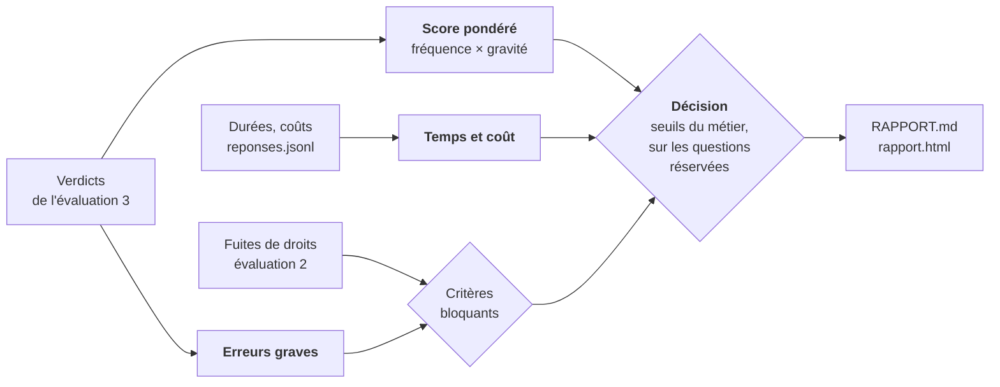

# 4. Évaluation de bout en bout

## Ce que vérifie cette évaluation

On regarde le RAG comme l'utilisateur le voit : une question, une réponse, au bout d'un certain temps et pour un certain coût. L'évaluation de bout en bout vérifie que le RAG est bon là où ça compte, assez rapide et pas trop cher. Elle vérifie **quatre choses**.

**1. Le RAG est bon sur les questions qui comptent** (seuil : 80 %)

Le métier a donné à chaque question une fréquence (rare 1, occasionnelle 2, fréquente 3) et une gravité (faible 1, moyenne 2, forte 3). Le poids de la question est fréquence × gravité, de 1 à 9. Chaque question reçoit sa note de l'[évaluation de la réponse](3_evaluation_reponse.md) : juste 1, partielle 0,5, fausse 0. Une abstention compte juste si la question n'a pas de réponse, et fausse si elle en a une. Le score est la moyenne des notes, pondérée par les poids. Une erreur sur une question fréquente et grave coûte 9 fois plus qu'une erreur sur une question rare et sans risque.

**2. Aucune erreur grave** (seuil : 0, bloquant)

Le même compte qu'à l'évaluation de la réponse, repris ici parce qu'il décide à lui seul.

**3. Le RAG répond assez vite** (seuils : 15 s et 30 s)

Le service mesure le temps de chaque réponse. Le temps médian, celui sous lequel répond la moitié des questions, doit rester sous 15 s. Le temps sous lequel répondent 95 % des questions doit rester sous 30 s.

**4. Le RAG ne coûte pas trop cher** (seuil : 0,05 € par question)

Le RAG indique le coût de chaque réponse ; le score est la moyenne par question. Il vaut 0 avec des modèles qui tournent en local.

Ces scores, avec ceux des évaluations 1 à 3, mènent à [la décision](#la-décision), plus bas.

C'est la dernière évaluation. Elle reprend les précédentes, pèse chaque question selon son importance, et rend la **décision**.



| Où | Quoi |
| --- | --- |
| [`reference/methode_evaluation.md`](reference/methode_evaluation.md) | la méthode (document 3), section 9 |
| [`../config/seuils.json`](../config/seuils.json) | les seuils du métier |
| [`../src/kit/etape_4_evaluation_bout_en_bout/scores.py`](../src/kit/etape_4_evaluation_bout_en_bout/scores.py) | les scores de bout en bout |
| [`../src/kit/etape_5_resultats/`](../src/kit/etape_5_resultats/) | la décision, le rapport, la publication dans Langfuse |

## La commande

Elle est déjà lancée par `kit evaluer`. Pour la relancer seule, sur les dernières réponses du RAG :

```bash
uv run kit evaluer-bout-en-bout
```

Elle a besoin de l'[évaluation 3](3_evaluation_reponse.md). Elle écrit la décision et le rapport.

## Tout en une commande

En pratique, une seule commande fait tout, une fois le RAG lancé :

```bash
uv run kit evaluer
```

Elle appelle d'abord les quatre portes du RAG ([0b](0b_porte_du_rag.md)) : elle lui envoie les documents, lui pose les 60 questions, et range ses réponses (5 minutes environ pour le RAG d'exemple). Elle vérifie ce que le RAG a rendu : si quelque chose est faux, elle s'arrête et dit pourquoi. Puis elle enchaîne les évaluations 1 à 4, dans l'ordre (5 minutes environ, dont 3 pour le juge).

Pour réévaluer des réponses déjà rangées, sans rappeler le RAG : `uv run kit evaluer --rag sorties/sorties_rag/<version du RAG>`. Une évaluation s'appelle `<version du corpus>_<version du RAG>`. Relancer une étape remplace ses résultats. Évaluer une autre version du RAG crée une autre évaluation.

## Les scores

| Score | Ce qu'il mesure | Exemple |
| --- | --- | --- |
| `n4_score_pondere` | réponses justes, pondérées par **fréquence × gravité** (de 1 à 9). Une question fréquente et grave compte 9 fois plus qu'une question rare et sans gravité. Une abstention compte juste sur une question sans réponse, et fausse sur une question qui en a une | 80 % ± 12 % |
| `n4_erreurs_graves` | repris de l'évaluation 3 | 1 |
| `n4_temps_median`, `n4_temps_p95` | temps de réponse médian, et temps sous lequel répondent 95 % des questions | 7,4 s et 12,8 s |
| `n4_cout_moyen` | coût moyen par question, en euros | 0 € (modèles locaux) |

Le score pondéré dit ce que vivront les utilisateurs. Un RAG à 90 % d'exactitude qui se trompe sur les questions fréquentes et graves sera moins bon ici.

## Les seuils du métier

Ils sont dans [`../config/seuils.json`](../config/seuils.json). Pour chaque score : `seuil`, `sens` (`min` : au moins ; `max` : au plus) et `bloquant`. Les valeurs sont les repères du document 3. **Le métier les fixe avant la première évaluation**, et ne les change pas après avoir vu les résultats.

| Score | Seuil | Bloquant |
| --- | --- | --- |
| passages retrouvés dans l'index (`n1_passages_rattaches`) | ≥ 95 % | |
| erreur de lecture des scans (`n1_erreur_caracteres`) | ≤ 2 % | |
| bon passage retrouvé (`n2_reussite_k`) | ≥ 90 % | |
| **fuites de droits** (`n2_fuite_droits`) | 0 | **oui** |
| réponses justes (`n3_exactitude`) | ≥ 80 % | |
| abstentions correctes (`n3_abstention_correcte`) | ≥ 80 % | |
| fidélité aux sources (`n3_fidelite`) | ≥ 90 % | |
| **erreurs graves** (`n3_erreurs_graves`, `n4_erreurs_graves`) | 0 | **oui** |
| score pondéré (`n4_score_pondere`) | ≥ 80 % | |
| temps médian, temps à 95 %, coût moyen | 15 s, 30 s, 0,05 € | |

## La décision

Deux règles la décident :

1. **Les critères bloquants : une fuite de droits ou une erreur grave bloque, quel que soit le reste.** Ils se jugent sur **toutes** les questions.
2. **Les seuils** se jugent sur les **questions réservées à la décision** : celles qui n'ont jamais servi à régler le RAG.

Pour le RAG d'exemple, la décision est **« mise en production non recommandée »** :
- 1 erreur grave (Q-046, une synthèse hors sujet), ce qui déclenche un critère bloquant ;
- l'OCR à 15 %, pour un seuil de 2 % ;
- sur les questions réservées : le bon passage retrouvé dans 69 % des cas (seuil 90 %), 77 % de réponses justes (seuil 80 %), un score pondéré de 76 % (seuil 80 %).

> **Pourquoi deux jeux de questions ?** Si l'on règle le RAG en regardant les questions de la décision, on finit par le régler « pour le test », et le score ne veut plus rien dire. Le rapport et le CSV montrent donc le détail des questions de réglage. Pour les questions réservées, ils ne montrent que les scores globaux. Leur détail reste dans la base.

**Étape suivante** : [5. Résultats et comparaison](5_resultats_et_comparaison.md).
