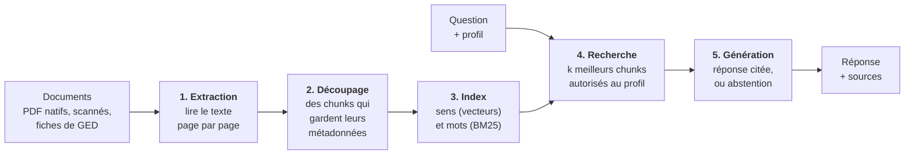
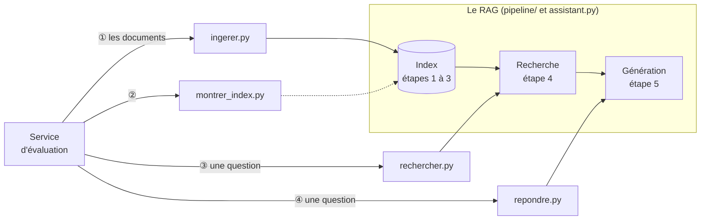

# Guide du RAG d'exemple

Ce service contient **un RAG simple et complet**, qui marche seul sur n'importe quels documents. Il sert d'exemple : le sujet du dépôt est l'évaluation, pas le RAG. Il est volontairement minimal, et ses défauts sont utiles : ils donnent à l'évaluation quelque chose à mesurer.



Il cherche les morceaux de texte de deux façons, par le sens (les vecteurs) et par les mots (BM25). Il n'a pas de graphe de connaissances. Ce que l'évaluation pourrait mesurer d'un RAG qui en a un : [Pour aller plus loin : les cas particuliers](../../service-evaluation/documentation/cas_particuliers.md#1-un-rag-avec-un-graphe-de-connaissances).

## Les fichiers

Ce que contient chaque dossier : le [README du service](../README.md#ce-quil-y-a-dans-ce-dossier), puis le README de chaque dossier. L'essentiel :

- le RAG lui-même est dans [`src/rag/pipeline/`](../src/rag/pipeline/), une étape par fichier, dans l'ordre ;
- [`src/rag/endpoints_evaluation/`](../src/rag/endpoints_evaluation/) est écrit pour le service d'évaluation, et rien d'autre ;
- tous les réglages sont dans [`config/config.yaml`](../config/config.yaml).

Les endpoints se servent du RAG, jamais l'inverse : si on supprime `endpoints_evaluation/`, le RAG marche toujours. Un test le vérifie, comme il vérifie que le RAG n'importe rien du service d'évaluation.

## Deux espaces : la production et l'évaluation

Le RAG range ses documents et son index dans deux espaces, qui ne se mélangent jamais :

| Espace | Ses documents | Son index |
| --- | --- | --- |
| production | son corpus documentaire, dans `corpus_documentaire/`, avec la liste des documents exportée de la gestion documentaire | `sorties/production/` |
| evaluation | ceux que le service d'évaluation envoie par l'endpoint « ingérer » | `sorties/evaluation/` |

Dans le banc d'essai, le corpus documentaire du RAG d'exemple est vide : il n'a que les documents de l'évaluation.

## S'en servir seul

Une fois que le service d'évaluation lui a envoyé ses documents, on peut lui poser des questions directement :

```bash
uv run rag demander "Combien de temps faut-il pour consigner une armoire divisionnaire ?" --espace evaluation
```

```
La durée moyenne de consignation pour une armoire divisionnaire BT est de 20 minutes [1].

  [1] cité  PR-1101 (version v3), page 3
  [2]       PR-1103 (version v2), page 1
  …
```

Avec `--profil`, la question est posée par un utilisateur de ce profil, et il ne voit que ses documents. Le réglage du relais de protection générale est dans NT-051, réservé à « Maintenance » :

```bash
uv run rag demander "Quel est le réglage du relais de protection générale ?" --profil exploitation --espace evaluation
```

```
Je ne trouve pas cette information dans les documents.
```

Avec `--profil maintenance`, la même question reçoit la réponse : « Seuil 72 A, Temporisation 500 ms [5] ».

En production, on met ses documents et leur liste dans `corpus_documentaire/`, puis `uv run rag indexer`, et `rag demander` sans `--espace`.

## Les étapes, une par une

### 1. Extraction — [`pipeline/etape_1_extraction.py`](../src/rag/pipeline/etape_1_extraction.py)

Lire chaque document et en sortir le texte, page par page.

| Format | Outil | Pourquoi |
| --- | --- | --- |
| PDF natif | Docling (conteneur du [`docker-compose.yml`](../docker-compose.yml)) | il rend la mise en page en Markdown : titres, listes, tableaux |
| PDF scanné | Docling, OCR forcé | les pages ne sont que des images |
| Fiche de GED | pypdf, mode « mise en page » | il garde les deux colonnes « champ : valeur » |

Chaque document arrive avec ses métadonnées : sa référence, son titre, son type, sa version, son format, ses droits d'accès et le nom de son fichier. En production, elles viennent de l'export de la gestion documentaire (`corpus_documentaire/liste_des_documents.csv`) :

```
reference;titre;type_document;version;format;droits_acces;fichier
NT-051;Réglages des protections du poste HTA;Note technique;v3;PDF natif;Maintenance;NT-051.pdf
```

Pour l'évaluation, elles arrivent avec les documents, par l'endpoint « ingérer ».

Le RAG traduit les libellés en codes (« PDF scanné » → `pdf_scanne`, « Tous les utilisateurs » → `tous`) et ne lit rien d'autre : ni le fichier Excel du métier, ni le corpus exporté par le kit.

### 2. Découpage — [`pipeline/etape_2_decoupage.py`](../src/rag/pipeline/etape_2_decoupage.py)

Couper chaque document en chunks, c'est-à-dire en morceaux assez petits pour être retrouvés, assez grands pour avoir un sens.

| Élément | Un chunk = |
| --- | --- |
| texte | une section, avec le chemin de titres en tête ; recoupée au-delà de 1 500 caractères |
| tableau | le tableau, chaque ligne écrite « colonne : valeur » (les en-têtes sont répétés) |
| figure | sa légende (pas de modèle de vision ici) |
| fiche de base | un champ |

Chaque chunk garde **la référence du document, sa version, sa page, son type d'élément, ses droits d'accès et son ordre dans la page**. Sans eux, le RAG ne pourrait ni citer ses sources ni filtrer les droits.

### 3. Index — [`pipeline/etape_3_index.py`](../src/rag/pipeline/etape_3_index.py)

Rendre les chunks cherchables de deux façons : par le **sens** (un vecteur par chunk, modèle d'embeddings) et par les **mots** (BM25). Les vecteurs sont gardés dans un fichier, pas dans une base vectorielle : quelques milliers de chunks tiennent en mémoire. L'index est écrit dans `sorties/<espace>/index/`.

### 4. Recherche — [`pipeline/etape_4_recherche.py`](../src/rag/pipeline/etape_4_recherche.py)

Trouver les k chunks les plus utiles. Deux recherches, par le sens et par les mots, fusionnées par rang : un chunk bien classé par les deux remonte en tête. **Le filtre des droits s'applique pendant la recherche** : un chunk interdit au profil n'est jamais classé, donc jamais montré au modèle. Pour une question de suite, on cherche avec la question précédente et la nouvelle.

### 5. Génération — [`pipeline/etape_5_generation.py`](../src/rag/pipeline/etape_5_generation.py)

Rédiger la réponse à partir des chunks retrouvés, et d'eux seuls. Chaque phrase cite son extrait, [1], [2]… Si les extraits ne suffisent pas, le modèle répond une phrase fixe, « Je ne trouve pas cette information dans les documents. », au lieu d'inventer.

Le modèle « réfléchit » avant d'écrire, et cette réflexion compte dans `max_tokens`. Avec 800, les réponses longues revenaient vides ou coupées en cours de phrase (Q-043, Q-030, Q-046) ; avec 4 000, la plus longue en prend 1 265. Couper la réflexion (`sans_reflexion: true`) corrige aussi la coupure, et répond 8 fois plus vite, mais l'évaluation montre qu'elle fait perdre des calculs : [5. Résultats et comparaison](../../service-evaluation/documentation/5_resultats_et_comparaison.md#5-comparer-deux-versions).

## Le régler : un seul fichier

Tout est dans [`config/config.yaml`](../config/config.yaml) ; seule la clé est dans `.env` (`RAG_LLM_CLE`). Après un changement : `docker compose restart rag`.

| Réglage | Valeur ici | Pour changer |
| --- | --- | --- |
| `modeles.adresse` | `http://127.0.0.1:8080/v1` (LiteLLM local) | n'importe quel point d'accès compatible OpenAI |
| `modeles.generation.modele` | `gemma-4-e4b` | un autre modèle ; prix au million de tokens pour le coût |
| `modeles.generation.max_tokens` | 4 000 | la réflexion du modèle compte dedans : trop bas, la réponse est coupée |
| `modeles.generation.sans_reflexion` | `false` | `true` : 8 fois plus rapide, moins juste sur les calculs |
| `modeles.embeddings.modele` | `embed` (bge-m3) | les documents sont réindexés à la prochaine ingestion |
| `recherche.k` | 5 | ou `RAG_K=3 docker compose up -d` (ou `--k 3` sur la ligne de commande) |
| `documents` | `corpus_documentaire/`, vide | le dossier du corpus documentaire que le RAG sert à ses utilisateurs |
| `liste_des_documents` | `corpus_documentaire/liste_des_documents.csv` | l'export de votre gestion documentaire, avec les mêmes colonnes |
| `endpoints_evaluation` | `127.0.0.1`, port 8100 | l'adresse des endpoints d'évaluation |

## Ses endpoints d'évaluation — [`endpoints_evaluation/`](../src/rag/endpoints_evaluation/)

C'est la seule partie du RAG écrite pour l'évaluation. Elle ne change rien au RAG : elle ouvre les **quatre endpoints** que le service d'évaluation demande à tout RAG, un fichier par endpoint.



| Endpoint | Fichier | Ce qu'elle reçoit | Ce qu'elle rend |
| --- | --- | --- | --- |
| ① ingérer | [`ingerer.py`](../src/rag/endpoints_evaluation/ingerer.py) | les documents et leurs métadonnées | le nombre de documents, de chunks, de pages ; ils sont indexés dans l'espace « evaluation » |
| ② montrer l'index | [`montrer_index.py`](../src/rag/endpoints_evaluation/montrer_index.py) | — | la version exacte du RAG, les chunks de l'index avec leurs métadonnées, le texte de chaque page lue |
| ③ rechercher | [`rechercher.py`](../src/rag/endpoints_evaluation/rechercher.py) | une question, un profil, l'échange précédent | les k chunks retrouvés, avant la génération |
| ④ répondre | [`repondre.py`](../src/rag/endpoints_evaluation/repondre.py) | une question, un profil, l'échange précédent | la réponse, l'abstention, les chunks cités et ceux du contexte, la durée, le coût, la trace |

[`adresse_web.py`](../src/rag/endpoints_evaluation/adresse_web.py) les ouvre à http://127.0.0.1:8100. Le service Docker le fait au démarrage ; sans Docker : `uv run rag ouvrir-endpoints`. La documentation de chaque endpoint est à http://127.0.0.1:8100/docs.

La règle complète, pour ouvrir les endpoints de **votre** RAG : [les endpoints du RAG](../../service-evaluation/documentation/0b_endpoints_du_rag.md).

La **version du RAG** (`graphrag-vectoriel-k5-5954e822`) se calcule à partir de k, des modèles, du prompt et de l'index. Le préfixe `graphrag` n'est que le `nom` donné dans `config/config.yaml` : le RAG n'a pas de graphe. Changer un réglage donne une nouvelle version, que le service d'évaluation range à part. Deux versions se comparent avec `kit comparer`.

## Ses limites connues, et ce que l'évaluation en dit

| Limite | Ce que le kit mesure |
| --- | --- |
| Pas de modèle de vision : une figure n'est connue que par sa légende | évaluation 3 (réponse) : la question Q-034 (câbles du TGBT-A, lisibles seulement sur le schéma) reçoit une abstention |
| Docling écarte l'en-tête et le pied de page, colle des mots, mélange parfois l'ordre des lignes d'un scan | évaluation 1 (ingestion) : 15 caractères sur 100 mal lus |
| Toutes les versions des documents sont indexées, même celles qui ne sont plus en vigueur | évaluation 2 (recherche) : « périmé ou piège avant le bon passage » |
| Recherche simple, sans reranker ni décomposition de la question | évaluation 2 (recherche) : les questions qui combinent plusieurs passages échouent plus souvent |
| Un seul prompt, petit modèle (4 milliards de paramètres) | évaluation 3 (réponse) : les synthèses sur l'ensemble des documents sont fausses |

Pour aller plus loin, le document [Construire le pipeline d'un RAG : ce qu'on met en place selon les cas](reference/techniques_rag.md) décrit les techniques d'un RAG selon les cas, et ce qu'il faut corriger quand un score est mauvais.
