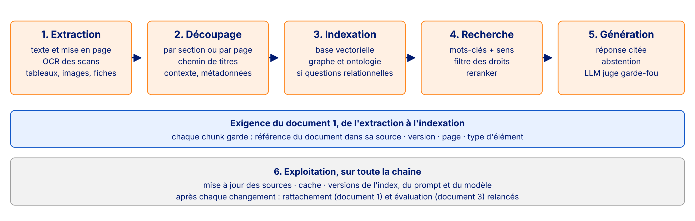

# Construire le pipeline d'un RAG : ce qu'on met en place selon les cas

Règles à suivre pour tout projet RAG. Ce document dit quelle technique mettre en place à chaque étape du pipeline, dans quel cas, et quel score de l'évaluation (document « Évaluer le RAG avec le corpus ») montre qu'elle marche. Il s'appuie sur le corpus d'évaluation (document « Constituer le corpus d'évaluation d'un RAG »).

**La règle :** une technique ajoutée doit améliorer un score du document « Évaluer le RAG avec le corpus ». Sinon, on la retire : elle coûte en temps de réponse, en argent et en maintenance.

## 1. Le pipeline en un schéma

| Étape | Rôle | Qui |
| --- | --- | --- |
| 1. Extraction | lire chaque document et en sortir un texte fidèle | équipe technique |
| 2. Découpage | couper ce texte en chunks qui se comprennent seuls | équipe technique |
| 3. Indexation | ranger les chunks dans une base vectorielle, et dans un graphe si besoin | équipe technique |
| 4. Recherche | trouver les bons chunks pour une question | équipe technique |
| 5. Génération | rédiger la réponse à partir des chunks trouvés | équipe technique |
| 6. Exploitation | garder le RAG à jour et sous contrôle | équipe technique, avec le métier |

## 2. Le socle : configuration minimale ou recommandée

| Étape | Configuration minimale | Configuration recommandée |
| --- | --- | --- |
| Extraction | outil d'analyse de mise en page ; OCR sur les scans | traitement dédié des tableaux, des images et des fiches de base de données |
| Découpage | par section, avec le chemin de titres ; métadonnées du document « Constituer le corpus d'évaluation d'un RAG » | phrase de contexte devant chaque chunk |
| Indexation | une base vectorielle qui sait filtrer par métadonnées | graphe et ontologie si l'évaluation montre des échecs sur les questions relationnelles |
| Recherche | recherche hybride (mots-clés et sens), filtre des droits | reranker ; réécriture des questions de conversation |
| Génération | réponse citée ; abstention si le contexte ne suffit pas | LLM juge garde-fou avant l'envoi |
| Exploitation | mise à jour des sources ; rattachement et évaluation relancés | cache ; suivi des signaux de production |

## 3. Étape 1 — Extraction

Ce que l'extraction perd est perdu pour tout le reste : aucune étape suivante ne le rattrape.

| Si | On met en place | Ce que ça fait | Le score qui le montre (document « Évaluer le RAG avec le corpus ») |
| --- | --- | --- | --- |
| PDF avec du texte | lecture du texte natif et analyse de mise en page (Docling, Marker) | garde l'ordre de lecture, les titres, les colonnes et les tableaux | part de passages perdus au rattachement |
| PDF scanné | OCR rapide sur toutes les pages, modèle de vision seulement sur les pages difficiles | rend le texte lisible sans payer le modèle partout | passages perdus, sur les documents scannés |
| Tableau dans un document | un chunk par tableau ou par groupe de lignes, avec titre et en-têtes répétés ; lignes écrites « colonne : valeur » | un chiffre reste lié à sa ligne et à sa colonne | recherche, sur les passages de type tableau |
| Tableur ou export de données | chargement dans une base et réponse en SQL, pas d'index | un calcul exact au lieu d'une recherche approximative | réponse, sur les questions de type calcul |
| Image ou schéma | description par un modèle de vision ; chunk de type « image ou schéma » avec sa page | l'image devient cherchable | recherche, sur les passages de type image |
| Fiche de GED | export de la fiche en « champ : valeur », un chunk par fiche | chaque champ garde son nom | recherche, sur ce type de document |
| Texte invisible dans un document | suppression du texte blanc sur blanc ou minuscule | empêche des consignes cachées d'atteindre le modèle | — |

État de l'art : aucun OCR testé ne suffit seul, et ses erreurs se propagent jusqu'à la réponse (OHRBench, 2024).

## 4. Étape 2 — Découpage et enrichissement

| Si | On met en place | Ce que ça fait | Le score qui le montre |
| --- | --- | --- | --- |
| Document structuré (titres, sections) | un chunk par section ; une section trop longue est recoupée | chaque chunk porte une idée complète | recherche |
| Structure douteuse | un chunk par page | le meilleur choix par défaut sur des PDF d'entreprise | recherche |
| Coupure à taille fixe | chevauchement de 10 à 20 % entre chunks voisins | évite de séparer une règle de son exception | recherche |
| Chunk incompréhensible seul (« le délai est de 14 jours ») | chemin de titres dans le texte du chunk, et une phrase de contexte écrite par un LLM | le chunk dit de quel document et de quelle section il parle | recherche |
| Réponse précise dans un contexte large | chercher sur de petits chunks, donner au modèle la section entière | précision de la recherche et contexte pour la réponse | recherche et réponse |
| Toujours | métadonnées : référence du document, version, page, type d'élément, droits d'accès, date | permet le rattachement au corpus, le filtrage et la citation | rattachement possible |

État de l'art : une page par chunk fait mieux que les tailles fixes sur des PDF d'entreprise (NVIDIA, 2025, éditeur). Le découpage « sémantique » ne fait pas mieux que la taille fixe (Qu et al., 2024). La phrase de contexte fait passer l'échec de recherche de 5,7 % à 3,7 % (Anthropic, 2024, éditeur).

## 5. Étape 3 — Indexation : base vectorielle, graphe, ou les deux

**La base vectorielle** se choisit sur les fonctions dont on a besoin, pas sur un classement de vitesse.

| Besoin | Bases qui le font nativement |
| --- | --- |
| Combiner mots-clés et sens | Elasticsearch / OpenSearch, Qdrant, Weaviate, Milvus (avec pgvector, à assembler soi-même) |
| Filtrer pendant la recherche (droits, document, date) | Qdrant, Weaviate (pgvector filtre après coup) |
| Vecteurs et données métier dans la même base | pgvector (PostgreSQL) |
| Très gros volume | Milvus distribué, index sur disque |

**Le graphe** s'ajoute quand l'évaluation montre des échecs que la recherche de passages ne peut pas corriger.

| Si les questions demandent | On met en place | Ce que ça fait | Le score qui le montre |
| --- | --- | --- | --- |
| Une liste complète (« tous les équipements alimentés par… ») | un graphe métier, structuré par une ontologie, alimenté depuis les bases et les documents | rend la liste entière, pas seulement les passages les plus proches | réponse, sur les questions de type liste |
| Une chaîne de liens (« quel site dépend de quel fournisseur ») | le même graphe, interrogé par requêtes SPARQL générées et contrôlées par l'ontologie | suit les liens au lieu de les deviner | réponse, sur les questions difficiles à plusieurs passages |
| Une synthèse de tout le corpus (« quels thèmes reviennent dans les retours d'expérience ») | GraphRAG : regroupement des entités en communautés et résumés | répond sur l'ensemble, pas sur quelques passages | réponse, sur les questions de type explication |
| Des faits simples | rien de plus : la recherche hybride suffit | — | — |

Chaque élément du graphe garde la même provenance qu'un chunk (référence, version, page) : le rattachement du document « Constituer le corpus d'évaluation d'un RAG » s'applique.

État de l'art : sur une base métier, un LLM répond juste à 16,7 % en SQL généré, 54,2 % en SPARQL avec ontologie, 72,55 % avec contrôle et correction par l'ontologie (Sequeda et al., 2023 ; Allemang et Sequeda, 2024). GraphRAG gagne 72 à 79 % des comparaisons sur la synthèse globale, mais recule sur les faits simples et coûte cher à indexer (Edge et al., 2024).

## 6. Étape 4 — Recherche

| Si | On met en place | Ce que ça fait | Le score qui le montre |
| --- | --- | --- | --- |
| Toujours | recherche hybride : embedding (le sens) et BM25 (les mots-clés, où un mot rare pèse plus) | trouve les reformulations et les codes exacts | recherche (rappel) |
| Des utilisateurs aux droits différents | filtre des droits pendant la recherche, à partir de l'identité de l'utilisateur | aucun chunk non autorisé, et des résultats même pour un utilisateur aux droits restreints | aucun passage non autorisé retrouvé |
| Le bon chunk est trouvé, mais mal classé | reranker : un modèle relit la question et chaque chunk ensemble, puis reclasse | met le bon chunk en tête | recherche (rang du premier bon chunk) |
| Questions de suite de conversation (« et pour le site B ? ») | réécriture en question autonome avant la recherche | la recherche sait de quoi on parle | recherche, sur ces questions |
| Questions avec une date, une version, un service | filtres extraits de la question (« procédure en vigueur », « site B ») | cherche dans le bon sous-ensemble | recherche |
| Questions qui demandent plusieurs recherches successives | décomposition de la question, ou agent dont le nombre d'appels est plafonné | enchaîne les recherches nécessaires | réponse, sur les questions à plusieurs passages |

État de l'art : sur le jeu LIMIT, le meilleur embedding seul retrouve 18,9 % des bons documents, BM25 93,6 % (Weller et al., 2025). Reclasser avec un reranker fait passer le MRR@10 de 16,7 à 36,5 sur MS MARCO (Nogueira et Cho, 2019).

## 7. Étape 5 — Génération

| Si | On met en place | Ce que ça fait | Le score qui le montre |
| --- | --- | --- | --- |
| Toujours | citations obligatoires : chaque phrase renvoie à son chunk | l'utilisateur vérifie ; l'évaluation mesure la fidélité | fidélité |
| Le contexte ne contient pas la réponse | consigne d'abstention, et vérification que le contexte suffit avant de répondre | le RAG dit qu'il ne sait pas au lieu d'inventer | abstention, sur les questions « réponse dans les documents : non » |
| Risque d'invention sur des sujets à forte gravité | LLM juge garde-fou : vérifie avant l'envoi que chaque affirmation est appuyée par un chunk | bloque une réponse non appuyée | fidélité ; taux de rejet en production |
| Calculs, dates, totaux | calcul délégué au code ou au SQL | évite les erreurs d'arithmétique du LLM | réponse, sur les questions de type calcul |
| Plusieurs versions d'un document | réponse à partir de la version en vigueur (métadonnée de version) | évite de citer une version périmée | réponse |

État de l'art : sans consigne d'abstention, un modèle passe de 10,2 % à 66,1 % de réponses fausses quand le contexte est insuffisant (Sufficient Context, 2025).

## 8. Étape 6 — Exploitation

| Si | On met en place | Ce que ça fait |
| --- | --- | --- |
| Les sources changent | synchronisation des changements, plus une passe complète régulière ; suppression des chunks des documents supprimés ; puis rattachement et évaluation relancés | le RAG ne cite pas un document supprimé ou périmé |
| Les mêmes questions reviennent souvent | cache des réponses avec un seuil de similarité strict | répond sans tout recalculer |
| On change de modèle, de prompt ou de découpage | numéro de version pour chacun ; évaluation relancée avant la bascule | on sait si le changement améliore ou dégrade |
| En production | traces par question (chunks retrouvés, chunks cités, abstention, versions, durée, coût) envoyées à Langfuse | alimente les signaux de production du document « Évaluer le RAG avec le corpus » |
| Toujours | ouvrir les quatre endpoints d'évaluation (document « Évaluer le RAG avec le corpus », section 2), ou produire les fichiers du contrat | le RAG s'ouvre au service d'évaluation, quel que soit son type |

## 9. Ce qu'on ne fait pas

| À éviter | Pourquoi |
| --- | --- |
| Le découpage « sémantique » par défaut | il ne fait pas mieux que la taille fixe, pour un coût plus élevé |
| Un agent pour une question simple | plus lent, plus cher, plus de points d'échec |
| GraphRAG pour des faits simples | il recule sur ces questions et coûte cher à indexer |
| Un réentraînement de modèle avant d'avoir le corpus d'évaluation | on ne saura pas s'il a servi |
| Laisser le LLM calculer | il se trompe sur les additions et les dates |
| Vérifier les droits seulement à l'indexation | un droit retiré resterait actif jusqu'à la prochaine indexation |

## Sources

- OHRBench, 2024 : [arxiv.org/abs/2412.02592](https://arxiv.org/abs/2412.02592)
- Anthropic, Contextual Retrieval, 2024 : [anthropic.com/news/contextual-retrieval](https://www.anthropic.com/news/contextual-retrieval)
- Qu et al., Is Semantic Chunking Worth the Computational Cost?, 2024 : [arxiv.org/abs/2410.13070](https://arxiv.org/abs/2410.13070)
- Weller et al., LIMIT, 2025 : [arxiv.org/abs/2508.21038](https://arxiv.org/abs/2508.21038)
- Nogueira et Cho, Passage Re-ranking with BERT, 2019 : [arxiv.org/abs/1901.04085](https://arxiv.org/abs/1901.04085)
- Sequeda et al., 2023 : [arxiv.org/abs/2311.07509](https://arxiv.org/abs/2311.07509) ; Allemang et Sequeda, 2024 : [arxiv.org/abs/2405.11706](https://arxiv.org/abs/2405.11706)
- Edge et al., GraphRAG, 2024 : [arxiv.org/abs/2404.16130](https://arxiv.org/abs/2404.16130)
- Sufficient Context, 2025 : [arxiv.org/abs/2411.06037](https://arxiv.org/abs/2411.06037)
